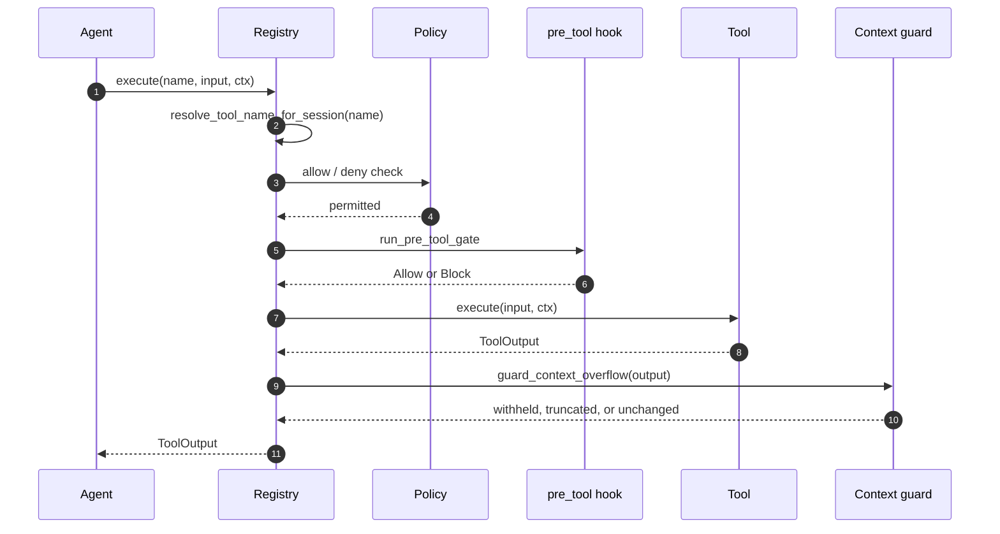
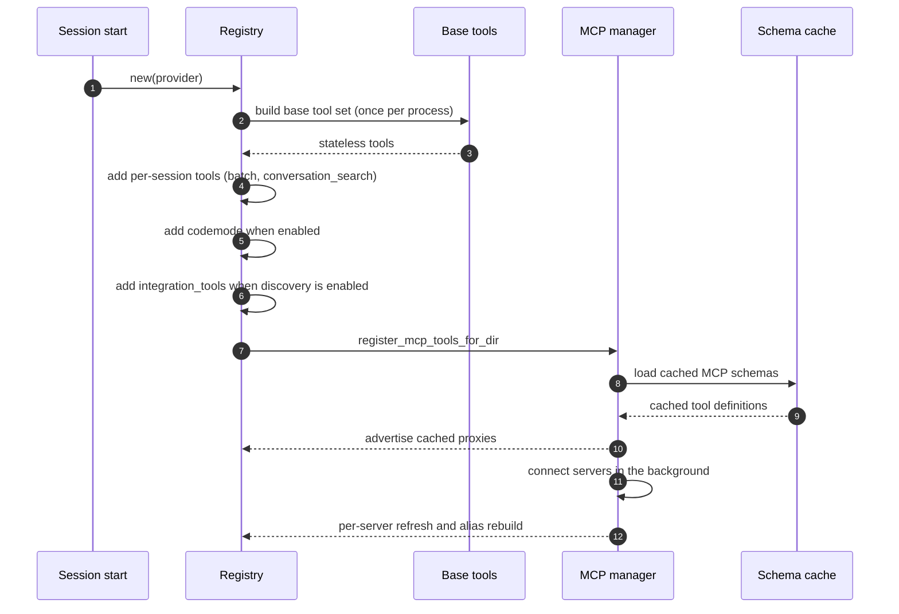
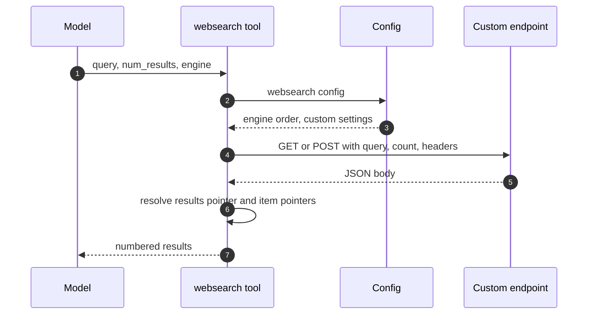

# Specification: Agent Tool Suite

## Overview

The tool runtime is split across three crates.
`jcode-tool-types` owns the shared data model (`ToolOutput`, `ToolImage`) and the canonical tool-name alias table.
`jcode-tool-core` owns the `Tool` trait, the `ToolContext` handed to every call, and the schema helpers that inject the shared `intent` and `accept_large_output` properties.
`jcode-app-core` owns the `Registry` and every concrete tool implementation under `crates/jcode-app-core/src/tool/`.
The registry resolves the requested name to a canonical name, enforces the session allow and deny policy, runs the pre-tool gate, dispatches to the tool, applies the post-tool hooks, and guards the result against the context budget.
This document was reverse-engineered from the existing codebase during an SDLC sync.

## Architecture

```
                        model turn
                            │
                            ▼
                 jcode-app-core/src/tool/mod.rs
                        Registry
                            │
   ┌────────────────────────┼──────────────────────────┐
   │                        │                          │
   ▼                        ▼                          ▼
 name resolution     session tool policy        lifecycle logging
 (resolve_tool_name  (allow / deny, MCP          (TOOL_LIFECYCLE
  in jcode-tool-types  alias history)              start/done/error)
  + functions. prefix)                                  │
   │                        │                          │
   └────────────┬───────────┘                          │
                ▼                                      │
        pre_tool hook gate ──► blocked ────────────────┤
                │                                      │
                ▼                                      ▼
        tool.execute(input, ToolContext) ──► ToolOutput
                │                                      │
                ▼                                      ▼
        post_tool observer / post_tool_feedback       │
                │                                      ▼
                └──────────────────────────► context overflow guard
                                               (90% of budget, 30% and
                                                50k token single-output cap)

 tool implementations (crates/jcode-app-core/src/tool/)
   ├── files     read, write, edit, replace, apply_patch, ls, agentgrep
   ├── shell     bash, bg
   ├── web       websearch (ddg / bing / searxng / custom), webfetch
   ├── mcp       mcp, mcp_search, mcp_call, mcp__SERVER__TOOL
   ├── agents    batch, swarm, todo, conversation_search, session_search
   ├── knowledge  memory, skill_manage, jcode_docs
   ├── desktop   panel, side_panel, applet, user_response
   ├── external  browser, macos_computer_use, compile_remote, integration_tools
   ├── workspace gmail, calendar, open, invalid, maintainer_feedback
   └── lifecycle selfdev, desktop_selfdev, debug_socket, ambient tools, codemode

 shared contracts
   ├── jcode-tool-core     Tool trait, ToolContext, intent / accept_large_output
   ├── jcode-tool-types    ToolOutput, ToolImage, resolve_tool_name
   └── jcode-config-types  WebSearchConfig, CustomWebSearchConfig
```

## Data Models

### Tool definition (provider facing)

| Field | Type | Constraints | Description |
|---|---|---|---|
| name | string | not null, unique per registry | The registry key, which overrides the name the tool reports for itself. |
| description | string | not null, token-capped | Human-readable purpose of the tool. |
| input_schema | object | not null, must be an object schema | JSON Schema for the arguments, with `intent` injected and required. |
| defer_loading | bool | not null | Whether the provider may defer loading the tool definition. |

### Tool input schema properties

| Property | Type | Required | Description |
|---|---|---|---|
| intent | string | yes | Short label shown in the UI explaining why the call is made. |
| accept_large_output | boolean | no | Opt in to the stated token cost of an otherwise withheld result. |
| tool-specific fields | varies | varies | Declared by each tool; unknown keys are ignored by the tool. |

### Tool output

| Field | Type | Constraints | Description |
|---|---|---|---|
| output | string | not null | The text handed back to the model. |
| title | string | optional | Short label for the rendered result. |
| metadata | JSON value | optional | Tool-specific structured data. |
| images | list of `ToolImage` | optional | Inline images produced by the tool. |

### Tool image

| Field | Type | Constraints | Description |
|---|---|---|---|
| media_type | string | not null | MIME type of the image payload. |
| data | string | not null | Base64-encoded image bytes. |
| label | string | optional | Caption for the image. |

### Tool context

| Field | Type | Constraints | Description |
|---|---|---|---|
| session_id | string | not null | The session the call belongs to. |
| message_id | string | not null | The assistant message that requested the call. |
| tool_call_id | string | not null | Unique call identity; subcalls derive a parent-scoped identity from it. |
| working_dir | path | optional | Base directory for relative paths. |
| stdin_request_tx | channel | optional | Channel used to ask the user for command input. |
| graceful_shutdown_signal | signal | optional | Raised when the session is shutting down. |
| execution_mode | enum | not null | `AgentTurn` or `Direct`. |

### Tool execution mode

| Value | Description |
|---|---|
| AgentTurn | The call runs as part of a model turn. |
| Direct | The call runs outside a model turn, for example from the CLI. |

### Custom web search configuration (`[websearch.custom]`)

| Key | Type | Default | Description |
|---|---|---|---|
| endpoint | string | none | Absolute HTTP(S) URL of the search endpoint, without userinfo or a fragment. |
| method | `GET` or `POST` | `GET` | HTTP method used for the request. |
| query_param | string | `q` | Literal key that receives the query. |
| count_param | string | none | Literal key that receives the result count; must differ from `query_param`. |
| params | map of string to string | empty | Static URL query parameters, applied to both methods. |
| body | JSON object | `{}` | Static JSON body for POST requests. |
| headers | map of string to string | empty | Static header values. |
| header_env | map of string to string | empty | Header name to environment variable holding the complete header value. |
| results_pointer | JSON pointer | `/results` | Pointer to the result array. |
| title_pointer | JSON pointer | `/title` | Pointer to the title, relative to each result item. |
| url_pointer | JSON pointer | `/url` | Pointer to the URL, relative to each result item. |
| snippet_pointer | JSON pointer | `/snippet` | Pointer to the snippet, relative to each result item. |

### Web search configuration (`[websearch]`)

| Key | Type | Default | Description |
|---|---|---|---|
| engine | enum | `duckduckgo` | Preferred local engine. |
| fallback_engines | list of enum | `[bing]` | Engines tried in order after the preferred one. |
| prefer_native | bool | `true` | Whether provider-side search replaces the local tool. |
| bing_api_key | string | none | API key for the primary Bing search. |
| bing_api_key_env | string | `JCODE_BING_API_KEY` | Environment variable holding the Bing API key. |
| bing_market | string | `en-US` | Bing market code. |
| searxng_url | string | none | Base URL of a SearXNG instance. |
| searxng_url_env | string | `JCODE_SEARXNG_URL` | Environment variable holding the SearXNG base URL. |

## API Contracts

This feature defines no HTTP API surface, so no `api.yaml` accompanies this document.
The contract below is the in-process tool contract, exposed as the `Tool` trait in `jcode-tool-core`.

| Operation | Signature | Purpose |
|---|---|---|
| Describe | `Tool::name`, `Tool::description`, `Tool::parameters_schema` | The metadata the provider sees. |
| Convert | `Tool::to_definition` | Produces the provider-facing `ToolDefinition`, with the shared properties injected. |
| Execute | `Tool::execute(input: Value, ctx: ToolContext) -> Result<ToolOutput>` | Runs the tool and returns its result. |
| Identify | `Tool::mcp_identity` | The original `(server, tool)` of an MCP proxy, independent of its registry alias. |

Error codes shared across tool calls:

| Condition | Message | Description |
|---|---|---|
| Unknown tool | `Unknown tool: NAME. Did you mean: SUGGESTIONS? Available tools: LIST.` | The name resolved to no registered tool. |
| Tool not allowed | `Tool 'NAME' is not allowed` | The session allow list excludes the tool. |
| Tool disabled | `Tool 'NAME' is disabled` | The session deny list includes the tool. |
| Blocked by hook | `Tool call blocked by pre_tool hook: REASON` | The user-configured pre-tool gate refused the call. |
| Product separation | `Tool 'NAME' targets Jcode CLI, not Desktop. Use 'desktop_selfdev'.` | The tool does not apply to the current checkout. |
| Context exhausted | `CONTEXT LIMIT REACHED: ...` | The result could not be returned because the window is full. |
| Output withheld | `OUTPUT WITHHELD: this result is about N k tokens ...` | The result was too large and was not opted into. |

## Sequences

### Dispatching a tool call



### Registering the tool surface



### Running a custom web search



## Technical Decisions

| Decision | Choice | Rationale |
|---|---|---|
| Tool contract location | A `Tool` trait in `jcode-tool-core` with the output types in `jcode-tool-types` | Keeps the data model usable by crates that must not depend on the app layer. |
| Alias table location | `jcode-tool-types::resolve_tool_name` | The config layer can normalize tool names without depending on the tool subsystem. |
| Registry key as the provider name | The registry key overrides `Tool::name` | MCP proxies are registered under `mcp__server__tool` while the tool still reports its raw name. |
| Schema injection in one place | `ensure_intent_in_schema` at definition conversion | Every tool, including MCP proxies that never edit their own schema, asks for an intent. |
| Oversized-result policy | Refuse by default, truncate only on explicit opt-in | Truncating by default still charged the caller for a prefix that usually did not hold the answer. |
| Single-output cap | 30% of the budget and 50,000 tokens, whichever is smaller | 30% of a 1M-token window would otherwise permit a 300k-token single result. |
| Weak registry reference inside tools | `WeakRegistry` upgraded only for the duration of a call | A tool that strongly owned its registry would create an `Arc` cycle. |
| Base tools cached process-wide | A `OnceLock` of stateless tools, cloned per session | Session startup must not pay per-tool construction cost. |
| Per-session compaction manager | Each registry clone gets a fresh `CompactionManager` | Parallel subagents must not corrupt each other's message history accounting. |
| MCP advertise-early | Proxy tools registered from the on-disk schema cache before connections settle | The first tool snapshot then already contains MCP tools, so the prompt cache is not invalidated. |
| MCP alias rebuild is skipped when the catalog is unchanged | Identities and definitions are compared before rebuilding | Rebuilding about 400 aliases for each of about 13 connections was most of a reload storm's CPU. |
| MCP policy follows original identities | Alias history is retained for the life of the registry | An alias retired after a reconnect must not become callable again through its old name. |
| Deterministic definition ordering | Definitions are sorted by name | Stable ordering is required for provider prompt-cache hits. |
| Custom search never follows redirects | The request is issued with redirects disabled, including same-host ones | A redirect could forward a configured credential to another destination. |
| Custom search credentials from the environment | `header_env` maps header names to environment variables | Credentials stay out of the config file and out of diagnostics. |
| Web search result cap | Default 8 results, maximum 20 | Keeps a search result from dominating a turn. |
| File writes are serialized per path | A per-path async lock around the read-modify-write | Two tools writing one file must not interleave a partial write. |

## Tool inventory

Registered names, grouped by the surface that registers them.

| Tool name | Module | Registered when | Purpose |
|---|---|---|---|
| read | `read.rs` | always | Read text, image, or PDF content from a file. |
| write | `write.rs` | always | Create or overwrite a file. |
| edit | `edit.rs` | always | Exact-match replacement edits, all or nothing. |
| replace | `replace.rs` | always | Literal or regular-expression replacement across files. |
| apply_patch | `apply_patch.rs` | always | Apply a Codex envelope or unified-diff patch. |
| ls | `ls.rs` | always | List directory contents. |
| agentgrep | `agentgrep.rs` | always | Search code and file names (grep, find, outline, trace). |
| bash | `bash.rs` | always | Run a shell command. |
| bg | `bg.rs` | always | Manage background tasks. |
| websearch | `websearch.rs` | always | Search the web through a local engine. |
| webfetch | `webfetch.rs` | always | Fetch a URL as text, Markdown, or HTML. |
| browser | `browser.rs` | always | Drive a real browser. |
| open | `open.rs` | always | Open or reveal a file, folder, or URL. |
| compile_remote | `compile_remote.rs` | always | Compile in a remote sandbox with metered usage. |
| invalid | `invalid.rs` | always | Report malformed tool usage. |
| maintainer_feedback | `feedback.rs` | always | Send product feedback to the maintainer. |
| jcode_docs | `jcode_docs.rs` | always | Search the bundled Jcode documentation. |
| todo | `todo.rs` | always | Track structured work items and goal assessments. |
| session_search | `session_search.rs` | always | Search past chat sessions. |
| memory | `memory.rs` | always | Manage long-lived memory. |
| gmail | `gmail.rs` | always | Read and send mail. |
| calendar | `calendar.rs` | always | Manage Google calendars and events. |
| schedule | `ambient.rs` | always | Schedule a wake-up for a session. |
| selfdev | `selfdev/mod.rs` | always | Build, reload, and test the CLI in development. |
| desktop_selfdev | `desktop_selfdev.rs` | always | Build, reload, test, and screenshot the Desktop app. |
| skill_manage | `skill.rs` | always | Load, list, read, and reload skills. |
| swarm | `communicate.rs` | always | Spawn and coordinate other agents. |
| panel | `panel.rs` | always | Manage desktop panels. |
| side_panel | `side_panel.rs` | always | Legacy panel management. |
| macos_computer_use | `computer/mod.rs` | macOS only | Control the macOS desktop. |
| batch | `batch.rs` | per session | Run independent tool calls in parallel. |
| conversation_search | `conversation_search.rs` | per session | Search the current conversation history. |
| codemode | `codemode.rs` | when `[tools] codemode` is enabled | Run a JavaScript program that calls other tools. |
| integration_tools | `discover.rs` | when integration discovery is enabled | Discover external integrations. |
| applet | `applet.rs` | desktop UI capability enabled | Show an interactive native card. |
| user_response | `user_response.rs` | desktop UI capability enabled | Answer the user with inline Markdown. |
| mcp | `mcp.rs` | MCP registration | Manage MCP servers. |
| mcp_search | `mcp.rs` | MCP registration | Search the MCP tool catalog. |
| mcp_call | `mcp.rs` | MCP registration | Call an MCP tool by name. |
| mcp__SERVER__TOOL | `mcp.rs` | per connected server | Direct call surface for one server tool. |
| debug_socket | `debug_socket.rs` | self-dev session | Access the debug socket. |
| end_ambient_cycle | `ambient.rs` | ambient session | End the current ambient cycle. |
| schedule_ambient | `ambient.rs` | ambient session | Schedule the next ambient cycle. |
| request_permission | `ambient.rs` | ambient session | Ask the user for permission. |
| send_message | `ambient.rs` | ambient session | Send a message to a channel. |
| client-defined | `sdk.rs` | per session | Callback tools registered by a client. |
| initiative | `goal.rs` | not registered | Durable initiatives, retained for a future re-enable. |
| patch | `patch.rs` | not registered | Unified-diff tool, superseded by `apply_patch`. |

## Risks and Unknowns

1. The tool surface is wide, and the provider-facing schemas of 40-plus tools are paid on every request, so the token caps on descriptions are load-bearing.
2. The `codemode` tool re-enters the registry from inside a sandbox, so the recursion guard and the session policy inside the sandbox are the main correctness risk in that path.
3. The MCP alias scheme depends on sanitized names, so an alias cannot be split back into its `(server, tool)` identity after the fact.
4. The custom web search engine trusts the configured endpoint; the request safeguards prevent credential forwarding but do not make an untrusted endpoint safe.
5. The ambient, self-dev, and desktop tools have registration conditions spread across several call sites, so a new registration path can expose a tool in a context that should not have it.
6. Several tools (browser, computer use, compile_remote, gmail, calendar) depend on external services whose availability and rate limits are not modelled anywhere in the tool layer.

## Out of Scope

- The command-safety gate that blocks destructive shell commands, implemented in `crates/jcode-command-risk/` and `crates/jcode-app-core/src/tool/bash_destructive_gate.rs`, is a separate feature.
- The Codemode sandbox runtime, implemented in `crates/jcode-codemode/`, is a separate feature. Only the `codemode` tool that drives it is documented here.
- The agent applet runtime, implemented in `crates/jcode-applet-types/`, is a separate feature. Only the `applet` tool that mounts an applet is documented here.
- The provider runtimes, the turn loop, the compaction engine, and the session store are documented by their own features.
- The MCP server implementations themselves, as opposed to the tool surface that connects to them.
