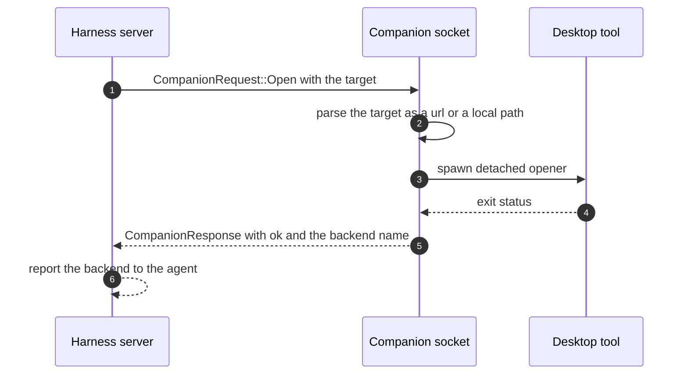
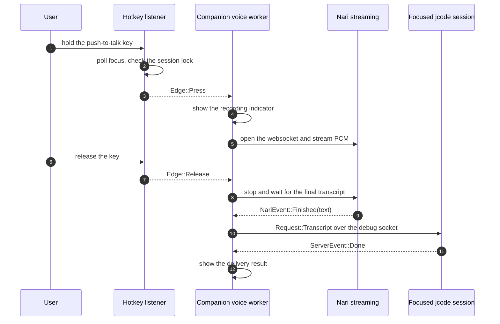
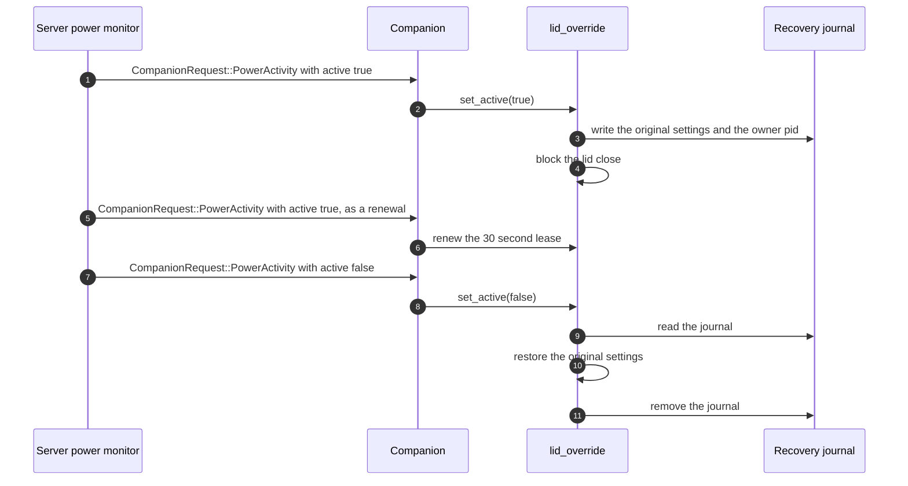

# Specification: Desktop Companion and Voice

## Overview

The technical approach is a brokered split between a screen-free runtime and a per-login desktop companion.
The harness server and the agent runtime keep no screen, keyboard, microphone, or lid dependency.
When they need a desktop effect they send one JSON request over a local socket to `jcode companion`, a small process that runs as the user inside the graphical login session and owns the desktop integrations.
The companion answers with one JSON response line, so the wire format is a line-delimited JSON request/response protocol with a versioned request set.
The voice subsystem is a separate crate, `jcode-voice`, that captures microphone audio (natively through cpal, or through an external recorder process), resamples it to mono 16 kHz PCM16, and streams it to the Nari realtime transcription API over a websocket.
The companion's global push-to-talk listener, the TUI's `/voice` and `/dictate` commands, and the `jcode dictate` CLI all feed that same capture and transcription path.
This specification documents already-implemented code, reverse-engineered during an SDLC sync.

## Architecture

The runtime and the companion are separate processes that talk over one local socket.

```
  +----------------------------+           +---------------------------------+
  | harness server             |---------->| jcode companion (per-login)     |
  | (no screen, no keyboard,   |---------->| runs in the graphical session   |
  |  no microphone, no lid)    |---------->|                                 |
  |                            |---------->| socket server, JSON per line    |
  |   open tool                +---------->|   open / reveal                 |
  |   terminal spawn           +---------->|   spawn_terminal                |
  |   power monitor            +---------->|   power_activity                |
  |   auth browser             +---------->|   global voice                  |
  |                            |---------->|   browser bridge updater        |
  |                            |---------->|   lid override (macOS, Windows) |
  |   no companion listening?  |---------->|                                 |
  |   -> local fallback        |---------->|                                 |
  +----------------------------+           +---------------------------------+
```

The socket lives at `JCODE_COMPANION_SOCKET`, else `jcode-companion.sock` in the runtime directory.
The companion sets `JCODE_COMPANION=1` in its own environment, so a terminal it spawns does not call back into it.

```
  voice capture and transcription (jcode-voice)

    push-to-talk key (evdev)      TUI /voice         jcode dictate
                |                |                |
                +----------------+----------------+
                                 |
                capture start, on an explicit press
                                 |
              +-----------------------------------+
              |                                   |
     native cpal capture                  external recorder
    (jcode-voice capture)               pw-record, parecord,
                                        arecord, rec, ffmpeg
              |                                   |
              +--------> mono 16 kHz PCM16 <------+
                                 |
                     resample, downmix, level
                                 |
                    nari_pcm_channel (bounded)
                                 |
                 NariRecording, websocket to Nari
                                 |
                 NariEvent::Transcript / ::Finished
                                 |
              +-----------------------------------+
              |                                   |
         TUI session                global companion voice
         voice input                send over the jcode debug socket
```

## Data Models

### CompanionRequest

Defined in `crates/jcode-base/src/companion_client.rs` and shared by the client and the server.

| Field | Type | Constraints | Description |
|---|---|---|---|
| op | string | required, one of the known operations | Discriminator of the tagged enum. |
| target | string | required for `open` | URL or local path to open. |
| path | path | required for `reveal` | Local path to show in the file manager. |
| program | path | required for `spawn_terminal` | Program to run in the new window. |
| args | list of string | required for `spawn_terminal` | Arguments for the program. |
| cwd | path | required for `spawn_terminal` | Working directory for the program. |
| title | string | optional | Window title for the new terminal. |
| kind | string | optional | Caller-defined kind such as `resume`. |
| session_id | string | optional | Session the new terminal belongs to. |
| env | list of pairs | optional, omitted when empty | `JCODE_SPAWN_*` metadata exported to hooks and the terminal. |
| client_terminal_env | list of pairs | optional, omitted when empty | Terminal environment of the client that asked, so the window lands in the terminal the user is attached to. |
| active | bool | required for `power_activity` | Whether a session is actively working. |

### CompanionResponse

| Field | Type | Constraints | Description |
|---|---|---|---|
| ok | bool | required | Whether the request completed. |
| message | string | default empty | Human-readable result, such as the opener that ran, or the error text. |
| protocol | u32 | default 0 | Protocol version of the responder, currently `PROTOCOL_VERSION = 1`. |
| capabilities | list of string | omitted when empty | Capabilities the responder handles, such as `open`, `reveal`, `spawn_terminal`, `lid`, `voice`. |

### CompanionOptions

| Field | Type | Constraints | Description |
|---|---|---|---|
| socket | path | defaults to `socket_path()` | Where the companion binds its listener. |
| voice | bool | defaults to true | Run the global push-to-talk listener, Linux only. |
| browser_updates | bool | defaults to true | Periodically update an installed browser bridge. |

### LidSnapshot

The original power settings captured before the override changes them, tagged by platform.

| Field | Type | Constraints | Description |
|---|---|---|---|
| platform | string | `macos`, `windows`, or `fake` | Discriminator of the tagged enum. |
| sleep_disabled | bool | macOS only | Original `pmset` sleep state. |
| scheme | string | Windows only | Active power scheme GUID in canonical form. |
| ac_lid_action | u32 | Windows only | Original lid-close action on AC power. |
| dc_lid_action | u32 | Windows only | Original lid-close action on battery. |
| value | u32 | test backend only | Original value of the in-memory stand-in. |

### Journal

| Field | Type | Constraints | Description |
|---|---|---|---|
| owner_pid | u32 | required | Process id that owns the override, used to detect a dead owner. |
| snapshot | LidSnapshot | required | Original settings to restore. |

### Target and LocalTargetKind

| Field | Type | Constraints | Description |
|---|---|---|---|
| path | path | local targets only | Existing local path. |
| kind | LocalTargetKind | `file` or `directory` | Whether the path is a file or a directory, decided by `LocalTargetKind::of`. |
| url | string | url targets only | The URL to hand to the system opener. |

### DictationConfig

Configured under `[dictation]` in `~/.jcode/config.toml`.

| Field | Type | Constraints | Description |
|---|---|---|---|
| command | string | empty means dictation is not configured | Shell command that prints the transcript to stdout. |
| mode | TranscriptMode | `insert`, `append`, `replace`, or `send` | How the transcript is applied inside jcode. |
| key | string | default `off` | Optional in-app hotkey that triggers dictation. |
| timeout_secs | u64 | default 90, 0 means no timeout | Maximum time to wait for the dictation command. |
| vocabulary | list of string | optional | Extra recognition context sent to the transcription service. |
| recorder | string | empty means auto-detect | Custom command that prints raw mono 16 kHz s16le PCM. |
| global_devices | list of path | empty disables global voice | Keyboard event devices the companion watches for push-to-talk. |

### NariEvent

| Field | Type | Constraints | Description |
|---|---|---|---|
| Started | variant | emitted once | The transcription session is open. |
| Transcript | string | aggregate revision, not a delta | The latest full transcript so far. |
| Finished | result | emitted exactly once | The final transcript, or the failure that ended the session. |

### Edge

| Field | Type | Constraints | Description |
|---|---|---|---|
| Press | variant | physical key down | Start a capture. |
| Release | variant | physical key up | Stop the capture and deliver the transcript. |
| Cancel | variant | safety or failure | Abort without finalizing a transcript. |
| Spawn | variant | Shift plus push-to-talk | Open a new window that records the hold. |
| Tap | variant | hold already ended | Start a click-style recording instead of losing the request. |

## API Contracts

This feature defines no HTTP API, so there is no `api.yaml` alongside this document.
The normative contracts are the two local interfaces below: the companion socket protocol, and the command-line and TUI surfaces that reach it.

### Companion socket protocol

- Transport: a Unix domain socket at `JCODE_COMPANION_SOCKET`, else `jcode-companion.sock` in the runtime directory. On Windows the transport is a named pipe.
- Framing: one JSON object per line. A request line is answered by exactly one response line, and the connection stays open for further requests.
- The request is a tagged enum on `op`; the response carries `ok`, `message`, `protocol`, and `capabilities`.
- A line longer than 64 KiB is rejected, and a line that is not a known request is answered with `ok: false` and an `invalid request` message.

| Operation | Request fields | Response message | Purpose |
|---|---|---|---|
| `status` | none | the companion version string | Liveness probe, reports the protocol version and the capabilities. |
| `open` | `target` | name of the opener that ran | Open a URL or local path with the desktop's default application. |
| `reveal` | `path` | name of the backend that showed it | Show a local path in the file manager. |
| `spawn_terminal` | `program`, `args`, `cwd`, optional `title`, `kind`, `session_id`, `env`, `client_terminal_env` | `terminal` | Run a program in a new terminal window in the user's session. |
| `power_activity` | `active` | `engaged` or `released` | Hold or release the lid-close override while a session works. |

Client-side error mapping:

| Condition | Error | Caller behavior |
|---|---|---|
| No companion is listening | `CompanionError::Unavailable` | Fall back to the local behavior. |
| The companion answered with `ok: false` | `CompanionError::Failed(message)` | Report the message, or fall back for `open` and `spawn_terminal`. |
| The connection broke mid-request | `CompanionError::Io` | Report the failure. |

### CLI surface

| Command | Options | Effect |
|---|---|---|
| `jcode companion` | none | Run the companion in the current login session. |
| `jcode companion --status` | `--status` | Report whether a companion is running, with its socket path and capabilities, then exit. |
| `jcode companion --no-voice` | `--no-voice` | Run the companion without the global push-to-talk listener. |
| `jcode dictate` | none | Run the configured dictation command and apply the transcript in the configured mode. |
| `jcode dictate --type` | `--type` | Run the configured dictation command and type the transcript into the focused application with `wtype`. |

### TUI command surface

| Command | Effect |
|---|---|
| `/dictate` | Run the configured dictation command and apply the transcript. |
| `/dictation` | Alias of `/dictate`. |
| `/voice` | Toggle the built-in voice input: press to record, press again to send, `Esc` to cancel. |

## Sequences

### Desktop effect requested by the server



### Global push-to-talk capture and delivery



### Lid override engaged and released



## Technical Decisions

| Decision | Choice | Rationale |
|---|---|---|
| Where desktop effects live | A separate per-login companion process over a local socket | Keeps the harness server and the agent runtime free of screens, keyboards, microphones, and lids, so a headless or remote server never pops a window on the wrong machine. |
| Wire format | Line-delimited JSON, one request per line, one response per line | Matches the form of the rest of the jcode socket protocols, needs no framing library, and is trivial to inspect by hand. |
| Protocol versioning | A single `PROTOCOL_VERSION` constant, bumped on an incompatible change | The client and the companion can be different builds during a hot reload, and the status reply reports the version. |
| Fallback behavior | The caller opens or spawns locally when no companion answers | A standalone `jcode` on a machine with no graphical session must keep working. |
| Single-instance enforcement | A status probe before binding, and a refusal to replace a live socket | Two companions on one login session would fight over the lid override and the routing registry. |
| Recursive spawn guard | The companion sets `JCODE_COMPANION=1` in its own environment | A terminal spawned by the companion must not call back into the companion socket. |
| Power-activity lease | A 30 second lease, renewed by the server and expired by a 5 second tick | A crashed server must not leave the machine unable to sleep. |
| Crash recovery | A journal file holding the original settings and the owner pid, written before the change | The macOS and Windows settings outlive the process, so the originals have to survive a kill. |
| Ownership arbitration | A live foreign owner is left alone, a dead owner is repaired | Two jcode processes on one machine must not undo each other's override. |
| Linux lid handling | `systemd-inhibit` with `handle-lid-switch` | It is a per-process lock that is released when the helper dies, so no persistent setting and no journal are needed. |
| macOS elevation | `sudo -n /usr/bin/pmset -a disablesleep` with a `sudoers` hint | The command must never prompt for a password inside an agent turn. |
| Windows elevation | The active power plan is edited directly | Standard users may change their own plan, so no elevation is needed. |
| Global voice platform | Linux only, through evdev polling | A hold listener needs the raw key events, which the Linux input devices provide. |
| Key event privacy | Only the configured event devices are opened, and no ordinary key events are read | The listener is scoped to the push-to-talk chord so it never observes ordinary typing. |
| Routing arbitration | A shared registry under the runtime directory, with the newest focus winning | Jcode Desktop and the companion both offer push-to-talk, and the most recently focused one should handle the press. |
| Recording indicator | A desktop notification, and recording is refused when it cannot be shown | The user must always be able to see that the microphone is live. |
| Voice transcription | Nari realtime over a websocket, with aggregate transcript revisions | Partial results are needed while the user is still speaking, and the final result is authoritative. |
| Audio sources | Native cpal capture, or an external recorder printing raw PCM | Terminal builds do not link a native audio stack, and a custom recorder keeps the capture scriptable. |
| Audio format | Mono 16 kHz PCM16, at most 5 minutes and 10 MiB | One format across capture paths, and a hard bound on what can be sent or stored. |
| Browser bridge updates | A periodic task in the companion | The browser tool used to check for a newer bridge inline, which added a GitHub round trip to every agent turn. |
| Browser window raising | niri IPC, with a new window preferred over the most recently focused one | A newly created browser window is the one that handled the URL, and raising it is what the user expects. |
| Browser window raising scope | niri only, other compositors are skipped | The compositor interface is not yet abstracted, and the fallback open still works everywhere. |

## Risks and Unknowns

1. The macOS lid override depends on a `sudoers` rule the user must add by hand, and the override is silently skipped without it. The one-time hint in `MACOS_SUDOERS_HINT` is the only signal.
2. The Windows lid override rewrites the active power plan. Restoring it never switches the user back to a plan they changed in the meantime, so the restore is skipped when the plan is no longer active.
3. The global voice listener and the focus lookup depend on the niri compositor. On another Linux desktop the listener still registers, but the focused session cannot be resolved, so the press is ignored.
4. The external recorder path depends on one of `pw-record`, `parecord`, `arecord`, `rec`, or `ffmpeg` being installed and behaving as documented.
5. The Nari websocket is a third-party dependency, and a failure mid-session can leave the capture released without a transcript, which the user sees as a cancelled recording.
6. The 64 KiB request cap and the 10 MiB audio cap are fixed constants. A future request with a large payload would need a different framing.
7. The browser bridge refresh runs hourly inside the companion, so a companion that is rarely started keeps the bridge stale.
8. The companion protocol has no authentication beyond filesystem permissions on the runtime directory, so any process running as the same user can drive the desktop.

## Out of Scope

- The Jcode Desktop application itself, which shares the voice and routing code but lives in another repository.
- The server-side browser tool, the browser bridge implementation, and the browser bridge download itself.
- The remote handoff and session migration design sketched in `docs/REMOTE_HANDOFF.md`, which is not implemented.
- The wording rules for user-facing messages, which are covered by `docs/MESSAGE_VOICE.md`.
- The macOS and Windows global hotkey listeners, which belong to the platform hotkey feature.
- Subscription entitlement and billing for the transcription service.
