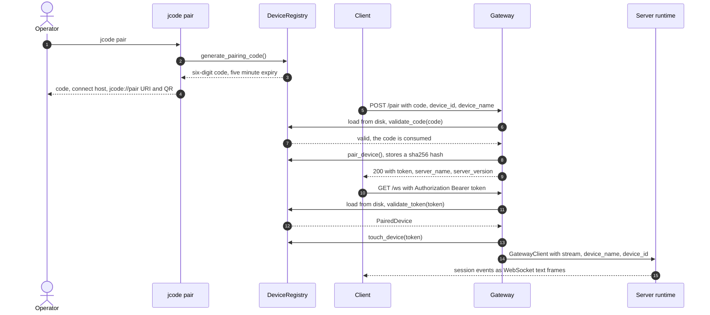
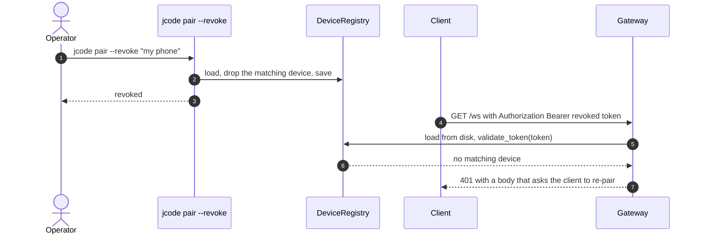

# Specification: Remote Client Gateway

## Overview

The gateway lives in `crates/jcode-base/src/gateway.rs` with three supporting modules, `gateway/auth.rs` for the WebSocket handshake, `gateway/control.rs` for the shared `/remote` and `jcode pair` control logic, and `gateway/registry.rs` for the persisted device records.
The wire types `PairedDevice` and `PairingCode` live in the `jcode-gateway-types` crate so that both the server and client-facing code can depend on them without pulling in the rest of `jcode-base`.
The server starts the listener from `crates/jcode-app-core/src/server.rs` and accepts each gateway client in `crates/jcode-app-core/src/server/runtime.rs`, where the bridged stream is handed to the same client handler that serves Unix-socket clients.
This document was reverse-engineered from the existing codebase during an SDLC sync.

## Architecture

```
remote client (iOS app or web client)
            |
            | TCP on the configured port, default 7643
            v
+---------------------------------------------------+
| jcode-base/src/gateway.rs                         |
|  handle_connection()                              |
|    peek the first bytes, look for "Upgrade:"       |
|      no  -> handle_http()                         |
|               GET  /health                         |
|               POST /pair                           |
|               OPTIONS (CORS preflight)             |
|      yes -> handle_ws_connection()                 |
+---------------------------------------------------+
            | tungstenite accept_hdr_async, auth inside the
            | upgrade callback
            v
+---------------------------------------------------+
| gateway/auth.rs                                   |
|  extract_ws_auth()     Authorization: Bearer or ?token=
|  authorize_ws_device() 401 for unknown or revoked  |
+---------------------------------------------------+
            | authorized device
            v
+---------------------------------------------------+
| transport::stream_pair()                          |
|  (server_stream, bridge_stream)                   |
+----+----------------------------------------+-----+
     | client_tx                              | relay tasks
     v                                        v
+----------------------------+   +-------------------------------+
| jcode-app-core server      |   | ws <-> NDJSON relay           |
| runtime, one task per      |   |  text frame, newline appended |
| client, same handle_client |   |  ping/pong, 20s keepalive     |
| path as a local client     |   |  401 handshake rejections     |
+----------------------------+   +-------------------------------+
            |
            v
+---------------------------------------------------+
| ~/.jcode/devices.json (DeviceRegistry)           |
|  devices[]      PairedDevice, token_hash only    |
|  pending_codes[] PairingCode, five minute TTL     |
+---------------------------------------------------+
```

The relay is deliberately thin.
A WebSocket text frame carries exactly one newline-delimited JSON request, and the relay appends the newline the server-side reader expects.
In the other direction the relay reads one newline-terminated line from the bridge and sends it as one text frame.
Because the framing is identical on both sides of the bridge, the session server cannot tell whether its client arrived over a Unix socket or over a WebSocket.

## Data Models

### Pairing code (`jcode_gateway_types::PairingCode`)

| Field | Type | Constraints | Description |
|---|---|---|---|
| code | string | not null, six decimal digits | Code shown to the operator and entered or scanned by the client. |
| created_at | string | not null, RFC 3339 | Mint time in UTC. |
| expires_at | string | not null, RFC 3339 | Expiry time, five minutes after `created_at`. |

### Paired device (`jcode_gateway_types::PairedDevice`)

| Field | Type | Constraints | Description |
|---|---|---|---|
| id | string | PK, not null | Client-supplied device id; pairing the same id again replaces the record. |
| name | string | not null | Human-readable device name shown in the device list. |
| token_hash | string | not null, `sha256:` prefix | SHA-256 hash of the auth token; the raw token is never stored. |
| apns_token | string | optional, omitted when absent | APNs push token for the iOS client. |
| paired_at | string | not null, RFC 3339 | Time the device was paired. |
| last_seen | string | not null, RFC 3339 | Time of the most recent successful gateway connection. |

### Device registry (`jcode_base::gateway::DeviceRegistry`)

Persisted at `~/.jcode/devices.json`.

| Field | Type | Constraints | Description |
|---|---|---|---|
| devices | list of PairedDevice | not null, default empty | Devices that hold a valid token. |
| pending_codes | list of PairingCode | not null, default empty | Unconsumed pairing codes; expired entries are pruned when the next code is minted. |

A missing, unreadable, or malformed `devices.json` loads as an empty registry rather than raising an error.

### Gateway config (`jcode_config_types::GatewayConfig`)

| Field | Type | Constraints | Description |
|---|---|---|---|
| enabled | bool | default false | Whether the server binds the gateway listener at startup. |
| port | u16 | default 7643 | TCP port to listen on. |
| bind_addr | string | default `0.0.0.0` | Bind address; a wildcard binds every interface. |

### Pairing invite (`jcode_base::gateway::control::PairingInvite`)

| Field | Type | Constraints | Description |
|---|---|---|---|
| code | string | not null, six decimal digits | The minted pairing code. |
| dial_address | string | not null, `host:port` | The address a remote client should dial. |
| uri | string | not null | `jcode://pair?host=<host>&port=<port>&code=<code>`, rendered as a QR code. |
| gateway_enabled | bool | not null | Whether the gateway is currently enabled, so the UI can warn when the code cannot be used yet. |

## API Contracts

The gateway surface is not a REST API, so there is no OpenAPI document for it.
The normative contract is this section, and `docs/IOS_APP.md` records the same pairing and WebSocket flow for client authors.

### CLI surface

`jcode pair` is a top-level subcommand of the `jcode` binary.

| Command | Purpose |
|---|---|
| `jcode pair` | Mint a six-digit pairing code and print it, the connect host, the bind address, and a QR code of the `jcode://pair` URI. |
| `jcode pair --list` | List the paired devices with their id, name, pairing time, last-seen time, and a truncated APNs token. |
| `jcode pair --revoke <target>` | Remove the device whose id or exact name equals `<target>`, and report whether anything matched. |

`jcode pair` prints a warning when the gateway is disabled, because a code cannot be used until the port is open.
The TUI exposes the same operations as `/remote status`, `/remote on`, `/remote off`, `/remote pair`, and `/remote revoke <device>`.

### HTTP and WebSocket endpoints

| Method | Path | Purpose |
|---|---|---|
| GET | /health | Return the server status, the server version, and the gateway flag. |
| POST | /pair | Exchange a pairing code for an auth token. |
| OPTIONS | any | Answer the CORS preflight with the allowed methods and headers. |
| GET (Upgrade) | /ws | Upgrade to a WebSocket that carries the session protocol. |

Error codes shared across endpoints:

| Status | Code | Description |
|---|---|---|
| 400 | INVALID_JSON | The `POST /pair` body is not valid JSON. |
| 401 | INVALID_PAIRING_CODE | The pairing code is unknown, already consumed, or expired. |
| 401 | MISSING_TOKEN | The upgrade carried neither an `Authorization` header nor a `token` query parameter. |
| 401 | MALFORMED_TOKEN | The token is not 64 hexadecimal characters. |
| 401 | CONFLICTING_TOKENS | The header token and the query token are different. |
| 401 | UNKNOWN_TOKEN | The token does not match a paired device, or the device was revoked. |
| 404 | NOT_FOUND | The upgrade path is not `/ws`, or the HTTP path is unknown. |

### `POST /pair` request and response

Request body:

```json
{
  "code": "123456",
  "device_id": "<client-supplied device id>",
  "device_name": "Jeremy's iPhone",
  "apns_token": "<optional push token>"
}
```

Success response, status 200:

```json
{
  "token": "<64 hexadecimal characters>",
  "server_name": "jcode",
  "server_version": "<version>"
}
```

The pairing code is consumed by a successful exchange, so it cannot be replayed.
The registry is reloaded from disk before the code is validated, so a code minted by a separate `jcode pair` invocation is accepted.

### WebSocket upgrade handshake

Request:

```
GET /ws HTTP/1.1
Host: <host>:<port>
Upgrade: websocket
Connection: Upgrade
Sec-WebSocket-Key: <key>
Sec-WebSocket-Version: 13
Authorization: Bearer <64 hexadecimal characters>
```

Browser clients that cannot set headers may instead pass the token as a `token=` query parameter on the `/ws` path.
A request that carries both with different values is rejected.

A successful upgrade answers 101 Switching Protocols, and each text frame then carries one newline-delimited JSON request or event.
A rejected upgrade answers 401 with a plain-text body that names the reason, and no session stream is created.

## Sequences

### Pair, then connect



### Revoke, then reconnect



The registry is reloaded from disk on every handshake, so the revocation applies to the next connection attempt without a server restart.
A session that is already open when the device is revoked is not closed.

## Technical Decisions

| Decision | Choice | Rationale |
|---|---|---|
| Transport | Plain TCP with a WebSocket upgrade on port 7643 | Browsers and the iOS app cannot speak the Unix-socket transport, and both can speak WebSocket. |
| Protocol bridging | A virtual socket pair plus a relay task | Reuses the existing client handler, so remote and local clients share one session implementation. |
| Frame format | One newline-delimited JSON request per WebSocket text frame | Matches the Unix-socket wire format exactly, so no second protocol is needed. |
| Authorization point | The token is validated inside the upgrade callback | A refused upgrade returns a real 401 the client can act on, instead of an accepted and then dropped socket that looks like a network fault. |
| Token storage | SHA-256 hash of a 32-byte random token | A leaked `devices.json` does not leak usable tokens. |
| Pairing code | Six random decimal digits, five minute lifetime, consumed on use | Short enough to read aloud, and stale soon enough that a shoulder-surfed code is worthless. |
| Token transport | `Authorization: Bearer` preferred, `?token=` accepted for browsers | Browsers cannot set headers on a WebSocket, so both forms are needed; the query form is logged as deprecated. |
| Registry freshness | The registry is reloaded from disk on every handshake and pair request | A revocation from the CLI takes effect without restarting the server. |
| Dial-address resolution | Bind address, then `JCODE_GATEWAY_HOST`, then Tailscale MagicDNS, then the system hostname | A wildcard bind address says nothing about how another machine reaches this one. |
| Transport encryption | Not provided by the gateway | The gateway is meant to sit on a trusted network such as Tailscale, and the status output warns about a wildcard bind. |
| Control logic in one place | `gateway/control.rs` is shared by the TUI, the CLI, and the server runtime | The TUI and the CLI cannot drift apart on gateway state, pairing, or revocation. |

## Risks and Unknowns

1. The gateway speaks plain TCP, so transport confidentiality depends on the network.
   A wildcard bind that is reachable from the public internet exposes session traffic to anyone who can reach the port.
2. The pairing code is six decimal digits, and there is no attempt counter or rate limit on `POST /pair`, so a code can be guessed inside its five-minute lifetime.
3. Revoking a device removes its record, but a session that is already open for that device is not terminated.
4. The `?token=` query form puts the token in the URL, where intermediaries can log it.
   The header form is preferred and the query form is logged as deprecated.
5. `DeviceRegistry::load` returns an empty registry when `devices.json` is unreadable or malformed, which silently drops every pairing instead of failing loudly.
6. The listener binds at server startup, so enabling the gateway needs a server restart that the tooling does not perform on its own.
7. The remote protocol is not versioned.
   Third-party clients that need a stable, versioned surface are expected to use the harness API instead.
8. The trust model is a shared secret that the operator hands to the client, and the code is entered on the client device, so a compromised client device can pair itself within the code lifetime.

## Out of Scope

- The versioned harness API bridge: `jcode api-bridge`, `crates/jcode-harness-api/`, `crates/jcode-harness-api-server/`, `crates/jcode-sdk/`, and `sdk/typescript/`.
  That is a separate feature and is not described here.
- The iOS app itself: `ios/`, including JCodeKit and JCodeMobile.
- TLS termination and transport encryption for the gateway listener.
- Jcode Cloud activation and the managed-host control plane behind `/remote cloud`.
- The public HTTP API surface of the jcode server.
