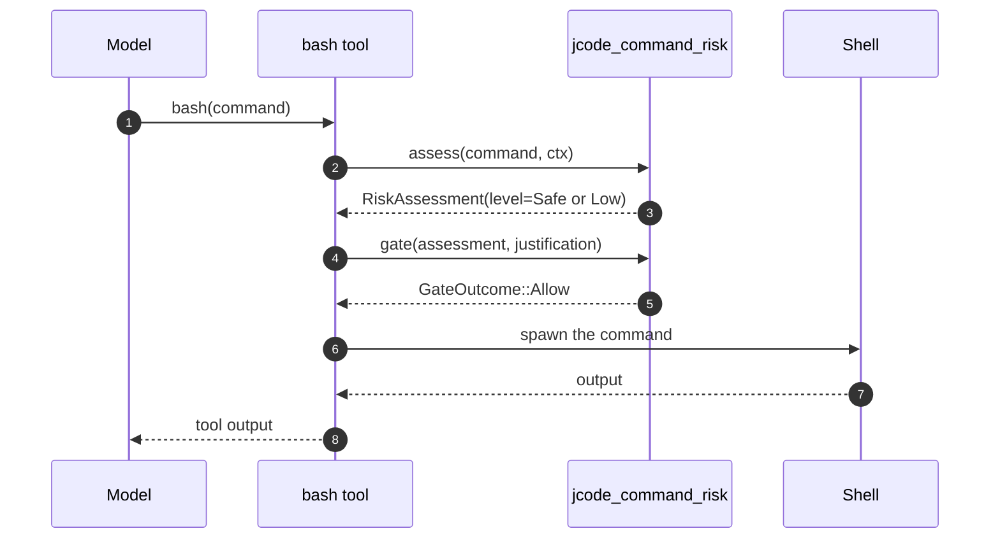
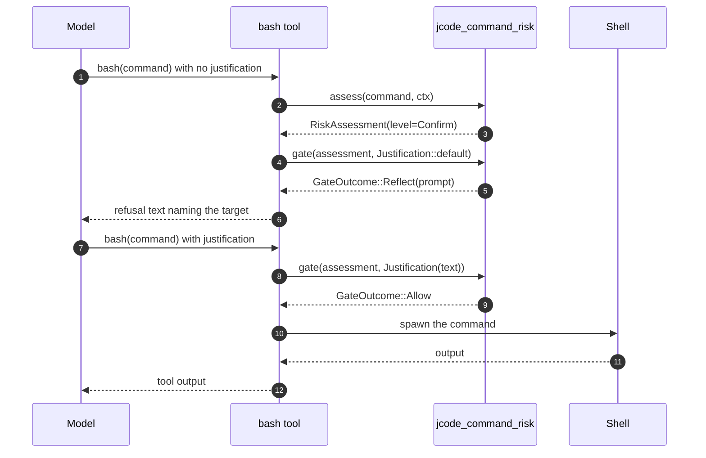
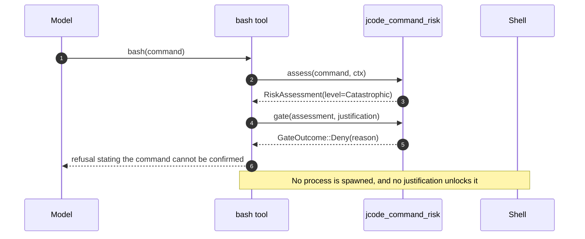

# Specification: Command Safety Gate

## Overview

The command safety gate is a two-stage cascade implemented in the dependency-free `jcode-command-risk` crate and wired into the `bash` and `apply_patch` tools.
Stage 1 is `assess(command, &RiskContext)`, a deterministic offline parser that classifies a command by blast radius and returns a `RiskAssessment` carrying a `RiskLevel` of `Safe`, `Low`, `Confirm`, or `Catastrophic`.
Stage 2 is `gate(&assessment, &Justification)`, which turns a `Confirm` verdict into a `Reflect` outcome carrying a reflection prompt, and turns a `Catastrophic` verdict into an unconditional `Deny`.
The `bash` tool calls the gate at the single `Tool::execute` chokepoint before any process is spawned, and the `apply_patch` tool consults the same path policy for the catastrophic tier when deleting files.

## Architecture

```
                    model tool call
                           |
          +----------------+----------------+
          |                                 |
       bash tool                      apply_patch tool
          |                                 |
          v                                 v
  +------------------+              +------------------+
  | bash.rs          |              | apply_patch.rs   |
  | Tool::execute    |              | DeleteFile hunk  |
  | (chokepoint)     |              +------------------+
  +------------------+                       |
          |                                   | resolved absolute path
          | command + justification           v
          |                     +-----------------------------------+
          |                     | jcode_command_risk::               |
          |                     |   is_catastrophic_target()        |
          |                     |   (catastrophic tier only)        |
          |                     +-----------------------------------+
          v
  +--------------------------------+
  | bash_destructive_gate.rs       |
  |   destructive_command_refusal()|
  |   bash_parameters_schema()     |
  +--------------------------------+
          |
          v
  +---------------------------------------------------------------+
  | crates/jcode-command-risk                                      |
  |                                                               |
  |   stage 1   assess(command, &RiskContext) -> RiskAssessment    |
  |               tokenize.rs  split_segments, embedded_          |
  |                           substitutions, Token flags          |
  |               paths.rs     expand, classify_target,           |
  |                           is_catastrophic_target              |
  |                                                               |
  |   stage 2   gate(&assessment, &Justification) -> GateOutcome  |
  +---------------------------------------------------------------+
          |              |                    |
   Allow  |   Reflect {prompt}        Deny {reason}
          v              v                    v
    run the         return the           return the refusal
    command         prompt to            and log a warning
                    the model
```

## Data Models

### Risk level

| Variant | Order | Constraints | Description |
|---|---|---|---|
| `Safe` | 0 | runs immediately | No destructive potential was detected. |
| `Low` | 1 | runs immediately | Destructive but bounded, typically inside the working directory or a temp directory. |
| `Confirm` | 2 | never runs immediately | The destructive target cannot be determined statically, so a justification is required. |
| `Catastrophic` | 3 | absolute deny | The target is the filesystem root, the home directory, a credential store, or a device node. |

- The variants are totally ordered, and the assessment takes the maximum over its findings.
- `runs_immediately` is true for `Safe` and `Low`.
- `is_absolute_deny` is true only for `Catastrophic`.

### Risk finding

| Field | Type | Constraints | Description |
|---|---|---|---|
| `level` | `RiskLevel` | not null | The severity contributed by this finding. |
| `reason` | `String` | not null, human readable | The explanation shown to the model verbatim. |
| `target` | `Option<String>` | none | The concrete path or argument that triggered the finding. |

### Risk assessment

| Field | Type | Constraints | Description |
|---|---|---|---|
| `level` | `RiskLevel` | not null, maximum of the finding levels | The overall verdict for one command. |
| `findings` | `Vec<RiskFinding>` | empty when the level is `Safe` | The individual reasons the command was flagged. |

- `explanation()` renders the findings as a bullet list, each line ending with the target when one is present.

### Risk context

| Field | Type | Constraints | Description |
|---|---|---|---|
| `working_dir` | `Option<PathBuf>` | none | The working directory of the tool call, used to judge bounded targets. |
| `home_dir` | `Option<PathBuf>` | none | The user's home directory, read from `HOME` by `RiskContext::from_env`. |
| `scratch_dir` | `Option<PathBuf>` | none | The dedicated scratch directory, read from `JCODE_SCRATCH_DIR`. |

- `RiskContext::from_env` fills `home_dir` and `scratch_dir` from the environment.
- The `bash` gate overrides `scratch_dir` with the tool's own scratch directory on non-Windows hosts, so the assessed path is the path the child shell receives.

### Gate outcome

| Variant | Payload | Description |
|---|---|---|
| `Allow` | none | Run the command as issued. |
| `Reflect` | `prompt: String` | Refuse this attempt and make the model justify itself first. |
| `Deny` | `reason: String` | Refuse permanently, because no justification can unlock it. |

### Justification

| Field | Type | Constraints | Description |
|---|---|---|---|
| `text` | `Option<String>` | none | The model's account of which user request the command serves. |

- `is_substantive` requires at least 25 trimmed characters and rejects a bare affirmation such as `yes`, `ok`, `proceed`, or `go ahead`.
- The bar is deliberately low: the goal is to force a reflection turn, not to grade prose.

### Bash tool schema surface

| Property | Type | Required | Description |
|---|---|---|---|
| `command` | string | yes | The bash command to execute. |
| `intent` | string | no | The intent annotation shared by the tool suite. |
| `timeout` | integer | no | Timeout in milliseconds. |
| `run_in_background` | boolean | no | Run in the background with progress reporting. |
| `notify` | boolean | no | Notify on completion. |
| `wake` | boolean | no | Wake on completion. |
| `stall_wake_seconds` | integer | no | Wake delay for a background job that goes quiet. |
| `justification` | string | no | Only when re-issuing a command the destructive gate refused. Explains which user request it serves. |

- The `justification` field lives in the same module as the gate so the schema and the policy that reads it stay in sync.
- An explicit `null` for `justification` is accepted and treated as absent, matching the other optional arguments.

## API Contracts

This feature exposes no HTTP or RPC surface.
The contract is the Rust API below, implemented in `crates/jcode-command-risk` and consumed from `crates/jcode-app-core`.

| Function | Module | Purpose |
|---|---|---|
| `assess(command: &str, ctx: &RiskContext) -> RiskAssessment` | `jcode_command_risk` | Stage 1, classify a shell command by blast radius. |
| `gate(assessment: &RiskAssessment, justification: &Justification) -> GateOutcome` | `jcode_command_risk` | Stage 2, decide whether to allow, hold for reflection, or deny. |
| `is_catastrophic_target(path: &Path, ctx: &RiskContext) -> bool` | `jcode_command_risk` | The single most important predicate, exposed so it can be tested and reused in isolation. |
| `classify_target(expanded: &Path, raw: &str, recursive: bool, ctx: &RiskContext) -> Option<RiskFinding>` | `jcode_command_risk` | Classify one resolved target into a risk level. |
| `expand(raw: &str, ctx: &RiskContext) -> PathBuf` | `jcode_command_risk` | Resolve `~`, `$HOME`, and relative paths lexically, without touching the filesystem. |
| `destructive_command_refusal(command: &str, justification: Option<&str>, working_dir: Option<PathBuf>) -> Option<String>` | `jcode_app_core::tool::bash` | The seam that returns refusal text, or `None` when the command may run. |

Failure modes:

| Condition | Behaviour |
|---|---|
| Malformed or garbage command text | A verdict is still produced, never an error. |
| `HOME` unset on the host | The system-path tier still applies, and the home tier is skipped. |
| The home directory is reassigned inside the command | The trusted protected paths still apply and the command is held. |
| A catastrophic target | Denied unconditionally, with no justification path. |

## Sequences

### Allow flow



### Confirm flow



### Deny flow



## Technical Decisions

| Decision | Choice | Rationale |
|---|---|---|
| Classify by blast radius, not by command name | Ask what the command destroys and whether it can be undone | A denylist of `rm -rf` misses `find -delete`, `shred`, `truncate`, `dd`, and `>file`. |
| Stage 1 is deterministic and offline | Pure lexical parsing with no model call and no network call | It costs nothing on the overwhelmingly common safe path, and the verdict cannot be talked around by a remote service. |
| Stage 2 is a reflection prompt, not a second model | The harness refuses once and hands back a structured prompt | An LLM judge is expensive, adds latency to every borderline call, and can be talked around by the same reasoning that produced the command. |
| The refusal is not satisfiable by repetition | The model must supply a `justification` naming the user request | This separates the gate from a "run it twice" speed bump that an agent defeats reflexively. |
| The catastrophic tier is absolute and path-based | A small set of protected paths, compared after normalization | The one protection that cannot be argued around must not depend on correctly parsing the command. |
| Credential stores are protected recursively, config roots are matched exactly | `~/.ssh/id_ed25519` is protected, `~/.config/app/settings.toml` is not | Destroying a single private key is as damaging as destroying the directory, while individual config files are edited all day. |
| `/home` and `/Users` are not recursively protected | Only the exact roots, plus the user's own home directory | A user's own project lives under those roots, so a recursive rule would block ordinary work. |
| Ambiguity escalates rather than allows | Unknown target, piped operands, opaque wrapper, or inline script all yield `Confirm` | A false positive costs one reflection turn, a false negative costs the user's data. |
| Wrappers are unwrapped before classification | `sudo`, `env`, `nice`, `timeout`, `xargs`, `command`, `exec`, and similar are stripped | Otherwise any common prefix is a complete bypass of the gate. |
| Path resolution is lexical | `expand` and `normalize` never touch the filesystem | The classifier stays total, cannot be slowed down by a hostile argument, and works on paths that do not exist. |
| The gate lives at the single `Tool::execute` chokepoint | The check runs before background dispatch | Every other caller, including batch, dispatches through `Tool::execute`, so there is exactly one place to get right. |
| `apply_patch` consults only the catastrophic tier | Ordinary file deletes remain the tool's normal job | The bash gate does not cover the patch path, so the absolute deny is duplicated there. |
| The classifier lives in its own crate with no runtime dependencies | `jcode-command-risk` | Any tool can adopt the policy without pulling in the agent runtime. |
| The gate records decisions in the log | A warning for a denial, an info line for a hold | Operators need to see what was blocked and what was held. |

## Risks and Unknowns

1. Static parsing is defeatable by a determined command such as `sh -c "$(printf ...)"`, so the gate is defense in depth and not a sandbox.
2. The `bash` tool on Windows runs `cmd.exe`, and the classifier models POSIX shell syntax, so Windows-specific destructive verbs are not classified.
3. Path normalization is not symlink-aware, so a symlink pointing outside the working directory is not resolved before the comparison.
4. The protected path set is hardcoded, so a home directory laid out differently from the defaults is not protected.
5. No benchmark harness pins the latency budget in NFR-1, so a future refactor could make the safe path expensive without a test failing.
6. A `Confirm` command with a plausible but wrong justification still runs, because the gate forces a reflection turn rather than proving intent.
7. The repository document `docs/SAFETY_SYSTEM.md` describes the ambient-mode permission system, which is a separate subsystem and does not document this gate.
8. The gate module's own tests are compiled only on non-Windows hosts, so the Windows build has no direct coverage of the policy seam.

## Out of Scope

- The rest of the tool suite beyond `bash` and `apply_patch`, which is documented as a separate feature.
- The ambient-mode permission system described in `docs/SAFETY_SYSTEM.md`.
- Sandboxing, containerization, or any OS-level confinement of the agent's processes.
- A second, model-based judge for destructive commands.
- The opt-in external `pre_tool` hook that `ToolRegistry::execute` offers.
- Classification of Windows `cmd.exe` destructive syntax.
- Making the protected path set user-configurable.
