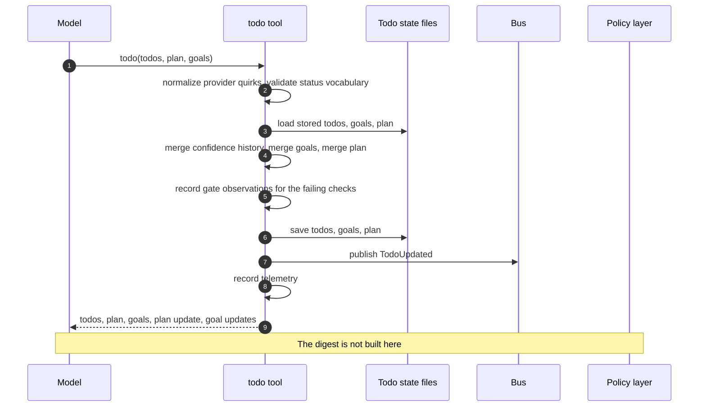
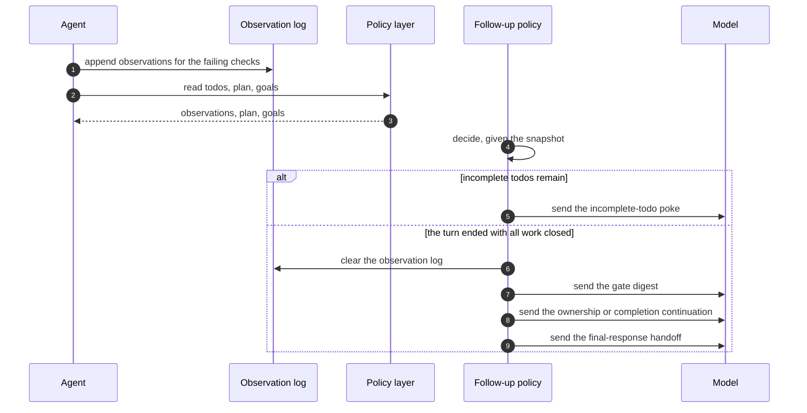
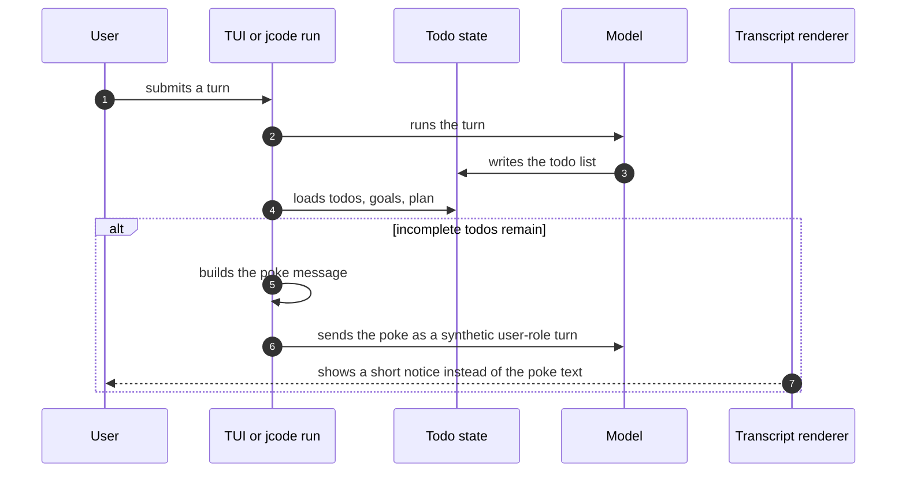

# Specification: Todo and Goal Tracking

## Overview

The feature is split across three layers.
`jcode-task-types` holds the pure domain model (todos, goals, plan-level intent assessment, initiatives, and the semantic states used for every assessment).
`jcode-todo-policy` holds the pure policy (the quality-gate bars, the synthetic continuation messages, the transcript classifiers, the turn-end follow-up state machine, and the on-disk layout), with no storage, terminal, or provider dependency.
`jcode-app-core` and `jcode-tui` hold the runtime surfaces (the `todo` and `initiative` tools, the persistence helpers in `jcode-base`, the auto-poke loop in the TUI and in `jcode run`, and the todo widgets).
The same policy crate is re-exported by `jcode-base` (`crate::todo::*`), served to SDK clients through the harness API, and re-exported by `jcode-sdk` as `jcode_sdk::todo`, so the TUI, the CLI, the SDK, and Desktop all run the same rules.
This document was reverse-engineered from the existing codebase during an SDLC sync.

## Architecture

```
                    jcode-task-types (pure domain model)
                    TodoItem, TodoGoal, TodoPlan, Goal, GoalMilestone
                    semantic states: IntentUnderstanding, FeedbackLoopState,
                    FeedbackLoopRelevance, FeedbackLoopCoverage,
                    FeedbackLoopTraceability, ConfidenceState, Difficulty,
                    Autonomy, DeliveryState, IterationMaturity
                              │
                              ▼
                    jcode-todo-policy (pure policy, no I/O)
                    ├── lib.rs        quality-gate bars, continuation messages,
                    │                 transcript classifiers, session title
                    ├── followup.rs   FollowUpPolicy: turn-end decision state machine
                    └── store.rs      on-disk layout under <jcode home>/todos/
                              │
            ┌─────────────────┼──────────────────────────┐
            ▼                 ▼                          ▼
   jcode-base            jcode-app-core              jcode-sdk
   crate::todo::*        tool/todo.rs                jcode_sdk::todo
   load/save todos,      tool/goal.rs (initiative)   todo_state()
   goals, plan, gate      BusEvent::TodoUpdated       ack_todo_follow_up()
   observations, review   BusEvent::SidePanelUpdated
   state, side panel      telemetry
            │                 │
            ▼                 ▼
   jcode-tui              harness API server
   ├── app/todos_view.rs  get_todo_state
   ├── app/input.rs       ack_todo_follow_up
   ├── info_widget_todos.rs
   └── app/commands.rs    /initiatives, /goals
            │
            ▼
   root crate: jcode run (src/cli/commands.rs)
```

## Data Models

### Todo item

| Field | Type | Constraints | Description |
|---|---|---|---|
| content | string | not null | What the item is. |
| status | string | not null, one of pending, in_progress, completed, cancelled | Canonical status. Natural synonyms are canonicalized on parse. |
| priority | string | not null | Priority label, used to weight the aggregate confidence. |
| id | string | not null | Stable identifier of the item within the plan. |
| group | string, optional | trimmed, empty collapses to absent | Group label. One group per coherent goal. |
| confidence | ConfidenceState, optional | absent means not assessed | Forward-looking evidence state that the item can be completed correctly. |
| completion_confidence | ConfidenceState, optional | absent means not assessed | Evidence state recorded when the item was completed. |
| confidence_history | list of ConfidenceState | tool-owned, oldest first | Every distinct state the item has carried. Model-supplied values are discarded. |
| blocked_by | list of string | default empty | Identifiers of the items that block this one. |
| assigned_to | string, optional | default absent | Owner of the item. |

### Todo group

A group is not a stored entity.
It is the normalized (trimmed, non-empty) group label carried by a set of todo items, and it is the key that binds a `TodoGoal` assessment to the items it describes.
The ungrouped flat list is the implicit group with the key `None`, so a flat plan still has exactly one goal assessment.
Groups appear in the order they are first seen, and the ungrouped bucket is always rendered last.

### Goal (todo-level assessment)

| Field | Type | Constraints | Description |
|---|---|---|---|
| group | string, optional | normalized | The group this assessment describes. `None` is the ungrouped list. |
| closed_feedback_loop | FeedbackLoopState, optional | alias `hill_climbability` | How much of the goal's correctness the feedback loop can report on its own. |
| feedback_loop | string, optional | none | The concrete requirement-to-check process used to judge each iteration. |
| feedback_loop_relevance | FeedbackLoopRelevance, optional | none | How directly the checks represent the acceptance behavior. |
| feedback_loop_coverage | FeedbackLoopCoverage, optional | none | How broadly the checks exercise main paths, integration boundaries, and edge cases. |
| feedback_loop_traceability | FeedbackLoopTraceability, optional | none | Whether every requirement and changed public output maps to a concrete check. |
| delivery_state | DeliveryState, optional | alias `end_to_end_ownership` | How far the result traveled toward the user's outcome. |
| difficulty | Difficulty, optional | descriptive, never gated | Intrinsic difficulty of the goal. |
| autonomy | Autonomy, optional | gated at necessary_followthrough | How far beyond the literal request the work went. |
| iteration_maturity | IterationMaturity, optional | gated | How far the loop was exercised, and the basis for stopping. |
| stopping_evidence | string, optional | required for a confirmed plateau, exhausted constraints, or an exhausted budget | Evidence behind the reported iteration maturity. |
| `*_history` fields | list of state, optional | tool-owned, oldest first | The distinct states each assessment has carried. Model-supplied values are discarded. |

The difficulty only calibrates the feedback-loop bars.
A goal at or above the involved difficulty needs acceptance-aligned relevance, edge-and-integration coverage, and complete traceability.
The delivery bar is never raised by difficulty, because operational delivery comes from the request rather than from implementation difficulty.

### Plan-level intent assessment

| Field | Type | Constraints | Description |
|---|---|---|---|
| user_intention | string, optional | inherited from the stored plan when omitted | The user's underlying reason and desired end state, kept distinct from the agent's steps. |
| understands_user_intent | IntentUnderstanding, optional | alias `alignment_score`, `user_intention_alignment` | How well the agent understands what the user actually wants. |
| understands_user_intent_history | list of IntentUnderstanding | tool-owned, oldest first | The distinct understanding states the plan has carried. |

The plan is stored in its own file so the todo list file stays a bare array of items.

### Confidence scores

Confidence is expressed as semantic states, not as numbers.
`ConfidenceState` runs speculative, plausible, validated, verified.
`IntentUnderstanding` runs uncertain, partial, clear, complete.
`FeedbackLoopState` runs absent, weak, usable, strong, closed.
`FeedbackLoopRelevance` runs indirect, synthetic, representative, acceptance_blocked, acceptance_aligned.
`FeedbackLoopCoverage` runs narrow, main_paths, edge_and_integration_paths.
`FeedbackLoopTraceability` runs unmapped, partial, complete.
`DeliveryState` runs change_made, integrated, workflow_validated, outcome_delivered.
`Difficulty` runs trivial, routine, involved, complex, hard, expert, research, open_ended.
`Autonomy` runs requested_only, necessary_followthrough, proactive, stewardship.
`IterationMaturity` runs not_started, exploring, improving, plateau_unproven, outcome_reached, constraints_exhausted, plateau_confirmed, budget_exhausted.

Each state keeps a legacy 0-100 band and a representative score, so a payload recorded before the semantic-state migration still loads on the closest state and telemetry can still aggregate numerically.
The states serialize as snake_case strings and parse case-insensitively.

### Initiative (durable goal)

| Field | Type | Constraints | Description |
|---|---|---|---|
| id | string | slugified, unique within the scope | Identifier of the initiative. |
| title | string | not empty | Title. |
| scope | GoalScope | global or project, default project | Where the initiative is stored. |
| status | GoalStatus | draft, active, paused, blocked, completed, archived, abandoned | Lifecycle state. |
| description | string, optional | none | Free-form description. |
| why | string, optional | none | The reason the initiative exists. |
| success_criteria | list of string | none | What "done" means. |
| milestones | list of GoalMilestone | none | Ordered steps, each with its own steps. |
| next_steps | list of string | none | The immediate next actions. |
| blockers | list of string | none | What is currently blocked. |
| current_milestone_id | string, optional | none | The active milestone. |
| progress_percent | integer 0-100, optional | clamped to 100 | Reported progress. |
| created_at / updated_at | timestamp | not null | Bookkeeping. |
| updates | list of GoalUpdate | not null | Checkpoint history. |

Initiatives live outside the session todo state, under `<jcode home>/goals/global` and `<jcode home>/goals/projects/<project hash>`, and are mirrored into the memory store.

### Follow-up decision

| Field | Type | Constraints | Description |
|---|---|---|---|
| follow_up | FollowUp, optional | none | The synthetic continuation to send, with its kind, model-facing message, and user-facing notice. |
| notice | string, optional | none | A user-facing notice with no follow-up, used by the circuit breaker. |
| effects | TodoEffects | none | Persistent side effects to apply, namely clearing the gate-observation log and marking the long-session review delivered. |

`FollowUpKind` runs incomplete_todos, long_session_review, gate_digest, ownership, completion_validation, confidence_spike, final_response.

## API Contracts

This feature defines no HTTP endpoint, so no `api.yaml` accompanies this document.
The contract surface is the model-facing tool schema, the TUI commands, and the SDK capability pair.

### Model-facing tools

| Tool | Action | Purpose |
|---|---|---|
| `todo` | read | Return the stored todo list, plan, and goal assessments. |
| `todo` | write | Write the todo list, the plan, and the goal assessments. A write with no `todos`, `goals`, or `plan` is a read. |
| `initiative` | create, list, show, resume, update, checkpoint, focus | Manage durable initiatives. The update and checkpoint actions refresh an already-open goal page in update-only mode, which never steals focus. |

### SDK capabilities

| Capability | Purpose |
|---|---|
| `todo_state` | Read the session todo snapshot (todos, plan, goals, gate observations, long-session review flag). |
| `ack_todo_follow_up` | Apply the follow-up effects (clear the observation log, mark the review delivered). |

### TUI commands

| Command | Purpose |
|---|---|
| `/todos`, `/todo` | Toggle the inline todo card in the chat. |
| `/todos panel`, `/todos on`, `/todos off` | Toggle the transient todo page in the side panel. |
| `/todos pin`, `/todos pin on`, `/todos pin off` | Toggle the pinned todo band. |
| `/initiatives`, `/goals` | Open the initiatives overview in the side panel. |
| `/initiatives resume` | Resume the attached or first resumable initiative. |
| `/initiatives show <id>` | Open one initiative in the side panel. |

## Sequences

### Write a todo list



### Evaluate the quality gate at turn end



### Auto-poke continuation



## Technical Decisions

| Decision | Choice | Rationale |
|---|---|---|
| One pure policy crate | `jcode-todo-policy` has no storage, terminal, or provider dependency | The SDK and any embedding client run the same rules as the TUI, and the policy is unit-testable without a runtime. |
| Semantic states instead of 0-100 scores | Every assessment is an ordered enum with a legacy numeric band | The bands describe evidence, not a number to maximize, and legacy payloads still load on the closest state. |
| Deferred gates with a turn-end digest | Checks record observations during the turn and replay them once at turn end | Understanding of a request starts low and rises, so interrupting on every low reading punished agents that were resolving the ambiguity. |
| A late climb is still raised | The score decides the wording, not whether the point is raised | Work done while the score was low never benefited from the better loop that arrived afterwards. |
| Tool-owned score histories | Model-supplied histories are discarded in favor of the stored trail plus this write's observation | A model must not be able to fabricate a gradual climb that clears a gate. |
| Writes are never rejected by a gate | The write is saved, and the gate runs after the turn | A rejected write loses the agent's work, and the turn-end check still catches the problem. |
| One file per format | Todos, goals, plan, gate observations, and review state each live in their own file | The todo list stays a bare array that every existing consumer can read. |
| The todo tool never opens the side panel | The initiative tool refreshes an already-open page in update-only mode | An agent must not steal the user's focus or open panels the user did not ask for. |
| The private elapsed-time trigger stays private | The 30-minute review threshold never appears in model-facing text | A visible timer would let the model target the evaluator instead of doing the work. |
| Legacy continuations are kept for classification only | The old wordings are matched by the classifier but never sent | Persisted transcripts must not re-render an old gate message as a user prompt. |
| A shared transcript classifier | `is_auto_poke_message` and `auto_poke_display_summary` classify every synthetic message | The live UI, the transcript renderer, and the SDK agree on what is synthetic. |

## Risks and Unknowns

1. The gate thresholds are private constants, so a change to them can silently change model behaviour without any visible test failure beyond the policy unit tests.
2. The follow-up state machine is duplicated in the TUI (`schedule_auto_poke_followup_if_needed`) and in the pure policy (`FollowUpPolicy::decide`), so the two can drift.
3. The semantic-state migration depends on the legacy bands staying stable, because a session's stored score is mapped through them on every load.
4. The long-session review clock is durable per session, so a session that is resumed after a long gap can receive the review immediately.
5. The todo widget and the pinned band are dense render paths, so layout regressions at narrow widths are the most likely source of visible defects.
6. The `todo` tool's model-visible schema is hand-written, so a careless edit could reintroduce calibration wording that the policy tests would not catch.

## Out of Scope

- The swarm plan DAG in `crates/jcode-plan` and `crates/jcode-swarm-core`, which is a separate feature.
- The swarm plan projection that the info widget can render in place of the session todo list.
- Multi-agent or sub-agent todo coordination, which is handled by the swarm feature.
