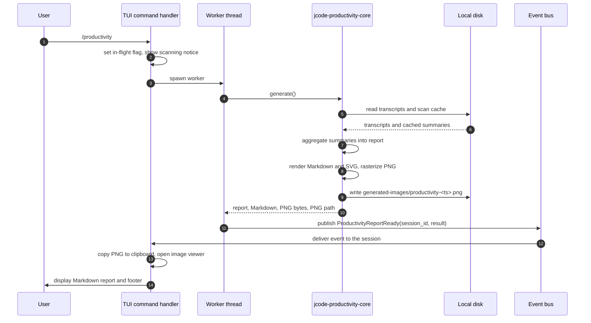
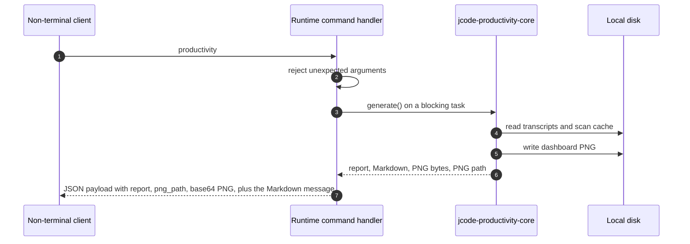
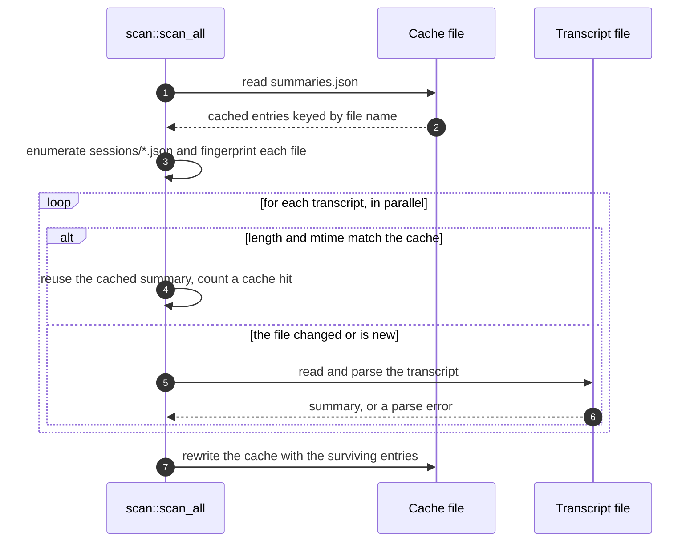

# Specification: Productivity Reporting

## Overview

The feature is implemented in the workspace crate `jcode-productivity-core` (`crates/jcode-productivity-core/`) and is driven from the TUI by the `/productivity` slash command (`crates/jcode-tui/src/tui/app/productivity.rs`) and from non-terminal clients by the runtime `productivity` command (`crates/jcode-app-core/src/server/runtime_special_commands.rs`). The crate is split into five modules: `scan` reads the local transcript store and maintains an incremental cache, `aggregate` folds the per-session summaries into a `ProductivityReport`, `markdown` renders the report for the chat transcript, `dashboard` builds an SVG and rasterizes it to PNG, and `model` holds the data types. The crate depends only on `jcode-storage` for path resolution, so the report is produced entirely from local data. This document was reverse-engineered from the existing codebase during an SDLC sync.

## Architecture

```
      /productivity   /wrapped   /stats          runtime command "productivity"
             │                                      (jcode-app-core)
             ▼                                              │
 crates/jcode-tui/src/tui/app/productivity.rs              │
   (spawns a worker thread, publishes a bus event)          │
             │                                              │
             └──────────────► jcode_productivity_core::generate() ◄──┘
                                          │
        ┌─────────────────────────────────┴──────────────────────────────┐
        ▼                                                            ▼
 scan::scan_all()                                        aggregate::build_report()
   reads  ~/.jcode/sessions/*.json                        folds Vec<SessionSummary>
   cache  ~/.jcode/cache/productivity/summaries.json             │
   key    (file_len, mtime_ns)                                 ▼
        │                                            ProductivityReport
        ▼                                                   │
 Vec<SessionSummary>                        ┌──────────────┴──────────────┐
                                            ▼                             ▼
                            markdown::render_markdown          dashboard::render_svg
                            (chat transcript)                        │
                                                         dashboard::render_png (usvg/resvg)
                                                                          │
                                                                          ▼
                                              ~/.jcode/generated-images/productivity-<ts>.png
```

Data flow in one line: transcripts on disk, summaries in the scan cache, one aggregated report, two renderers, one PNG on disk and one Markdown block in the chat.

The TUI never calls the crate on the UI thread. The command handler sets an in-flight flag, spawns a thread that runs `generate()`, and publishes the outcome as a `BusEvent::ProductivityReportReady` event carrying the originating session id.

## Data Models

### SessionSummary

The compact per-session aggregate that is cached between runs. One instance is produced per transcript file.

| Field | Type | Constraints | Description |
|---|---|---|---|
| first_ts | string | nullable | RFC3339 timestamp of the first timestamped message. |
| last_ts | string | nullable | RFC3339 timestamp of the last timestamped message. |
| created_at | string | nullable | Session creation timestamp from the transcript header. |
| updated_at | string | nullable | Session update timestamp from the transcript header. |
| project | string | nullable | Basename of the session working directory. |
| working_dir | string | nullable | Full working directory path. |
| provider_key | string | nullable | Provider identifier recorded in the transcript. |
| model | string | nullable | Model identifier recorded in the transcript. |
| user_msgs | u32 | not null | Count of messages with role `user`. |
| assistant_msgs | u32 | not null | Count of messages with role `assistant`. |
| user_chars | u64 | not null | Characters typed by the human, excluding `<system-reminder>` blobs. |
| assistant_chars | u64 | not null | Characters produced by the assistant in text blocks. |
| tools | map | not null | Tool invocation histogram keyed by canonical tool name. |
| images | u32 | not null | Images attached or produced in the transcript. |
| input_tokens | u64 | not null | Sum of reported input tokens. |
| output_tokens | u64 | not null | Sum of reported output tokens. |
| cache_read_tokens | u64 | not null | Sum of reported cache-read tokens. |
| cache_creation_tokens | u64 | not null | Sum of reported cache-creation tokens. |
| hour_hist | array[24] | not null | Local-time activity histogram, one slot per hour of day. |
| weekday_hist | array[7] | not null | Local-time activity histogram, one slot per weekday with Monday at index 0. |
| active_dates | list[string] | not null | Sorted distinct local calendar dates on which the session was active. |

`SessionSummary::total_tool_calls()` sums the tool histogram into a `u64`.

### Tally

A single named, sortable metric used for the top-N lists in the report.

| Field | Type | Constraints | Description |
|---|---|---|---|
| name | string | not null | Label of the counted item, such as a project name or a tool name. |
| count | u64 | not null | Number of occurrences. |

### ProductivityReport

The fully computed report. It is serializable so the same structure backs the Markdown, the PNG, and the runtime command payload.

| Field | Type | Constraints | Description |
|---|---|---|---|
| generated_at | string | not null | Local timestamp of the report generation, formatted as `YYYY-MM-DD HH:MM`. |
| total_sessions | u64 | not null | Number of sessions folded into the report. |
| total_messages | u64 | not null | Sum of user and assistant messages. |
| user_prompts | u64 | not null | Sum of user messages. |
| assistant_messages | u64 | not null | Sum of assistant messages. |
| total_tool_calls | u64 | not null | Sum of all tool histogram entries. |
| total_images | u64 | not null | Sum of images across sessions. |
| input_tokens | u64 | not null | Sum of input tokens. |
| output_tokens | u64 | not null | Sum of output tokens. |
| cache_read_tokens | u64 | not null | Sum of cache-read tokens. |
| cache_creation_tokens | u64 | not null | Sum of cache-creation tokens. |
| user_chars | u64 | not null | Sum of characters typed by the human. |
| user_words | u64 | not null | Approximate prompt word count, derived as `user_chars / 5`. |
| assistant_chars | u64 | not null | Sum of characters produced by the assistant. |
| first_day | string | nullable | Earliest active calendar date. |
| last_day | string | nullable | Latest active calendar date. |
| active_days | u64 | not null | Number of distinct active calendar dates. |
| span_days | u64 | not null | Inclusive day span between the first and last active dates. |
| current_streak | u64 | not null | Consecutive active days ending today or yesterday. |
| longest_streak | u64 | not null | Longest run of consecutive active days. |
| busiest_day | Tally | nullable | Active date with the highest message count. |
| hour_hist | array[24] | not null | Folded hour-of-day histogram. |
| weekday_hist | array[7] | not null | Folded weekday histogram. |
| peak_hour | u8 | not null | Hour slot with the highest activity. |
| chronotype | string | not null | Label derived from the peak hour. |
| top_projects | list[Tally] | not null | Up to 8 projects ranked by session count. |
| distinct_projects | u64 | not null | Number of distinct project names. |
| top_tools | list[Tally] | not null | Up to 10 tools ranked by call count. |
| top_models | list[Tally] | not null | Up to 6 models ranked by message count, excluding `<synthetic>`. |
| top_providers | list[Tally] | not null | Up to 6 providers ranked by message count. |
| code_edits | u64 | not null | Calls to edit, write, multiedit, apply_patch, patch, and replace. |
| commands_run | u64 | not null | Calls to bash. |
| searches | u64 | not null | Calls to grep, agentgrep, and glob. |
| web_actions | u64 | not null | Calls to browser, websearch, and webfetch. |
| longest_session_msgs | u64 | not null | Largest message count in a single session. |
| avg_session_msgs | f64 | not null | Mean message count per session. |
| archetype | string | not null | Shareable activity archetype label. |
| archetype_blurb | string | not null | One-line explanation of the archetype. |
| power_score | u64 | not null | Weighted headline score. |
| badges | list[string] | not null | Shareable badge labels earned by the activity profile. |
| scanned_files | u64 | not null | Number of transcripts read or served from cache. |
| parse_errors | u64 | not null | Number of transcripts that failed to parse. |
| scan_secs | f64 | not null | Wall-clock seconds spent in the scan. |
| cache_hits | u64 | not null | Number of transcripts served from the scan cache. |

### ProductivityOutput

The bundle returned by `jcode_productivity_core::generate()`.

| Field | Type | Constraints | Description |
|---|---|---|---|
| report | ProductivityReport | not null | The aggregated report. |
| markdown | string | not null | Rendered Markdown for the chat transcript. |
| png | Vec\<u8\> | not null | PNG dashboard bytes, identical to the saved file. |
| png_path | PathBuf | not null | Absolute path of the saved PNG. |

## API Contracts

This feature defines no HTTP surface, so there is no `api.yaml` alongside this document.
The feature is reached through two command contracts.

| Command | Surface | Purpose |
|---|---|---|
| `/productivity`, `/wrapped`, `/stats` | TUI slash command | Generate the report, print the Markdown, and copy and open the dashboard PNG. |
| `productivity` | Runtime command (`RuntimeCommand::Productivity`) | Return the structured report, the saved PNG path, and the PNG as base64 to non-terminal clients. |

The runtime command accepts no arguments, or the single argument `status` or `show`; any other argument is rejected with `This command accepts only status or show`.
The runtime response is a JSON object with these fields.

| Field | Type | Description |
|---|---|---|
| report | object | The serialized `ProductivityReport`. |
| png_path | string | Path of the saved dashboard PNG. |
| image.media_type | string | Always `image/png`. |
| image.base64 | string | Standard base64 encoding of the PNG bytes. |
| scope | string | Always `runtime host`. |

The runtime command also returns the rendered Markdown as its human-readable message.

The slash command writes a footer under the Markdown report that names the saved PNG path and states whether the image was copied to the clipboard and whether it was opened in an image viewer.

## Sequences

### Slash command report generation



### Runtime command report generation



### Incremental scan



## Technical Decisions

| Decision | Choice | Rationale |
|---|---|---|
| The feature lives in its own workspace crate | `jcode-productivity-core` | Keeps the reporting code out of the TUI and the app core, and lets the app core call it without a TUI dependency. |
| Transcripts are parsed with a tolerant partial deserializer | Local `RawSession` and `RawMessage` types with `serde` defaults | The crate stays dependency-light and keeps working when the canonical transcript schema drifts. |
| The scan keeps an on-disk cache keyed by file fingerprint | `(file_len, mtime_ns)` per file name, stored at `cache/productivity/summaries.json` | Transcripts can number in the tens of thousands; re-parsing all of them on every run is not viable. |
| The cache is rewritten from the current scan | Entries for deleted transcripts are dropped | The cache never grows without bound and stays consistent with the store. |
| A cache format version invalidates stale entries | `CACHE_VERSION` bumped when summary semantics change | A semantic change in the summary must not reuse summaries computed under the old rules. |
| The cache is best-effort | Read and parse failures fall back to an empty cache | A corrupted cache must never block the report. |
| Parsing is parallelized | `rayon` over the file list | The scan is the expensive part and the per-file work is independent. |
| Only compact summaries are retained | `Vec<SessionSummary>` instead of raw transcripts | Memory stays bounded over multi-gigabyte histories. |
| Batch tool calls are expanded | The inner calls of a `batch` invocation are counted individually | Otherwise a single batched turn hides most of the tool usage from the report. |
| Legacy tool names are normalized | `file_read`, `file_write`, `file_edit`, `file_grep`, and `todowrite` map to `read`, `write`, `edit`, `grep`, and `todo` | Old transcripts and new transcripts must contribute to the same tally. |
| Activity buckets are derived from the tool tally | Fixed tool groups map to code edits, commands, searches, and web actions | The buckets make the report comparable without a second pass over the transcripts. |
| The dashboard is hand-built SVG rasterized to PNG | `usvg` plus `resvg` with the system font database | No headless browser and no network font download; the output is deterministic per machine. |
| Emoji are stripped from dashboard text | `ascii_only` keeps ASCII plus a small set of punctuation | The system sans font cannot render emoji, and the PNG must not show tofu boxes. |
| Generation runs off the UI thread | A worker thread publishes `BusEvent::ProductivityReportReady` | A cold scan over a large history takes seconds, and the interface must stay responsive. |
| The result event carries the session id | `ProductivityReportReady { session_id, result }` | A report requested in one session must not be rendered in another. |
| Clipboard access is best-effort | Wayland `wl-copy`, then `xclip`, then `arboard` | Clipboard tooling varies per desktop, and a missing clipboard tool must not lose the report. |
| The report is exposed over the runtime command surface | `RuntimeCommand::Productivity` | Non-terminal clients need the same report and image that the TUI shows. |

## Risks and Unknowns

1. The transcript schema is read with a partial deserializer, so a change to the on-disk format can silently drop a metric rather than fail loudly.
2. The scan cache is keyed by length and modification time, so a transcript edited in place with the same length and the same timestamp granularity is served stale.
3. The `user_words` figure is a proxy derived from characters, not a real word count.
4. The dashboard depends on the system font database, so a machine without the expected fonts renders a different poster than a machine with them.
5. The power score, archetype, and badges are tuned constants, so the thresholds are a matter of taste rather than a measured model.
6. Clipboard and image-viewer integration is only exercised on the desktop platforms that ship the expected tools.

## Out of Scope

- Any hosted service, account, upload, or network call in the reporting path.
- A selectable report time window; the report always covers all recorded history.
- Editing, pruning, or summarizing the underlying transcripts.
- A historical series of past reports; each run produces a fresh report from the current store.
