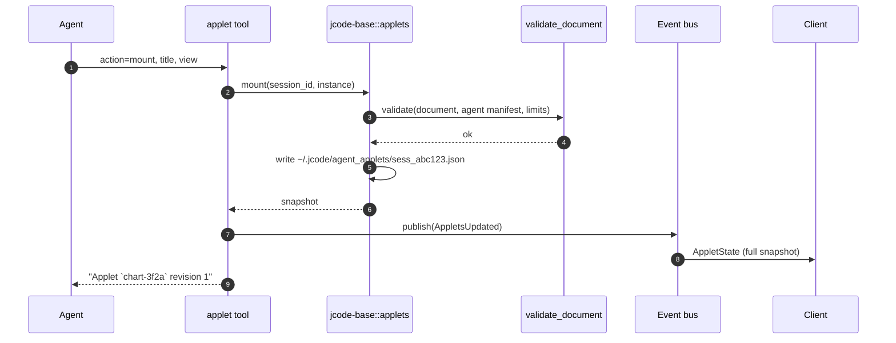
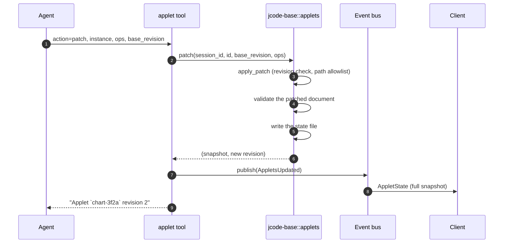
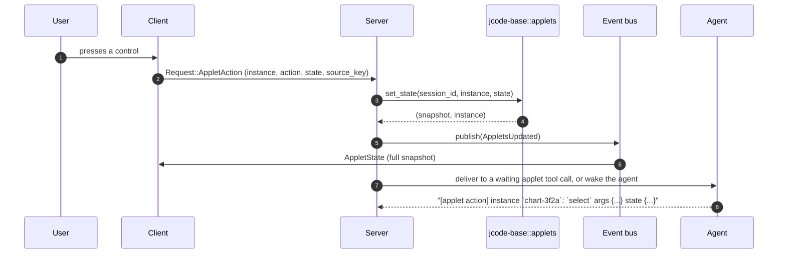
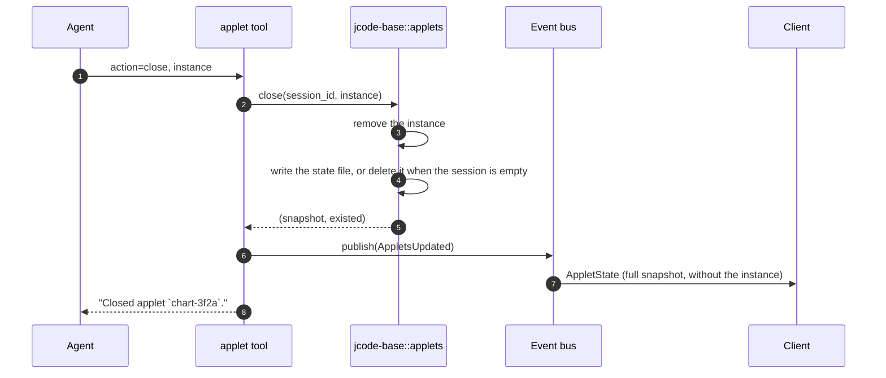

# Specification: Agent Applets

## Overview

The applet feature is split across three crates.
`crates/jcode-applet-types` holds the versioned wire types, the document validator and the patch engine, with no dependency beyond `serde` and `serde_json`.
`crates/jcode-base` holds the per-session persistence and the MCP resource bridge.
`crates/jcode-app-core` holds the `applet` tool the agent calls and the server handlers that turn client actions into agent messages.
The harness API, the internal protocol and the Rust SDK expose the same applet surface to external clients.
This document was reverse-engineered from the existing codebase during an SDLC sync.

## Architecture

```
  Provider (agent, MCP server, local process, native desktop code)
  |  no provider code runs inside the host process
  |  ProviderMessage: register / mount / patch / move / toast / busy / close
  v
+---------------------------------------------------------------------+
| jcode-applet-types                                                  |
|   Document  Instance  Placement  Anchor  Scope  Lifetime            |
|   Node / NodeKind (closed set)   PatchOp   Action   HostMessage    |
|   validate_document   apply_patch   NodeKind::Unknown -> fallback   |
+---------------------------------------------------------------------+
  |                                     ^
  | jcode-base::applets                 | jcode-app-core::tool::applet
  v                                     |   (mount, update, patch, move, close, list)
+-------------------------------+       |
| ~/.jcode/agent_applets/       |       |
|   one file per session         |       |
|   mount / patch / move /      |       |
|   close / set_state / publish |       |
+-------------------------------+       |
  |                                     |
  | Bus::AppletsUpdated (full snapshot) |
  v                                     v
+---------------------------------------------------------------------+
| jcode-app-core::server                                              |
|   BusEvent::AppletsUpdated  ->  ServerEvent::AppletState            |
|   Request::AppletAction      ->  store state, publish, wake agent  |
|   Request::CloseApplet       ->  close, publish, no agent wake      |
+---------------------------------------------------------------------+
  |  ServerEvent::AppletState      |  Request::AppletAction
  v                               v
+---------------------------------------------------------------------+
| Client (Jcode Desktop)                                             |
|   renders the node tree, owns layout / theme / input / focus       |
+---------------------------------------------------------------------+
       |  Request::AppletAction / Request::CloseApplet
       v
  jcode-protocol  ->  jcode-harness-api  ->  jcode-sdk / external clients
```

The persistence layer sits between the wire types and the server.
Every change is written to disk first and then published as a full snapshot, so a client that misses an event still recovers the whole set on the next one.

## Data Models

### Applet document

The unit the host stores, persists and renders.

| Field | Type | Constraints | Description |
|---|---|---|---|
| revision | u64 | Monotonic, not null | The revision this document is at; a patch carries the revision it applies to. |
| title | String | not null | Human-readable title shown in the applet chrome. |
| view | Node | not null, must be a known or unknown node | Root of the view tree. |
| state | Value | Object, not null, size-bounded | Values bound by inputs, toggles, selects and tabs, keyed by `bind`. |
| assets | Vec\<AssetDecl\> | Optional, count and size bounded | Binary assets referenced by id from image nodes. |

### Applet instance

A mounted applet, as the host tracks it.

| Field | Type | Constraints | Description |
|---|---|---|---|
| id | InstanceId | 1 to 64 chars of `[A-Za-z0-9-_.]`, unique per session | Host-unique identity of one mounted instance. |
| applet | AppletId | Forced to `jcode.agent` for agent-mounted instances | The applet that owns the instance. |
| placement | Placement | not null | Where the instance appears. |
| scope | Scope | Defaults to `global` | Visibility scope; agent-mounted instances use `session`. |
| lifetime | Lifetime | Defaults to `session` | How long the host keeps the instance and its last document. |
| document | Document | not null | The rendered content. |

### Placement

Where an instance appears. Placement is independent of tool calls; a tool call is one possible inline anchor.

| Variant | Fields | Meaning |
|---|---|---|
| panel | `open`: split, replace or background | A first-class workspace panel that can be tiled, focused and closed. |
| sidebar | none | A compact section in the workspace sidebar. |
| overlay | `corner`: top_right, bottom_right, bottom_left, top_left | A floating card over the workspace. |
| composer | `session_id` | A strip directly above a session's composer. |
| inline | `session_id`, `anchor` | Inside the conversation transcript, scrolled with the messages. |
| background | none | No visible UI; the instance can still post toasts and launch panels. |

Inline anchors are `tool_call` (with `call_id`), `after_message` (with `message_id`) and `end`.

### Patch operation

An RFC 6902 style operation on the JSON form of a document.

| Field | Type | Constraints | Description |
|---|---|---|---|
| op | `add`, `replace` or `remove` | not null | The operation kind. |
| path | String | Must be `/view`, `/state` or `/title`, or a path under one of them | The target path. |
| value | Value | Required for `add` and `replace` | The new value. |

Applying a patch copies the document, applies every operation, revalidates the result and increments the revision by one.
A revision mismatch, a forbidden path, a missing path or an invalid result rejects the whole patch.

### Host message

A host to provider message.

| Variant | Fields | Meaning |
|---|---|---|
| action | `instance`, `revision`, `action`, `state`, `source_key` | A user intent from a node, with the instance's current local state. |
| launch | `applet`, `launcher`, `instance` | A launcher fired; the provider should mount an instance. |
| resync | `instance`, `revision`, `reason` | The host rejected a message; the provider should mount a full document. |
| tool_call | `session_id`, `call_id`, `tool`, `input`, `output`, `error`, `done` | A claimed tool call started or finished. |
| visibility | `instance`, `visible` | Visibility changed; providers may pause polling while hidden. |
| closed | `instance` | The user or host closed the instance. |
| rejected | `instance`, `reason` | A message failed validation and was not rendered. |

The provider to host direction uses the mirror type `ProviderMessage` with the variants `register`, `mount`, `patch`, `move`, `toast`, `busy` and `close`.

### View node

The closed set of native components a provider may use.
Layout nodes are `stack`, `grid`, `scroll`, `card`, `tabs`, `spacer` and `divider`.
Content nodes are `text`, `markdown`, `code`, `image`, `icon`, `key_value`, `table`, `progress`, `empty` and `error`.
Control nodes are `button`, `chip`, `toggle`, `input`, `select`, `list` and `list_item`.
`html` is the sandboxed escape hatch and requires the `html` capability.
A node carries an optional `key` for stable identity across patches and an optional `fallback` shown by hosts that do not know the type.

## API Contracts

There is no HTTP surface for applets.
The contract is a tool contract plus a JSON message protocol, so the tables below describe the callable surfaces instead of REST endpoints.

### `applet` tool

Registered only when the client advertises the desktop inline response renderer capability.

| Action | Required input | Optional input | Effect |
|---|---|---|---|
| mount | `view` | `instance`, `title`, `state`, `assets`, `placement`, `lifetime`, `wait` | Mounts a new instance, or replaces the instance with the same id. |
| update | `instance` | `title`, `view`, `state`, `assets`, `placement`, `lifetime`, `wait` | Replaces the document of an existing instance. |
| patch | `instance`, `ops` | `base_revision`, `wait` | Applies patch operations to the instance document. |
| move | `instance`, `placement` | `wait` | Moves the instance to a new placement. |
| close | `instance` | none | Removes the instance from the session. |
| list | none | none | Lists the mounted instances with their id, revision, title and state. |

`placement` accepts the shorthands `inline`, `end`, `panel`, `sidebar`, `overlay` and `composer`, or a placement object.
`inline` defaults to anchoring at the calling tool call.
`wait` blocks the tool call until a user action arrives on the instance, with a default timeout of 600 seconds clamped to the range 1 to 3600 seconds.
It applies to every action except `list` and `close`, which return immediately.

### Harness API requests

| Request | Fields | Effect |
|---|---|---|
| `applet_action` | `session_id`, `instance`, `action`, `state`, `source_key` | The user pressed something; the server stores the state, publishes, then wakes the agent or resolves a waiting tool call. |
| `close_applet` | `session_id`, `instance` | The user closed an instance; the agent is not woken. |

### Harness API events

| Event | Fields | Effect |
|---|---|---|
| `applet_state` | `session_id`, `snapshot` | The complete set of agent-mounted instances for a session. The client replaces its previous snapshot, including when the set is empty. |

The same event and request names exist in the internal protocol (`jcode-protocol`) and are surfaced by the Rust SDK as `applet_action`, `close_applet` and the `AppletState` event.

## Sequences

### Mount an applet



### Patch an applet



### A user acts on an applet



### Unmount an applet



## Technical Decisions

| Decision | Choice | Rationale |
|---|---|---|
| Wire types in their own crate | `jcode-applet-types` with only `serde` and `serde_json` as dependencies | The schema is a published contract shared by the host, the protocol, the harness API and the SDK, so it must not drag in the application stack. |
| Declarative tree instead of provider code | A closed set of node types, no provider binary in the host process | The host owns layout, theme and input, and a provider cannot compromise the app. |
| Unknown node types degrade | `NodeKind::Unknown` keeps the raw fields and the fallback text | A provider built against a newer host still works on an older host, and relaying or persisting the node stays lossless. |
| Validation before storage and after every patch | `validate_document` runs on mount and on the patched result | A bad patch never leaves a half-updated document on screen, and an invalid document never reaches the store. |
| Full-snapshot events | `AppletState` carries the whole instance set | A client that misses an event recovers on the next one, and no client-side delta logic is needed. |
| Persist before publish | The state file is written, then the bus event is published | A client that reacts to the event always sees state that is already on disk. |
| Revision-checked patches | `base_revision` must match the current revision | The provider detects that it is out of date and re-sends a full document. |
| State writes keep the revision | `set_state` does not bump the revision | A patch that was computed against the state the user just produced still applies. |
| Session-scoped file per session | `~/.jcode/agent_applets/`, one file per session named after the session id | Sessions are independent, the file is easy to inspect, and an empty session leaves no file behind. |
| Instance ids are slugs plus four hex digits | `generate_instance_id` | Ids stay readable in transcripts and messages while staying unique within a session. |
| MCP resources become applets | `ui://` HTML, `ui://` URI lists and native applet JSON are mapped to documents | An MCP server ships UI without a custom client, and the resource is anchored to the tool call that produced it. |
| The tool is desktop-only | The registry registers it only when the desktop capability is on | Terminal, headless, batch and codemode clients never advertise or execute it. |
| Capability gating | Host actions and image sources require a declared capability | The user approves a capability set per applet, and validation enforces it. |

## Risks and Unknowns

1. The schema version policy is ambiguous. The wire types say the suffix changes only for breaking changes and that additive node types keep the same version, so a long-lived `jcode.applet/1` will accumulate node types that older hosts render as fallback text.
2. The agent applet manifest grants the `html` capability by default, so every agent-mounted applet can render sandboxed HTML without a separate user approval.
3. A waiting `applet` tool call can hold a tool call open for up to an hour, and the wait is cancelled only by a timeout or a graceful shutdown signal.
4. The Desktop renderer is not in this repository, so the host's handling of `NodeKind::Unknown` fallback text and of every placement is asserted by the wire contract and by the client protocol, not by an automated test in this repository.
5. The instance cap of 64 is a fixed constant, and a session that reaches it cannot mount anything new until the agent closes an instance.
6. The `ui://` bridge is heuristic. A URI list is read as its first non-comment line, and a resource with a non-`ui://` URI and a non-native mime type is silently ignored rather than reported.

## Out of Scope

- The Desktop renderer that draws the node tree, including layout, theming, focus and scrolling.
- The provider side of the protocol, such as a plugin host that receives `ProviderMessage` and `HostMessage`.
- The capability approval user interface, which decides how a user grants a capability set to an applet.
- Rendering applets in the terminal client, which is excluded by the desktop-only tool registration.
- Non-image assets. The asset model currently carries only image mime types.
