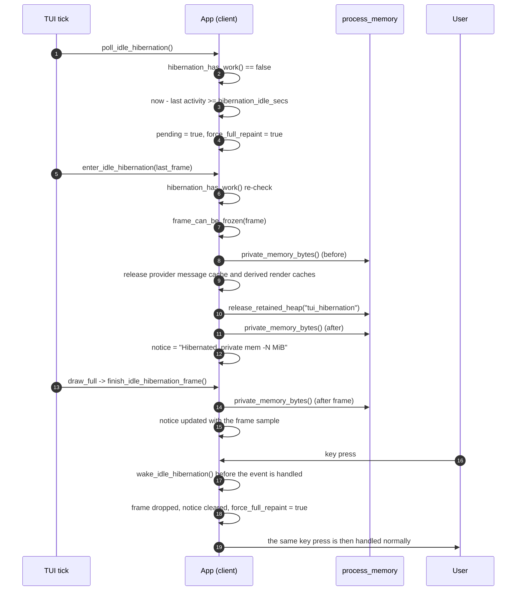
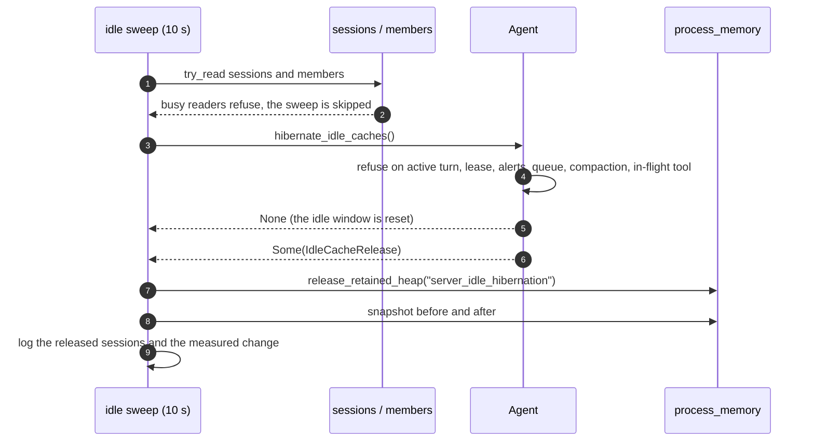
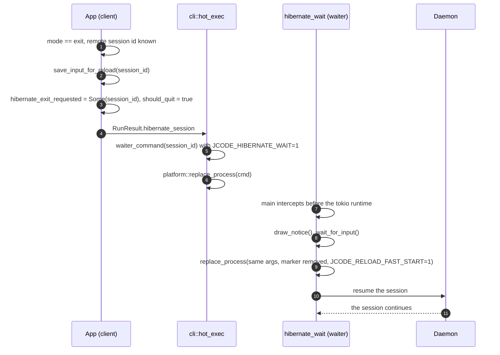

# Specification: Session Hibernation

## Overview

Session hibernation is split between the daemon and the terminal client.
The daemon runs a background sweep that reclaims lazy reproducible caches for sessions that have been idle for long enough.
The terminal client releases its derived render caches and its retained heap after the same kind of idle period, keeps a bounded copy of its last frame, and measures its own memory before and after the release.
The wake is transparent: the next interaction restores the session without a thaw protocol, because the canonical transcript never left memory.
A third mode goes further and replaces the client process with a tiny waiter that resumes the session on the next key press.
The shared policy lives in `crates/jcode-config-types/src/session.rs` so the daemon and the client read the same idle period and the same mode.
This document was reverse-engineered from the existing codebase during an SDLC sync.

## Architecture

```
  [session] config (crates/jcode-config-types/src/session.rs)
    hibernation_idle_secs = 1800   (0 disables)
    hibernation_mode      = caches | transcript | exit

  +---------------------------------------------+    +---------------------------------------------+
  | [session] config (jcode-config-types)       |    | jcode-base::process_memory                  |
  |                                             |    |   snapshot()  rss / pss_anon                |
  | jcode-base::config                          |    |   release_retained_heap()                   |
  |   Config.session                            |    |                                             |
  |   env override: JCODE_HIBERNATION_IDLE_SECS |    |                                             |
  |                 JCODE_HIBERNATION_MODE      |    |                                             |
  +---------------------------------------------+    +---------------------------------------------+

                         |                                              |
                         v                                              v
  +---------------------------------------------+    +---------------------------------------------+
  | jcode-app-core::server::idle_hibernation    |    | jcode-tui::app::idle_hibernation            |
  |   spawn() every 10 s                        |    |   poll_idle_hibernation()                   |
  |   try_read sessions / members               |    |   enter_idle_hibernation()                  |
  |   IdleState { since, last_status_change,    |    |   wake_idle_hibernation()                   |
  |                released }                   |    |   finish_idle_hibernation_frame()           |
  |   reclaim_idle_caches()                     |    |                                             |
  |     -> Agent::hibernate_idle_caches()       |    | jcode-tui::app::idle_heap_release           |
  |     -> release_retained_heap()              |    |   maybe_release_idle_heap()                 |
  |                                             |    |   16 MiB budget, 60 s idle, 300 s re-trim   |
  +---------------------------------------------+    +---------------------------------------------+

                         |                                              |
                         v                                              v
  +---------------------------------------------+    +---------------------------------------------+
  | jcode-app-core::agent                       |    | derived render caches released              |
  |   hibernate_idle_caches()                   |    |   prepared frames, rendered lines,          |
  |     refuses: active turn, migration lease,  |    |   highlighting, copy viewport, side pane,   |
  |     pending alerts, soft interrupts,        |    |   diff and image state, markdown renderer   |
  |     compaction, in-flight tool              |    |   frame frozen (bounded)                    |
  |   returns IdleCacheRelease                  |    |   private memory measured before / after    |
  +---------------------------------------------+    +---------------------------------------------+

                         |
                         v

  +---------------------------------------------+
  | session cache release                       |
  |   release_provider_messages_cache()         |
  |   tool_call_ids = {}                        |
  |   tool_result_ids = {}                      |
  |   tool_output_scan_index = 0                |
  +---------------------------------------------+

  exit mode (remote client only)
    App::hibernate_exit_requested -> RunResult.hibernate_session
      -> cli::hot_exec::execute_requested_action
        -> cli::hibernate_wait::waiter_command
             (JCODE_HIBERNATE_WAIT=1, --resume SESSION_ID)
          -> platform::replace_process
            -> main() intercepts before the tokio runtime
              -> draw_notice() -> wait_for_input()
              -> replace_process (same args, marker removed)
```

The daemon never suspends the scheduler and never replaces the live `Agent` or session.
The client never rebuilds the transcript from disk to wake; it only drops derived state that the renderer recreates.

## Data Models

### IdleCacheRelease

The report of what one daemon-side hibernation released.
Defined in `crates/jcode-app-core/src/agent/idle_hibernation.rs`.

| Field | Type | Constraints | Description |
|---|---|---|---|
| provider_cache_bytes | usize | not null, may be 0 | The size in bytes of the provider message cache that was released, taken from the session memory profile snapshot before the release. |
| tool_index_entries | usize | not null, may be 0 | The number of entries in the tool call and tool result id sets that were released. |

The report is summed across the sessions released in one sweep and written to the log together with the before and after resident memory of the daemon process.

### SessionConfig

The shared idle policy, defined in `crates/jcode-config-types/src/session.rs` and embedded in `Config` as the `session` field.

| Field | Type | Constraints | Description |
|---|---|---|---|
| hibernation_idle_secs | u64 | Default 1800, `0` disables hibernation | The number of seconds without work or interaction before memory is released. |
| hibernation_mode | HibernationMode | Default `Caches` | How much an idle terminal client releases when it hibernates. |

The table is optional in the configuration file, and a file without it inherits the defaults.
`JCODE_HIBERNATION_IDLE_SECS` and `JCODE_HIBERNATION_MODE` override the file values, and an invalid override is ignored.

### HibernationMode

The depth of idle terminal client hibernation, from cheapest wake to largest saving.

| Variant | Serialized name | Aliases | Behavior |
|---|---|---|---|
| Caches | `caches` | `cache` | Drop rebuildable render caches only. The wake is instant and lossless. This is the default. |
| Transcript | `transcript` | none | Also drop the in-memory transcript and reload it from the server on wake. Local-only notices and the exact scroll position are not kept. |
| Exit | `exit` | `process` | Exit the client process entirely, leaving a tiny waiter that resumes the session on the next key press. The largest saving, and a wake of about one second. |

### Client idle state

The client-side state machine, defined in `crates/jcode-tui/src/tui/app/idle_hibernation.rs`.

| Field | Type | Description |
|---|---|---|
| last_busy | Instant | The last moment the client was busy; the idle period is measured from it. |
| pending | bool | The idle period elapsed and the client asked for a full repaint, but the eviction has not happened yet. |
| frame | Option\<Buffer\> | The bounded copy of the last completed terminal frame, kept on screen while hibernated. |
| notice | String | The one-line hibernation status, including the measured memory change. |
| rss_before | Option\<u64\> | The private memory measured before the release. |
| rss_after | Option\<u64\> | The private memory measured after the release, and again after the first frozen frame was painted. |
| measure_after_frame | bool | Set when the eviction point sample was taken and the frame sample is still owed. |
| notice_dirty | bool | Set when the notice changed and the screen must be repainted. |
| transcript_dropped | bool | Set in the transcript mode when the in-memory transcript was released. |
| history_reload_needed | bool | Set on wake when the transcript was dropped, so the history is refetched. |
| wake_count | u64 | The number of wakes so far. |
| hibernation_count | u64 | The number of hibernations so far. |
| last_wake_reason | Option\<String\> | The reason of the last wake, for the debug query. |

### Daemon idle state

The per-session idle bookkeeping of the daemon sweep, defined in `crates/jcode-app-core/src/server/idle_hibernation.rs`.

| Field | Type | Description |
|---|---|---|
| since | Instant | The start of the current idle window. |
| last_status_change | Instant | The swarm status generation observed at the last sweep, used to detect a turn that started and finished between two sweeps. |
| released | bool | Whether the session was already released, so it is not released twice. |

## API Contracts

There is no HTTP surface for session hibernation.
The contract is a configuration contract plus a debug command surface, so the tables below describe the callable surfaces instead of REST endpoints.

### Configuration

| Setting | Type | Default | Effect |
|---|---|---|---|
| `[session] hibernation_idle_secs` | u64 | 1800 | Seconds of inactivity before memory is released. `0` disables hibernation. |
| `[session] hibernation_mode` | string | `caches` | `caches`, `transcript` or `exit`. |

### Debug commands

| Command | Kind | Effect |
|---|---|---|
| `client:hibernation` | read-only | Returns the state, the scope, the source transcript retention flag, the memory metric, the busy flag, the hibernation and wake counts, the last wake reason, the measured readings, the signed change, the measurement phase, the frozen cell count and the notice. |
| `client:hibernate` | mutating | Requests an immediate hibernation. It bypasses the elapsed time requirement, but not the active work guards and not the disable setting. |

### Process contract for the exit mode

| Variable | Meaning |
|---|---|
| `JCODE_HIBERNATE_WAIT` | Set to `1` on the waiter process. `main` intercepts it before the tokio runtime is built, so the waiter holds only a few hundred KiB. |
| `JCODE_RESUMING` | Set to `1` on the waiter and on the resumed client, so the client knows it is resuming an existing session. |
| `JCODE_RELOAD_FAST_START` | Set to `1` on the resumed client, so it paints and accepts input before the authoritative history arrives. |

## Sequences

### Hibernate an idle session and wake it



### The daemon sweep releases an idle session



### The exit mode re-execs into a waiter



## Technical Decisions

| Decision | Choice | Rationale |
|---|---|---|
| Release derived state, not authoritative state | Only lazy reproducible caches are discarded | Reloading a session is not a transparent wake operation, so the canonical transcript, the frozen prompts and tools, the rewind undo state, the provider handle and the hook state stay resident. |
| The daemon sweeps on a fixed interval | A 10 second `tokio` interval with a skipped missed tick | A fixed cadence bounds the detection cost and needs no timer per session. |
| The sweep never queues behind a lock | `try_read` on the session and member maps, `try_lock` on the agent | The sweep must never delay a live turn, a roster change or a session operation. |
| The sweep releases the heap once per sweep | One process-wide purge after every agent and roster lock is dropped | RSS is a process-wide metric, so purging once avoids repeated allocator work for the same saving. |
| The idle window is tracked per session | A map from session id to an idle state | A session that becomes busy is dropped from the map, and a session that is released once is not released again until it becomes busy again. |
| A turn between two sweeps is detected by generation | The status change instant is compared, not its age | A whole turn can start and finish between two sweeps, even for thresholds below 10 seconds. |
| A decline resets the idle window | `since` is set to now when the agent refuses | Pending input, alerts, compaction and live tools all mean the session is not idle, so the window restarts. |
| The client freezes a bounded copy of the last frame | At most 128 thousand cells and 8 MiB of symbol bytes | Repainting the transcript into new caches on every idle tick would undo the saving, and an unbounded frame could hold more memory than it saves. |
| The client measures private memory, not shared pages | The anonymous proportional set size when the platform provides it, otherwise the resident set size | RSS counts the executable and the shared libraries that every client maps once, so a plain RSS change overstates what hibernation actually freed. |
| The final client sample is taken after the first frozen frame | The frame sample replaces the eviction point sample | The retained screen buffers belong to the hibernated state, so the reported number has to include them. |
| A positive change is shown as an increase | The notice formats the signed difference | A flat or unavailable reading must never be presented as a saving. |
| The wake happens before the event is handled | `wake_idle_hibernation` runs on the way into the handler and never consumes the event | The first typed character is inserted at the original cursor position, and the draft, the cursor and the scroll state are untouched. |
| Presence traffic does not wake the client | Heartbeats, acknowledgments, swarm status, side panel state, usage, model catalogs, memory activity and MCP status are excluded | These are read-only or periodic traffic, and waking on them would rebuild the caches on every tick. |
| The work guard is re-checked at the eviction point | `hibernation_has_work` runs again inside `enter_idle_hibernation` | Work can arrive between the timer and the paint, and the eviction must not cancel it. |
| The transcript mode reloads the history on wake | A `history_reload_needed` flag is set only when the transcript was dropped | The remote history fetch is not a lossless snapshot of the local view, so the flag exists only for the mode that actually drops it. |
| The exit mode replaces the process | The client execs into a waiter that holds a few hundred KiB | Leaving the process in place cannot free its heap, and the daemon still owns the session, so the waiter can resume it. |
| The waiter is intercepted before the tokio runtime | `main` checks `JCODE_HIBERNATE_WAIT` first | A runtime would keep worker threads and their stacks resident, which defeats the purpose of the exit mode. |
| The client trims its retained heap separately from hibernation | A 16 MiB per-client budget, a 60 second idle delay and a 300 second re-trim cadence | A workspace runs one process per open terminal, so the shared global threshold would retain hundreds of MiB in aggregate. |
| The per-client budget honors a lower global threshold | The client budget is the minimum of the global threshold and 16 MiB | An operator who set a lower threshold keeps it, and a disabled threshold stays disabled. |
| The config type lives in `jcode-config-types` | `SessionConfig` and `HibernationMode` are shared types | The daemon and the client must read the same policy, and the crate keeps the shared data models free of the application stack. |

## Risks and Unknowns

1. The released memory is a measurement, not a promise. Allocator behavior, shared pages and concurrent work all affect it, and a controlled 64 MiB fixture released about 63 MiB while a small real TUI fixture released only about 278 KB.
2. The daemon sweep reads the configuration on every tick, so the idle period can change under a running daemon without a notice.
3. The exit mode applies only to a remote client today, because the daemon must own the session that the waiter resumes. A local client cannot use it.
4. The transcript mode drops local-only display messages and the exact scroll position, because the remote history fetch cannot restore them.
5. The client polls the idle policy on its existing tick, so the effective idle period is the configured period plus up to one tick of latency.
6. The frozen frame is a copy of the terminal buffer, and its bound of 8 MiB of symbol bytes is a heuristic. A frame with very large inline image payloads can be refused and then retried on later idle ticks.
7. The daemon release is counted per session, but the resident memory it reports is process-wide, so a single sweep that releases several sessions reports one combined change.
8. The manual RSS measurement test in the agent module is ignored by default, because the allocator and the other tests in the same process perturb the reading.
9. The transcript mode marks the history for reload but does not define a reconciliation for local-only messages that were never sent to the server.

## Out of Scope

- Process suspension, swapping the scheduler or suspending the OS.
- Evicting the authoritative client transcript outside the explicit transcript mode.
- Serializing and destroying the whole agent, which needs a separate audited persistence and thaw boundary.
- A cross-session memory budget or a workspace-wide eviction policy.
- Changing the memory budget of the daemon itself beyond the idle cache sweep and the allocator purge.
- The daemon side of the transcript and exit modes, which are client-side depths only.
