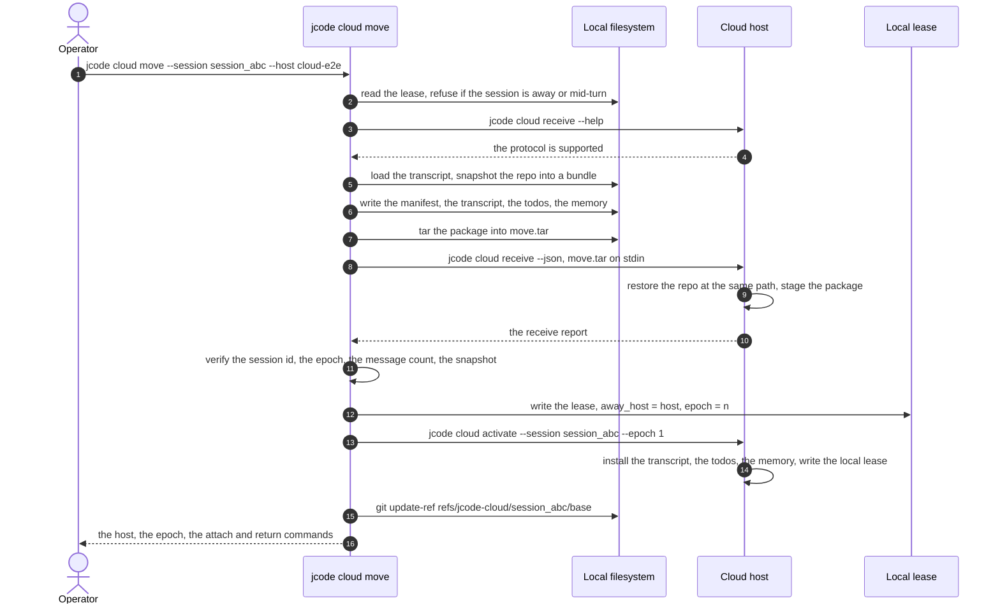
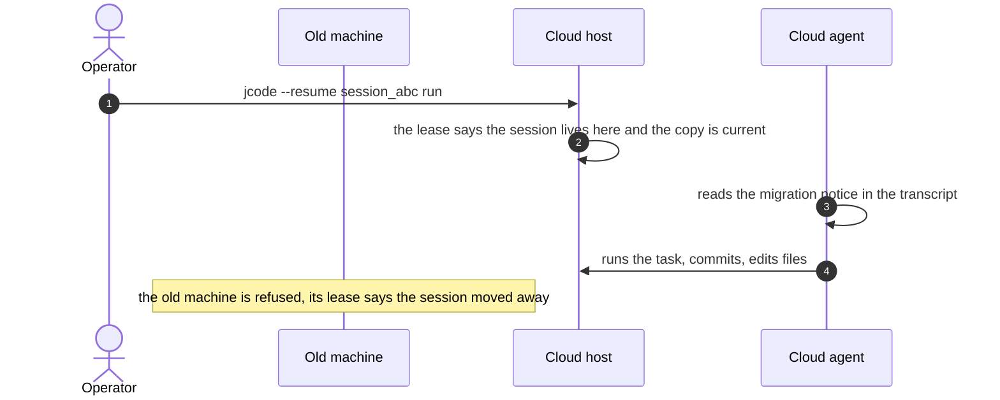
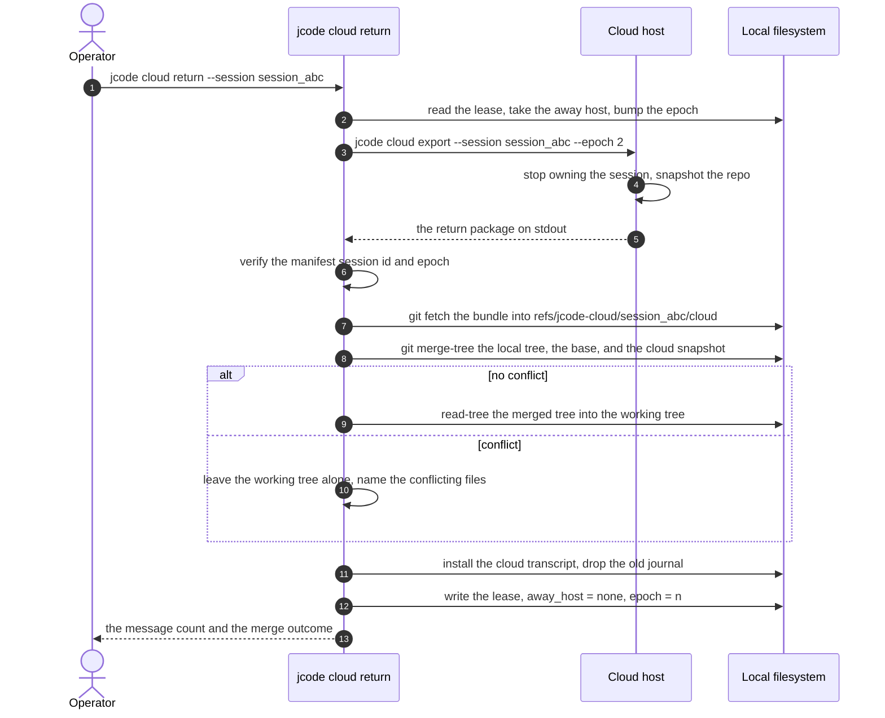

# Specification: Cloud Session Handoff

## Overview

The handoff lives in `src/cli/cloud_move.rs`, in the root crate.
It implements a staged transfer of a live session between two machines: `run_move` prepares a package on the local side, transfers it over the remote transport, verifies what the far side received, and only then hands ownership over, and `run_return` reverses the flow and merges the cloud work back into the local checkout.
The remote half of the protocol is three hidden subcommands of the same binary, `cloud receive`, `cloud activate`, and `cloud export`, so the far side needs nothing but a jcode binary.
Ownership is decided by a per-machine lease file in `crates/jcode-storage/src/session_lease.rs`, which carries a monotonic migration epoch, and the agent consults that lease before every turn and before every save.
The TUI surface is `crates/jcode-tui/src/tui/app/commands_cloud.rs`, which runs the same CLI commands between turns and then reattaches at the new location.
A separate half of the `jcode cloud` surface, `jcode cloud sessions`, uploads session transcripts to Jade cloud storage through a private helper and shares no state with the move protocol.
This document was reverse-engineered from the existing codebase during an SDLC sync.

## Architecture

```
 local machine (laptop)                     cloud host
 +--------------------------------+         +-------------------------------+
 | jcode cloud move               |         | jcode cloud receive (hidden)  |
 |   src/cli/cloud_move.rs        |         | jcode cloud activate (hidden) |
 |   run_move()                   |         | jcode cloud export  (hidden)  |
 |                                |         |                               |
 |  prepare                       |         |  receive                      |
 |   load session transcript      |         |   read move.tar from stdin    |
 |   snapshot_repo() -> bundle    |         |   restore_repo() same path    |
 |   build MoveManifest           |         |   stage in cloud_inbox        |
 |   tar -> move.tar              |         |                               |
 |                                |         |  activate                     |
 |  transfer                      |         |   install transcript + todos  |
 |   ssh host jcode cloud receive | ------> |   write lease, away_host=none |
 |                                |         |                               |
 |  verify                        |         |  export                       |
 |   id, epoch, messages, snapshot|         |   stop owning here            |
 |                                |         |   snapshot_repo() -> bundle   |
 |  commit                        | <------ |   stream return.tar on stdout |
 |   write lease, away_host=host  |         |                               |
 |   ssh host jcode cloud activate|         |                               |
 |   git update-ref .../base      |         |                               |
 +--------------------------------+         +-------------------------------+
          |                                              |
          v                                              v
  ~/.jcode/session_leases/session_abc.json   ~/.jcode/session_leases/session_abc.json
    local lease: epoch, away_host = host,   cloud lease: epoch, away_host = none
    repo_root, last_sync_snapshot, last_sync_head
```

The lease is the only shared state between the two machines, and each machine keeps its own copy of it.
The epoch in the lease is the tie-breaker: it is bumped on every move and every return, and each transcript carries the epoch of the migration that delivered it.
A copy may run turns and persist only when the lease says the session lives here and the copy is at least as new as the lease.

The repository travels as a git bundle plus a snapshot commit, and the merge back is a plain git 3-way merge.
Four refs carry the moved state in the local repository:

| Ref | Meaning |
|---|---|
| `refs/jcode-cloud/session_abc/base` | The snapshot both sides agreed on at move time. This is the merge base for the return. |
| `refs/jcode-cloud/session_abc/outgoing` | The snapshot commit taken on the sending side. |
| `refs/jcode-cloud/session_abc/cloud` | The cloud snapshot fetched back into the local repository. |
| `refs/jcode-cloud/session_abc/cloud-head` | The branch head the cloud side had, when the cloud side committed. |

The agent side of the lease lives in three places, and all three consult the same helper:

- `crates/jcode-app-core/src/agent/turn_execution.rs` calls `ensure_session_lease` before a turn starts.
- `crates/jcode-app-core/src/agent/turn_loops.rs` and `crates/jcode-app-core/src/agent/turn_streaming_mpsc.rs` re-check the lease on every loop iteration, so a move that happens during a long turn stops the loop.
- `crates/jcode-base/src/session/persistence.rs` refuses to write a session whose copy is blocked, so a stale in-memory copy cannot overwrite a newer transcript.

## Data Models

### Session lease (`jcode_storage::SessionLease`)

Persisted at `~/.jcode/session_leases/session_abc.json`.

| Field | Type | Constraints | Description |
|---|---|---|---|
| session_id | string | PK, not null, restricted character set | Session the lease belongs to. |
| epoch | u64 | not null, monotonic | Migration counter shared by both machines. |
| away_host | string | optional, omitted when absent | `None` when the session lives on this machine, otherwise the host that owns it. |
| repo_root | string | optional | Absolute repository root the session works in. |
| last_sync_snapshot | string | optional | Snapshot commit both machines last agreed on, used as the merge base. |
| last_sync_head | string | optional | Branch HEAD both machines last agreed on. |
| updated_at | string | not null, RFC 3339 | Time of the last lease write. |

The session id is validated before it becomes a file name: it must be non-empty, may hold only ASCII alphanumerics, underscore, dash, and dot, and must not start with a dot.
The lease is written to a `.json.tmp` file and then renamed into place, so a crash cannot leave a corrupt lease.
A missing lease file means the session never migrated and is not blocked.

### Lease block (`jcode_storage::SessionLeaseBlock`)

The reason a session copy may not run a turn or persist on this machine.

| Variant | Fields | Meaning |
|---|---|---|
| MovedAway | host, epoch | The lease says the session lives on another host. |
| StaleCopy | copy_epoch, lease_epoch | This in-memory copy is older than the lease. |

### Move manifest (`cloud_move::MoveManifest`)

The header of the transfer package, written as `manifest.json` inside the tarball.

| Field | Type | Constraints | Description |
|---|---|---|---|
| format_version | u32 | not null, currently 1 | Version of the transfer format. |
| session_id | string | not null | Session the package carries. |
| epoch | u64 | not null | Migration epoch of this move. |
| source_host | string | not null | Label of the sending machine. |
| target_host | string | not null | Host alias of the receiving machine. |
| created_at | string | not null, RFC 3339 | Time the package was built. |
| repo | RepoManifest | optional | Repository state, absent when the session has no git checkout. |
| env | list of (string, string) | not null | Allowlisted environment variables present on the sender. |
| toolchain_hints | list of string | not null | Toolchains the repository implies, for example `rust (rust-toolchain.toml)`. |
| not_transferred | list of string | not null | Local background tasks that were running and did not travel. |
| mcp_servers | list of string | not null | Locally configured MCP server names that are not connected on the far side. |

### Repository manifest (`cloud_move::RepoManifest`)

| Field | Type | Constraints | Description |
|---|---|---|---|
| root | string | not null | Absolute repository root, restored at the same path so transcript paths stay valid. |
| working_dir | string | not null | Session working directory, possibly a subdirectory of `root`. |
| branch | string | optional | Checked-out branch, absent when the head is detached. |
| head | string | not null | Commit the branch pointed at. |
| snapshot | string | not null | Snapshot commit holding the full working tree state. |
| dirty | bool | not null | Whether the snapshot differs from the HEAD tree. |
| origin_url | string | optional | `origin` remote URL. |
| git_user_name | string | optional | Repository `user.name`. |
| git_user_email | string | optional | Repository `user.email`. |
| ignored_files | list of string | not null | Allowlisted ignored files that were copied. |

### Receive report (`cloud_move::ReceiveReport`)

The JSON the cloud host prints after staging a move, and the document the sender verifies against.

| Field | Type | Constraints | Description |
|---|---|---|---|
| session_id | string | not null | Session that was staged. |
| epoch | u64 | not null | Epoch of the staged move. |
| messages | number | not null | Message count in the staged transcript. |
| snapshot | string | optional | Snapshot commit created on the cloud host. |
| repo_root | string | optional | Repository root restored on the cloud host. |

### Move report (`cloud_move::MoveReport`)

The JSON `jcode cloud move` prints.

| Field | Type | Constraints | Description |
|---|---|---|---|
| session_id | string | not null | Session that was moved. |
| host | string | not null | Host that now owns the session. |
| epoch | u64 | not null | Epoch of this move. |
| repo_root | string | optional | Repository root on the cloud host. |
| snapshot | string | optional | Snapshot commit that was transferred. |
| dry_run | bool | not null | Whether this was a dry run. |
| attach_command | string | not null | Suggested `jcode cloud attach` command. |
| return_command | string | not null | Suggested `jcode cloud return` command. |

### Return report (`cloud_move::ReturnReport`)

| Field | Type | Constraints | Description |
|---|---|---|---|
| session_id | string | not null | Session that came back. |
| host | string | not null | Host the session came from. |
| epoch | u64 | not null | Epoch of the return. |
| messages | number | not null | Message count in the returned transcript. |
| merge | MergeOutcome | not null | Outcome of the repository merge. |

### Merge outcome (`cloud_move::MergeOutcome`)

Serialized as an object with a `result` tag.

| Result | Fields | Meaning |
|---|---|---|
| no_repo | none | The session had no repository, so there was nothing to merge. |
| unchanged | none | The cloud snapshot equals the snapshot both sides agreed on. |
| refs_only | cloud_snapshot | The cloud work was fetched into refs and the working tree was not touched. |
| applied | cloud_snapshot, branch, head | The cloud work was merged into the local checkout. |
| conflicts | cloud_snapshot, files | The merge conflicted, the working tree was left untouched, and the conflicting files are named. |

### Where entry (`cloud_move::WhereEntry`)

| Field | Type | Constraints | Description |
|---|---|---|---|
| session_id | string | not null | Session the entry describes. |
| location | string | not null | `local`, or the host that owns the session. |
| epoch | u64 | not null | Epoch the lease records. |
| repo_root | string | optional | Repository root. |
| local_ahead_of_sync | number | optional | Commits the local HEAD is ahead of the last synced head. |

## API Contracts

The handoff is a command-line protocol, not an HTTP API, so there is no OpenAPI document for it.
The normative contract is this section, and the `jcode cloud` argument definitions in `src/cli/args.rs` and `src/cli/args/cloud_sessions.rs` are the machine-readable form of it.

### Move and return surface

| Command | Purpose |
|---|---|
| `jcode cloud move --session session_abc --host cloud-e2e` | Hand the session to the cloud host, and report the new host, the epoch, and the snapshot. |
| `jcode cloud move --dry-run` | Stage and verify the cloud copy without changing ownership. |
| `jcode cloud move --allow-active` | Allow the move while a turn is in flight. |
| `jcode cloud move --attach` | Attach this terminal to the cloud session after a successful move. |
| `jcode cloud move --json` | Print the move report as JSON. |
| `jcode cloud return --session session_abc` | Bring the session back and merge the cloud work into the local checkout. |
| `jcode cloud return --refs-only` | Fetch the cloud work into refs without touching the working tree. |
| `jcode cloud return --attach` | Resume the session locally after the return. |
| `jcode cloud return --json` | Print the return report as JSON. |
| `jcode cloud where [--session session_abc]` | Report where the moved sessions live and how far the local checkouts have diverged. |
| `jcode cloud attach [--session session_abc]` | Attach this terminal to the host that owns the session. |

### Remote surface, hidden from the help output

| Command | Purpose |
|---|---|
| `jcode cloud receive --json` | Read a move package from stdin, restore the repository, stage the package, and print the receive report. |
| `jcode cloud activate --session session_abc --epoch 1` | Take ownership of a staged package by installing the transcript, the todos, and the memory, and by writing the local lease. |
| `jcode cloud export --session session_abc --epoch 2` | Stop owning the session here, snapshot the repository, and stream the return package on stdout. |

### Jade cloud sessions surface

| Command | Purpose |
|---|---|
| `jcode cloud sessions configure` | Save the Jade API base URL, the bearer token, the token id, the user id, and the helper path. |
| `jcode cloud sessions status` | Report the saved Jade defaults without printing the token. |
| `jcode cloud sessions upload session_abc.json` | Upload one local session file to Jade cloud storage. |
| `jcode cloud sessions upload-latest` | Upload the newest local session file. |
| `jcode cloud sessions sync` | Upload new or changed local sessions, idempotently and safe to schedule. |
| `jcode cloud sessions list` | List the sessions in the Jade index. |
| `jcode cloud sessions verify session_abc` | Check that the cloud metadata and the S3 session blob both exist. |
| `jcode cloud sessions dashboard` | Render a local HTML dashboard of the uploaded sessions. |
| `jcode cloud sessions view session_abc` | Download and view one uploaded session. |

### Environment variables

| Variable | Purpose |
|---|---|
| `JCODE_CLOUD_HOST` | Default target host, used when `--host` is absent. |
| `JCODE_CLOUD_REMOTE_BINARY` | Default remote binary name or path, used when `--remote-binary` is absent. |
| `JCODE_CLOUD_TRANSPORT` | Default local command used in place of `ssh cloud-e2e`, used when `--transport` is absent. |
| `JCODE_CLOUD_HOST_LABEL` | Label the machine reports for itself in the manifest and in the notices. |
| `JCODE_CLOUD_QUIET` | When set, the stage progress lines are suppressed. |
| `JCODE_SESSION_ID` | The session a move or return acts on when `--session` is absent. |

### Failure modes

| Stage | Condition | Message | State left behind |
|---|---|---|---|
| resolve | Neither `--host` nor `JCODE_CLOUD_HOST` is set | No cloud host configured, naming both sources | Nothing changed. |
| preflight | The remote jcode does not know the `cloud receive` subcommand | The host does not support `cloud move` yet, naming `--remote-binary` and `JCODE_CLOUD_REMOTE_BINARY` | Nothing changed. |
| move | The lease names an away host | The session already lives on that host, use `jcode cloud return` first | Nothing changed. |
| move | A turn is in flight and `--allow-active` is absent | The session is mid-turn | Nothing changed. |
| prepare | The repository has no commits yet | Commit once before moving | Nothing changed. |
| receive | The incoming format version is not supported | The format version is not supported and the expected version is named | Nothing changed. |
| receive | The host already holds the session at that epoch or later | The host already has the session at that epoch | Nothing changed. |
| receive | The cloud checkout holds work jcode did not place | The path has changes that were never returned, and the paths to clean it are named | The existing files are untouched. |
| verify | The cloud report names another session, another epoch, another message count, or another snapshot | The mismatch is reported with both values | Ownership is not handed over. |
| commit | The activation on the cloud host fails | Cloud activation failed and the session stays local | The previous local lease is restored. |
| return | The session has no lease | The session was never moved | Nothing changed. |
| return | The lease names no away host | The session already lives here | Nothing changed. |
| export | The host does not own the session | The session does not live on this host | The host keeps ownership. |
| export | The requested epoch is not newer than the host epoch | The stale epoch and the current epoch are reported | The host keeps ownership. |
| export | A turn is in flight on the cloud host | The session is mid-turn on the cloud host | The host keeps ownership. |
| merge | The merge conflicts | The conflicting files are named and the cloud ref is named | The working tree is untouched. |

## Sequences

### Move a session to a cloud host



### Work on the cloud host



### Return the session to the local machine



## Technical Decisions

| Decision | Choice | Rationale |
|---|---|---|
| Conversation ownership | A per-machine lease file with a monotonic epoch | A transcript is linear, so exactly one machine may run turns. A shared counter is cheaper than a lock service and needs no control plane. |
| Code transfer | A git bundle plus a snapshot commit | Git already knows how to move a working tree, and a bundle carries the history without a server. |
| Snapshot creation | A temporary index through `GIT_INDEX_FILE`, then `git add -A` and `git write-tree` | The snapshot captures the staged, unstaged, and untracked work while the user's index and working tree stay untouched. |
| Snapshot commit | `git commit-tree` on top of HEAD, with a fallback identity only when the repository has none | The snapshot is a real commit, so the bundle carries it and the merge base is a normal commit. |
| Merge on return | `git merge-tree --write-tree` with an explicit `--merge-base` | The merge is computed on trees, so a conflict can be reported without writing conflict markers into the user's files. |
| Merge base | The snapshot both sides agreed on at move time, stored in the lease | The base is the exact state the move started from, so edits on both sides merge cleanly. |
| Refs namespace | `refs/jcode-cloud/session_abc/{base,outgoing,cloud,cloud-head}` | Every piece of moved state stays reachable from a ref, so nothing is lost even when the merge is refused. |
| Path preservation | The repository is restored at the same absolute path | Every path mentioned in the transcript stays valid on the cloud host. |
| Environment transfer | A fixed allowlist of locale, editor, git identity, and build variables | Machine-local, display, and secret variables must not travel. |
| Ignored files | A fixed allowlist, git-ignored only, at most 256 KiB each | A `.env` file is often needed to run, but build output must never travel. |
| Transport | `ssh cloud-e2e` by default, overridable with `--transport` | SSH is already how operators reach their machines, and the override makes the whole flow testable without a second machine. |
| Handoff shape | Prepare, transfer, verify, commit | A failure before the commit is a no-op, so the local session stays usable and the agent can read the error and fix it. |
| Lease write | Write to a temporary file, then rename | A crash during the write cannot leave a corrupt lease. |
| Remote commands | Hidden `cloud receive`, `cloud activate`, and `cloud export` subcommands | The remote half is invoked over SSH and is not part of the user-facing surface. |
| Journal handling | The incoming snapshot replaces the local snapshot and the old journal is deleted | The incoming transcript is complete and newer, so the old journal would be stale. |
| TUI integration | The TUI runs the CLI between turns and then reattaches | The CLI stays the single implementation, and the TUI only decides when to call it. |
| Jade uploads | A separate helper process driven by `jcode cloud sessions` | The upload half talks to a cloud index and shares no state with the move protocol, so it stays out of the lease design. |
| Managed control plane | Not part of this implementation | `docs/JCODE_CLOUD_AWS.md` is a design direction, and the control plane it describes is not deployed. |

## Risks and Unknowns

1. The transfer is unencrypted at the application layer, so confidentiality depends entirely on the SSH transport.
2. The lease lives on local disk, so a machine that loses its jcode home forgets its proof of ownership and can no longer tell whether it is the owner.
3. The lease is checked at the start of a turn and on every loop iteration, not at the provider-request boundary inside one streaming request, so a move that lands during a streaming request can let that request finish.
4. The merge base is the snapshot agreed at move time, so a local rebase, reset, or branch switch between the move and the return can make the base inapplicable and force a conflict.
5. The cloud overwrite guard compares the current tree against the snapshots jcode placed and the HEAD tree, so work that matches neither is preserved by refusing the move, and the operator has to clean the cloud checkout by hand.
6. `git merge-tree --write-tree` needs a recent git, and an older git makes the merge fail rather than degrade.
7. The ignored-file allowlist copies `.env` and similar files to the cloud host, so the cloud host ends up holding local secrets.
8. The `where` report counts commits against the last synced head, so it does not show uncommitted local work.
9. The `jcode cloud sessions` half talks to a private Jade helper that lives outside this repository, so its upload path cannot be exercised from this codebase alone.
10. The transfer format carries a single version number, so a protocol change that is not backward compatible breaks the move for every older cloud host at once.
11. The move protocol assumes the cloud host runs the same jcode major version, and the preflight only detects a missing subcommand, not a behavioral difference.

## Out of Scope

- The managed AWS control plane in `docs/JCODE_CLOUD_AWS.md`, including per-user hosts, account activation, the `api.jcode.sh/v1` cloud endpoints, and the subscription tiers. That document is a design direction, and the control plane is not deployed. The only live AWS deployment it names is a single internal reference host in `us-east-1`.
- Migrating background processes, dev servers, terminals, and background tasks. They are detected and named in the manifest, not carried.
- The native SSH attach implementation itself, which `jcode cloud attach` and `/cloud` reuse. It is described in `docs/NATIVE_SSH.md`.
- The remote handoff design sketch in `docs/REMOTE_HANDOFF.md`, which proposes a transport abstraction that is not implemented.
- The Jade cloud index and the S3 session storage behind it. The `jcode cloud sessions` commands are documented here only as a CLI surface.
