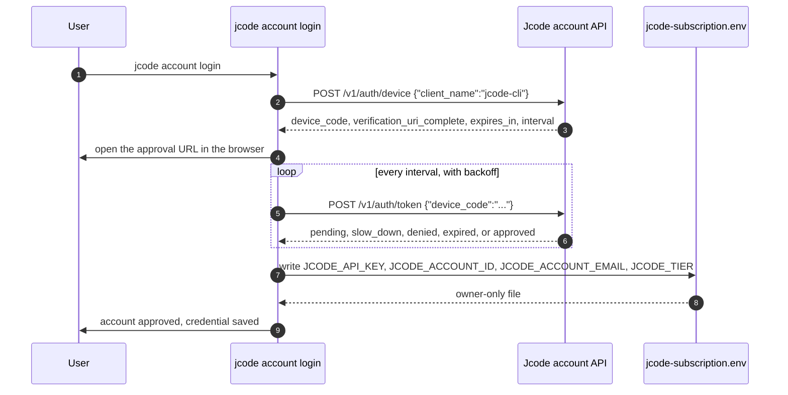
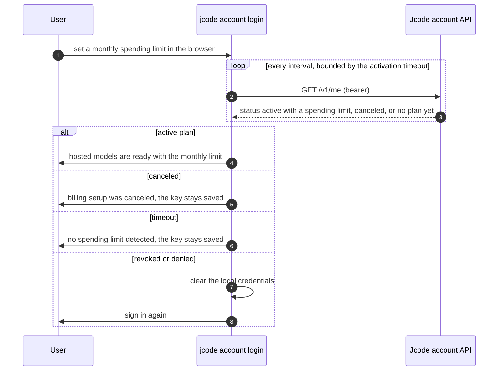
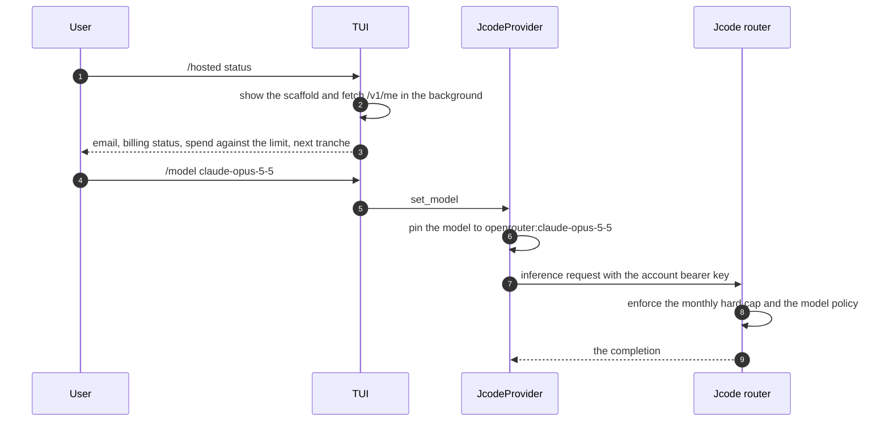
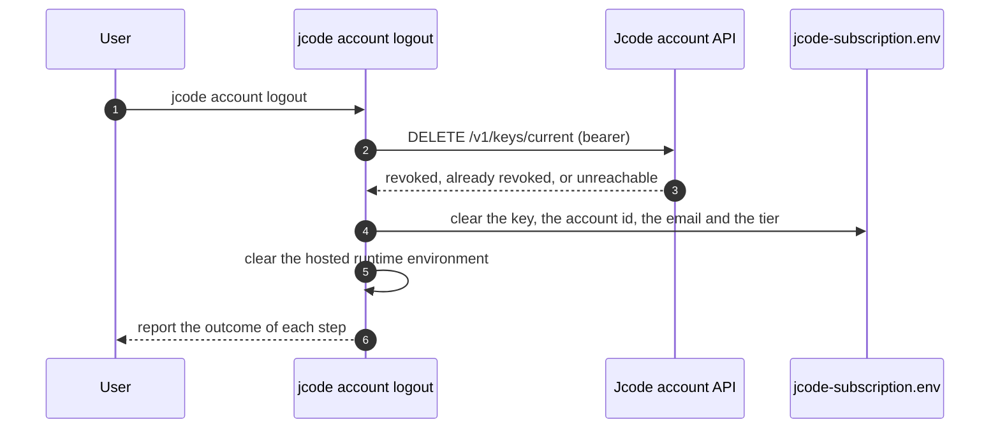

# Specification: Hosted Account and Plans

## Overview

The hosted account is implemented in three layers.
`crates/jcode-base` owns the protocol and the state: `subscription_api.rs` is the typed client for the account and billing API, `subscription_catalog.rs` owns the credential file, the plan tiers, the curated model catalog and the runtime environment, `subscription_notice.rs` turns a plan-allowance hit into a user-facing notice, and `account_login.rs` is a reusable device-authorization and email-code login that never chooses a provider and never activates billing on its own.
`src/cli` owns the terminal surface: `src/cli/args.rs` defines the `jcode account` subcommands, `src/cli/account.rs` implements status, manage and logout, and `src/cli/login/jcode_device.rs` orchestrates the browser-first device flow and the plan-activation wait.
`crates/jcode-tui` owns the interactive surface: `auth_account_commands.rs` parses `/hosted`, `/subscription` and `/account jcode ...`, `auth_subscription_status.rs` renders the hosted account status and the live spend, and `subscribe_nudge.rs` delivers the rate-limited invitation to try hosted models.
The hosted route itself is a provider in `crates/jcode-base/src/provider/jcode.rs`, which pins every curated model to the managed Jcode router transport, and the spending balance is reported by `crates/jcode-base/src/usage/provider_fetch.rs`.
This document was reverse-engineered from the existing codebase during an SDLC sync.

## Architecture

```
  CLI user                                  TUI / Desktop user
     |                                              |
     v                                              v
+-------------------------------------+  +-----------------------------------+
| jcode account login|status|manage|  |  | /hosted  /subscribe              |
| logout                             |  | /hosted status                    |
|   src/cli/args.rs   (subcommands)  |  | /login jcode                      |
|   src/cli/account.rs (status,       |  | /account jcode status|manage|     |
|                     manage, logout)|  |            logout                  |
|   src/cli/login/jcode_device.rs     |  |   crates/jcode-tui/.../app/       |
|     (device flow + activation wait) |  |     auth_account_commands.rs      |
|   src/cli/login/jcode_device/       |  |     auth_subscription_status.rs   |
|     tests.rs                        |  |     auth.rs (jcode login/logout)  |
+-------------------------------------+  |     subscribe_nudge.rs            |
     |                                  +-----------------------------------+
     |                                              |
     +-------------------+--------------------------+
                         v
+---------------------------------------------------------------+
| crates/jcode-base                                             |
|  account_login.rs       device flow, email code, save/current |
|  subscription_api.rs    typed client, /v1/me, billing, revoke  |
|  subscription_catalog.rs tier, catalog, credentials, env       |
|  subscription_notice.rs  plan-limit notice, upgrade card        |
|  provider/jcode.rs      JcodeProvider, curated route           |
|  usage/provider_fetch.rs  inference spending balance            |
+---------------------------------------------------------------+
     |  Authorization: Bearer <account key>
     v
+---------------------------------------------------------------+
| Jcode account API   https://api.jcode.sh/v1 (JCODE_API_BASE)  |
|   POST   /v1/auth/device        start the device flow          |
|   POST   /v1/auth/token         exchange the device code       |
|   POST   /v1/auth/email/start   send a sign-in code            |
|   POST   /v1/auth/email/verify  check the sign-in code         |
|   GET    /v1/me                 canonical account and usage    |
|   DELETE /v1/keys/current       revoke the account key         |
|   GET    /v1/billing             billing state                 |
|   PUT    /v1/billing/hard-cap    set the monthly hard cap      |
|   POST   /v1/billing/portal     Stripe billing portal session  |
|   POST   /v1/billing/subscribe  Stripe Checkout session        |
|   POST   /v1/billing/plan       change the plan                |
+---------------------------------------------------------------+
     |  enforces the spending limit, picks the upstream, bills
     v
+---------------------------------------------------------------+
| Jcode router (server side)                                    |
|   monthly hard cap   model policy   tranche billing            |
+---------------------------------------------------------------+
     ^
     |  curated model ids pinned to openrouter:<model>
+---------------------------------------------------------------+
| Hosted provider transport (OpenRouter runtime,                 |
| transport state "jcode-subscription")                          |
+---------------------------------------------------------------+
```

The credential file is the only piece of state the client owns.
`jcode-subscription.env` holds `JCODE_API_KEY`, `JCODE_ACCOUNT_ID`, `JCODE_ACCOUNT_EMAIL` and `JCODE_TIER`, and it is separate from `JCODE_API_BASE` because the base is endpoint configuration rather than a credential.
The client never enforces the spending limit and never picks an upstream.
The router does both, which is why the curated catalog is a single flat list with no client-side tier gate.

## Data Models

### Subscription profile

The canonical account record returned by `GET /v1/me`.

| Field | Type | Constraints | Description |
|---|---|---|---|
| account_id | String | not null | Stable account identifier. |
| email | String | not null | The account email address. |
| tier | String | not null | Wire tier value: `none`, `plus`, `pro`, `max`, `ultra` or `flagship`. `none` is the metered account. |
| status | String | not null | Account status, for example `active`, `inactive`, `canceled`. |
| usage | SubscriptionUsage | defaults to zero | The spend against the monthly limit and the tranche state. |
| manage_url | Option\<String\> | Optional, https, allowlisted origins only | The public account-management page. Never carries a secret. |
| capabilities | SubscriptionCapabilities | defaults to false | Server-verified entitlements such as `voice_transcription` and `remote_compile`. |
| jev_usage | Option\<JevUsage\> | Optional | Daily allowances for the included features, memory recall and browser automation. |

Derived helpers on the profile:

| Helper | Rule |
|---|---|
| `parsed_tier()` | Parses `tier` into `JcodeTier`, case-insensitively. `none` and an unknown value both yield `None`. |
| `has_active_paid_plan()` | True when `status` is `active` and either the spending limit is above zero or a tier is present. |
| `checkout_was_canceled()` | True when `status` is `canceled` or `cancelled`. |

### Subscription usage

The spending limit and the tranche state.

| Field | Type | Constraints | Description |
|---|---|---|---|
| used_usd | f64 | Default 0 | Inference spend so far in the current period. |
| budget_usd | f64 | Default 0, aliases `spend_limit_usd` and `limit_usd` | The user-selected monthly spending limit. |
| billed_usd | f64 | Default 0 | The amount already collected in billing tranches this month. |
| next_charge_at_usd | Option\<f64\> | Optional | The usage amount at which the next tranche is collected. |
| resets_at | Option\<String\> | Optional, RFC 3339 | When the usage window resets. |

### Account status

The rendered account state, in two shapes.

| Shape | Field | Description |
|---|---|---|
| CLI text | Email | The account email. |
| CLI text | Plan | The tier display name, falling back to the raw wire tier, followed by the account status. |
| CLI text | Usage | The used amount and the monthly limit, formatted as dollars. |
| CLI text | Resets | The reset timestamp, when the account reports one. |
| CLI text | Manage | The allowlisted management URL, falling back to `https://jcode.sh/account`. |
| CLI json | SubscriptionMe | The parsed account payload, pretty-printed. |
| TUI activity | Email, Billing, Spend, Billed, Next tranche, Resets | The live account read from `/v1/me` on a background task. |
| TUI scaffold | Credentials, Router base, Billing, Runtime mode, Catalog, Billing rules | The static status block shown before the live read completes. |

### Hosted account credential

What the client persists in `jcode-subscription.env`.

| Field | Type | Constraints | Description |
|---|---|---|---|
| JCODE_API_KEY | String | not null, never empty, owner-only file | The account key. Sent only as a bearer token. |
| JCODE_ACCOUNT_ID | String | Optional, cleared on logout | Non-secret account identity. |
| JCODE_ACCOUNT_EMAIL | String | Optional, cleared on logout | Non-secret account identity. |
| JCODE_TIER | String | Optional, cleared on logout | The last tier the backend reported. |
| JCODE_API_BASE | String | Optional, retained on logout | The account API base URL. Endpoint configuration, not a credential. |

### Plan tier

The legacy tier ladder, kept for compatibility with account servers that still answer with a tier shape.

| Field | Type | Constraints | Description |
|---|---|---|---|
| value | JcodeTier | One of Plus, Pro, Max, Ultra, Flagship | The tier. `Flagship` displays as `Solo`. |
| retail_price_usd | u32 | 10, 20, 100, 200, 1000 | The list price of the tier. |
| usable_budget_usd | f64 | Twice the retail price | The inference allowance the tier buys. |
| min_tier | JcodeTier | `Plus` for every curated model today | The minimum tier that may use a curated model. |

### Curated hosted model

The hosted catalog.

| Field | Type | Constraints | Description |
|---|---|---|---|
| id | &'static str | One of `claude-opus-5-5`, `claude-sonnet-5-5`, `claude-haiku-5-5`, `gpt-6.1-sol` | The canonical model id. |
| display_name | &'static str | not null | The name shown in the TUI. |
| aliases | &'static [&'static str] | not null | The names that resolve to the id, including spaced and short forms. |
| default_enabled | bool | `true` only for the flagship | The fallback when no flagship can be ranked. |
| routing_policy | UpstreamRoutingPolicy | `ServerManaged` | The routing is decided server-side by the Jcode router. |
| min_tier | JcodeTier | `Plus` | The minimum tier, retained for compatibility. |
| note | &'static str | not null | The one-line description shown in the status surface. |

### Plan-limit notice

The notice produced when an included daily allowance is exhausted.

| Field | Type | Constraints | Description |
|---|---|---|---|
| feature | String | `memory` or `browser` in practice | Which included feature hit its limit. |
| tier | Option\<String\> | Optional | The current plan. |
| upgrade_tier | Option\<String\> | Optional | The plan that raises the limit. |
| upgrade_url | Option\<String\> | Optional, https and restricted to jcode.sh | Where to upgrade. |
| resets_at | Option\<String\> | Optional | When the daily allowance resets. |

## API Contracts

The client does not own an HTTP surface for this feature.
The contract is a set of CLI and TUI commands plus the remote account API this repository consumes, so the tables below describe the callable surfaces and the remote endpoints rather than local routes.
The account API is owned by the Jcode service, and the client-side contract is the typed wrapper in `crates/jcode-base/src/subscription_api.rs`.

### CLI surface

| Command | Purpose |
|---|---|
| `jcode account login [--no-browser]` | Run the browser device authorization, then wait for plan activation. `--no-browser` prints the public approval URL instead of opening a browser. |
| `jcode account status [--json]` | Report the canonical account, the plan and the usage from `/v1/me`. |
| `jcode account manage` | Open `https://jcode.sh/account` in the browser, or print the URL when browser launch is suppressed. |
| `jcode account logout` | Revoke the key when reachable, then always clear the local credential and cache. |

### TUI surface

| Command | Purpose |
|---|---|
| `/hosted` | Show the hosted-model pitch: no subscription, a user-controlled monthly limit, milestone warnings, and the curated catalog. |
| `/subscribe` | Alias for `/hosted`. |
| `/hosted status` | Show the hosted account status, the router configuration and the billing rules. |
| `/subscription`, `/subscription status` | Aliases for `/hosted status`. |
| `/login jcode`, `/account jcode login` | Start the hosted account login in the TUI. |
| `/account jcode status` | Show the hosted account status. |
| `/account jcode manage` | Open the account management page. |
| `/account jcode logout` | Revoke the key when reachable and clear the local credential. |
| `/usage` | Show the inference spending balance and the daily feature allowances. |

### Account API

| Method | Path | Purpose |
|---|---|---|
| POST | /v1/auth/device | Start a device authorization. Body: `{"client_name":"jcode-cli"}`. |
| POST | /v1/auth/token | Exchange the device code. Body: `{"device_code":"..."}`. |
| POST | /v1/auth/email/start | Send a sign-in code. Body: `{"client_name":"jcode-cli","email":"..."}`. |
| POST | /v1/auth/email/verify | Check the sign-in code. Body: `{"login_token":"...","code":"..."}`. |
| GET | /v1/me | The canonical account, the usage and the plan. Bearer auth. |
| DELETE | /v1/keys/current | Revoke the account key. Bearer auth. |
| GET | /v1/billing | The billing state, the monthly hard cap and the period spend. Bearer auth. |
| PUT | /v1/billing/hard-cap | Set the monthly hard cap in whole cents. Bearer auth. |
| POST | /v1/billing/portal | Create a Stripe billing portal session. Bearer auth. |
| POST | /v1/billing/subscribe | Create a Stripe Checkout session for a monthly plan. Bearer auth. |
| POST | /v1/billing/plan | Change the plan of an active subscription. Bearer auth. |

Error codes shared across endpoints:

| Status | Code | Description |
|---|---|---|
| 400 | `authorization_pending`, `pending` | The browser approval has not happened yet. The client keeps polling. |
| 400 | `slow_down` | The client is polling too fast. The client backs off. |
| 400 | `expired_token`, `expired`, `expired_device_code` | The device code is gone. The client starts a new flow. |
| 400 | `access_denied`, `denied` | The user denied the request in the browser. |
| 400 | `invalid_code` | The emailed sign-in code is wrong. The response may carry `attempts_remaining`. |
| 401 | - | The account key is revoked or expired. The client clears the local credential. |
| 403 | - | The account request was denied. |
| 404 | - | The configured account API uses the legacy email-based contract. |
| 428 | - | The device flow is still pending approval. |
| 429 | - | The client is polling too fast. The `Retry-After` header sets the next delay. |
| 5xx | - | The account service is temporarily unavailable. The client retries with backoff. |

## Sequences

### Sign in



### Activate the plan



### Switch to hosted models



### Log out



## Technical Decisions

| Decision | Choice | Rationale |
|---|---|---|
| Sign-in protocol | Browser device authorization | No secret is typed in the terminal and no email is sent, so the terminal never handles a credential the user could paste somewhere unsafe. |
| Client name on the device request | Always `jcode-cli` | The deployed API rejects `jcode-desktop` with HTTP 400, so Desktop reuses the shared contract rather than an unrecognized name. |
| Where the spending limit is set | The browser at `https://jcode.sh/account` | The limit is a billing decision, and the account page already holds the payment method. The terminal stays a reader of the limit, not a writer. |
| Where the limit is enforced | Server-side in the Jcode router | A client-enforced limit can be bypassed by a modified client. The client therefore only reports the limit, never gates on it. |
| Client-side model gating | Flat curated catalog, no tier gate | A stale cached tier must never hide a router-supported model, so the tier ladder is kept for compatibility but does not filter the catalog. |
| Route pinning | Every hosted model becomes `openrouter:<model>` | Hosted model ids overlap with direct provider ids, so a bare id would let the family heuristic escape to the user's own Anthropic or OpenAI credentials. |
| Runtime mode | An environment flag set when the hosted provider is constructed | The flag is what tells the rest of the runtime that the managed transport is live, and clearing it is what makes the opt-out immediate. |
| Credential storage | One owner-only env file next to the other provider keys | The account key then reuses the existing secret writer, permission hardening and clearing paths rather than introducing a second store. |
| API base retention on logout | Retained | The API base is endpoint configuration, not an authorization credential, so clearing it would break a self-hosted account setup for no security gain. |
| Local cleanup on logout | Unconditional and first-class | The CLI can always enforce the local security boundary, even offline, so remote revocation is treated as best effort. |
| URL validation | Allowlist of public origins plus a shape check | A URL returned by the account service is untrusted input, so the client checks the scheme, the host, the port, the path, the query and the fragment before opening it. |
| Plan-limit notices | A single remembered notice, taken once | A busy background feature must not spam the transcript, and one card per session keeps the surface readable. |
| Upgrade path | Always the browser | Nothing is purchased in-app, so the upgrade card opens the pricing page rather than embedding a payment flow. |
| Telemetry | Only the coarse `auth_success` event | The account email and the spending limit are personal and financial data, so they never leave the machine. |

## Risks and Unknowns

1. The metered plan and the legacy `JcodeTier` ladder are both live in the code, and only the metered plan drives the catalog and the limit.
   The ladder is currently only exercised by compatibility tests.
2. `budget_usd` is the canonical wire name for the spending limit while the user-facing wording is "spending limit", and the older names `spend_limit_usd` and `limit_usd` are still accepted as aliases.
3. The account API exposes a full billing surface (hard cap, portal, checkout, plan change) that the current user flow never calls, because the browser owns the limit.
   Those endpoints are tested but not reachable from a command.
4. The hosted model catalog is a static list in the client.
   Adding a model is a client release, and the router may support models the client cannot name.
5. The activation wait depends on the account service reporting an active plan within 10 minutes.
   A slow checkout leaves the user with a saved key and no hosted routing until they retry.
6. A single-use device code can be consumed by a canceled exchange, so a canceled login requires a new flow rather than a resume.
7. The email-code sign-in path exists in the shared library but is not wired to a TUI or CLI command, so it is exercised only by library tests.
8. There are no dedicated `subscription_*` telemetry events.
   The only signal for this feature is the coarse `auth_success` event with the hosted provider and the device-code browser method, so plan changes and limit changes are not measurable in aggregate.

## Out of Scope

- The Jcode account service itself, its storage, its billing and its router implementation.
- The Jcode Cloud control plane, the host provisioning and the cloud entitlement ladder described in `docs/JCODE_CLOUD_AWS.md`.
- The Stripe billing portal, checkout and plan-change flows, which the client can call but does not expose.
- The hosted model catalog contents, which the server owns and the client mirrors.
- The Desktop rendering of the hosted account surfaces, which lives outside this repository.
