# Architecture

## System Overview

Fusion is a monorepo of TypeScript packages.
A React dashboard SPA with an embedded Express API server and a terminal CLI/TUI both drive one shared domain model and task store.
The engine package performs the automated work (triage, scheduling, execution, review, merge, self-healing).
The desktop (Electron) and mobile (Capacitor) shells wrap the dashboard through a shared `window.fusionShell` bridge.
The desktop shell runs a local Fusion server, and the mobile shell is a remote client of a Fusion server.
Several machines (nodes) can share one PostgreSQL backend through the mesh protocol.
A plugin layer (`@fusion/plugin-sdk` and `plugins/*`) extends dashboard routes, engine runtimes, and tools.
Two npm packages are published: `@runfusion/fusion` (the CLI plus a `pi` extension) and `runfusion.ai` (a thin alias that boots the same CLI).
The `@fusion/*` packages are not published on their own, they are bundled into the published CLI.

```
┌───────────────┬──────────────────────────────────────────────────────────────┐
│  Surfaces                                                                    │
│  Dashboard SPA (React)   CLI/TUI (fn)   Desktop (Electron)   Mobile          │
│  ──────────────────────────────────────────────────────────────────────────  │
│  @runfusion/fusion   (fn commands, terminal TUI, serve/daemon, pi extension) │
│  @fusion/dashboard   (web UI + Express API, domain routes, /api/events)      │
│  @fusion/plugin-sdk + plugins/*   (dashboard routes, engine runtimes, tools) │
└───────────────┬──────────────────────────────────────────────────────────────┘
                │  static imports / REST + SSE event bus
┌───────────────▼──────────────────────────────────────────────────────────────┐
│  @fusion/core   (domain model + task store: task-store/, workflows/,         │
│                 planner/, agents/, missions/, goals/, research/, secrets/,   │
│                 settings, mesh/, plugins/)                                   │
└───────────────┬──────────────────────────────────────────────────────────────┘
                │  Domain API (no raw DB access outside core)
┌───────────────▼──────────────────────────────────────────────────────────────┐
│  @fusion/engine   (scheduler, triage, executor, merger, review,              │
│                    workflow-graph execution, self-healing, sandbox,          │
│                    agent heartbeat)                                          │
└───────────────┘
                │
      ┌────────▼────────┐      ┌─────────────────────┐
      │ PostgreSQL      │      │ Git worktrees /     │
      │ (embedded/runtime│      │ remote PRs (GitHub  │
      │  storage)        │      │  / GitLab)          │
      └─────────────────┘      └─────────────────────┘
```

## Entity Relationship Diagram

The diagram lists the core domain entities and their relationships.
The database holds 148 tables: 130 in the `project` schema (116 core tables plus 14 plugin-owned tables), 17 in `central`, and 1 in `archive`.
Most `project` schema rows carry a `project_id` partition key instead of a foreign key to `central.projects`, so project scoping is a partitioning relationship.
Column types, constraints, and indexes live in `schema.dbml`.

```mermaid
erDiagram
    projects ||--o{ tasks : "scopes"
    projects ||--o{ automations : "schedules"
    projects ||--o{ secrets : "holds"
    projects ||--o{ incidents : "tracks"
    nodes ||--o{ projects : "hosts"
    nodes ||--o{ peer_nodes : "peers"
    nodes ||--o{ task_claims : "claims"
    tasks ||--o{ task_documents : "has"
    tasks ||--o{ task_document_revisions : "revisions"
    tasks ||--o{ artifacts : "has"
    tasks ||--o{ activity_log : "triggers"
    tasks ||--o{ agents : "bound_to"
    tasks ||--o{ merge_queue : "queued_in"
    tasks ||--o{ merge_requests : "merges_via"
    tasks ||--o{ workflow_work_items : "instantiates"
    tasks ||--o{ workflow_run_branches : "lands_in"
    tasks ||--o{ workflow_run_step_instances : "runs"
    tasks ||--o{ task_workflow_selection : "selects"
    tasks ||--o{ task_lifecycle_events : "emits"
    tasks ||--o{ cli_sessions : "drives"
    tasks ||--o{ task_commit_associations : "linked_to_commits"
    tasks ||--o{ usage_events : "records_usage"
    tasks ||--o{ pull_requests : "opens"
    tasks ||--o{ approval_requests : "requests_approval"
    tasks ||--o{ run_audit_events : "audits"
    tasks ||--o{ mission_features : "implements"
    tasks ||--o{ eval_task_results : "scored_by"
    workflows ||--o{ workflow_steps : "defines"
    workflows ||--o{ task_workflow_selection : "selected_by"
    agents ||--o{ agent_heartbeats : "emits"
    agents ||--o{ agent_runs : "executes"
    agents ||--o{ agent_task_sessions : "sessions"
    agents ||--o{ agent_ratings : "rated_by"
    agents ||--o{ agent_activity_events : "emits"
    agents ||--o{ chat_sessions : "chats"
    agents ||--o{ chat_room_members : "joins"
    chat_sessions ||--o{ chat_messages : "contains"
    chat_sessions ||--o{ chat_token_usage : "accounts_for"
    chat_sessions ||--o{ cli_sessions : "runs"
    chat_rooms ||--o{ chat_room_members : "members"
    chat_rooms ||--o{ chat_room_messages : "messages"
    missions ||--o{ milestones : "contains"
    milestones ||--o{ slices : "contains"
    slices ||--o{ mission_features : "contains"
    missions ||--o{ mission_goals : "linked_to"
    goals ||--o{ mission_goals : "linked_from"
    milestones ||--o{ mission_contract_assertions : "validates"
    mission_features ||--o{ mission_validator_runs : "validated_by"
    mission_validator_runs ||--o{ mission_validator_failures : "produces"
    research_runs ||--o{ research_exports : "exports"
    research_runs ||--o{ research_run_events : "logs"
    eval_runs ||--o{ eval_task_results : "scores"
    eval_runs ||--o{ eval_run_events : "logs"
    experiment_sessions ||--o{ experiment_session_records : "records"
    pull_requests ||--o{ pull_request_thread_state : "review_threads"
    branch_groups ||--o{ pull_requests : "opens"
    project_insight_runs ||--o{ project_insight_run_events : "logs"
    todo_lists ||--o{ todo_items : "contains"
    approval_requests ||--o{ approval_request_audit_events : "audits"
    incidents }o--|| tasks : "fixed_by"
```



## Key Components

| Component | Responsibility | Technology |
|---|---|---|
| `@runfusion/fusion` (`packages/cli`) | `fn` command surface, terminal TUI, HTTP API server and daemon host, `pi` extension carrier | Node.js CLI, Ink (React for the terminal), Express, pnpm-packed |
| `runfusion.ai` (`packages/cli-alias`) | npm alias so `npx runfusion.ai` boots the dashboard; forwards every other argument to `@runfusion/fusion` | Node.js, npm alias package |
| `@fusion/dashboard` | React SPA (board, task detail, planning mode, command center) plus an Express API server whose routes are mounted by domain registrars under `packages/dashboard/src/routes/` | React 19, Express 5, i18next, EventSource/SSE |
| `@fusion/core` | Domain model and task store: tasks, lifecycle moves, workflow IR, planner and overseer state, agents, missions, goals, research, secrets, settings, mesh and project registries, plugins; PostgreSQL persistence through Drizzle ORM (table definitions under `packages/core/src/postgres/schema/`) | TypeScript, Drizzle ORM, PostgreSQL (embedded-postgres PG15) |
| `@fusion/engine` | Triage, scheduler, executor (agent sessions), merger (squash, rebase, conflict resolution), workflow review service, workflow-graph executor and node runners, self-healing sweeps, agent heartbeat | TypeScript, pi coding agent SDK, MCP SDK |
| `@fusion/desktop` / `@fusion/mobile` | Native shells wrapping the dashboard SPA through a shared `window.fusionShell` bridge; the desktop shell runs a local server and the mobile shell connects to a remote one | Electron 35 / Capacitor 8 |
| `@fusion/i18n` | Locale catalogs and shared i18next configuration used by the dashboard and the CLI | i18next |
| `@fusion/plugin-sdk`, `plugins/*` | Third-party plugin authoring SDK and the bundled first-party plugin directories | TypeScript |
| `packages/pi-claude-cli`, `packages/droid-cli`, `packages/pi-llama-cpp` | First-party `pi` extensions that route model calls into different coding-agent runtimes (Claude Code CLI, Droid CLI, llama.cpp HTTP server) | TypeScript, pi coding agent SDK |

## Data Flow

- Tasks are created from the dashboard, the CLI, imports, or mission and research flows, and are stored in `@fusion/core`'s task store in PostgreSQL.
- Triage and the scheduler claim eligible tasks.
- The executor opens a permission-bounded agent session and drives it inside an isolated git worktree.
- The workflow-graph executor advances the graph through planning, code, review, gate, and merge node runners.
- The merger lands the branch into the default branch (squash by default) or drives a GitHub or GitLab pull request, guarded by file-scope, lineage, and diff-volume checks.
- Self-healing sweeps and the scheduler reconcile stranded state.
- The dashboard receives lifecycle events over the shared `/api/events` SSE bus.
- External signals from GitHub, GitLab, Sentry, Datadog, PagerDuty, and generic webhooks arrive through signed connectors into the Command Center.

## Infrastructure

- **CI/CD:** GitHub Actions (`.github/workflows/`): `pr-checks.yml` (thin merge gate: lint, typecheck, build, gate), `full-suite.yml` (non-blocking on `main`), plus mobile, desktop packaging, release, version, test-release, and security-scan workflows.
- **Storage:** PostgreSQL runtime storage through Drizzle ORM (148 tables across the `project`, `central`, and `archive` schemas; embedded-postgres PG15 binaries for local runs; table definitions under `packages/core/src/postgres/schema/`; see `docs/storage.md`); retained SQLite files are migration inputs and operator backups only.
- **Observability:** structured diagnostic logging (see `docs/diagnostics.md`), append-only run-audit event rows, the durable agent activity stream, and Command Center health, usage, and metrics surfaces.
- **Packaging:** `pnpm` workspace; desktop and mobile signed installers (macOS and Windows signing scripts); Docker builds (`Dockerfile`, `docs/docker.md`).
- **Localization:** i18next catalogs for en, es, fr, ko, pt-BR, zh-CN, and zh-TW, with translated READMEs in the same languages.

## Architecture Decisions

Formal records live under `.sdlc/knowledge/decisions/` (empty at initial sync). Key known decisions:
- The `@fusion/*` packages are not published on their own; they are bundled into the published `@runfusion/fusion` CLI and the `runfusion.ai` alias.
- Cross-`@fusion/*` imports are statically analyzable; `@fusion/core` injects agent creation through DI to break the core and engine cycle.
- Workflow-graph nodes own plan, code, and browser review exclusively; there is no second review authority inside an implementation session.
- The merge gate is deliberately thin; broad verification runs non-blocking.
- PostgreSQL is the runtime store; the SQLite files are migration inputs and operator backups only.
- Releasing is operator-only and driven by `pnpm release` (see `scripts/release.mjs`).
