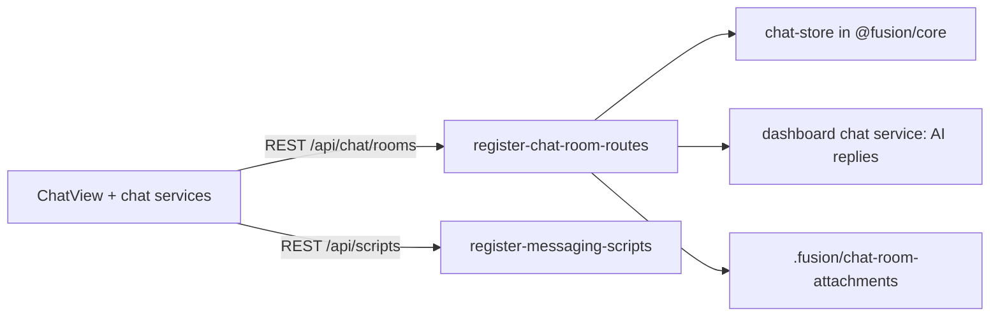

# Specification: Chat Rooms & Messaging

## Overview

Chat persistence lives in `@fusion/core` (`chat-store.ts`, `chat-types.ts`) and is exposed through dashboard Express registrars (`register-chat-room-routes.ts`, `register-messaging-scripts.ts`, plus `chat-project-services.ts` for project scoping). AI replies are produced via the dashboard chat service with a typed `RoomReplyGenerationError`. Attachments are streamed to disk under `.fusion/chat-room-attachments/<roomId>` with basename and prefix validation.

## Architecture

## Data Models

### ChatRoom

| Field | Type | Constraints | Description |
|---|---|---|---|
| id | text | PK, not null | Room identifier |
| slug | text | unique, not null | Human-readable room key |
| status | text | not null | Room status |
| thinkingLevel | text | nullable | Per-room thinking level override |

### ChatRoomMember

| Field | Type | Constraints | Description |
|---|---|---|---|
| roomId | text | FK, not null | Owning room |
| agentId | text | not null | Member agent |

### ChatMessage

| Field | Type | Constraints | Description |
|---|---|---|---|
| id | text | PK, not null | Message identifier |
| roomId | text | FK, not null | Owning room |
| metadata | json | validated | Validated message metadata |

## API Contracts

Summary; full schemas live in the route implementations.

| Method | Path | Purpose |
|---|---|---|
| GET | /api/chat/rooms | List rooms |
| POST | /api/chat/rooms | Create a room |
| GET | /api/chat/rooms/:id | Fetch one room |
| PATCH | /api/chat/rooms/:id | Update a room |
| DELETE | /api/chat/rooms/:id | Delete a room |
| GET/POST/DELETE | /api/chat/rooms/:id/members... | Manage membership |
| GET/POST/DELETE | /api/chat/rooms/:id/messages... | Manage messages |
| POST/GET | /api/chat/rooms/:id/attachments... | Upload and fetch attachments |
| GET/PUT/DELETE | /api/scripts... | Manage saved messaging scripts |

## Key Sequences

- Post message: validate metadata, persist via chat-store, optionally trigger AI reply generation, return message or typed generation error.
- Upload attachment: check MIME allowlist and size caps, basename the filename, verify the resolved path stays under the room directory, stream to disk.

## Technical Decisions

- Rate limits are split (`RATE_LIMITS.api` for reads, `RATE_LIMITS.mutation` for writes).
- Attachment validation is defense in depth: MIME allowlist plus size caps plus path containment.
- Only PlanningMode chat is covered by FEAT-p3; team rooms are this feature's scope.

## Risks and Unknowns

- Whether rooms should reference tasks or missions is undecided (see requirements open questions).
