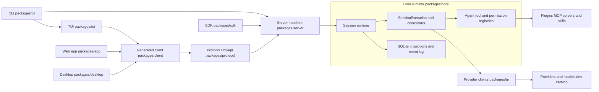
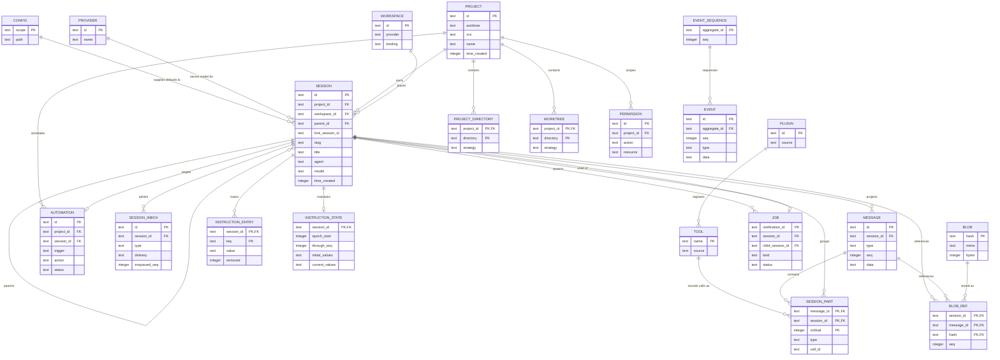
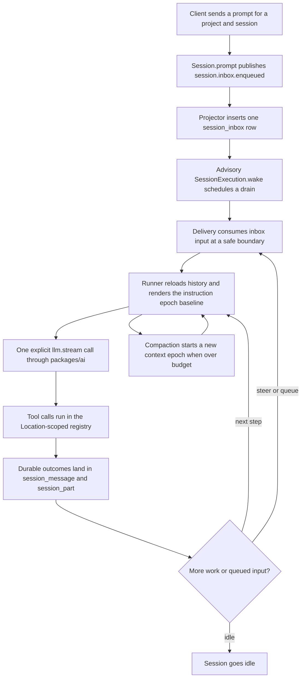

<!-- session_link: http://localhost:10000/?session=ses_df5cc15baffea6HFTvAOmQ6bxA -->
# Architecture

## System Overview

OpenCode is a TypeScript monorepo using Bun workspaces over `packages/*`, `packages/plugins/*`, `packages/data/*`, and `services/*`, with a Rust native CLI under `packages/cli-rs`.
A core runtime owns sessions, the tool registry, model resolution, and storage.
Thin clients (CLI, TUI, web, desktop, and SDK) compose on top of that runtime through the public HTTP contract.

## Entity Relationship Diagram

The durable tables live in `packages/core/src/database/schema.gen.ts`, with the generated DBML view in `schema.dbml`.
Conceptual entities (Config, Provider, Plugin, Tool) come from the config, catalog, and plugin host code and have no table of their own.
The full schema with types, constraints, and indexes lives in `schema.dbml`.

## Key Components

| Component | Responsibility | Technology |
|---|---|---|
| `packages/cli` | CLI entry: launches TUI, ACP server, and server process (`src/index.ts`, `src/acp/`, `src/run/`, `src/server-process.ts`) | TypeScript, Bun |
| `packages/cli-rs` | Native CLI (`opencode-native`) with parity harnesses against the TypeScript client | Rust, OpenTUI |
| `packages/core` | Core runtime: sessions, agents, tools, config, permissions, models, plugins, database, and PTY support | TypeScript, Effect, Drizzle |
| `packages/server` | HTTP API implementation: assembled router, per-domain handlers (`src/handlers/`), pairing, and event feed | Effect HttpApi |
| `packages/protocol` | Public HTTP API contract: `HttpApi` groups, middleware, and OpenAPI | Effect HttpApi |
| `packages/schema` | Shared Effect Schema definitions (IDs, datatypes, durable events) for client, protocol, and server | Effect |
| `packages/ai` | LLM provider clients, provider protocols, and provider catalog support (`src/providers/`, `src/protocols/`) | Effect |
| `packages/codemode` | Confined code execution runtime: schema-described tools and sandbox limits | Effect, TypeScript |
| `packages/tui` | Terminal UI implementation, including the mini variant and built-in feature plugins | SolidJS, OpenTUI |
| `packages/theme` | TUI theme definitions and palettes | TypeScript |
| `packages/app` | Web UI shell and SolidStart runtime, including the GUI plugin host | SolidJS, Tailwind, Vite |
| `packages/ui` | Shared web component library (icons, navigation, themes) | SolidJS |
| `packages/session-ui` | Reusable session timeline and message components | SolidJS |
| `packages/desktop` | Native desktop app wrapping the web UI, with the main-process GUI plugin host | Electron |
| `packages/gui-plugins` | Built-in desktop and web feature plugins (terminal, review, files, browser, SSH, updater) on the GUI plugin SDK | TypeScript |
| `packages/plugin` | Source for `@opencode/plugin`: authoring runtime, TUI built-ins, and the GUI plugin SDK under `src/gui/` | TypeScript |
| `packages/plugin-browser` | Desktop browser plugin (tabs, CDP, snapshot tools) via CodeMode | TypeScript |
| `packages/latex`, `packages/merman` | TUI code-block renderer plugins (LaTeX/math, Mermaid diagrams) | TypeScript |
| `packages/sdk` | Embeddable in-process host (`OpenCode.create()`) composing client, core, and server | TypeScript |
| `packages/client` | Generated TypeScript HTTP client (Promise and Effect APIs, do not edit) | TypeScript (generated) |
| `packages/httpapi-codegen` | Build-time Promise/Effect API generator from `HttpApi` | TypeScript |
| `packages/http-recorder` | Record/replay of Effect HTTP and WebSocket traffic with deterministic cassettes | Effect |
| `packages/simulation` | Loopback drive harness with simulated provider and network | TypeScript |
| `packages/util` | Shared cross-cutting utilities plus observability helpers (`src/observability/`) | TypeScript, Effect |
| `packages/data/core`, `packages/data/app`, `packages/data/server` | MySQL Drizzle schema, data API, and data site for usage stats and provider leaderboards | Drizzle, SolidStart, Cloudflare Workers |
| `packages/nav-menus`, `packages/patchmark` | Shared navigation menu definitions and diff markup helpers | TypeScript |
| `packages/stories` | Storybook stories used by Playwright component tests | Storybook, Playwright |
| `services/site`, `services/data`, `services/files`, `services/update`, `services/legacy` | Public website and docs, data service, file distribution, release updater, and legacy endpoints | SolidStart, Cloudflare Workers, Hono (legacy only) |
| `sdks/vscode` | VSCode editor extension | TypeScript |
| `.github/workflows` | GitHub Actions workflows for check, test, triage, release, nightly, and deploy | GitHub Actions |

## Data Flow

1. A client (TUI, web, desktop, SDK, or CLI) sends a prompt through the HTTP contract or an in-process host.
2. `Session.prompt` publishes `session.inbox.enqueued`, and the projector inserts one `session_inbox` row before advisory `SessionExecution.wake`.
3. Delivery consumes the inbox row at a safe step boundary and inserts a visible message into Session history.
4. The runner reloads history and renders the baseline for the current instruction epoch before each step.
5. The runner makes one explicit `llm.stream` call through `packages/ai` for the step.
6. Tool calls run through the Location-scoped registry, and durable outcomes land in `session_message` and `session_part`.
7. Oversized tool output spills to managed tool-output files, and compaction starts a new context epoch when the request exceeds the model budget.
8. Instruction changes are admitted as deltas and rendered once as chronological system messages when context sources change.

## Infrastructure

- **CI/CD:** GitHub Actions (`.github/workflows`) with 20 workflows covering check, test, triage, release, nightly, and deploy jobs.
- **Lint/format:** oxlint plus ast-grep rules (`script/ast-grep/`); `bun run check` runs lint plus turbo typecheck from the root.
- **Cloud:** Deploy workflows publish the site, data, files, and update services to Cloudflare Workers; usage data uses MySQL through `packages/data/core`.
- **Distribution:** npm (`@opencode/cli`), Homebrew, Scoop, Chocolatey, pacman, AUR, mise, Nix, plus an `install` script and GitHub releases for desktop builds.
- **Observability:** Effect telemetry and OpenTelemetry helpers in `packages/util/src/observability/`; Sentry is wired into the web and desktop clients.

## Architecture Decisions

- The session core keeps durable prompt admission (`session_inbox`) separate from model execution; see `AGENTS.md` (Session Core) and `specs/v2/` for the full algebra.
- One step is one logical LLM call, and history is reloaded before durable continuation.
- Provider support is data-driven through models.dev (`packages/core/src/plugin/models-dev.ts`) rather than per-provider code.
- Storage is SQLite accessed through Effect/Drizzle adapters (`packages/core/src/database/`).
- Runtime dependency direction is Schema to Core and Protocol, then to Server; client code may depend on Schema and Protocol but never Core or Server.
- Event replay ownership is separate from process-local Session execution ownership.
