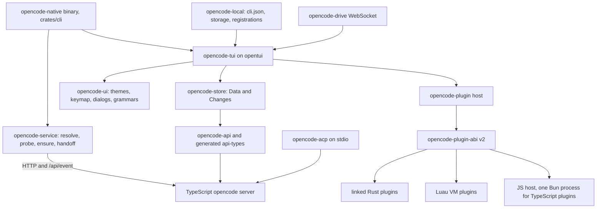
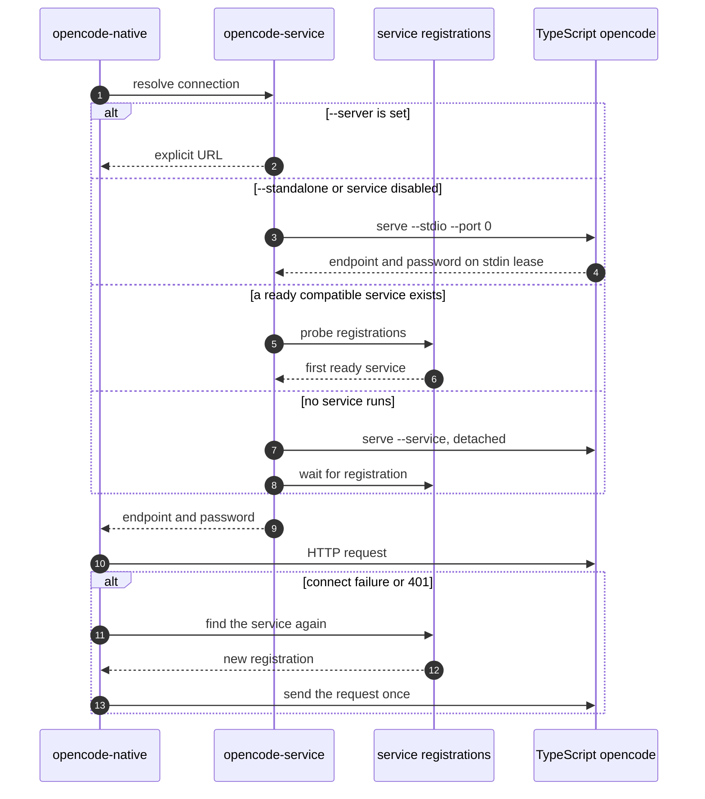
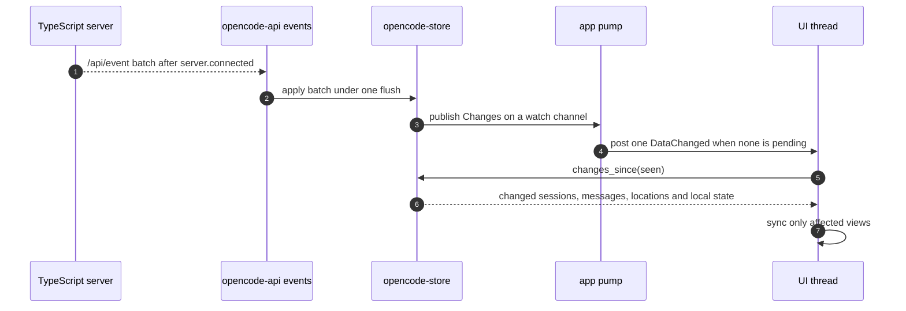
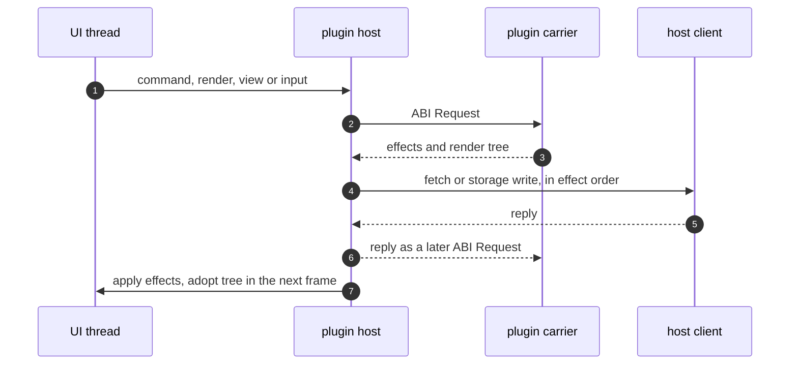

# Specification: Native Rust CLI

## Overview

The native client is a Rust workspace under `packages/cli-rs` that builds on OpenTUI Rust crates.
It is a client of the TypeScript `opencode` server and communicates over HTTP, server-sent events and WebSockets.
Each crate ports a TypeScript module of `packages/cli` or `packages/tui`, and each intended difference is recorded under `parity/deviations/`.
Generated bindings and fixtures come from the TypeScript sources, and `check:drift` fails when a committed output no longer matches.

## Architecture

Crates depend only on crates above them in this order: `util`, `api-types`, `api`, `local`, `service`, `store`, `plugin-abi`, `ui`, `plugin`, `latex`, `mermaid`, `tui`, `mini`, `acp`, `drive`, `parity`, `cli`.
Third-party crates are declared once in `[workspace.dependencies]`.
The root `Cargo.toml` pins `opentui` to an exact crates.io version, and `script/opentui-native.ts` installs the matching native library with a verified sha256.

## Data Models

### Generated API types

| Field | Type | Constraints | Description |
|---|---|---|---|
| SessionID, message IDs and other brands | newtype over string | Generated from branded string schemas | Keeps identity types distinct |
| String-literal enum fields | enum with `Unknown(String)` | Forward compatible | Reads values from newer servers |
| Object union fields | enum with `Unknown(serde_json::Value)` | Forward compatible | Reads shapes from newer servers |
| Optional nullable field | `Option<Option<T>>` | Two levels | Absent stays distinct from `null` |
| Declared server error | struct implementing `TaggedError` | `_tag` or `name` on the wire | Maps server errors into Rust errors |

### Client-local files

| Path or key | Type | Constraints | Description |
|---|---|---|---|
| `<config>/cli.json` | JSONC `Info` | Strict decoding, whole document becomes `{}` on a type error | Config shared with the TypeScript client, with comments and formatting preserved on writes |
| `<state>/<channel>/tui/<key>.json` | `serde_json::Value` | Unknown fields survive a write | TUI storage shared with the TypeScript client |
| JSONL files | prompt history, stash and frecency records | Append and compact through a lock | Client-local prompt state |
| `<state>/model.json` | model preference | Shared path and format | Selected model and variant |
| `<state>/session.json` | pinned sessions | Shared path and format | Pinned session IDs |
| `<state>/service.json` or `service-<channel>.json` | service registration and config | Locked, channel aware | Service address, password and state |
| `<state>/plugin-approvals.json` | plugin directory to digest map | Private, locked file | Decisions to run project plugins |

### Store

| Field | Type | Constraints | Description |
|---|---|---|---|
| `Data` | cheap `Clone` handle around one locked `State` | Never holds the lock across an await | Read API for views and plugins |
| `State` | sessions, families, status, messages, parts, inbox items, permissions, forms, projects, shells, locations | Port of the TypeScript `createData` | Client copy of server state |
| `Changes` | union of touched things | Last 256 revisions kept | Drives independent view updates through `changes_since(seen)` |
| event batch | list of server events | Applied under one flush | Reconnect invalidates cached reads and `server.connected` rehydrates |

### Plugin ABI 2.0

| Field | Type | Constraints | Description |
|---|---|---|---|
| `Manifest` | registrations from setup | One schema in `crates/plugin-abi/schema/v2.json` | Commands, layers, slots, routes, surfaces, storage keys and event handlers |
| `Request` | host to plugin message | Answer described by `x-messages` in the schema | Render, view, input, command, search and lifecycle calls |
| `HostRequest` | plugin to host message | Answer described by `x-messages` in the schema | Reads and effects such as storage, dialogs, fetch and navigation |
| `v2::Node` and `Node` | keyed render trees | Bounded by node, row, text and content limits | What the host reconciles and draws |
| `Surface` | route, slot, panel, overlay or dialog body | Each showing is a mount with a generation | Owns widgets, memo table, key layers and requests |
| `Fence` | code block claim with a key and width | At most one fence node per claim tree | Draws LaTeX, Mermaid and other code fence outputs |

The schema is generated from the Rust types and referenced by the Luau and TypeScript bindings.
Minor 2.x versions add optional fields, request types and node kinds, and readers ignore unknown fields.

### ACP messages

ACP runs as JSON-RPC on standard input and output.
The Rust crate owns capabilities, catalogs, sessions, turns, permissions, elicitation, slash commands, config options, content blocks and cancellation.
Session and permission state is translated to and from the server API, and transcripts are recorded byte for byte for parity.

## API Contracts

This feature defines no new public HTTP endpoint.
It consumes the server's `ClientApi`, so an OpenAPI `api.yaml` is not part of this feature.
The local interfaces are summarized below.

| Interface | Transport | Purpose |
|---|---|---|
| Server API | HTTP and server-sent events | Generated methods and request builders for the TypeScript server's endpoints |
| Server sockets | WebSocket | Pseudo-terminal traffic and client-served MCP tools, with tickets where needed |
| Agent Client Protocol | JSON-RPC on standard input and output | Editor integration through `opencode-native acp` |
| Drive endpoint | WebSocket, enabled by `OPENCODE_DRIVE` | Headless TUI control and screen capture for P-TUI simulations |
| Plugin ABI 2.0 | Rust values, Luau tables or framed JSON to the JS host | Plugin registrations, reads, effects and render trees |
| Command line | process arguments and standard streams | Commands, flags, help, completions and exit codes matching the TypeScript CLI |

Error behavior follows the server contract for declared errors, uses `UnexpectedStatus` for other statuses, and reports transport or malformed response failures as text for plugin fetches.

## Sequences

### Server resolution

### Event to UI wake

### Plugin call

## Technical Decisions

| Decision | Choice | Rationale |
|---|---|---|
| Language and UI | Rust on exact-version OpenTUI crates | Native terminal client with the same cell model as the TypeScript TUI |
| Client boundary | Consume the TypeScript server over HTTP | Shares sessions, background service and local files without a second server implementation |
| Server startup | Prefer an existing compatible service, start one only when none runs | Avoids replacing a service another client owns |
| API bindings | Generate types, builders and methods from `ClientApi` | Keeps the Rust client aligned with the server contract and tolerates newer fields |
| Plugin boundary | One ABI 2.0 contract for three carriers | Built-ins, Luau and TypeScript plugins share registrations and limits |
| Native plugin libraries | Not loaded in process | Avoids third-party code in the client process |
| Parity source of truth | TypeScript client output and recorded fixtures | Differences are visible and reviewable as cells, files, requests and transcripts |
| Deviations | A file per intended difference under `parity/deviations/` | A difference without a file fails the parity check |
| Test layout | One integration binary per linked OpenTUI crate | Links the static native library and tree-sitter set once |
| No `test` package script | Run cargo tests and `parity:machines` explicitly | Turbo would otherwise run the slow plugin machine suite on unrelated pull requests |
| Generated files | Committed and checked by `check:drift` | Reviewers see generated changes and stale files fail checks |

## Risks and Unknowns

1. The README states that the binary does not ship yet, so distribution and release ownership are unresolved.
2. An OpenTUI re-pin changes the native library, sha256 table, `Cargo.lock` and `.cargo/config.toml` together; a partial change breaks builds.
3. Parity deviations allow known differences, and a release needs a decision on which ones remain acceptable.
4. The JS host depends on a discoverable Bun and on the TypeScript client's plugin API; compatibility changes can silently reduce plugin coverage.
5. A Luau VM runs in the client process, so its limits are resource containment rather than a security boundary.
6. No dedicated GitHub workflow for this package was found in this checkout, so its checks rely on package-local commands.

## Out of Scope

- Implementing or replacing the TypeScript HTTP server.
- Shipping installers, release artifacts or a public binary in this feature.
- Loading third-party native plugin libraries into the client process.
- Changing the TypeScript client's behavior to match the Rust client.
- Manual terminal verification on Windows, which is documented as a checklist in `docs/testing.md`.
