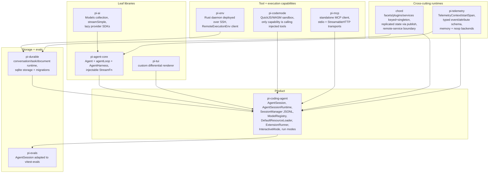
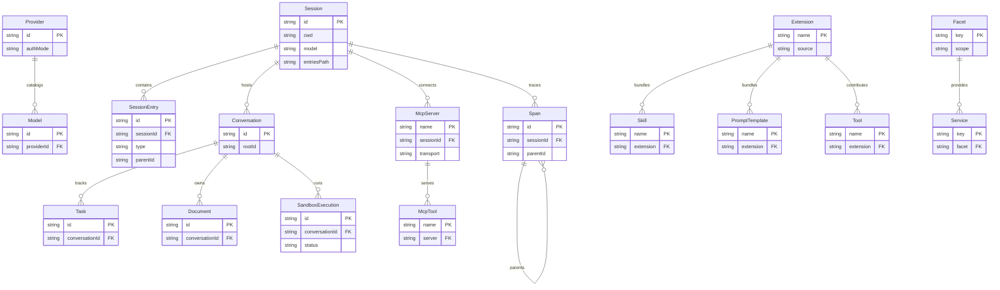

# Architecture

## System Overview

Pi is a layered TypeScript monorepo.
Three leaf libraries (`pi-ai`, `pi-agent-core`, `pi-tui`) compose into the `pi-coding-agent` CLI product.
`pi-ai` is the LLM boundary, `pi-agent-core` is the agent loop boundary, `pi-tui` is the rendering boundary, and the coding agent wires them together with sessions, extensions, tools, and a TUI.
Three capability packages extend what the agent can do: `pi-codemode` runs model-written JavaScript in an isolated QuickJS/WASM sandbox whose only capability is calling injected tools, `pi-mcp` is a standalone MCP client (stdio and StreamableHTTP transports) that the coding agent consumes through `src/extensions/mcp/`, and `pi-env` provides remote execution via a small Rust daemon deployed over SSH with a `RemoteExecutionEnv` client for the durable runtime.
`pi-durable` is the durable conversation/task/document runtime with SQLite storage, migrations, and storage backends under `packages/durable/src/storage/sqlite/`.
`pi-evals` adapts a real `AgentSession` to `vitest-evals` for model-backed behavioral checks.
Two cross-cutting runtimes serve the product: `chord` (facets/plugins/services with replicated state) and `pi-telemetry` (spans and typed events).
The former remote-session stack (`pi-protocol` CBOR framing, `pi-client` `PiClient`, `pi-server` `PiServer`, the `pi-session-backend-sqlite-node` package, and the legacy supervisor) is deleted and has no replacement in this topology.

## Entity Relationship Diagram

There is no traditional domain database.
Session state lives in JSONL files (`SessionManager`), and durable conversation/task/document state lives in the `pi-durable` SQLite store (`packages/durable/src/storage/sqlite/`, with migrations and storage backends).
There are no protocol-level session entities: the former `hello`/`SessionLease`/snapshot model is gone with the deleted remote-session stack.

## Key Components

| Component | Responsibility | Technology |
|---|---|---|
| `pi-ai` | Unified multi-provider LLM chat + image API, auth resolution, token/cost tracking, streaming, tool-calling | TypeScript, TypeBox, lazy-loaded provider SDKs |
| `pi-agent-core` (Agent) | Stateful agent runtime: prompt loop, tool execution (sequential/parallel), retry/abort, message queues | TypeScript, built on pi-ai via injectable `StreamFn` |
| `pi-agent-core` (AgentHarness) | Higher-level orchestrator: sessions, compaction, skills, system prompts, provider hooks | TypeScript |
| `pi-tui` | Terminal UI framework: components, overlays, differential rendering, input, terminal images | TypeScript (custom, no React/Ink), native addons for win32/darwin |
| `AgentSession` | Coding-agent core: lifecycle, prompt loop, model/thinking management, compaction, branching, bash exec, HTML export | TypeScript |
| `AgentSessionRuntime` | Owns the active session + cwd-bound services; hot-swaps on fork/switch/tree navigation | TypeScript |
| `SessionManager` | JSONL session persistence, tree-structured entries, branching, listing, migration | TypeScript, JSONL |
| `ModelRegistry` | Model/provider catalog: built-ins, user `models.json`, extension providers, API key + header resolution | TypeScript |
| `DefaultResourceLoader` | Discovers/loads extensions, skills, prompt templates, themes, AGENTS.md/CLAUDE.md context | TypeScript, jiti |
| `ExtensionRunner` | Extension lifecycle, event dispatch, UI context | TypeScript |
| Built-in tools | `read`, `bash`, `edit`, `write` (default) and `grep`, `find`, `ls` (read-only set) | TypeScript |
| `InteractiveMode` | Full TUI: editor, message list, footer/header, slash-command UIs, widgets, overlays | pi-tui |
| Run modes | Interactive (default), print (`-p`), JSON (`--mode json`), RPC (`--mode rpc`), SDK | TypeScript |
| `pi-codemode` | Sandboxed JavaScript execution where the only capability is calling injected tools: QuickJS/WASM sandbox (`quickjs-wasi`), inline/remote/host runtimes, declaration rendering, `codemode-store` cross-call state | TypeScript + WebAssembly (QuickJS), Cloudflare worker target |
| `src/extensions/codemode/` (coding-agent) | `codemode` tool wiring: model-facing tool definition, script execution through the agent loop tool pipeline, worker scheduling, result rendering | TypeScript, built on pi-codemode + pi-agent-core |
| `pi-mcp` | Standalone MCP client: JSON-RPC protocol types, `McpClient`, stdio and StreamableHTTP transports, OAuth providers, in-memory transport for tests | TypeScript |
| `src/extensions/mcp/` (coding-agent) | MCP integration: server config, connection/transport/OAuth runtime (lazily loaded), tool/resource adaptation, CLI and UI surfaces | TypeScript, built on pi-mcp |
| `pi-env` | Remote execution environments for durable: small Rust daemon (`daemon/Cargo.toml`, deployed over SSH with host-key verification), `Connection` session management, `RemoteExecutionEnv`/`LocalExecutionEnv`, remote terminal and file watching | TypeScript client + Rust daemon, SSH |
| `pi-durable` | Durable conversation/task/document runtime: harness (agent, compaction, generation, tool tasks, live docs, inbox, task graph), `ExecutionEnv` abstraction (node + remote), SQLite storage with migrations | TypeScript, node:sqlite |
| `pi-durable` SQLite storage | Conversation/entry/task/submission/document persistence: `SqliteDatabase`, `applySqliteMigrations`, versioned schema under `packages/durable/src/storage/sqlite/` | TypeScript, node:sqlite |
| `pi-evals` | Behavioral model-backed evals: adapts a real `AgentSession` to `vitest-evals`, isolated temp project/agent dirs, native pi session artifacts | TypeScript, vitest-evals |
| `chord` | Facet/plugin/service runtime: keyed and singleton registrations, replicated state via publish, remote-service boundary, standalone use outside the coding agent | TypeScript |
| `pi-telemetry` | Structured observability primitives: `TelemetryContext`/`startSpan`, `TelemetrySpan`, typed event/attribute schema utilities, memory + noop backends | TypeScript |

## Data Flow

A user prompt flows through the system as follows.
Input arrives via the editor (interactive), `-p`/stdin (print/JSON), JSONL (RPC), or `session.prompt()` (SDK).
`AgentSession.prompt()` expands slash commands, skills, and prompt templates, then emits an `input` event extensions can intercept or transform.
If the agent is mid-stream, the message is queued as steering (delivered after the current tool batch) or follow-up (after the agent stops), based on streaming behavior settings.
`before_agent_start` fires (extensions may modify the system prompt or inject messages).
`AgentSession` delegates to the pi-agent-core `Agent`, whose `agentLoop` calls the injectable `StreamFn`.
`StreamFn` (default `streamSimple` from pi-ai) resolves auth via `ModelRegistry`, applies retry/timeout/transport settings and provider attribution headers, then streams events from the provider SDK.
The agent streams text/thinking/toolcall deltas; tool calls are validated and executed (sequential or parallel), emitting `tool_call`/`tool_result` events extensions can observe or mutate.
A `codemode` tool call takes a distinct path: the model-written script runs inside the pi-codemode QuickJS/WASM sandbox, nested tool calls flow back through the agent loop tool pipeline (`ctx.executeTool`) with validation, hooks, and permission checks applied, and only the script output (plus `codemode-store` writes) reaches the model.
An MCP tool call takes another distinct path: the coding-agent MCP extension runtime forwards the call through the pi-mcp `McpClient` over the configured stdio or StreamableHTTP transport (with OAuth when required), then adapts the MCP result back into the agent tool-result shape.
After the agent stops, `AgentSession` loops: handles retryable errors, compaction triggers, and queued steering/follow-up messages via `agent.continue()` until queues drain.
Throughout, `AgentSession` appends entries (messages, model changes, compaction summaries, branch summaries) to the `SessionManager` JSONL file.
Durable pico conversations/tasks/documents persist in the pi-durable SQLite store alongside the session, and file/shell work under a remote target executes through the pi-env daemon over SSH via `RemoteExecutionEnv` rather than local Node syscalls.
Telemetry spans and typed events wrap the loop (memory backend in tests, noop by default).
Each mode renders the streamed events: `InteractiveMode` renders incrementally via pi-tui; print writes final text or one JSON object per event; RPC forwards `AgentSessionEvent`s as JSONL on stdout.

## Infrastructure

Hosting is local-first: the CLI runs on the developer machine, remote file/shell work goes through the pi-env SSH daemon, and persistence is JSONL session files plus the pi-durable SQLite store.
CI, release, and tooling details live in `infrastructure.md`.
Monitoring, telemetry backends, and alerting live in `observability.md`.

## Architecture Decisions

- **Minimal core, maximal extension surface:** No built-in sub-agents, plan mode, or permission popups. Extensions provide these. (Maintainer philosophy in `CONTRIBUTING.md`.)
- **Provider-centric LLM access (pi-ai):** The `Models` collection routes by owning provider; legacy global registry preserved in `/compat` for migration.
- **Lazy SDK loading:** Provider factories import only catalogs; provider SDKs load on first request via `.lazy.ts` wrappers.
- **Transport-agnostic agent:** `pi-agent-core` calls an injectable `StreamFn`, enabling direct (`streamSimple`), proxy (`streamProxy`), or custom backends.
- **Custom TUI:** `pi-tui` is hand-written (imperative component model + differential renderer), not React/Ink.
- **Failures encoded, not thrown:** LLM stream failures are encoded as final events with `stopReason: "error"|"aborted"`; agent run failures become synthetic failure assistant messages.
- **Codemode isolation:** model-written code runs only inside the QuickJS/WASM sandbox and its sole capability is calling injected tools, so scripts cannot touch the host except through the agent loop tool pipeline with its validation, hooks, and permission checks.
- **Standalone MCP client:** `pi-mcp` has no coding-agent dependency and owns the JSON-RPC protocol, transports, and auth, so the coding-agent MCP extension is a thin adaptation layer (config, runtime, tool/resource mapping, UI) over a reusable client.
- **Remote execution behind ExecutionEnv:** local and remote file/shell work share the `ExecutionEnv` interface, and `RemoteExecutionEnv` delegates syscalls to the Rust pi-env daemon over SSH, keeping platform rules (paths, errors, results) in one client-side implementation.
- **Lockstep versioning:** All packages share one version; `patch` = fixes + additions, `minor` = breaking changes, no major releases.
- **Local-first persistence:** JSONL is the session source of truth; the pi-durable SQLite store is the durable conversation/task/document source of truth alongside it, not a second copy of the session log.
- **Standalone chord runtime:** chord facets/plugins/services work without the coding agent and cross process boundaries only through the remote-service boundary with replicated state via publish.
- **Durable pico over ephemeral chat:** long-lived conversation/task/document state lives in the durable runtime (SQLite storage today), separate from the append-only session log.

Formal ADRs live under `.sdlc/knowledge/decisions/`.
