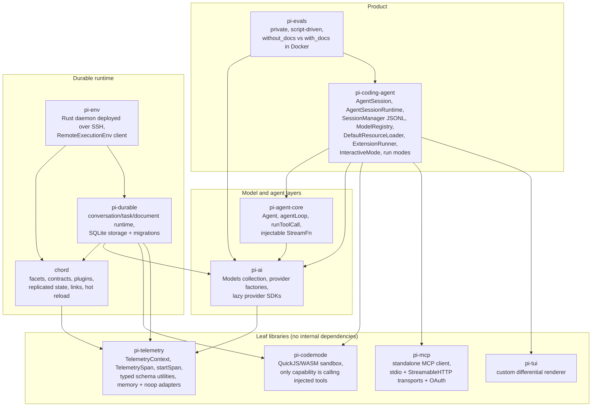
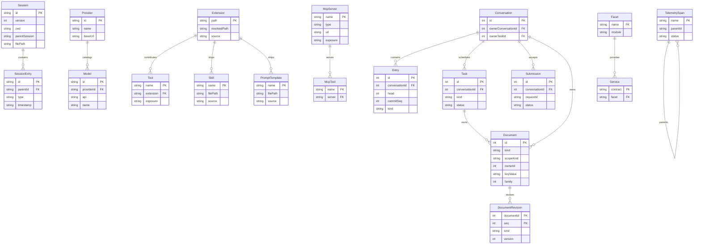

<!-- session_link: http://localhost:10000/?session=ses_6b3f0a1c2d4e5f60718293a4b5c6d7e8 -->
# Architecture

## System Overview

Every arrow in the diagram means "depends on", read from the `dependencies` and `devDependencies` fields of each `packages/*/package.json`.
Pi is a TypeScript monorepo of npm workspaces under `packages/`.
Four packages have no internal dependency: `pi-telemetry`, `pi-tui`, `pi-codemode`, and `pi-mcp`.
`pi-ai` depends on `pi-telemetry`, and `pi-agent-core` depends on `pi-ai`.
`pi-coding-agent` depends on `pi-agent-core`, `pi-ai`, `pi-codemode`, `pi-mcp`, and `pi-tui`.
The durable stack is a separate branch of the graph: `chord` depends on `pi-telemetry`, `pi-durable` depends on `chord`, `pi-ai`, `pi-codemode`, and `pi-telemetry`, and `pi-env` depends on `chord` and `pi-durable`.
`pi-coding-agent` does not depend on `pi-durable`, `chord`, `pi-telemetry`, or `pi-env`, and `pi-agent-core` does not depend on `pi-telemetry`.
`pi-evals` is private and depends on `pi-ai` and `pi-coding-agent` as dev dependencies only.

`pi-ai` is the LLM boundary, `pi-agent-core` is the agent loop boundary, `pi-tui` is the rendering boundary, `pi-codemode` is the sandbox boundary, and `pi-mcp` is the Model Context Protocol boundary.
`pi-coding-agent` wires those boundaries into the `pi` CLI with sessions, extensions, tools, and a TUI.
`pi-codemode` runs model-written JavaScript in an isolated QuickJS/WASM sandbox whose only capability is calling injected tools.
`pi-mcp` is a standalone MCP client with stdio and StreamableHTTP transports, an OAuth client, and no dependency on any other pi package.
The durable branch is a separate product surface: `pi-durable` is a durable conversation/task/document runtime with SQLite storage and migrations, and `pi-env` gives that runtime remote execution through a small Rust daemon deployed over SSH.
`chord` is the typed host runtime underneath `pi-durable` for contracts, facets, plugins, replicated state, and links.
`pi-telemetry` is the vendor-neutral telemetry contract that `pi-ai`, `chord`, and `pi-durable` build on.
`pi-evals` drives a real coding-agent `AgentSession` through `vitest-evals` to compare a `without_docs` variant against a `with_docs` variant in Docker.

The former remote-session stack (`pi-protocol` CBOR framing, `pi-client` `PiClient`, `pi-server` `PiServer`, the `pi-session-backend-sqlite-node` package, and the legacy supervisor) has been deleted.
No package in `packages/` carries those names today, and no part of the current topology replaces them.
What remains of that idea is the JSONL session tree in `pi-coding-agent` and the durable conversation/task/document model in `pi-durable`, which share no protocol with the removed stack.

## Entity Relationship Diagram

The coding-agent entities above are runtime values, not tables.
`Session` and `SessionEntry` are the JSONL session tree written by `SessionManager` under `~/.pi/agent/sessions/<encoded-cwd>/`, with a version-3 header and entries linked by `id`/`parentId`.
`Provider` and `Model` are the pi-ai catalog types.
`Extension`, `Tool`, `Skill`, and `PromptTemplate` are what `DefaultResourceLoader` and `ExtensionRunner` load; skills and prompt templates also come from the agent directory and the project's `.pi/` directories, not only from installed packages.
`McpServer` and `McpTool` describe a configured MCP server and the namespaced tools it exposes.

The durable entities mirror the SQLite schema in `packages/durable/src/storage/sqlite/migrations.ts`, which is also recorded in `schema.dbml`.
`entries.conversation_id` points at the owning conversation, `entries.head` marks the first entry of the active context, and `entries.commit_seq` is the commit that wrote the row.
`tasks.status` is one of `pending`, `running`, `waiting`, `sleeping`, `completing`, or `terminal`.
`submissions.status` is one of `queued`, `placed`, `done`, or `unanswered`.
`documents` is addressed by `kind`, `scope_kind` (`session`, `conversation`, or `task`), `owner_id`, `family` (0 for a singleton, 1 for a family member), and `key_value`.
`document_revisions` stores each revision of a document as a `base` or a `delta`, keyed by `(document_id, seq)`.
A durable document holds its state as chord replicated state, so the `Facet` and `Service` entities describe the chord hosts and services that back it.
`TelemetrySpan` is the vendor-neutral span type from `pi-telemetry`; only `pi-ai` and `pi-durable` currently define instrumented schemas against it.

There is no traditional domain database.
Session state lives in JSONL files (`SessionManager`), and durable conversation/task/document state lives in the `pi-durable` SQLite store (`packages/durable/src/storage/sqlite/`, with migrations and storage backends).
There are no protocol-level session entities: the former `hello`/`SessionLease`/snapshot model is gone with the deleted remote-session stack.

## Key Components

| Component | Responsibility | Technology |
|---|---|---|
| `pi-ai` | Unified multi-provider LLM chat, image, and classifier API, auth resolution, token/cost tracking, streaming, tool calling; 42 built-in providers, 10 chat APIs, 1 image API, 4 classifier APIs | TypeScript, TypeBox, lazy-loaded provider SDKs |
| `pi-agent-core` | Stateful agent runtime: prompt loop, tool execution (parallel by default, sequential when a tool asks for it), abort, steering and follow-up queues, before/after tool-call hooks | TypeScript, built on pi-ai via an injectable `StreamFn` |
| `pi-agent-core` public API | `Agent`, `agentLoop`, `agentLoopContinue`, `runAgentLoop`, `runAgentLoopContinue`, `runToolCall`, `streamProxy`, `setDefaultStreamFn`, plus the types in `src/types.ts` | TypeScript, 6 files under `packages/agent/src/` |
| `pi-tui` | Terminal UI framework: components, overlays, differential rendering, input, terminal images | TypeScript (custom, no React/Ink), native addons for darwin, linux, and win32 |
| `AgentSession` | Coding-agent core: lifecycle, prompt loop, model/thinking management, compaction, branching, bash exec, HTML export | TypeScript |
| `AgentSessionRuntime` | Owns the active session and cwd-bound services; hot-swaps on fork, switch, and tree navigation | TypeScript |
| `SessionManager` | JSONL session persistence, tree-structured entries, branching, listing, migration | TypeScript, JSONL |
| `ModelRegistry` | Model/provider catalog: built-ins, user `models.json`, extension providers, API key and header resolution | TypeScript |
| `DefaultResourceLoader` | Discovers and loads extensions, skills, prompt templates, themes, and AGENTS.md/CLAUDE.md context | TypeScript, jiti |
| `ExtensionRunner` | Extension lifecycle, event dispatch, UI context | TypeScript |
| Built-in tools | Default active set is `read`, `bash`, `edit`, `write`; `grep`, `find`, `ls`, and `powershell` exist but are off by default | TypeScript, `packages/coding-agent/src/core/tools/` |
| `InteractiveMode` | Full TUI: editor, message list, footer/header, slash-command UIs, widgets, overlays | pi-tui |
| Run modes | Interactive (default), print (`-p`), JSON (`--mode json`), RPC (`--mode rpc`), SDK | TypeScript |
| `pi-codemode` | Sandboxed JavaScript execution where the only capability is calling injected tools: QuickJS/WASM sandbox (`quickjs-wasi`), inline, worker-host, and remote runtimes, declaration rendering, and a `store()`/`load()` API limited to `MAX_STORE_VALUE_CHARS` (256K characters) per value and `MAX_STORE_TOTAL_CHARS` (1M characters) in total | TypeScript + WebAssembly (QuickJS), Cloudflare Workers target |
| `src/extensions/codemode/` (coding-agent) | `codemode` tool wiring: model-facing tool definition, script execution, nested tool calls through the agent loop pipeline, worker scheduling, result rendering, and persistence of successful `store()` writes as `codemode-store` session entries | TypeScript, built on pi-codemode + pi-agent-core |
| `pi-mcp` | Standalone MCP client: JSON-RPC protocol types, `McpClient`, stdio and StreamableHTTP transports, MCP OAuth (`McpOAuthProvider`, `OAuthCallbackServer`, discovery, PKCE, dynamic client registration, refresh, step-up), in-memory transport for tests; protocol versions `2025-11-25`, `2025-06-18`, `2025-03-26`, and `2024-11-05` | TypeScript, `cross-spawn` only |
| `src/extensions/mcp/` (coding-agent) | MCP integration: server config, connection/transport/OAuth runtime (lazily loaded), tool/resource adaptation, CLI and UI surfaces | TypeScript, built on pi-mcp |
| `pi-env` | Remote execution environments for the durable runtime: a Rust daemon crate at `packages/env/daemon/` (edition 2024, toolchain 1.96.0) deployed over SSH with host-key verification, `Connection` session management, `RemoteExecutionEnv` and `LocalExecutionEnv`, remote terminal, and file watching | TypeScript client + Rust daemon, SSH |
| `pi-env` wire protocol | Protocol v1: big-endian length-prefixed frames over the daemon's stdin/stdout, with request, result, error, event, cancel, and ping frame types | Rust daemon, documented in `packages/env/docs/protocol.md` |
| `pi-durable` | Durable conversation/task/document runtime: harness (agent, compaction, generation, tool tasks, live docs, inbox, task graph), `ExecutionEnv` abstraction (node and remote), SQLite storage with migrations | TypeScript, node:sqlite |
| `pi-durable` document kinds | `pi.agent`, `pi.inbox`, `pi.live`, `pi.provider`, `pi.usage`, and the `pi.tool.nested-call` family; task kinds are `pi.generation`, `pi.tool`, and `pi.compaction` | TypeScript, `packages/durable/src/harness/` |
| `pi-durable` SQLite storage | Conversation, entry, task, submission, document, and document-revision persistence: `SqliteStorage`, `applySqliteMigrations`, `CURRENT_SQLITE_SCHEMA_VERSION` (2), and the versioned table schema under `packages/durable/src/storage/sqlite/` | TypeScript, node:sqlite, `SqliteDatabase` facade from chord |
| `pi-evals` | Private, script-driven model-backed evals: a `vitest-evals` harness that runs a real `AgentSession` in an isolated home, agent directory, workspace, and session directory, comparing a `without_docs` variant against a `with_docs` variant in Docker; no `src/index.ts` and no `exports` map | TypeScript, vitest-evals, Docker |
| `chord` | Typed host runtime: contracts, facets, plugins, services, observable replicated state, JSON links (in-memory, Node IPC, WebSocket), hot reload, and child host processes through `createHostManager` and `forkDriver` | TypeScript |
| `pi-telemetry` | Vendor-neutral telemetry contract: `TelemetryContext`, `TelemetrySpan`, `startSpan`, `TelemetryMetrics`, `TelemetryPropagation`, `defineTelemetrySchema`, typed span and metric helpers, the `InMemoryTelemetryContext` reference adapter, `NOOP_TELEMETRY_CONTEXT`, and a `./testing` conformance suite; zero dependencies | TypeScript |

## Data Flow

A user prompt flows through the system as follows.
Input arrives via the editor (interactive), `-p` or stdin (print and JSON), JSONL on stdin and stdout (RPC), or `session.prompt()` (SDK).
`AgentSession.prompt()` first runs any extension command when the text starts with `/`, then emits the `input` event so extensions can intercept or transform the text, then expands skill commands and prompt templates.
If the agent is mid-stream, the message is queued as steering (delivered at the start of the next turn, after the current tool batch) or as a follow-up (delivered after the agent stops), based on the streaming behavior option.
`before_agent_start` fires, and extensions may replace the system prompt or inject messages.
`AgentSession` delegates to the pi-agent-core `Agent`, whose `agentLoop` calls the injectable `StreamFn`.
`StreamFn` (the coding agent installs pi-ai `streamSimple` through `setDefaultStreamFn`) resolves auth via `ModelRegistry`, applies retry, timeout, and transport settings plus provider attribution headers, then streams events from the provider SDK.
The agent streams text, thinking, and tool-call deltas; tool calls are validated and executed, emitting `tool_call` and `tool_result` events extensions can observe or mutate.
A `codemode` tool call takes a distinct path: the model-written script runs inside the pi-codemode QuickJS/WASM sandbox, nested tool calls flow back through the agent loop tool pipeline (`ctx.executeTool`) with validation, hooks, and permission checks applied, and only the script output plus `codemode-store` writes reach the model.
An MCP tool call takes another distinct path: the coding-agent MCP extension calls the pi-mcp `McpClient` directly over the configured stdio or StreamableHTTP transport (with OAuth when required) and adapts the MCP result into the agent tool-result shape; it does not go through `ctx.executeTool`.
After the agent stops, `AgentSession` loops: it handles retryable errors, compaction triggers, and queued steering and follow-up messages via `agent.continue()` until the queues drain.
Throughout, `AgentSession` appends entries (messages, model changes, compaction summaries, branch summaries) to the `SessionManager` JSONL file.
Compaction is threshold-driven from the session's context usage, and it writes a `compaction` entry that keeps the original entries in the file.
The coding agent emits no telemetry spans, events, or metrics; its only outbound telemetry is a hand-rolled install ping to `https://pi.dev/api/report-install`, plus a crash log at `~/.pi/agent/crashes.json` and a debug log at `~/.pi/agent/pi-debug.log`.
Telemetry spans and typed events wrap the loop in the other two instrumented packages: `pi-ai` observes model requests through `observeModelRequest` against `AI_TELEMETRY_SCHEMA`, and `pi-durable` wraps submissions and task phases against `DURABLE_TELEMETRY_SCHEMA`.
Each mode renders the streamed events: `InteractiveMode` renders incrementally via pi-tui; print writes final text or one JSON object per event; RPC forwards `AgentSessionEvent`s as JSONL on stdout.

The durable runtime has its own flow, separate from the coding agent.
A host opens a `Harness` over a storage backend (`MemoryStorage`, node SQLite, node JSONL, or Durable Object SQLite), then submits input to a conversation.
`Session.commit()` computes the write set, applies document deltas, and calls `Storage.commit`, which returns the commit sequence.
`pi-durable` persists its own conversations, entries, tasks, submissions, and documents in the `pi-durable` SQLite store; it does not share storage with the coding-agent JSONL session log.
File and shell work under a remote target runs through the pi-env daemon over SSH via `RemoteExecutionEnv`, which implements the durable `ExecutionEnv` contract, instead of local Node syscalls.
The durable package ships its own codemode, tool-search, and image subtrees under `src/codemode/`, `src/tool-search/`, and `src/images/`, independent of the coding agent's built-in extensions.

## Infrastructure

Hosting is local-first: the CLI runs on the developer machine, persistence is JSONL session files, and the separate durable runtime adds a SQLite store plus remote file and shell work through the pi-env SSH daemon.
CI, release, and tooling details live in `infrastructure.md`.
Monitoring, telemetry backends, and alerting live in `observability.md`.

## Architecture Decisions

- **Minimal core, maximal extension surface:** pi's core is minimal, and anything that does not belong in the core should be an extension (`CONTRIBUTING.md`). Sub-agents, plan mode, and permission gates ship as extensions under `packages/coding-agent/examples/extensions/`, not as built-ins.
- **Provider-centric LLM access (pi-ai):** the `Models` collection routes by owning provider; the legacy global registry is preserved in `/compat` for migration.
- **Lazy SDK loading:** provider factories import only catalogs; provider SDKs load on first request through the `.lazy.ts` wrappers under `packages/ai/src/api/`.
- **Transport-agnostic agent:** `pi-agent-core` calls an injectable `StreamFn`, enabling direct (`streamSimple`), proxy (`streamProxy`), or custom backends. It has no provider catalog dependency and no default stream function until a host calls `setDefaultStreamFn`.
- **Custom TUI:** `pi-tui` is hand-written (imperative component model and differential renderer), not React or Ink.
- **Failures encoded, not thrown:** LLM stream failures are encoded as final events with `stopReason: "error"` or `"aborted"`; agent run failures become synthetic failure assistant messages.
- **Codemode isolation:** model-written code runs only inside the QuickJS/WASM sandbox, and its sole capability is calling injected tools, so scripts cannot touch the host except through the agent loop tool pipeline with its validation, hooks, and permission checks.
- **Standalone MCP client:** `pi-mcp` has no pi dependency and owns the JSON-RPC protocol, transports, and OAuth, so the coding-agent MCP extension is a thin adaptation layer (config, runtime, tool and resource mapping, UI) over a reusable client.
- **Remote execution behind ExecutionEnv:** local and remote file and shell work share the `ExecutionEnv` interface, and `RemoteExecutionEnv` delegates syscalls to the Rust pi-env daemon over SSH, keeping platform rules (paths, errors, results) in one client-side implementation.
- **Lockstep versioning:** all published packages share one version, enforced by `scripts/sync-versions.js`; the root exposes `version:patch`, `version:minor`, and `version:major`.
- **Local-first persistence:** JSONL is the coding-agent session source of truth; the pi-durable SQLite store is the durable conversation, task, and document source of truth alongside it, not a second copy of the session log.
- **Standalone chord runtime:** chord facets, contracts, plugins, and services work without the coding agent. Cross-process work uses links (in-memory, Node IPC, or WebSocket) that carry JSON frames at `PROTOCOL_VERSION` 4, hot reload swaps code while the host runs, and child host processes are spawned through `createHostManager` and `forkDriver`.
- **Durable runtime over ephemeral chat:** long-lived conversation, task, and document state lives in the durable runtime (SQLite storage today), separate from the append-only coding-agent session log.

Formal ADRs live under `.sdlc/knowledge/decisions/`.
