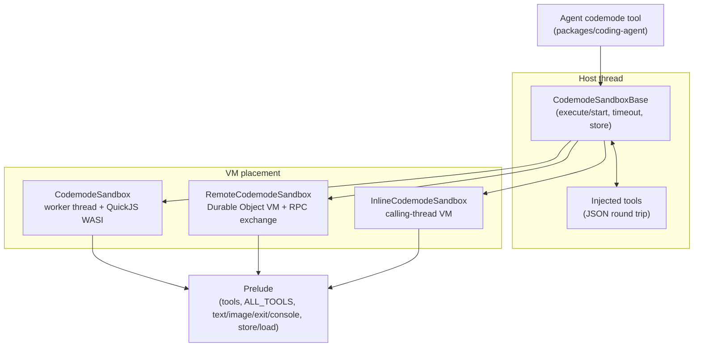
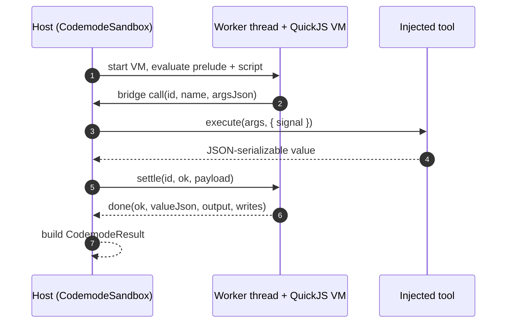
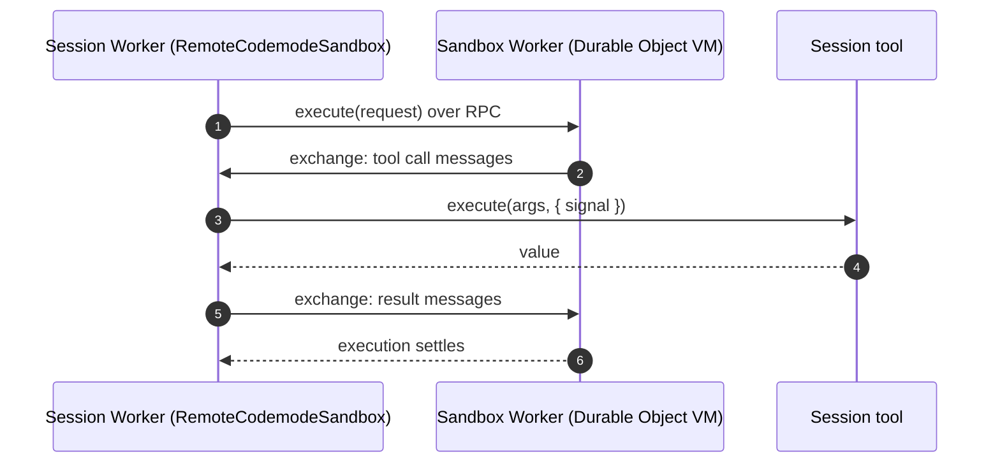
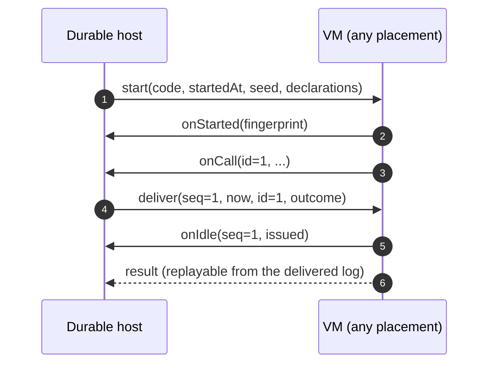

# Specification: Codemode Sandbox

## Overview

One host-side execution pipeline drives three VM placements that share a prelude, a JSON message protocol, and a result builder.
`CodemodeSandbox` runs each execution in a Node or Bun worker thread hosting a fresh QuickJS WASI instance, `RemoteCodemodeSandbox` moves only the VM behind an RPC exchange while tools stay with the caller, and `InlineCodemodeSandbox` runs the VM on the calling thread.
Deterministic `start()` runs fix time, randomness, timezone, and result ordering so a durable host can replay a script from a log of call results.

## Architecture

## Data Models

### CodemodeTool

| Field | Type | Constraints | Description |
|---|---|---|---|
| name | string | required, unique per sandbox | Script calls it as `tools[jsName]` and `tools["name"]`. |
| description | string | optional | Doc comment in declarations and `ALL_TOOLS` entry. |
| inputSchema | CodemodeJsonSchema | optional | Rendered as the parameter type; values are not validated. |
| outputSchema | CodemodeJsonSchema | optional | Rendered as the promise type; values are not validated. |
| spread | boolean | globals only | `execute` receives all call arguments as an array. |
| signature | string | globals only | Replaces the schema-generated declaration. |
| execute | function | required | Receives JSON-round-tripped args plus `{ signal }`. |

### CodemodeResult

| Field | Type | Constraints | Description |
|---|---|---|---|
| ok | boolean | required | True for returned or `exit()` scripts, false otherwise. |
| value | unknown | ok only | JSON-round-tripped return value (`undefined` after `exit()`). |
| error | CodemodeError | !ok only | `{ kind, name?, message, stack? }` with kind `script`, `timeout`, `aborted`, or `sandbox`. |
| output | CodemodeOutputItem[] | required, ordered | Text, console, and image items, kept for failed executions too. |
| calls | CodemodeCall[] | required | Every tool call with `name`, `status` (`ok`, `error`, `cancelled`), and `durationMs`. |
| storeWrites | CodemodeStoreWrites | ok only | `{ set, delete }` keys the script changed. |
| during | CodemodeDuring | start() runs only | Result `seq` being processed when a self-ending script ended. |

### CodemodeRunOptions / CodemodeRun

| Field | Type | Constraints | Description |
|---|---|---|---|
| startedAt | number | required | VM clock start in ms since the epoch. |
| seed | number | required, uint32 | Seeds `Math.random()` and other VM randomness. |
| tools | CodemodeDeclaredTool[] | optional | Script-visible `{ name, jsName?, description }` per tool. |
| globals | CodemodeDeclaredGlobal[] | optional | Script-visible `{ name, spread? }` per global. |
| store | Record | optional | Snapshot the script reads with `load()`. |
| onStarted | callback | optional | Receives the VM fingerprint before the script runs. |
| onCall | callback | required | Host answers each call via `run.deliver(seq, now, id, outcome)`. |
| onIdle | callback | optional | Fires after each processed result with `(seq, issued)`. |

### CodemodeExecuteOptions

| Field | Type | Constraints | Description |
|---|---|---|---|
| signal | AbortSignal | optional | Aborts the execution with kind `aborted`. |
| timeoutMs | number | optional | Overrides the sandbox default (300000 ms) for one execution. |
| store | Record | optional | JSON-serializable snapshot for `load()`; writes are caller-persisted. |

### CodemodeSourceOptions

| Field | Type | Constraints | Description |
|---|---|---|---|
| maxOutputTokens | number | non-negative safe integer | Token budget for output; the caller enforces it. |
| timeoutMs | number | positive integer up to 2147483647 | Hard deadline; the caller enforces it. |

## API Contracts

There is no HTTP surface, so no `api.yaml` is needed.
The contract is the TypeScript API across the package entries.

| Entry | Export | Purpose |
|---|---|---|
| `.` | `CodemodeSandbox` | Worker-thread sandbox for Node and Bun. |
| `.` | `loadQuickJSWasm` | Loads the QuickJS wasm bytes for bundled hosts. |
| `./portable` | `InlineCodemodeSandbox` | Calling-thread sandbox for any WebAssembly runtime. |
| `./portable` | `RemoteCodemodeSandbox` | RPC-client sandbox keeping tools in the caller. |
| `./portable` | `serveCodemodeRemote` | Runs the remote VM end of the RPC exchange. |
| `./source` | `parseCodemodeSource` | Splits the `// @options:` line from code. |
| `./source` | `CODEMODE_SOURCE_GRAMMAR` | Lark grammar for grammar-constrained model input. |
| `./declarations` | `renderDeclarations` | Renders tool and global TypeScript declarations. |
| `./cloudflare` | `CodemodeSandboxDurableObject` | Stateless sandbox Durable Object for the sandbox Worker. |
| `./cloudflare` | `createInlineCodemodeSandbox` | Inline sandbox pre-wired to the Wrangler-compiled module. |
| `./worker` | worker entry | Entry bundled hosts import for the worker file. |

Error codes shared across sandboxes:

| Kind | Code | Description |
|---|---|---|
| script | `script` | The script threw or failed to parse; `stack` points at `codemode.js:<line>`. |
| timeout | `timeout` | The deadline expired or the interrupt budget ran out; the VM was stopped. |
| aborted | `aborted` | The caller signal fired or `close()` ran; the VM was stopped. |
| sandbox | `sandbox` | The VM or transport failed (wasm trap, missing worker file, failed remote). |

## Sequences

### Worker-thread execute

### Remote execute on Cloudflare

### Deterministic start/run

## Technical Decisions

| Decision | Choice | Rationale |
|---|---|---|
| Script engine | QuickJS compiled to WASI WebAssembly (`quickjs-wasi`) | Small embeddable interpreter with synchronous execution and no host access beyond declared imports. |
| WASI shim surface | Clock, random, and discarded stdout/stderr plus one host-call entry | The script cannot reach the host except through registered functions. |
| Worker per execution | Fresh worker thread and fresh VM per `execute()` on Node/Bun | Keeps synchronous QuickJS execution off the host event loop and isolates runs. |
| Portable export | `/portable` entry with no `node:*` imports | Lets Cloudflare Workers, Durable Objects, and browsers use the same script environment. |
| Prelude closure bridge | Single host bridge hidden in a closure; built-ins frozen read-only | The script cannot call the bridge directly, and `eval`/`Function` stay inside the same VM. |
| Cloudflare placement | Separate sandbox Worker Durable Object with tools staying in the session | A computing script in the session object or a Dynamic Worker blocks all its requests; a separate Worker limits the delay to about 50 ms. |
| Compute limits | Poll-counted interrupt budget plus `Date.now()` frozen on Workers | No timer can fire while a script computes, so wall-clock timeouts cannot stop it; the budget can. |
| Deterministic runs | Fixed start time, seed, UTC clock, ordered numbered results | A durable host can resume a run after restart and get identical calls and output. |
| Store ownership | Caller-owned snapshot with `storeWrites` diff | The sandbox stays stateless and works in Durable Objects that never touch storage. |

## Risks and Unknowns

1. A remote VM computing at abort time keeps running until its next tool call or budget exhaustion, so abort latency is bounded by the budget rather than instant.
2. The interrupt budget is calibrated in polls, so its wall-clock meaning drifts across hardware and needs the cpu_ms ceiling kept in mind on Cloudflare.
3. All VMs in one isolate share 128 MB, so concurrent executions on one object compete for memory.
4. QuickJS interprets, so scripts doing heavy computation run slower than V8 and should delegate work to tools.
5. Schemas shape declarations only and values are never validated, so malformed tool input reaches `execute` unchecked.

## Out of Scope

- Model prompting, tool choice, and output token accounting beyond parsing the options line.
- Persistence of `storeWrites` (owned by the caller, e.g. session custom entries).
- Exporters, sampling, or telemetry for sandbox executions.
- Non-JavaScript guest languages.
