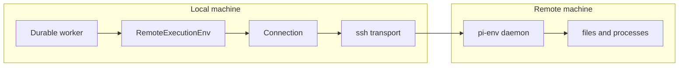
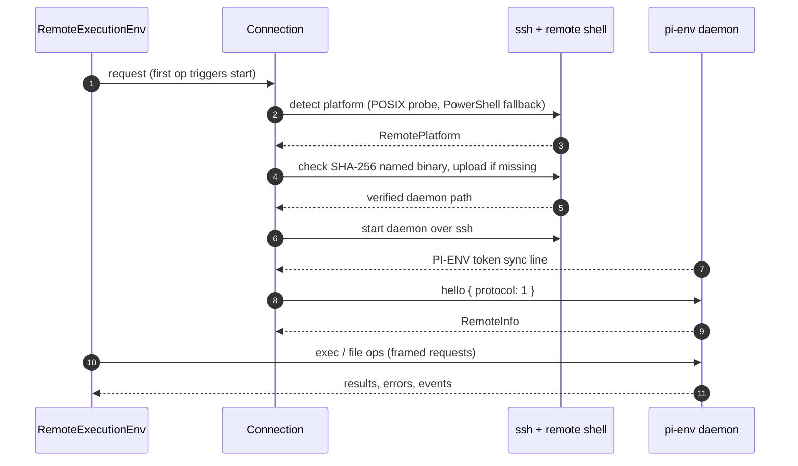
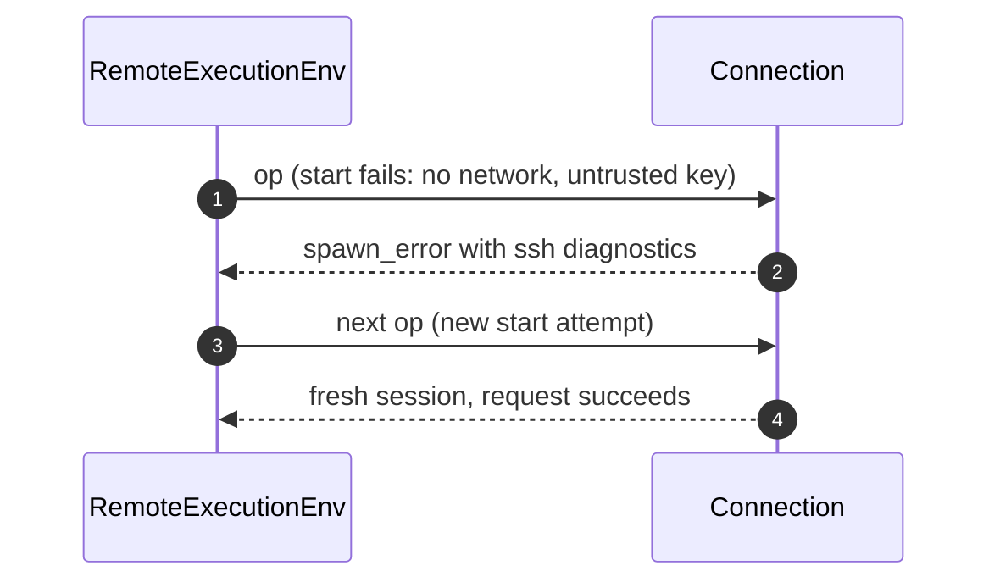

# Specification: Remote Execution Env

## Overview

A small Rust daemon (`daemon/`, crate `pi-env`) runs on the remote machine and speaks a framed request/response protocol over its stdin and stdout.
The TypeScript client (`packages/env/src/`) opens a `Connection` to one daemon process, detects the remote platform and deploys the matching binary over SSH before starting it, and exposes the daemon through `RemoteExecutionEnv`, which implements Durable's `ExecutionEnv` with Node's path, error, and result rules applied client-side.

## Architecture



## Data Models

### RemoteInfo (hello reply)

| Field | Type | Constraints | Description |
|---|---|---|---|
| protocol | number | Must be 1 | Wire protocol version |
| version | string | Not null | npm package version the daemon shipped with |
| os | string | Rust spelling | `linux`, `android`, `macos`, or `windows` |
| arch | string | Rust spelling | `x86_64` or `aarch64`, mapped by `nodePlatform` |
| home | string | Not null | Remote home directory |
| tmpdir | string | Not null | Follows remote Node `os.tmpdir` rules |
| separator | string | `/` or `\` | Remote path separator |
| cwd | string | Not null | Daemon working directory for drive-relative resolution |
| driveCwds | map | Windows only | Per-drive working directories from `=C:` variables |
| pid | number | Not null | Daemon process id |
| features | string[] | Optional | Protocol-1 additions this daemon supports (e.g. `listFiles`) |

### Frame (both directions, big-endian)

| Field | Type | Constraints | Description |
|---|---|---|---|
| length | u32 | 9 to 16 MiB | Bytes after this field |
| type | u8 | 1 to 6 | request, result, error, event, cancel, ping |
| id | u32 | 0 for unowned frames | Request id the frame belongs to |
| jsonLength | u32 | Within length | UTF-8 JSON object size |
| json | object | Must parse | `op` plus operation fields; errors carry `{ code, message, syscall?, path? }` |
| payload | bytes | Remainder | File contents, command output, or listing records |

### SshTarget

| Field | Type | Constraints | Description |
|---|---|---|---|
| host | string | No leading dash or whitespace | Host name or `~/.ssh/config` alias |
| user | string | Optional | Remote login user |
| port | number | Optional, 1 to 65535 | SSH port |
| identityFile | string | Optional | Key file, forced with `IdentitiesOnly` |
| knownHostsFile | string | Not null | Application-owned trust store |
| hostKeyAlias | string | Not null | Fixed alias keys are stored under |
| ssh | string | Optional | `ssh` program override |
| configFile | string | Optional | `-F` config instead of `~/.ssh/config` |

### RemotePlatform

| Field | Type | Constraints | Description |
|---|---|---|---|
| platform | enum | `linux`, `android`, `darwin`, `windows` | Detected remote system |
| arch | enum | `x64`, `arm64` | Normalized architecture |
| home | string | Not null | Remote home in remote spelling |
| shell | enum | Windows only | `cmd` or `powershell` default shell |
| warnings | string[] | Not null | Operator notices (e.g. Termux without `termux-exec`) |

## API Contracts

There is no HTTP surface, so there is no `api.yaml`.
The normative wire contract is `packages/env/docs/protocol.md`; result parity rules are `packages/env/docs/semantics.md`.
The TypeScript surface is:

| Export | Kind | Purpose |
|---|---|---|
| `RemoteExecutionEnv` | class | Durable `ExecutionEnv` on another machine through a `Connection` |
| `LocalExecutionEnv` | class | `NodeExecutionEnv` with daemon-backed `listFiles` on the same machine |
| `Connection` | class | Lazily started, self-restarting session with one daemon process |
| `connectSsh` | function | Detect and deploy now, return a connection that starts the daemon over ssh |
| `sshConnection` | function | Lazy connection that detects, deploys, and connects on first request |
| `scanHostKey` | function | Capture presented host keys plus fingerprints against a temporary file |
| `acceptHostKey` | function | Trust scanned key lines, refusing changed keys of the same type |
| `forgetHostKey` | function | Remove all trusted keys for the alias |
| `detectPlatform` | function | Probe the remote system via login shell or PowerShell |
| `deployDaemon` | function | Upload the matching binary to its SHA-256 named path and verify it |
| `openTerminal` | function | Run a program in a daemon pseudo-terminal |
| `nodePlatform` | function | Map Rust `os`/`arch` spellings to Node platform names |
| `localDaemon` | function | Path of the shipped daemon for this machine |

Error codes shared across operations:

| Code | Description |
|---|---|
| ENOENT and Node-style codes | File failures; the client maps them via `toFileError` as `NodeExecutionEnv` does |
| shell_unavailable | Configured shell path does not exist |
| spawn_error | Process or connection start failure, carrying `lost: true` when the connection is gone |
| timeout | Command exceeded its timeout |
| aborted | Request cancelled; abort settles `exec` as `aborted`, `cleanup` kills without aborting |
| unknown | Anything else, including lost connections (`lost: true`), forcing reconnect on next request |
| not_supported | Daemon predates `listFiles`; callers fall back to their own walk |

## Sequences

### Detect, deploy, connect, execute



### Lazy retry after failure



### Cancellation and liveness

```mermaid
sequenceDiagram
    autonumber
    participant C as Connection
    participant D as pi-env daemon
    C->>D: cancel { id }
    D-->>C: exec and pty kill the process group, finish aborted
    C->>D: ping (every 5 s)
    D-->>C: ping (every 5 s; daemon exits after 30 s of silence)
```

## Technical Decisions

| Decision | Choice | Rationale |
|---|---|---|
| Daemon language | Rust (`daemon/`, crate `pi-env`) | Single static binary per platform with no remote runtime dependency |
| Transport | Framed stdio protocol over the daemon child process | Works over any `ssh` invocation and locally over a pipe with identical code |
| Shell banner tolerance | `PI-ENV <token>` sync line | Login shell startup files may print to stdout before the daemon runs |
| Split of work | Daemon does syscalls, client applies Node rules | Guarantees parity with `NodeExecutionEnv` on the remote machine |
| Daemon naming | Remote path includes full SHA-256 | Versions never collide and verification precedes every start |
| Host-key trust | Application-owned known-hosts file plus fixed alias | Trust is independent of aliases, ports, and jump hosts |
| Watching | Port of `NodeFileWatcher` inside the daemon | Native events only trigger rescans next to the files; reconnect reports `overflow` |
| Output handling | Windowed, paced, spillable exec output | Slow links delay bulk data, not control replies |

## Risks and Unknowns

1. A changed host key blocks the owner until they confirm it out of band and forget the old key, which can strand automation.
2. SSH hardening (no multiplexing, no locale forwarding) adds one connection per daemon start and may slow high-churn workloads.
3. POSIX remotes without `sha256sum`, `shasum`, or `openssl` cannot verify the daemon and are refused outright.
4. Handles belong to the daemon session that opened them, so every reconnect invalidates open readers and watchers.

## Out of Scope

- HTTP or any other management surface on the daemon.
- Windows pseudo-terminals (`pty` returns `ENOTSUP` there).
- Credential or secret management on the remote machine; credentials stay local.
