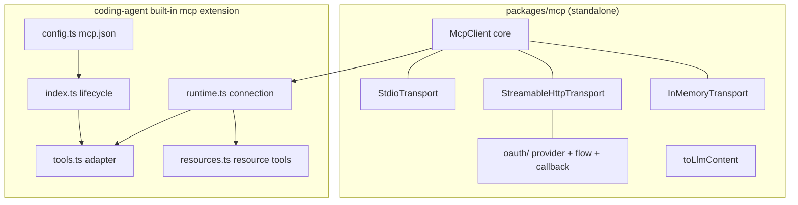
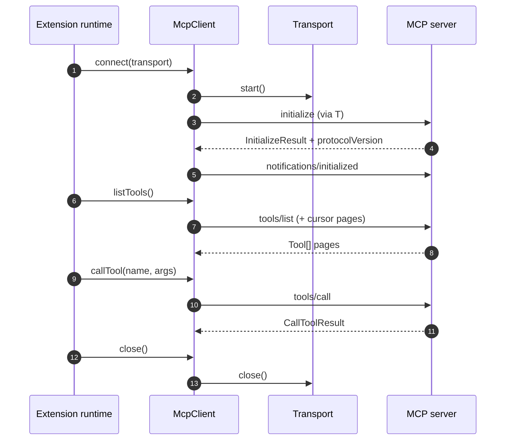
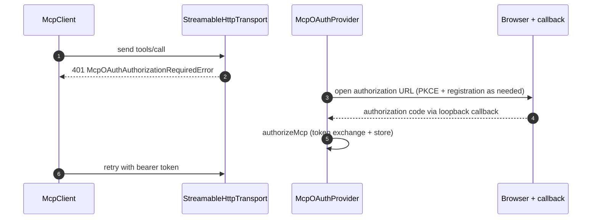
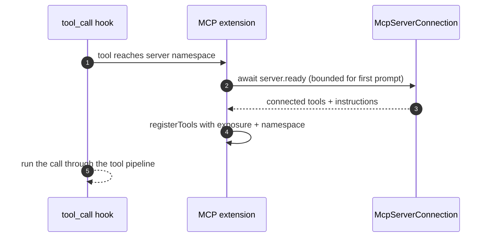

# Specification: MCP Client

## Overview

The implementation keeps a transport-neutral `McpClient` core in `packages/mcp/src/` that speaks JSON-RPC plus MCP lifecycle semantics, with stdio, Streamable HTTP, and in-memory transports behind the `McpTransport` interface and the OAuth client subset under `src/oauth/`.
The `packages/coding-agent` built-in MCP extension consumes that client lazily at session start, adapts each server tool to a pi `ToolDefinition`, and routes tools to the model through the four exposure modes.

## Architecture

## Data Models

### McpClientOptions

| Field | Type | Constraints | Description |
|---|---|---|---|
| name | string | required | Client info name sent in `initialize` |
| version | string | required | Client info version sent in `initialize` |
| capabilities | ClientCapabilities | optional | Advertised capabilities, with `roots` added automatically when roots are set |
| protocolVersion | SupportedProtocolVersion | optional, defaults to `2025-11-25` | Preferred version offered during initialization |
| requestTimeoutMs | number | optional, defaults to 30000 | Per-request timeout renewed by progress notifications |
| roots | Root[] or provider fn | optional | Roots served to `roots/list` server requests |

### Tool

| Field | Type | Constraints | Description |
|---|---|---|---|
| name | string | required | Server-side tool name before pi namespacing |
| description | string | optional | Human description shown in the adapted tool definition |
| inputSchema | object | required | JSON schema normalized to an object schema with `properties` |
| outputSchema | object | optional | Structured-content schema relocated under the result schema pointer |
| annotations | ToolAnnotations | optional | Boolean hints such as readOnly and destructive mapped to pi annotations |

### CallToolResult

| Field | Type | Constraints | Description |
|---|---|---|---|
| content | ContentBlock[] | defaults to `[]` when omitted | Text, image, audio, resource, and resource-link blocks |
| structuredContent | JSON value | optional | Machine payload passed through to scripts and the result schema |
| isError | boolean | optional | Tool-level failure flag preserved instead of raised as a protocol error |

### Resource

| Field | Type | Constraints | Description |
|---|---|---|---|
| uri | string | required | Address read by `resources/read` |
| name | string | defaults to uri when omitted | Display name, tolerating servers that omit it |
| mimeType | string | optional | Filters MCP App resources and detects text blobs |
| size | number | optional | Rendered next to resource links for the model |

### InitializeResult

| Field | Type | Constraints | Description |
|---|---|---|---|
| protocolVersion | string | must be one of the four supported versions | Version the server selected for the session |
| capabilities | ServerCapabilities | required | What the server offers, including tools and resources |
| serverInfo | Implementation | required, name plus version | Identity recorded on the client after connect |
| instructions | string | optional | Server instructions surfaced in the `mcp_servers` section and namespace |

### McpServerEntry

| Field | Type | Constraints | Description |
|---|---|---|---|
| name | string | required, namespace-unique modulo `-` versus `_` | Server name used in tool names and the prompt section |
| config | McpServerConfig | validated, stdio or HTTP shape | Command or URL plus enabled, exposure, toolExposure, timeout, and description |
| source | string | required | Config file path or registering extension path |
| scope | global, project, or extension | optional | Where the entry came from, deciding where edits are saved |
| override | string | optional | Project `mcp.json` carrying an enabled, exposure, or toolExposure override |

## API Contracts

No `api.yaml` accompanies this specification because the feature defines no HTTP surface of its own.
The normative surfaces are the TypeScript client API and the MCP transports it speaks.

| Surface | Member | Purpose |
|---|---|---|
| TS client | `McpClient.connect(transport)` | Runs transport start, `initialize` negotiation, and `notifications/initialized` |
| TS client | `McpClient.listTools(options?)` | Returns every tool across all `tools/list` pages |
| TS client | `McpClient.callTool(name, args?, options?)` | Calls one tool with timeout, cancellation, and progress support |
| TS client | `McpClient.listResources / listResourceTemplates / readResource` | Reads resource listings and contents, one page or all pages |
| TS client | `McpClient.ping / request / notify` | Sends protocol ping plus generic requests and notifications |
| TS client | `McpClient.setRequestHandler / onNotification / onError / onClose` | Serves `ping` and `roots/list` and observes connection events |
| TS client | `toLlmContent(result)` | Converts a `CallToolResult` to pi-ai text and image content |
| TS transport | `McpTransport.start / send / close` | Framing and I/O contract every transport implements |
| TS transport | `StdioTransport({ command, args })` | Spawns a server process with spec-ordered shutdown of its process group |
| TS transport | `StreamableHttpTransport({ url, headers, authProvider })` | HTTP transport with sessions, GET-stream reconnection, and `Last-Event-ID` resume |
| TS testing | `createInMemoryTransportPair()` | Linked client and server transports for unit and adapter tests |
| TS oauth | `McpOAuthProvider / authorizeMcp / OAuthCallbackServer` | Discovery, PKCE flow, registration, refresh, and loopback callback |
| Extension | `createMcpExtension(options?)` | Replaceable built-in extension wiring config, runtime, tools, and `/mcp` |
| Extension | `mcp.json` `mcpServers` shape | Shared config format with global file, trusted-project file, and per-tool overrides |

Error codes shared across endpoints:

| Status | Code | Description |
|---|---|---|
| n/a | McpError with JSON-RPC code | Protocol errors reject the pending request with code, message, and data |
| n/a | McpTimeoutError | Request exceeded its timeout without progress renewal |
| n/a | McpAbortError | Caller aborted the request through its abort signal |
| n/a | McpConnectionClosedError | Request or send raced a closed transport or client |
| n/a | McpOAuthAuthorizationRequiredError | HTTP 401 needs a browser sign-in before retry |

## Sequences

### Connect, list tools, call tool, close

### OAuth sign-in and retry

### Tool-call readiness in the extension

## Technical Decisions

| Decision | Choice | Rationale |
|---|---|---|
| Official SDK | No dependency on the MCP SDK anywhere | Keeps the client small, version-controlled, and free of SDK release coupling |
| Transport shape | Client core owns protocol semantics while transports own framing and I/O | Lets stdio, Streamable HTTP, and in-memory transports evolve independently |
| Protocol versions | Offer `2025-11-25` and accept the three prior versions back to `2024-11-05` | Tracks the current spec while staying compatible with older servers |
| Tool naming | Sanitize to `mcp__server__tool` with a hash suffix on collision or 64-char overflow | Satisfies provider name limits and keeps names stable and unique |
| Default exposure | `codemode` unless configured otherwise | Keeps MCP tools out of model declarations until scripts or search load them |
| Resource tools | Reuse the Codex `list_mcp_resources` trio with JSON payloads | Models trained on those tools work unchanged against pi |
| Prompt section | Bounded `mcp_servers` section instead of declaring indirect tools | Informs the model about reachable servers within a fixed character budget |
| OAuth scope | Adapt the SDK flow without opening browsers or choosing storage | Leaves UX and credential persistence to the host while reusing proven logic |
| Test seam | Ship the in-memory transport as a public testing entry point | Gives client and adapter tests a deterministic transport without processes or network |

## Risks and Unknowns

1. Servers that only speak legacy HTTP+SSE cannot connect until a transport is added for them.
2. Servers with non-conformant pagination or missing required fields may need further lenient validation beyond the current null-cursor and unnamed-resource handling.
3. OAuth edge cases across heterogeneous providers may surface flows the adapted implementation does not yet cover.
4. Large tool counts can strain the prompt budget, since direct exposure declares every tool to the model.

## Out of Scope

- Batch JSON-RPC messages and the legacy HTTP+SSE transport.
- Acting as an MCP server, including sampling support.
- MCP tasks and elicitation workflows.
- A browser-based sign-in UI beyond opening the authorization URL and serving the loopback callback.
