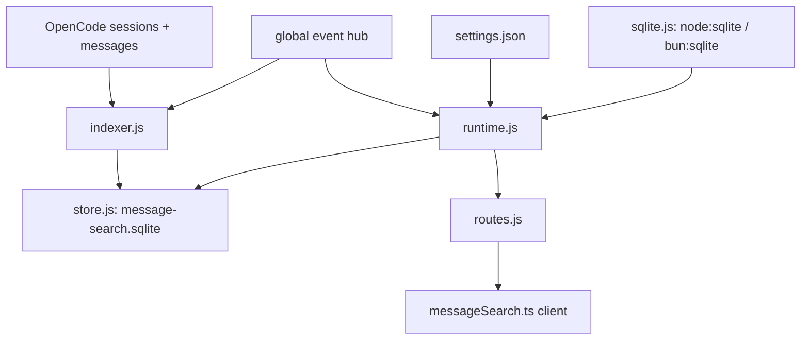

# Specification: Message Search

## Overview

`message-search` owns a per-server SQLite FTS5 index at `<dataDir>/message-search.sqlite`.
`store.js` owns the schema, match expressions, and snippet windowing; `indexer.js` keeps the index in step with OpenCode via live events and background walks; `runtime.js` follows the two settings switches, answers queries, reports status, and deletes the file; `routes.js` serves the three HTTP endpoints; `sqlite.js` opens the platform builtin; `packages/ui/src/lib/messageSearch.ts` asks the server and parses the answer once at the boundary.

## Architecture



## Data Models

### meta

| Field | Type | Constraints | Description |
|---|---|---|---|
| key | TEXT | PK | e.g. `schema`, `reasoning` |
| value | TEXT | NOT NULL | Schema version (`3`); reasoning flag (`1`/`0`) |

### sessions

| Field | Type | Constraints | Description |
|---|---|---|---|
| id | TEXT | PK | OpenCode session id |
| directory | TEXT | NOT NULL | Owning working directory |
| title | TEXT | NOT NULL, default `''` | Session title, updated on `session.updated` |
| created_at | INTEGER | NOT NULL, default 0 | Session creation time |
| revert_id | TEXT | nullable | Active revert boundary; nothing at or after it is indexed |
| user_cursor | TEXT | nullable | Paging cursor into user messages |
| assistant_cursor | TEXT | nullable | Paging cursor into assistant messages |
| user_anchor | TEXT | nullable | Id of the message the user cursor points after |
| assistant_anchor | TEXT | nullable | Id of the message the assistant cursor points after |
| synced_updated_at | INTEGER | nullable | Session `time.updated` at last read, for change detection |

### messages

| Field | Type | Constraints | Description |
|---|---|---|---|
| seq | INTEGER | PK | Row id shared with the FTS index |
| id | TEXT | NOT NULL, UNIQUE | Row id; `<messageId>:reasoning` for reasoning rows |
| message_id | TEXT | NOT NULL | Owning message; a reasoning hit leads back to it |
| session_id | TEXT | NOT NULL | Owning session |
| role | TEXT | NOT NULL | `user`, `assistant`, or `reasoning` |
| created_at | INTEGER | NOT NULL | Message creation time, used for paging |
| text | TEXT | NOT NULL | Searchable text |

### messages_fts

External-content FTS5 index over `messages` (`content='messages'`, `content_rowid='seq'`, `tokenize='trigram'`), kept by insert/delete/update triggers.
The trigram tokenizer matches any 3+ characters inside a word in any script, case-insensitive, with no word segmentation.

## API Contracts

| Method | Path | Query / Body | Response |
|---|---|---|---|
| GET | /api/openchamber/message-search | `q`, `session`, repeatable `directory`, `role` (`user\|assistant\|reasoning`), `reasoning` (`0\|1`), `order` (`asc\|desc`, default `desc`), `before` (`<createdAt>:<id>`), `limit` (1..200, default 20) | `{ status: 'ok', hits, next, index }` or `{ status: 'query-too-short', hits: [] }`; 503 when no index runs; 500 on failure |
| GET | /api/openchamber/message-search/status | — | `{ state: 'unsupported\|off\|on\|failed', sizeBytes, index }`; 500 on failure |
| DELETE | /api/openchamber/message-search/index | — | Status object after deletion; a fresh index starts at once while on; 500 on failure |

Hits carry `id`, `sessionId`, `role`, `createdAt`, `sessionTitle`, `directory`, and a plain-text `snippet` with matches marked by U+E000 / U+E001.
Pages are cut by row id (`seq`), since a reply and its reasoning share a message id, and `next` is serialized as `<createdAt>:<id>`.

## Sequences

### Indexing

```
1. Setting on (or reconnect): runtime opens the store and starts the indexer.
2. Indexer walks the session list; sessions with newer time.updated are queued behind live work.
3. Each session is read per message type from its stored cursor onward, one page at a time.
4. Settled user/assistant text is upserted; unfinished assistant records are skipped without moving the cursor.
5. Live session.idle / message.updated(time.completed) events queue the session, debounced.
6. session.updated renames/moves the row; session.deleted drops it; gone anchors or rejected cursors reset the session once per sync.
```

### Query

```
1. Client sends q + filters; route validates with zod (defaults: order desc, limit 20, reasoning included).
2. Runtime builds the FTS5 match (AND of quoted terms, short words dropped; null match answers query-too-short).
3. Store searches messages_fts joined to messages and sessions, filters by session/directory/role/reasoning, orders by created_at (+ row tiebreak), fetches limit + 1.
4. Runtime builds JS snippets around matches, slices the page, and returns hits + next cursor + indexer status.
```

## Technical Decisions

| Decision | Choice | Rationale |
|---|---|---|
| Trigram FTS5 | `tokenize='trigram'`, external content + triggers | In-word and CJK matching with no segmentation; ~5x text size accepted |
| JS snippet window | `buildSnippet` on hit text, not FTS5 `snippet()` | FTS5 counts trigrams and cuts hits to a few characters |
| Reasoning as separate rows | `role='reasoning'`, id `<messageId>:reasoning` | Filtered and dropped without touching replies; hits still resolve to the message |
| Cursor + anchor ids | Anchor message verified on empty pages | OpenCode answers a cursor past a revert tail with an empty page, identical to "nothing new" |
| Derived file | Schema version in `meta`; mismatch rebuilds | Index can always be regenerated from OpenCode |
| Serialized transitions | Single promise chain for start/stop/delete | Ordered, non-overlapping lifecycle changes |
| Client strictness | Parse once, throw on failure, 503/404 to `unavailable` | A fetch failure must never masquerade as an empty result |

## Risks and Unknowns

1. Trigram index size (~5x text, ~560 MB at 9072 sessions / 196k messages) may pressure small disks; delete/rebuild is the relief valve.
2. Reasoning indexing can multiply index size several times, which is why it is a separate default-off switch.
3. OpenCode cursor and event shapes are observed, not contracted; opaque cursors are passed through and formats are never assumed.

## Out of Scope

- Searching session titles (already covered by OpenCode 2).
- Indexing tool calls and output, attached context records, or subagent sessions.
- Cross-server or remote-directory search; the index covers this server's OpenCode only.
- An `api.yaml` contract file; sibling pending features carry none.
