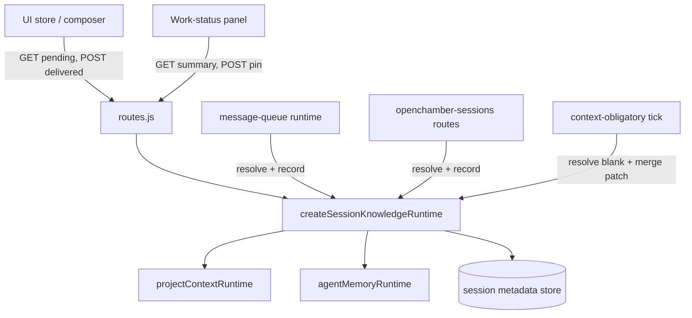

# Specification: Session Knowledge

## Overview

`session-knowledge/runtime.js` owns the decision of what a session still owes and the text it owes, while `session-knowledge/routes.js` exposes that decision over four HTTP endpoints and `sessionKnowledgeApi.ts` gives the browser a never-throwing client.
Senders stay thin: the UI store attaches the fetched text as a synthetic part and reports delivery after the send resolves, the message queue and session routes do the same for server-built prompts, and the context-obligatory tick re-sends after compaction with a deliberately blanked prior signature.
All per-session state lives in OpenChamber's own session metadata store because OpenCode 2.x accepts session metadata only at create time.

## Architecture



## Data Models

### Session metadata keys (`metadata.openchamber`)

| Field | Type | Constraints | Description |
|---|---|---|---|
| `project_context_pins` | `{ notes: string[], plans: string[] }` | Deduped non-empty id strings | Note and plan ids attached to that session only |
| `knowledge_context_delivered` | string | Empty means nothing recorded | Signature of what the session is carrying |

### Knowledge signature (`buildKnowledgeSignature`)

| Part | Shape | Description |
|---|---|---|
| Pinned notes | `n:id:updatedAt` | Revision-sensitive so edits re-send |
| Pinned plans | `p:id:title` | Identity plus title, sorted with the rest |
| Memory entries | `mg:id:updatedAt` and `mp:id:updatedAt` | Global and project scopes, flagged entries excluded upstream |
| Memory enabled | `m:on:c` or `m:on:p` | Complete only when both scopes loaded |
| Linking | `l:on` | Present only when the managed tool is available |
| Worktree move | `w:ask` or `w:auto` | Present only with the tool, form follows the setting |

### Assembled text (`buildKnowledgeText`)

| Block | Content |
|---|---|
| Pinned block | Standing-background preamble plus note bodies in creation order and full plan bodies, with `(plan content unavailable)` markers |
| Memory block | Save guidance, read-before-acting instructions, then titles grouped as user and project sections |
| Link guidance | `SESSION_LINK_GUIDANCE` when the tool is present |
| Worktree guidance | `WORKTREE_MOVE_GUIDANCE.ask` or `.auto` when the tool is present |

### Runtime surface (`createSessionKnowledgeRuntime`)

| Member | Role |
|---|---|
| `collect` / `collectSummary` | Read pins-supplied context, memory, and tool flags without session lookup |
| `resolvePending` / `resolvePendingForSession` | Compare fresh signature against delivered signature and return text plus signature |
| `setPin` | Merge-patch the pin set and clear the delivered signature so the next send carries the change |
| `recordDelivered` | Merge-patch only the delivered signature after the send is accepted |
| `readPins` / `readDeliveredSignature` | Pure readers over a stored session shape |
| `metadataKey` / `pinsMetadataKey` | Exported key names shared with the compaction merge patch |

## API Contracts

| Method | Path | Input | Output | Failure behavior |
|---|---|---|---|---|
| GET | `/api/session-knowledge` | `directory` required, optional `sessionId` | `{ text, signature }`, empty text when already delivered | Returns `{ text: '', signature: '', unavailable: true }` so the send proceeds |
| GET | `/api/session-knowledge/summary` | `directory`, optional `sessionId` | `{ notes, plans, memory: { global, project } }` with names and counts only | Returns empty notes, plans, and zero counts |
| POST | `/api/session-knowledge/pin` | `sessionId`, `directory`, `kind` (`note` or `plan`), `id`, boolean `pinned` | `{ pins: { notes, plans } }` | 400 on bad body, 500 with message on store failure |
| POST | `/api/session-knowledge/delivered` | `sessionId`, `directory`, `signature` | `{ recorded: true }` | Returns `{ recorded: false }` since the message already went out |

## Sequences

### UI message delivery

```
1. Composer starts fetchSessionKnowledge alongside the send.
2. routeMessage attaches the text as a synthetic part with systemContext session-knowledge.
3. Only after the send resolves, reportSessionKnowledgeDelivered posts the signature.
4. A send arriving while a delivery report is in flight awaits it first, avoiding a double carry.
```

### Server-built prompt delivery (scheduled task, agent dispatch)

```
1. message-queue or openchamber-sessions resolves pending for the session, swallowing errors to empty.
2. The knowledge text rides as a synthetic preamble admitted before the prompt or command.
3. After the prompt is accepted, recordDelivered stores the signature.
4. A rejected dispatch records nothing, so retry carries the block again.
```

### Post-compaction re-send

```
1. context-obligatory tick detects a completed compaction message not yet handled.
2. It resolves knowledge with a blank prior signature, since compaction removed delivered context.
3. Knowledge text and restored pinned messages travel in one synthetic turn joined by separators.
4. The tick merge-patches the compaction cursor together with the knowledge signature.
```

## Technical Decisions

| Decision | Choice | Rationale |
|---|---|---|
| Server ownership | One runtime decides text and owed-state for every sender | Headless sessions get context and no tab-local belief survives compaction |
| Split pending/delivered calls | Two endpoints because only the sender knows the send outcome | Recording at handover would mark failed sends as delivered |
| Metadata cursor | Signature lives in OpenChamber's session metadata store | Survives tab close and is visible to senders with no tab |
| Title-only memory index | Bodies never enter the block | A full-text index would grow without bound and crowd out conversation |
| Withhold flagged entries | Flagged memory stays stored and visible but out of blocks | Silent deletion would hide injection attempts from the judging user |
| Chats-root resolution | Dated chat directories resolve to the chats root | Every ordinary chat shares one knowledge owner instead of unreachable per-directory stores |
| Loud truncation | 8000-character budget with a truncation marker | Bounded context cost with visible rather than silent loss |
| Client dedup and cache | Delivery-report map plus 5-second summary cache | Prevents double carry on rapid sends and request storms when panels open |

## Risks and Unknowns

1. Plan signature uses id plus title rather than a revision stamp, so a body edit without a retitle may not re-send.
2. The 8000-character budget can cut pinned plans on heavily pinned sessions, with only the marker as notice.
3. Threat-pattern scanning is pattern-based and catches only blunt injections, which bounds the flagged-entry guarantee.
4. Worktree-move wording is duplicated with the agent-tool description, so the two can drift unless changed together.

## Out of Scope

- Threat-pattern scanning itself, owned by `agent-memory/threat-patterns`
- Pin management UI and panel rendering, which only consume the summary and pin endpoints
- The managed `openchamber` tool description text, which mirrors the guidance
- Agent-memory routes, settings rows, and panel tabs behind the memory enable flag
