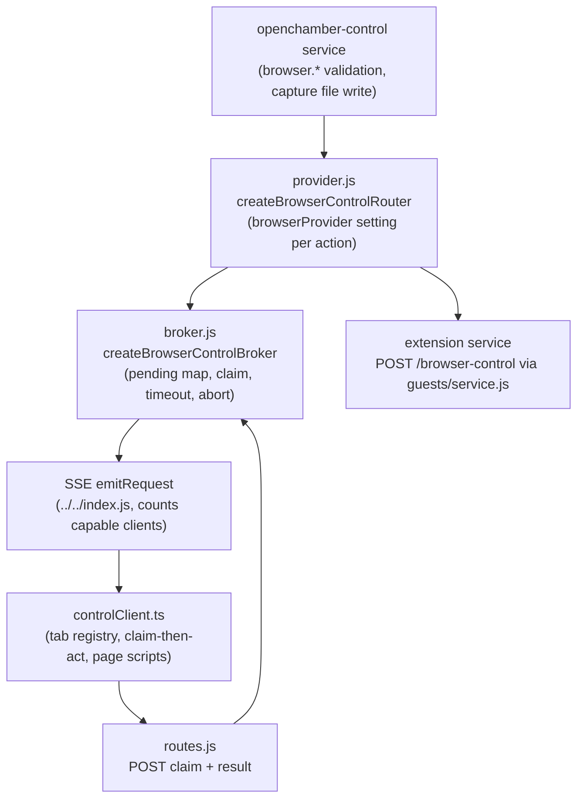

# Specification: Browser Control

## Overview

`broker.js` owns request lifetime: it publishes one action through the injected `emitRequest`, holds the pending request, and settles it on a client result, a timeout, or an abort signal.
`provider.js` sits between the control service and the broker and routes each action to the in-app broker or to an extension browser service based on the `browserProvider` setting read on every call.
`routes.js` is the claim/result callback surface, and `controlClient.ts` (with `pageActions.ts`, `hostCapability.ts`, and focus/capture helpers) is the client half that registers tab panes, claims requests, runs page scripts, and posts results.
`../openchamber-control/service.js` is the only caller: it maps the `browser.*` actions of the `openchamber_web` tool onto the router's `request()` and owns parameter validation plus server-side screenshot persistence.

## Architecture



## Data Models

### Pending request (broker, in-memory Map)

| Field | Type | Constraints | Description |
|---|---|---|---|
| requestId | string | PK | Correlates broadcast, claim, and result posts |
| finish | function | — | Settles the waiting agent promise with the outcome |
| timer | timer | bounded 1s-120s | Fires the 504 timeout outcome |
| claimed | boolean | first-claim-wins | Grants exactly one client the right to act |

### Request event (server to clients)

| Field | Type | Constraints | Description |
|---|---|---|---|
| requestId | string | required | Correlation id generated per request |
| action | string | `browser.*` | e.g. `browser.open`, `browser.snapshot`, `browser.click` |
| parameters | object | validated upstream | Action arguments including optional `tabId` |
| context | object | nullable fields | `directory` and `sessionId`, each `null` when unknown |

### Result envelope (client to server)

| Field | Type | Constraints | Description |
|---|---|---|---|
| requestId | string | required, trimmed | Correlation id |
| ok | boolean | must be `true` for success | `ok: false` becomes the agent's error |
| data | any | nullable | Success payload (snapshot text plus interactive elements) |
| error | string | — | Agent-visible failure message when `ok` is not true |

### Registered tab (client, in-memory)

| Field | Type | Constraints | Description |
|---|---|---|---|
| tabId | string | PK | Id agents pass as `tabId` |
| directory | string | fixed for tab lifetime | Project key as the context panel keys it |
| ownerSessionId | string or null | fixed for tab lifetime | Session whose agent opened the tab; null for the user's own |
| state | enum | controller or sleeping | Sleeping tabs wake on demand when an action lands on them |

## API Contracts

| Method | Path | Body limit | Behavior |
|---|---|---|---|
| POST | /api/browser-control/claim | 4kb JSON | Validates `requestId`, returns `{ granted }` from `broker.claim()`; 400 when `requestId` is missing |
| POST | /api/browser-control/result | 2mb JSON | Validates the envelope, calls `broker.resolve()`, returns `{ matched }`; 400 when the body or `requestId` is missing |

## Sequences

### Agent browser-action flow (builtin provider)

```
1. Agent calls a browser.* action on the openchamber_web tool with typed input.
2. service.js validates parameters (usage error on invalid input, no client woken).
3. provider.js reads the browserProvider setting; builtin delegates to broker.request().
4. broker.js emits the request (action, parameters, context) over SSE and counts capable clients.
5. Zero listeners -> immediate 503 describing the environment; otherwise the request pends.
6. Each receiving client resolves the target tab (named tabId, session tab, or shown user tab).
7. The acting client claims via POST /api/browser-control/claim; losers do nothing.
8. The winner runs the page script (waking a sleeping tab first if needed) and posts to /api/browser-control/result.
9. broker.js settles the agent promise; unknown ids return matched false; timeouts yield 504.
10. For browser.capture, service.js writes the image file server-side and returns its path.
```

### Extension provider flow

```
1. provider.js finds the selected guest and re-checks isBrowserProviderGuest on every action.
2. A guest that cannot serve triggers reset to builtin, the provider-reset event, and an in-app run.
3. A settings or catalog read failure throws 503 with nothing run and the choice unchanged.
4. A 409 refusal applies while the user holds the shared surface; runs are noted as agent activity.
5. The action proxies as POST /browser-control with requestId, action, parameters, and context.
6. The answer parses via browserProviderResultSchema; ok false becomes the agent error, anything else is unknown page state.
```

## Technical Decisions

| Decision | Choice | Rationale |
|---|---|---|
| Claim before act | Separate claim route, first claim wins | Deciding by first result is too late because every client would already have clicked |
| Immediate 503 when nobody listens | Broker rejects without waiting | A blocked wait ending in timeout is indistinguishable from a hung page |
| Per-action provider read | `browserProvider` setting read on every action | Settings changes apply to the next action with no restart |
| Reset on unservable extension, fail on unreadable choice | Reset only proves the extension cannot serve | A read error says nothing about the extension so the action must not land in an unchosen browser |
| Validation in the control service | service.js validates before the round trip | Invalid calls return correctable usage errors without waking clients or costing a timeout |
| Capture file written server-side | Client returns base64/mime, service writes the file | The file belongs beside the code it documents and the picturing client may be on another machine |
| Focus never leaves the user | Desktop-shell emulated focus with holdPageFocus fallback | Pickers stay open and clipboard calls work while keyboard focus stays with the user |

## Risks and Unknowns

1. Late results after a timeout are silently accepted as unmatched, so a slow client can change a page nobody is waiting on.
2. Snapshot tab-listing semantics for extension providers are undefined (see Open Questions in requirements).
3. Provider answer-shape drift against `@openchamber/sdk` schemas surfaces as unknown-page-state errors at runtime.

## Out of Scope

- The general browser surface itself (rendering, navigation, history, dev servers) outside agent control.
- Clipboard transport (contents intentionally never cross the broker).
- Destructive session/worktree operations, which belong to other subsystems.
