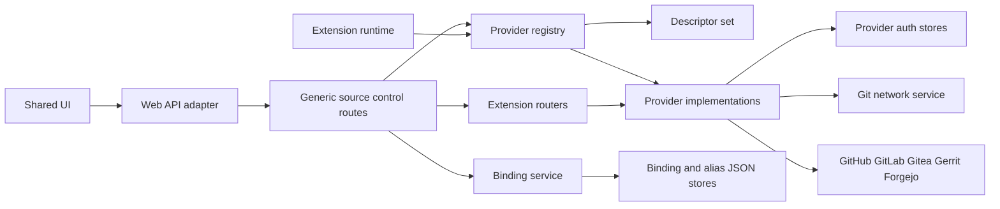
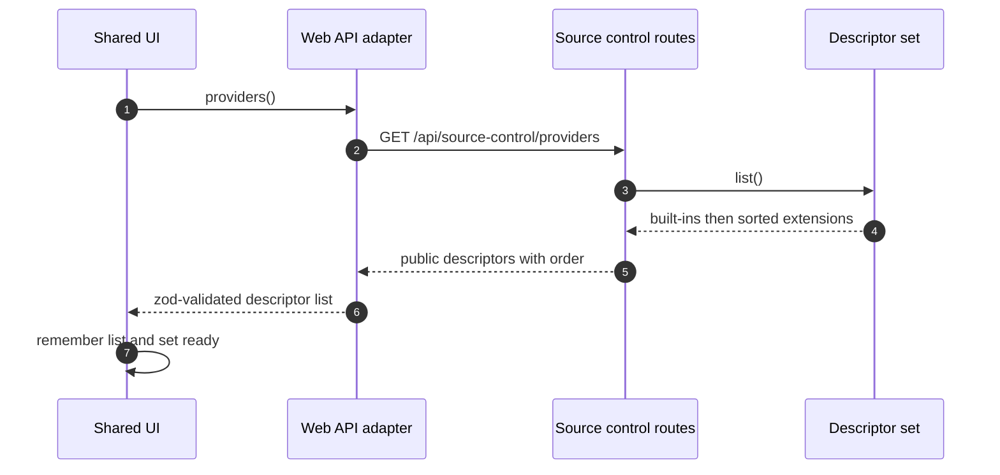
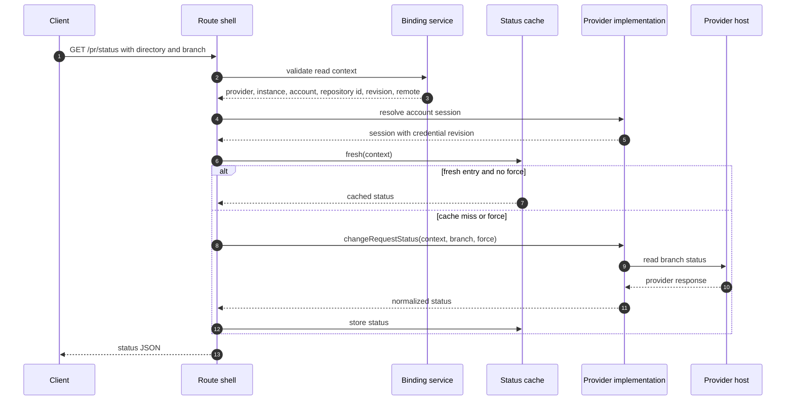

# Specification: Multi-provider source control

## Overview

The server keeps one descriptor set, one provider registry, and one HTTP route shell for every source control provider.
Descriptors carry presentation rules, capability flags, auth methods, instance rules, link templates, and limits.
The registry maps provider IDs to lazily loaded implementations and attaches extension providers after the fixed built-in order.
The route shell validates bound repository context, delegates reads and mutations to implementations, and keeps credentials outside binding records.
The shared UI fetches public descriptors, validates them with zod schemas, and renders provider-specific text and links from descriptor data.

## Architecture

## Data Models

### ProviderDescriptor

| Field | Type | Constraints | Description |
|---|---|---|---|
| id | ProviderId | Pattern `^[a-z][a-z0-9-]{0,31}$`, reserved IDs rejected | Stable provider identifier |
| label | string | Non-empty | Human-readable provider name |
| terminology | object | changeRequest and ci enums | Provider words for change requests and checks |
| referencePrefix | object | changeRequest and issue strings | Prefixes used in reference links and copy |
| iconId | string | Sprite or path identifier | Icon used by the shared UI |
| instance | object | form, defaults, normalize, origin | Instance parsing and normalization rules |
| repositoryPath | enum | owner/name, namespace/name, path | Project path style |
| capabilities | ProviderCapabilities | Typed flags and objects | Operations the provider supports |
| authMethods | object | device, pat, cli | Supported authentication methods |
| transport | object | HTTPS username and managed host rules | Git transport behavior |
| urls | object | Thread host list and pattern | Host URL matching rules |
| trackedItems | object | nestedOwners, defaultInstance, batchLimit | Live tracked item rules |
| limits | object | commentMaxLength, reviewerId, labelsMax, reviewersMax | Input bounds |
| identity | object | noReplyEmail function or null | Commit identity rule |
| settings | array | key, type, secret, scope | Provider-specific settings fields |
| presentation | object | labels, icons, URLs, features | UI rendering rules |
| routeAliases | object | optional | Legacy auth path aliases and retired paths |
| extension | object | optional | Guest id, name, version, and token format |

### ProviderCapabilities

| Field | Type | Constraints | Description |
|---|---|---|---|
| projects | boolean | Required | Project metadata reads |
| issues | boolean | Required | Issue reads and updates |
| changeRequests | boolean | Required | Change request reads and creates |
| draftChangeRequests | boolean | Required | Ready and draft transitions |
| merge | false or object | methods array | Merge methods, including submit-only hosts |
| comments | boolean | Required | Comment operations |
| reviewThreads | object | start, reply, resolve | Review thread operations |
| reviewDrafts | object | optional | Review draft file comments |
| uploads | boolean | Required | Upload reads |
| stacks | boolean | Required | Change request stack reads |
| changeRequestPatch | boolean | Required | Patch and file reads |
| liveSummaries | boolean | Required | Live tracked item summaries |
| referencePicker | boolean | Required | Reference search and detail reads |
| multipleAccounts | boolean | Required | Multiple connected accounts |
| reviewModel | enum | optional | verdict or votes |
| createVia | enum | optional | api or push |
| discussions | boolean | optional | Discussion operations |

### PublicProviderDescriptor

| Field | Type | Constraints | Description |
|---|---|---|---|
| id | ProviderId | From ProviderDescriptor | Provider identifier |
| label | string | From ProviderDescriptor | Provider label |
| order | number | Built-ins first, extensions sorted | Render order |
| terminology | object | Prefixes, abbreviation, prompt noun, ci | UI wording |
| icon | object | sprite, filledSprite, path | UI icon source |
| repository | object | nestedNamespaces, pathStyle | Project path interpretation |
| instances | object | format, defaults, multiple, reserved, placeholder | Instance input rules |
| auth | object | methods, cliName, login, cliTransport, token | Authentication UI |
| settings | object | fields array | Settings form fields |
| urls | object | changeRequest, issue, discussion, commit, user, resolve | Link templates |
| features | object | Presentation flags plus capability flags | Feature availability |
| extension | object | optional | Extension guest metadata |

### AccountIdentity and ProviderSession

| Field | Type | Constraints | Description |
|---|---|---|---|
| provider | ProviderId | From registry | Provider owning the account |
| instance | string | Normalized | Instance URL or host |
| accountId | string | Provider-specific | Account key used by the auth store |
| credentialRevision | number or null | Monotonic when present | Invalidates sessions and caches |
| providerUserId | string | Provider-specific | Actor attribution |
| secretKind | enum | oauth, pat, cli | Credential kind |
| persisted | boolean | Auth store state | Whether credentials survive restart |

### ProviderReadContext and ProviderMutationContext

| Field | Type | Constraints | Description |
|---|---|---|---|
| directory | string | Local repository path | Request scope |
| repositoryId | string | Binding repository id | Authoritative repository identity |
| provider | ProviderId | From route | Provider handling the request |
| instance | string | Normalized | Provider instance |
| accountId | string | From session | Active account |
| bindingRevision | number | Monotonic | Binding state version |
| primaryRemote | string | Git remote name | Remote used for branch and head reads |
| linked | boolean | optional | Linked repository flag |
| idempotencyKey | string | Mutation context only | Mutation replay key |
| target | BindingMutationTarget | Mutation context only | Validated mutation target |

### RepositoryBinding

| Field | Type | Constraints | Description |
|---|---|---|---|
| provider | ProviderId | From registry | Source control provider |
| instance | string | Normalized | Provider instance |
| accountId | string | Provider auth store key | Bound account reference |
| repositoryId | string | Stable repository id | Bound repository reference |
| bindingRevision | number | Monotonic | Binding state version |
| primaryRemote | string | Git remote name | Git transport source |
| credentialId | string | opaque | Managed HTTPS credential reference |
| credentialRevision | number | Monotonic | Credential version |
| providerUserId | string | From auth store | Actor and audit attribution |
| auxiliary | array | submodule or lfs plus redacted endpoint metadata | Secondary checkout credentials |

### ExtensionProviderRegistration

| Field | Type | Constraints | Description |
|---|---|---|---|
| guestId | string | Guest extension id | Source of the ext- prefix |
| id | ProviderId | `ext-<guestId>` | Registered provider id |
| descriptor | ProviderDescriptor | Validated | Provider presentation and capabilities |
| implementation | ProviderImplementation factory | Validated | Auth and resource behavior |
| router | Express Router | Mounted on demand | Routes under /api/source-control/ext-* |

## API Contracts

The route shell owns the generic HTTP contract.
Provider implementations own response bodies for their domain reads and mutations.
No normative OpenAPI file exists for this feature.

| Method | Path | Purpose |
|---|---|---|
| GET | /api/source-control/providers | List public provider descriptors in registry order |
| GET | /api/source-control/instances | List instances with aliases and unavailable providers |
| POST | /api/source-control/instances/aliases | Store instance aliases |
| GET | /api/source-control/repository-context | Resolve a directory to bound repository context |
| GET | /api/source-control/binding | Read the current repository binding |
| POST | /api/source-control/binding/provider | Bind a directory to a provider account and project |
| POST | /api/source-control/binding/transport | Bind a managed HTTPS transport credential |
| POST | /api/source-control/binding/transport/remove | Remove a managed transport credential |
| POST | /api/source-control/binding/reset | Clear a repository binding |
| POST | /api/source-control/binding/auxiliary | Store submodule or LFS credential metadata |
| GET | /api/source-control/{provider}/capabilities | Return static capability flags plus dynamic auth capabilities |
| GET | /api/source-control/{provider}/auth/status | Return provider auth status for an instance |
| GET | /api/source-control/{provider}/auth/accounts | List connected provider accounts |
| POST | /api/source-control/{provider}/auth/token | Connect a personal access token |
| POST | /api/source-control/{provider}/auth/ssh-url | Read or set a provider SSH URL |
| POST | /api/source-control/{provider}/auth/activate | Select the active account |
| POST | /api/source-control/{provider}/auth/cli | Inspect or disable CLI authentication |
| DELETE | /api/source-control/{provider}/auth | Remove a connected account |
| GET | /api/source-control/{provider}/me | Return 410 for the retired account route |
| GET | /api/source-control/{provider}/pr/status | Read change request status for the bound branch |
| GET | /api/source-control/{provider}/references | Search issues, pulls, or discussions |
| GET | /api/source-control/{provider}/references/detail | Read one reference with optional details |
| GET | /api/source-control/{provider}/references/status | Read statuses for a set of references |
| GET | /api/source-control/{provider}/references/labels | List available labels |
| GET | /api/source-control/{provider}/references/reviewers | List reviewer candidates |
| POST | /api/source-control/{provider}/references/across | Read references across bound contexts |
| GET | /api/source-control/{provider}/pr/review/state | Read draft review comments |
| GET | /api/source-control/{provider}/pulls/list | List change requests with filters and paging |
| GET | /api/source-control/{provider}/pulls/context | Read one change request with optional diff, checks, timeline, and references |
| GET | /api/source-control/{provider}/issues/list | List issues with filters and paging |
| GET | /api/source-control/{provider}/issues/get | Read one issue |
| GET | /api/source-control/{provider}/issues/comments | Read issue comments |
| GET | /api/source-control/{provider}/repo/upstream | Read project upstream metadata |
| GET | /api/source-control/{provider}/repo/branches | List project branches |
| GET | /api/source-control/{provider}/uploads/:secret/:filename | Stream a validated project upload |
| POST | /api/source-control/{provider}/pr/create | Create a change request |
| POST | /api/source-control/{provider}/pr/update | Update a change request |
| POST | /api/source-control/{provider}/pr/merge | Merge or submit a change request |
| POST | /api/source-control/{provider}/pr/ready | Mark a draft change request ready |
| POST | /api/source-control/{provider}/pr/draft | Convert a change request to draft |
| POST | /api/source-control/{provider}/pr/comment | Add a change request comment |
| POST | /api/source-control/{provider}/pr/thread/start | Start a review thread |
| POST | /api/source-control/{provider}/pr/thread/reply | Reply in a review thread |
| POST | /api/source-control/{provider}/pr/thread/resolve | Resolve a review thread |
| POST | /api/source-control/{provider}/issues/comment | Add an issue comment |
| POST | /api/source-control/{provider}/issues/update | Update an issue |
| POST | /api/source-control/{provider}/pr/comment/update | Edit a change request comment |
| POST | /api/source-control/{provider}/pr/comment/delete | Delete a change request comment |
| POST | /api/source-control/{provider}/issues/comment/update | Edit an issue comment |
| POST | /api/source-control/{provider}/issues/comment/delete | Delete an issue comment |
| POST | /api/source-control/{provider}/pr/state | Change change request state |
| POST | /api/source-control/{provider}/issues/state | Change issue state |
| POST | /api/source-control/{provider}/pr/labels | Update change request labels |
| POST | /api/source-control/{provider}/issues/labels | Update issue labels |
| POST | /api/source-control/{provider}/pr/reviewers | Update reviewers |
| POST | /api/source-control/{provider}/pr/review | Submit a review |
| POST | /api/source-control/{provider}/pr/review/comment | Add a review draft comment |
| POST | /api/source-control/{provider}/pr/review/comment/update | Edit a review draft comment |
| POST | /api/source-control/{provider}/pr/review/comment/delete | Delete a review draft comment |
| POST | /api/source-control/{provider}/pr/review/discard | Discard a review draft |
| POST | /api/source-control/{provider}/discussions/comment | Add a discussion comment |
| POST | /api/source-control/{provider}/discussions/comment/update | Edit a discussion comment |
| POST | /api/source-control/{provider}/discussions/comment/delete | Delete a discussion comment |
| POST | /api/source-control/{provider}/discussions/state | Change discussion state |
| POST | /api/source-control/{provider}/discussions/answer | Mark a discussion answer |
| POST | /api/source-control/{provider}/discussions/labels | Update discussion labels |
| POST | /api/source-control/{provider}/discussions/update | Update a discussion |

Error codes shared across endpoints:

| Status | Code | Description |
|---|---|---|
| 400 | INVALID_INPUT | Missing or malformed directory, project, number, instance, token, or upload parameters |
| 401 | INVALID_TOKEN | Provider rejected the supplied token |
| 404 | SOURCE_CONTROL_PROVIDER_UNAVAILABLE | Provider id has no loaded implementation |
| 409 | SOURCE_CONTROL_OAUTH_FLOW_BUSY | Device flow is already active |
| 409 | SOURCE_CONTROL_MUTATION_CONFLICT | Idempotency key was reused with different input |
| 410 | SOURCE_CONTROL_CONTEXT_REQUIRED | Legacy provider route is retired |
| 410 | SOURCE_CONTROL_OAUTH_FLOW_UNAVAILABLE | Device flow is unavailable |
| 501 | SOURCE_CONTROL_CAPABILITY_UNSUPPORTED | Provider does not declare or implement the operation |
| 502 | PROVIDER_UNREACHABLE | Upstream provider could not be reached |
| 503 | PROVIDER_TEMPORARILY_UNAVAILABLE | Upstream provider is temporarily unavailable |
| 500 | PROVIDER_ERROR | Provider implementation failed without a mapped provider response |

## Sequences

### Provider discovery and UI render

### Bound change request status read

## Technical Decisions

| Decision | Choice | Rationale |
|---|---|---|
| Provider identity | descriptor IDs with strict validation and reserved IDs | Prevents collisions with shell routes and unrelated integrations |
| Built-in order | GitHub, GitLab, Gitea, Gerrit, Forgejo, then sorted extensions | Keeps rendered provider lists stable |
| UI behavior | zod-validated public descriptors drive labels, icons, links, and terms | Shared components do not branch on provider ID |
| HTTP routing | one generic shell mounts the same endpoints for every provider | Provider modules implement contracts through the shared shell |
| Implementation loading | lazy factories in the provider registry | Provider modules load only when a route needs them |
| Credentials | provider auth stores hold tokens and bindings hold opaque references | Reduces secret exposure in repository state and logs |
| Status freshness | 90 second cache keyed by account, credentials, binding, branch, and remote | Avoids repeated upstream reads while honoring state changes |
| Mutations | executor with idempotency keys and replay reconciliation | Repeated requests do not create duplicate upstream changes |
| Extension support | `ext-<guestId>` IDs with on-demand routers | Extension providers use the same contract as built-ins |
| Older servers | GitHub and GitLab descriptor fallback in the web adapter | Shared UI works against server versions without the provider route |

## Risks and Unknowns

1. Extension providers depend on guest registration and host trust rules from the extensions subsystem.
2. Upstream provider APIs change independently and may invalidate mapper assumptions for GitLab, Gitea, Gerrit, or Forgejo.
3. The older-server fallback covers GitHub and GitLab only, so other providers disappear until the server is upgraded.
4. Path-style projects and top-level projects need descriptor-specific link and thread-key handling.
5. Multi-account behavior relies on every provider implementation honoring the active account from its auth store.
6. Provider route bodies are implementation-defined, so the shared table records endpoints and error codes only.

## Out of Scope

- GitHub-only behavior already covered by FEAT-0002-git-github-integration.
- Provider-neutral issue trackers, which belong to the tracker subsystem.
- Git network credential execution, which belongs to the Git network service.
- Changes to OpenCode itself, which lives in a separate repository.
- A committed OpenAPI schema for provider-specific request and response bodies.
- Changelog entries, which the maintainer writes through the changelog skill.
