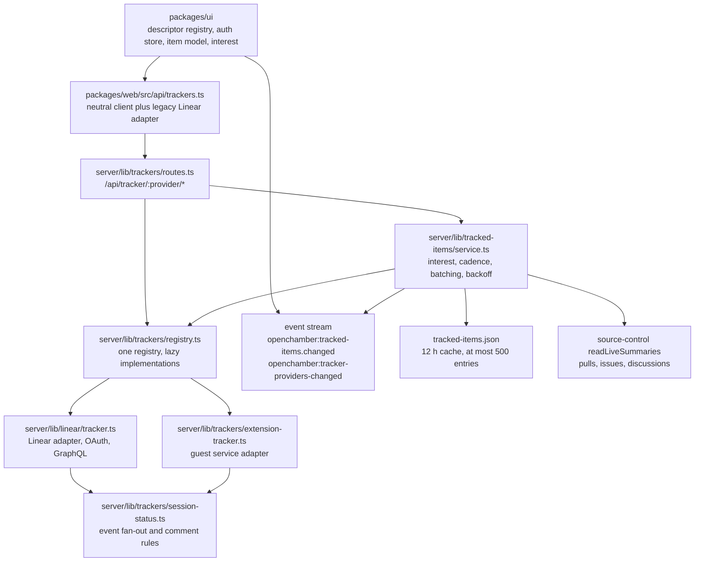
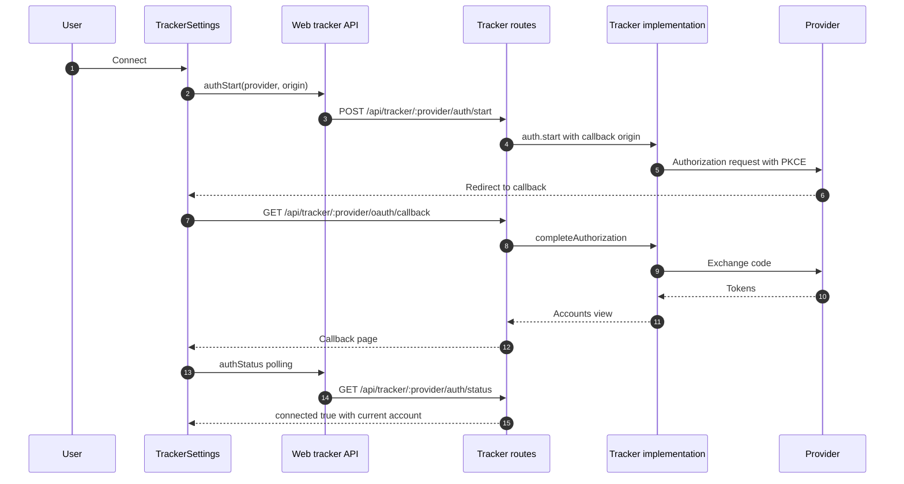
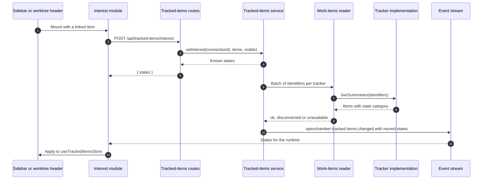

# Specification: Issue trackers and tracked items

## Overview

The server keeps one tracker registry and exposes provider-neutral routes over `/api/tracker/:provider/*`.
Linear is the first built-in implementation and maps its own GraphQL shapes to the neutral contract inside `packages/web/server/lib/linear/`.
Extensions can attach trackers with ids made of the prefix `ext-` followed by the guest id through the same registry, with a per-call service handle carrying credentials.
The tracked-items service follows only items that clients or server modules declare, reads them in batches and publishes moved states on the event stream.
The shared UI mirrors the descriptor list per runtime, gates surfaces by capability and connected account, and keeps the last known states in a client cache.

## Architecture

## Data models

### Tracker descriptor

Defined in `packages/web/server/lib/trackers/tracker-contract.d.ts` and mirrored by the UI descriptor schema.

| Field | Type | Constraints | Description |
|---|---|---|---|
| id | string | `^[a-z][a-z0-9-]{0,31}$`, shared namespace with source control | Provider key used in all route paths and identities |
| name | string | served JSON | Human name shown by a generic UI fallback |
| authMethods | readonly array of `oauth` and `token` | browser sign-in listed first when both apply | Ways a client can connect |
| capabilities | object of booleans | gates routes and UI actions | `multipleAccounts`, `stateUpdate`, `children`, `labels`, `priority`, `filters`, `projectMapping`, `sessionComments`, `hostAccess` |
| stateFilters | readonly string array | menu order | Accepted values for the list `state` query |
| urlPatterns | readonly array | host, path and optional query name | Patterns used by server and client link matchers |
| identifierPattern | string | bounded regular expression | Shape an extracted identifier must match |

### Tracker account and auth status

| Field | Type | Constraints | Description |
|---|---|---|---|
| id | string | generated by the provider | Account or workspace id used by `activate` |
| name | string or null | optional | Workspace or instance label |
| current | boolean | one current account | Account used for reads and writes |
| status | `valid` or `invalid` | extension trackers | Written-off credentials are listed but not signed in |
| connect | object | extension trackers | Instance, client presence and redirect URI for the Settings card |
| connected | boolean | top level | Disconnected may still carry accounts for the card |

### Tracker item

| Field | Type | Constraints | Description |
|---|---|---|---|
| provider | string | tracker id | Added to every item, including extension items |
| id | string | provider stable id | Identity for get and update calls |
| identifier | string | case-insensitive human key | Used in links, tracked-item keys and comments |
| title | string | required | Display title |
| url | string | public origin | Link opened by Tracker tabs |
| state | object or null | name, id, category | Category is one of triage, backlog, todo, in-progress, done, canceled |
| priority | `none` to `low` | Linear maps 0 to 4 | Optional neutral priority |
| labels | array of objects | id, name, color | Absent when the provider is not asked for labels |
| container | object or null | id, key, name | Linear team, used for mapping and workflow states |
| parent | item summary or null | recursive | Parent issue without labels |
| progress | object or null | total, done, more | Counts may cover only the first children |
| comments | array | id, body, createdAt, author | Present on a full item, not a summary |
| children | array of summaries | first page only | `childrenMore` marks further pages |

### Tracked item and state

Defined in `packages/web/server/lib/tracked-items/contracts.ts` and `packages/ui/src/lib/trackedItems/model.ts`.

| Field | Type | Constraints | Description |
|---|---|---|---|
| provider | string | well-formed provider id | Source-control id or tracker id |
| kind | `pull`, `issue`, `discussion`, `work-item` | discussion only where supported | Item shape |
| identifier | string | `^[A-Za-z0-9][A-Za-z0-9._-]{0,127}$` | Work-item human key, upper-cased |
| owner, repo, number | string, string, number | repository and positive issue number | Thread identity; repo may be a whole project path |
| instance | string | origin or host form | Host for a thread, absent for a work item |
| accountId | string | case-sensitive opaque id | Account that reads a bound pull request |
| key | string | server and UI identical | `${provider}|${IDENTIFIER}` or `${provider}|${instance}|${kind}|${owner}/${repo}#${number}[@accountId]` |
| state | object or null | provider shape or `{ name, category }` | Null means unknown, never a guessed closed state |
| fetchedAt | number | epoch milliseconds | Freshness and cache ordering |

### Tracked-items event and cache record

| Field | Type | Constraints | Description |
|---|---|---|---|
| type | string | `openchamber:tracked-items.changed` | Event name sent to interested connections |
| states | array of records | key, item, state, fetchedAt | Only moved states are published |
| requestedAt | number | server listeners only | When the read began, so stale answers can be dropped |
| version | number | 1 | Version of the `tracked-items.json` envelope |
| items | array of records | at most 500, 12 h retention | Atomic temp-file and rename write 2 s after a change |

## API contracts

All tracker routes are registered before the legacy Linear routes and are host-only.
JSON bodies on these routes are capped at 16kb.

| Method | Path | Purpose |
|---|---|---|
| GET | /api/tracker/providers | List served descriptors |
| GET | /api/tracker/:provider/auth/status | Auth status with accounts and optional connect info |
| POST | /api/tracker/:provider/auth/start | Start browser sign-in, with origin and optional instance |
| POST | /api/tracker/:provider/auth/token | Connect a token for an extension tracker |
| PUT | /api/tracker/:provider/auth/oauth-client | Save an extension tracker's OAuth client |
| GET | /api/tracker/:provider/oauth/callback | Public browser callback page for extension trackers |
| POST | /api/tracker/:provider/auth/activate | Switch the current account |
| DELETE | /api/tracker/:provider/auth | Disconnect the current account |
| GET | /api/tracker/:provider/items/list | List items with query, cursor, state, people, priority and containerId |
| GET | /api/tracker/:provider/items/get | Get one item by id |
| POST | /api/tracker/:provider/items/update | Set an item's state by stateId |
| GET | /api/tracker/:provider/states | List workflow states for a container |
| GET | /api/tracker/:provider/mapping | Read default and per-container project paths |
| PUT | /api/tracker/:provider/mapping | Replace project paths |
| GET | /api/tracker/:provider/preferences | Read the session-comments preference |
| PUT | /api/tracker/:provider/preferences | Write the session-comments preference |
| POST | /api/tracker/:provider/session-status | Post started, completed or failure |
| POST | /api/tracker/:provider/read-cache/refresh | Refresh cached reads for one provider |

Tracked-items routes parse 128kb bodies.

| Method | Path | Purpose |
|---|---|---|
| POST | /api/tracked-items/interest | Replace a connection's visible items and answer known states |
| POST | /api/tracked-items/presence | Mark a connection visible or hidden |
| POST | /api/tracked-items/refresh | Refresh the listed items now |

Legacy Linear routes stay available at `/api/linear/auth/*`, `/api/linear/issues/list`, `/api/linear/issues/get`, `/api/linear/issues/states`, `/api/linear/issues/update`, `/api/linear/mapping`, `/api/linear/preferences`, `/api/linear/session-status` and `/linear/oauth/callback`.

Error codes shared by tracker routes:

| Status | Code | Description |
|---|---|---|
| 400 | INVALID | Missing, malformed or unsupported filter, body field or provider user error |
| 404 | UNKNOWN_TRACKER | No descriptor for the provider id |
| 404 | UNSUPPORTED | Capability or implementation part is absent |
| 404 | ACCOUNT_NOT_FOUND | Activation named an account that is not stored |
| 404 | NOT_FOUND | Unregistered path under `/api/tracker` |
| 409 | Unknown connection code | Tracked-items interest named a connection that is not open |

Connect-specific extension errors carry their assigned status and code, including `INSTANCE_REQUIRED`, `TOKEN_REFUSED`, `STATE_MISMATCH`, `CONNECT_SUPERSEDED`, `MALFORMED_PROVIDER_RESPONSE` and `TRACKER_UNAVAILABLE`.
A provider error that is not a route error answers 500 even when it carries a status and a code, matching the legacy Linear routes.

## Sequences

### Browser sign-in for a tracker

### Live state of a linked work item

## Technical decisions

| Decision | Choice | Rationale |
|---|---|---|
| One registry on the server | Descriptors are served and implementations load lazily | A phone bundles its UI and talks to servers of other versions, so the server says which trackers exist |
| Neutral contract per tracker module | Linear shapes are mapped inside `../linear/` | Routes, UI and tracked items need no provider names |
| Legacy `/api/linear` alias | Both route sets call the same Linear functions | Older bundled UIs and host-Linear SDK guests keep working |
| Extension trackers attach to the same registry | Catalog reconciliation adds and removes `ext-` entries | Every consumer reads one list and one implementation path |
| Interest-driven tracked items | Clients declare visible items; the server never polls them blindly | Refresh cost follows what is on screen, with server followers as an explicit exception |
| Shared keys computed on both sides | Same identity strings in `items.ts` and `model.ts` | Legacy records keep their key and no migration is needed |
| Server-side preference and comment rules | The event hub posts session comments without a UI call | Origin reachability and dedupe cannot be decided in a renderer |
| Bounded local caches with atomic server writes | Temp file and rename, 12 h retention, 500 entries | Restarts show last known colours without letting cache grow without limit |
| Presentation compiled into the UI | Marks, translated nouns and branch prefixes live in `presentation.ts` | Translated text cannot come from the server |

## Risks and unknowns

1. A Linear state type added after this build reads as the todo category in live summaries until the mapping table is updated.
2. The OAuth broker is a remote dependency for built-in sign-in; a custom broker must implement start, callback, poll and complete with the same contract.
3. Extension services can be slow or unavailable, so reads and writes have per-method deadlines and write-off rules tied to observed 401 answers.
4. An older bundled UI can rewrite session links it cannot read, which is why Linear links keep `kind: 'linear'`.
5. A tracked item whose provider disappears reads as disconnected until the tracker returns; its state stays null rather than being guessed.
6. Oversized interest lists are rejected rather than truncated, so a surface that declares too much must shrink its own set.

## Out of scope

- Starting sessions or worktrees from a GitHub issue, which is covered by FEAT-0022-github-issue-pr-starters.
- Inbound Linear webhooks and issue actions initiated from Linear.
- Treating GitHub, GitLab, Gitea or Gerrit repositories as trackers; they stay in the source-control registry.
- Tracker surfaces in VS Code, which has no tracker API and no OpenChamber event stream.
- Product decisions about which tracker to enable by default or how a new tracker should be named in the UI.
