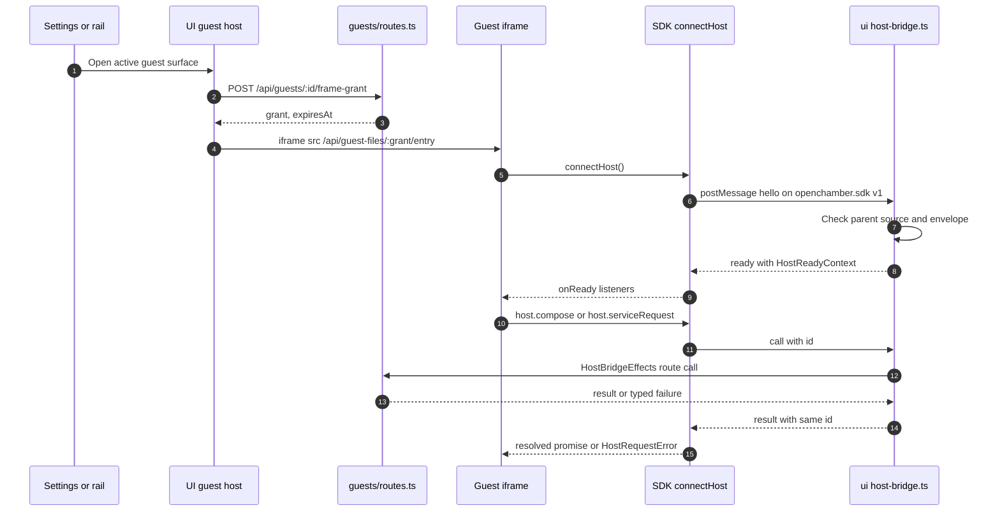
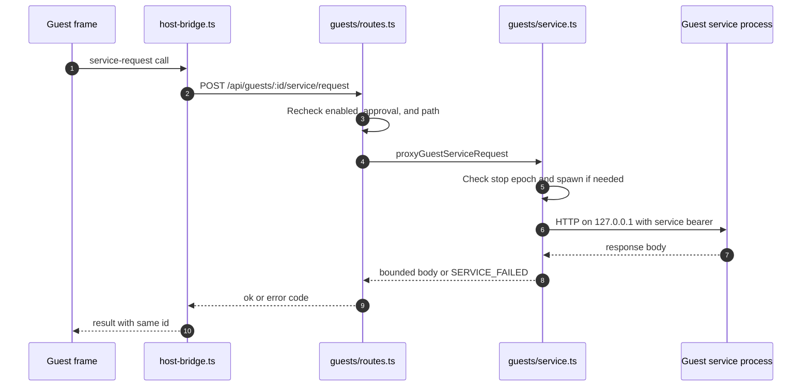
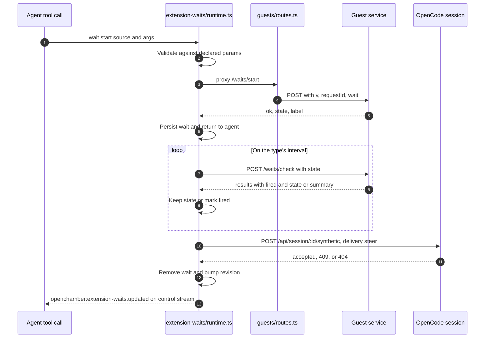

# Specification: Guest extensions and extension host

## Overview

The host treats each extension package as untrusted content.
Installation parses the manifest with `packages/sdk`, validates built assets, and stores a catalog row in the instance data directory.
The UI resolves package frames through short-lived grants, mounts them in sandboxed iframes, and brokers `postMessage` calls through the SDK wire contract.
Guest requests that need network, files, a model, or a local process go through server routes that recheck the current grant and pause state.
Extension waits keep agent-facing timers and service polling in the server so a service can stay stateless and stop between checks.
Built-ins use the same contract through an app-owned registry and receive only their declared grants automatically.

## Architecture

```mermaid
flowchart LR
    Author[Extension package] --> Manifest[packages/sdk parse.ts]
    Registry[packages/extensions/registry.json] --> Build[build-builtin-extensions.mjs]
    Build --> Bundled[packages/web/server/built-in-extensions]
    Source[Folder, ZIP, Git or SSH source] --> Install[guests/install.ts]
    Bundled --> Install
    Manifest --> Install
    Install --> Store[(extensions.json)]
    Store --> Catalog[guests/catalog.ts]
    Catalog --> Routes[guests/routes.ts]
    Routes --> Assets[guests/files.ts and frame-grants.ts]
    Routes --> Proxy[guests/request.ts and service.ts]
    Routes --> HostAPI[guests/host-callback.ts and service-host-api.ts]
    Proxy --> Service[(Guest service process)]
    Service --> Callback[guests/host-callback.ts]
    Callback --> HostAPI
    UICatalog[ui lib/guests/store.ts] --> UIHost[ui components/layout/GuestHosts]
    UIHost --> Bridge[ui lib/guests/host-bridge.ts]
    UIHost --> Pane[GuestSurfacePane and SurfaceClient]
    UIHost --> FrameURL[ui lib/guests/frame-url.ts]
    Pane --> Assets
    FrameURL --> Assets
    Bridge --> Routes
    UISync[ui sync/extension-waits.ts] --> UIHost
    Waits[extension-waits/runtime.ts] --> Service
    Waits --> WaitRoutes[GET and DELETE extension-waits]
    WaitRoutes --> UISync
    SDK[@openchamber/sdk and sdk/schemas] --> Manifest
    SDK --> Bridge
    SDK --> Pane
```

## Data Models

### Manifest

The normative parser is `openChamberManifestSchema` and `packageManifestSchema` in `packages/sdk/src/parse.ts:829`.
Both a bare block and `{ "version": ..., "openchamber": { ... } }` are accepted.
Legacy top-level `id`, `name`, and `icon` are lifted into `contributes.panel`.

| Field | Type | Constraints | Description |
|---|---|---|---|
| apiVersion | number | literal 1 | Manifest format accepted by this host. |
| engines.openchamber | string | semver or range like `>=1.22.0` | Minimum host version checked at install and update. |
| contributes | object | required, strict contributions | Everything the extension adds to the app. |
| contributes.panel.id | string | kebab-case, starts with a letter | Stable installation and URL identity. |
| contributes.panel.name | string | non-empty | Display name. |
| contributes.panel.icon | string | Remixicon name or package SVG path | Rail icon. |
| contributes.panel.entry | string | safe relative package path | Visible panel HTML. |
| contributes.panel.dock | enum | dock values from the SDK | Places the page beside a shared surface. |
| contributes.panel.size | number | SDK dock size range | Width in CSS pixels for that dock. |
| contributes.panel.mobile | true | optional | Phone opt-in for the panel. |
| version | string | semver, optional in package.json envelope | Shown on the extension card and used by update checks. |

### Contributions

The full contribution shape is `OpenChamberContributes` in `packages/sdk/src/manifest.ts:621`.
Install validation in `packages/sdk/src/parse.ts:744` enforces the relationships between them.

| Field | Type | Description |
|---|---|---|
| background | `{ entry: string }` | On-demand execution HTML with no visible surface. |
| attach | boolean, mode, or object | Adds the guest to composer and worktree attach menus. |
| page | true or `{ entry?, title?, mobile? }` | Full-screen page. |
| statusSection | true or `{ entry?, source?, title?, height?, ... }` | Work Status section or service-backed source. |
| capabilities | array of 6 declared names | `prompt`, `sessions`, `files`, `model`, `shells`, `microphone`. |
| integration | object | OAuth, token, or host integration with declared settings. |
| service | object | Host-run process with `entry`, `runtime: "host"`, permissions, provides, surface, keepRunning, and schedule. |
| filesystem | array of paths | Absolute or `~/` patterns for file access outside the project. |
| origins | array of HTTPS origins | Additional origins the guest may reach. |
| actions, commands, tools | arrays | Context actions, slash commands, and tool presentations. |
| providerLogos | map | Provider id to package SVG or PNG path. |
| fileEditors, blocks, links, mentions | objects or arrays | Editors, message blocks, link rules, and `@` mentions. |
| sourceControl, notifications, tracker, quota | objects | Declarations for matching service roles. |
| sessionEvents, sessionControl, instructions, skills, opencodePlugin | objects or flags | Session-scoped service roles and host context contributions. |
| waits, marks | array or flag | Agent waits and sidebar marks. |

### Capability grants

`requestedGuestCapabilities` in `packages/sdk/src/manifest.ts:662` derives the requested set.
`GUEST_CAPABILITIES` is the full vocabulary and `DECLARED_GUEST_CAPABILITIES` is the subset an author may declare directly.

| Source | Capability |
|---|---|
| Declared `contributes.capabilities` | prompt, sessions, files, model, shells, microphone. |
| Action with a `messages` payload | conversation. |
| `contributes.service` | service. |
| `provides: ["opencode"]` | opencode. |
| `contributes.integration` | network. |
| `contributes.filesystem` | filesystem. |
| `contributes.origins` | origins. |
| Session content from events or session control | transcript. |
| `sessionControl` and its `answers` flag | sessionControl, sessionAnswers. |
| `instructions`, `skills`, `opencodePlugin`, `links` | Same named capabilities. |
| `waits`, `marks` | wake, marks. |

`isGuestApproved` requires every requested capability to be present in the granted list.
`effectiveGrants` in `packages/web/server/lib/guests/enterprise.ts` narrows stored grants when the recorded scope no longer matches the package.

### Guest catalog row

`GuestPackage` and `GuestRecord` are defined in `packages/web/server/lib/guests/contracts.ts:7`.

| Field | Type | Description |
|---|---|---|
| id, name, icon | string | Identity from the parsed panel contribution. |
| packageRoot | string | Canonical package directory. |
| entry, backgroundEntry, pageEntry, statusEntry | string, optional | Validated package-local frame paths. |
| attach, attachEntry | string, optional | Attach mode and optional dialog HTML. |
| version, engines, revision | string, string, number | Version metadata and file-change count. |
| capabilities | `{ requested, granted }` | Public capability slice from the SDK. |
| service | object | Runtime, permissions, socket bindings, and `granted`. |
| integration | object | Public name, description, auth, and settings. No URLs or tokens. |
| storageId | string | Opaque installation identity for device-local storage. |
| enabled, capabilityGrants, folders | boolean, array, array | Pause state, approval record, and display scope. |
| sourceControl, sessionEvents, notifications, tracker, quota, waits | objects | Public slices for the approval dialog and cards. |
| enterpriseBlocked | array | Capabilities refused by current enterprise policy. |

### Wire envelope

`GuestMessage`, `HostMessage`, and `readHostMessage` live in `packages/sdk/src/contract.ts:548`.

| Field | Type | Description |
|---|---|---|
| channel | literal `openchamber.sdk` | Rejects unrelated frame traffic. |
| v | literal 1 | Wire version. |
| type | string | Message discriminant such as `hello`, `ready`, `request`, or `result`. |
| id | string, optional | Request correlation id for calls and results. |
| payload | object, optional | Typed message body. |
| ok, error, code | boolean, string, enum | Result status and `HostRequestErrorCode`. |

`HostReadyContext` in `packages/sdk/src/contract.ts:188` carries theme, locale, directory, session, surface, connection, settings, item, optional block, optional popover, feature flags, and device metrics.

### Extension wait record

The wait contract is `packages/sdk/src/waits.ts:3` and the server store is documented in `packages/web/server/lib/extension-waits/DOCUMENTATION.md:87`.

| Field | Type | Description |
|---|---|---|
| id, sessionID, directory | string, string, string or null | Wait identity and owning session. |
| guestId, type, title, label | string or null, string, string, string or null | Extension owner and display text. |
| args, state | object, JSON value | Validated arguments and opaque service state posted back on each check. |
| nextCheckAt, failingSince | number | Due time and start of consecutive check failures. |
| wake | object or null | Persisted wake message and its message id. |
| status | enum | `waiting` or `waking` in the client projection. |

The wait wire uses `v: 1`, `requestId`, and the paths `/waits/start` and `/waits/check`.
Check intervals range from 10,000 ms to 3,600,000 ms with a 30,000 ms default.
The store caps at 200 waits overall and 20 per session.

### Frame grants and stores

| Store | Shape | Owner |
|---|---|---|
| `extensions.json` | Install rows, grants, auth targets, folder limits, storage ids, and socket overrides. | `packages/web/server/lib/guests/persist.ts` |
| `guest-auth.json` | Tokens, client credentials, and the target each was minted for. | `packages/web/server/lib/guests/auth-store.ts` |
| `guest-storage/<id>.json` | Instance-scoped guest key/value data. | `packages/web/server/lib/guests/storage.ts` |
| `guest-data/<id>/` | Service-owned data directory created before spawn. | `packages/web/server/lib/guests/service.ts` |
| `extension-waits.json` | Waits, timers, state, and wake ids. | `packages/web/server/lib/extension-waits/runtime.ts` |
| Frame grant | Random 32-character grant, one per extension, 12-hour idle expiry, memory only. | `packages/web/server/lib/guests/frame-grants.ts` |

## API Contracts

This specification does not define an OpenAPI surface, so no `api.yaml` is part of this feature.
The normative route contract is the Express handlers in `packages/web/server/lib/guests/routes.ts` and `packages/web/server/lib/extension-waits/runtime.ts`, summarized in `packages/web/server/lib/guests/DOCUMENTATION.md`.

| Method | Path | Purpose |
|---|---|---|
| GET | /api/guests | List installed and built-in guests with public metadata and effective grants. |
| POST | /api/guests | Install a folder, local ZIP, or Git source, optionally replacing an id. |
| POST | /api/guests/upload | Install a ZIP body for browser and remote instances. |
| POST | /api/guests/updates/check | Check Git installs for newer semver versions. |
| POST | /api/guests/:id/update | Refresh a Git install. |
| DELETE | /api/guests/:id | Remove an install and stop its service. |
| PUT | /api/guests/:id/capabilities | Grant the exact requested set or withdraw approval. |
| PUT | /api/guests/:id/enabled | Pause or resume a guest. |
| PUT | /api/guests/:id/folders | Limit the directories where surfaces appear. |
| PUT | /api/guests/:id/settings | Save declared integration settings. |
| PUT | /api/guests/:id/token | Save a pasted API token. |
| PUT | /api/guests/:id/oauth/client | Save OAuth client id and secret. |
| POST | /api/guests/:id/oauth/start | Start OAuth with PKCE S256. |
| GET | /api/guests/:id/oauth/callback | Complete OAuth without a UI bearer. |
| DELETE | /api/guests/:id/oauth | Drop tokens for one guest. |
| POST | /api/guests/:id/request | Proxy to the declared HTTPS `apiOrigin`. |
| POST | /api/guests/:id/service/request | Proxy to the guest's loopback service. |
| GET | /api/guests/:id/service/status | Report `stopped`, `starting`, `ready`, or `failed`. |
| POST | /api/guests/:id/files | Read, write, list, or stat an approved path. |
| POST | /api/guests/:id/generate | Call the Small Model with an approved `model` grant. |
| POST | /api/guests/:id/frame-grant | Mint a package-file grant for an extension with a frame. |
| GET | /api/guest-files/:grant/{*filePath} | Serve package files under that grant. |
| GET | /api/guests/marks | List current sidebar marks from running services. |
| WS | /api/guests/:id/surface/ws | Attach a viewer to a shared surface session. |
| GET | /api/extension-waits | List the session's waits with a revision. |
| DELETE | /api/extension-waits/sessions/:sessionID | Stop one wait or every wait of a session. |

Error codes shared across endpoints:

| Status | Code | Description |
|---|---|---|
| 400 | invalid-manifest | Manifest or built asset validation failed. |
| 400 | invalid-path, invalid-url, invalid-folders | Install input failed validation. |
| 400 | DISABLED, NOT_GRANTED, NO_SERVICE, BAD_PATH | The guest is paused, unapproved, absent, or out of scope. |
| 400 | NO_MODEL, MODEL_FAILED | The Small Model is unavailable or failed. |
| 403 | enterprise-mode | Enterprise policy refuses the source or capability. |
| 404 | NOT_FOUND | Unknown extension or resource. |
| 409 | id-taken, already-installed | Duplicate install. |
| 409 | no named code | Extension wait caps refuse a new wait without evicting one. |
| 413, 415 | too-large, unsupported-media-type | Upload body over the cap or wrong content type. |
| 500 | invalid-store | Catalog or auth store cannot be read. |
| 502 | SERVICE_FAILED, REQUEST_FAILED, RESPONSE_TOO_LARGE | Service never became ready, answer unusable, or body over the cap. |

## Sequences

### Guest connect and a host call



### Service-backed request



### Extension wait



## Technical Decisions

| Decision | Choice | Rationale |
|---|---|---|
| Contract ownership | All guest types, limits, protocol helpers, and parsers live in `packages/sdk`. | Host and guest use one definition, and a bundled panel does not need a schema library. |
| Manifest validation | Fail closed with specific codes in `parse.ts`. | An invalid install is reported to the author instead of becoming a partially working extension. |
| Grant enforcement | Catalog rows carry effective grants, and routes recheck enablement and scope. | A policy change or version bump counts at once, even with a warm catalog cache. |
| Frame loading | Short-lived grants in the URL path, with legacy token and relay fallbacks. | Sandboxed frames have an opaque origin and lose `SameSite=Lax` cookies behind sign-in proxies. |
| Local capability | Host-owned child process behind a loopback proxy with a per-process bearer. | The iframe never sees a socket or a product-specific integration. |
| Waits | Host keeps timers, state, caps, and delivery; service answers `/waits/check`. | A service can stay stateless and stop between checks without `keepRunning`. |
| Built-ins | App-owned registry with stable `openchamber-builtin-` ids and declared grants. | First-party extensions use the same boundary as third-party ones. |
| Folders | Display scope only, not an authorization. | A service is one process for the server and should not restart on project switches. |
| Storage | Instance storage on the server, device storage in renderer preferences keyed by runtime and installation. | Each runtime identity partitions its own local data without trusting a URL alias. |
| UI parsing | Parse catalog rows and fields one at a time. | A newer server or a broken row must not hide unrelated extensions. |

## Risks and Unknowns

1. Sandboxed frames have an opaque origin, so browser APIs such as `getUserMedia` must be proxied by the host.
2. A guest service that never answers readiness is `SERVICE_FAILED`, while a sent request with no usable answer is `REQUEST_FAILED`, because the service may already have acted.
3. Frame grants are in-memory and expire after 12 idle hours or a restart, so long-lived frames need renewal and relay clients use a different path.
4. A slow catalog read can delay a due timer's wake, although it cannot cancel the timer.
5. A package that changes its API origin or OAuth endpoints invalidates stored credentials by design.
6. Enterprise policy and built-in allowlist changes depend on server startup and catalog reads to take effect.
7. VS Code and isolated spaces deliberately have no extension runtime, so their surfaces must stay hidden or unsupported.

## Out of Scope

- The OpenCode plugin manager in Settings → Plugins, which is a different feature.
- Authoring tools and bundler internals beyond their install-time validation and output shape.
- Third-party extension hosting, signing, or a public marketplace.
- New SDK wire versions, new capability names, or new service roles.
- Browser end-to-end automation for the frame and service flows.
- An OpenAPI document for the Express routes described above.
