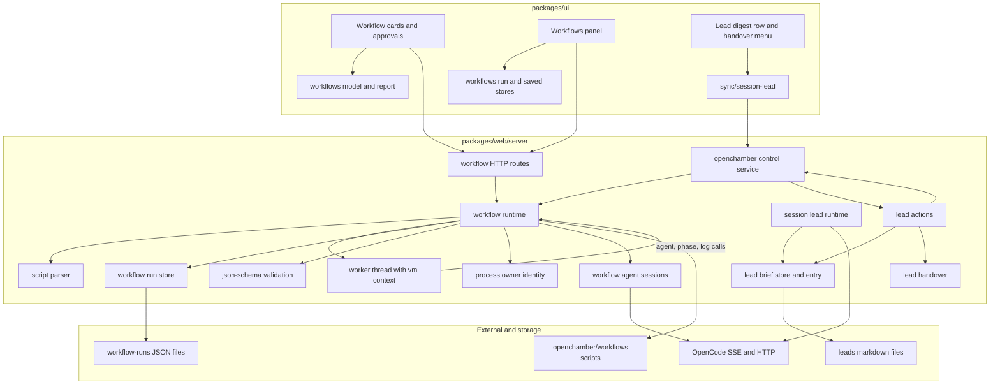
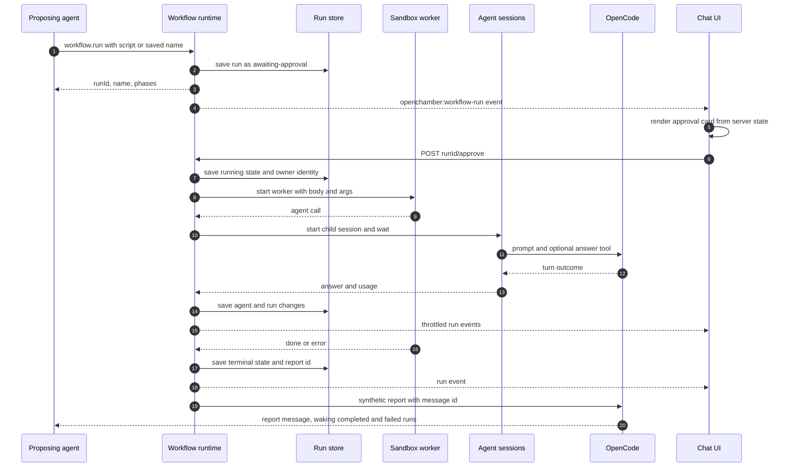
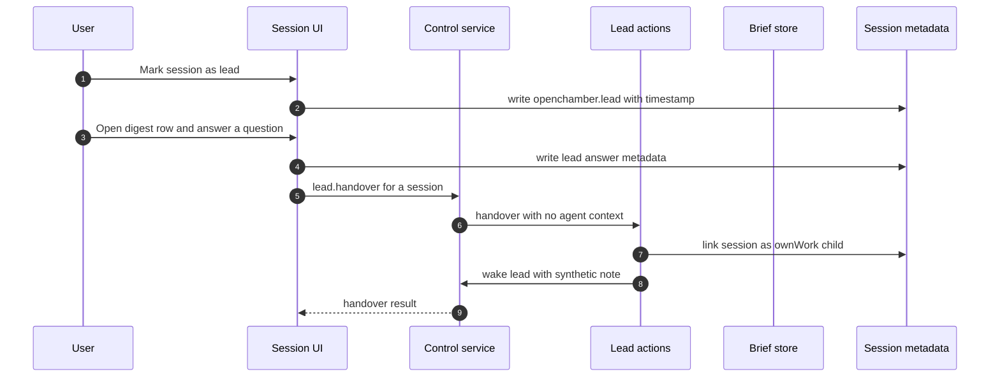

# Specification: Agent workflows and session leads

## Overview

The server owns workflow execution and lead state.
`packages/web/server/lib/workflows/` parses scripts, runs them in a worker with a vm context, drives agent sessions through OpenCode, persists runs to files, and exposes both control actions and user routes.
`packages/web/server/lib/session-lead/` owns the lead mark's server side, brief and digest storage, compaction timing, handover, and lead-specific workflow auto-approval.
`packages/ui` parses run responses, feeds events into Zustand stores, and renders chat cards and the Workflows panel.
The two subsystems meet at the approval setting and at the lead's digest and handover controls.

## Architecture

## Data models

### Workflow run

The store's Zod schema defines the persisted record under `<data-dir>/workflow-runs/<id>.json`.
Version 1 is the accepted file version.

| Field | Type | Constraints | Description |
|---|---|---|---|
| version | number | literal 1 | File format version |
| id | string | `wf_` plus 8 to 40 alphanumerics | Run identifier |
| parentSessionId | string | non-empty | Session that proposed the run |
| directory | string | non-empty | Session directory the agents work in |
| name | string | non-empty | Script meta name |
| description | string | any | Script meta description |
| phases | string array | any | Planned phases plus phases seen at runtime |
| script | string | any | Original script text, blanked in a light run |
| args | unknown | optional, at most 50000 JSON characters | Script arguments |
| state | enum | awaiting-approval, running, completed, failed, stopped, declined | Current run state |
| attempt | integer | non-negative | Number of starts |
| agentsStarted | integer | optional, non-negative | Agents started across all attempts |
| createdAt | number | any | Creation time |
| startedAt | number | optional | Current attempt's start time |
| endedAt | number | optional | Terminal time |
| ownerPid | integer | optional, positive | Server process that started the run |
| ownerStartedAt | string | optional | Platform process start identity |
| currentPhase | string or null | any | Last phase announced |
| agents | WorkflowAgent array | any | One record per call |
| logs | object array | at number, message string | Last 200 lines persisted, last 20 broadcast |
| result | unknown | optional | Script return value |
| error | string | optional | Failure or stop reason |
| report | object | messageId, delivered, resume | Synthetic report identity and marker |

### Workflow agent

| Field | Type | Constraints | Description |
|---|---|---|---|
| key | string | non-empty | Prompt and options hash plus occurrence |
| label | string | any | Call label or truncated prompt |
| phase | string or null | any | Presentation phase, not part of the replay key |
| prompt | string | any | Call prompt, truncated at 20000 characters when stored |
| agent | string | optional | Agent override |
| model | string | optional | Model override |
| schema | unknown | optional | JSON Schema for the answer |
| sessionId | string | optional | OpenCode session id |
| modelUsed | string | optional | Model read back after the turn |
| usage | object | cost, input, output, reasoning, cacheRead, cacheWrite | Spend read back after the turn |
| state | enum | queued, running, completed, failed, stopped | Agent state |
| replayed | boolean | optional | Answer reused from an earlier attempt |
| startedAt | number | optional | Start time |
| endedAt | number | optional | End time |
| result | unknown | optional | Answer text or parsed JSON |
| error | string | optional | Failure reason |

### Call options and sandbox message

`agent(prompt, options)` accepts `id`, `forkFrom`, `label`, `agent`, `model`, and `schema`.
`id` and `forkFrom` are checked in the worker before options cross the vm boundary as JSON, then checked again by `readAgentOptions` on the host.
The worker emits `call`, `phase`, `log`, `done`, and `error` messages to its private parent port.
A completed named call publishes its session id so a later `forkFrom` can resolve it.

### Workflow agent metadata

A workflow agent session carries `{ openchamber: { kind: 'workflow-agent', parentID: <proposing session> } }`.
OpenCode's own `parentID` is deliberately unset so a run of many agents does not wake the proposing session once per agent.

### Saved workflow

Saved scripts live at `<directory>/.openchamber/workflows/<name>.js`.
Listing returns `{ name, description }` for a valid script, or `{ name, error }` for one that no longer parses.

### Synthetic report

The report is a synthetic message with text `<openchamber-workflow runId="..." name="..." state="..."> ... </openchamber-workflow>`.
Its metadata is `{ source: 'openchamber-workflow', runId, name, state }`.
Delivery uses `steer`, and `resume` is true for completed and failed runs only.

### Lead mark and digest

The lead mark is session metadata at `openchamber.lead = { at: number, digest?: LeadDigest, dismissed?: string[] }`.

| Digest field | Type | Constraints | Description |
|---|---|---|---|
| needsYou | LeadQuestion array | at most 3 | `{ question, options?, recommended? }`, at most 4 options and 80 characters each, recommendation one of the options |
| now | string array | at most 8, each at most 300 characters | Where each strand stands |
| news | string array | at most 5, each at most 300 characters | What changed the picture |
| suggestions | string array | at most 3, each at most 300 characters | Offers the user can accept or dismiss |
| updatedAt | number | finite | Write time |

### Lead brief files

The current brief is `<data-dir>/leads/<id>.md`, limited to 12000 characters.
The brief held for the current conversation stretch is `<data-dir>/leads/<id>.entry.md`, written empty when no brief exists and refreshed at compaction.
Both files use owner-only mode and are written through a temporary file plus rename.

## API contracts

The table below is the HTTP surface implemented in `packages/web/server/lib/workflows/routes.ts` and `packages/web/server/lib/session-lead/server.ts`.
Control actions are dispatched by `POST /api/openchamber/control` and by the managed agent tool.

| Method | Path | Purpose |
|---|---|---|
| GET | /api/openchamber/workflows?sessionId= | Summaries of one session's runs |
| GET | /api/openchamber/workflows?directory=A&directory=B | Summaries of runs in one or more directories, at most 100 |
| GET | /api/openchamber/workflows/saved?directory= | Saved scripts and their descriptions or parse errors |
| POST | /api/openchamber/workflows/start | Start a saved script immediately, optionally in a named session |
| GET | /api/openchamber/workflows/:runId | Logs, script, args, and result |
| GET | /api/openchamber/workflows/:runId/agents/:key | One agent's prompt, schema, result, and error |
| POST | /api/openchamber/workflows/:runId/:action | approve, decline, stop, or resume |
| DELETE | /api/openchamber/workflows/:runId | Remove a finished run |
| POST | /api/openchamber/agent-tool/lead-compaction | Compaction hook that may return an authored lead note |
| POST | /api/openchamber/control | Dispatch of workflow and lead actions |

Control actions for workflows are `workflow.check`, `workflow.run`, `workflow.status`, `workflow.result`, `workflow.stop`, `workflow.resume`, `workflow.save`, `workflow.answer`, and `workflow.list`.
Control actions for leads are `lead.brief`, `lead.digest`, and `lead.handover`.
`workflow.answer` maps to the `openchamber_workflow_answer` tool and is allowed only in an agent session whose call asked for a schema.

Error codes shared across endpoints:

| Status | Code or body | Description |
|---|---|---|
| 400 | error message | Missing or invalid input, bad script, bad args, or wrong schema answer |
| 401 | Unauthorized | Compaction hook without authorization |
| 403 | error message | Workflows off, run owned by another session, or agent attempting a user-only lead action |
| 404 | error message | Unknown run, agent, saved script, or session |
| 409 | error message | Wrong run state, handover conflict, or a brief edit that does not apply |
| 500 | error message | Run save failure |

## Sequences

### Propose, approve, run, and report

### Lead brief and digest

## Technical decisions

| Decision | Choice | Rationale |
|---|---|---|
| Sandbox approach | Worker thread with `eval: true`, a 256 MB heap cap, and a vm context exposing only `agent`, `parallel`, `pipeline`, `phase`, `log`, and `args` | A worker can be terminated on an infinite loop and its heap is bounded. The vm context keeps server modules, `process`, timers, and network out of reach. The worker source is a string so it loads from the source tree, `node_modules`, and a packaged asar alike. This keeps a script from reaching or stalling the server, but it is not a boundary against the agent, which has a shell. |
| Execution location | The server runs the script, not OpenCode Code Mode | Code Mode holds the agent's turn and cannot call the subagent tool. Here the tool call answers at once, the run survives the turn, and the report arrives as a synthetic message. |
| Agent parent link | Metadata instead of OpenCode `parentID` | OpenCode reports child busy periods into the parent and wakes it for empty notices. Metadata keeps nesting and notifications while a run with many agents wakes the session only once. |
| Replay identity | Hash of prompt plus options, with an occurrence count and fork source | `parallel()` completion order varies between attempts. Positional keys would rerun finished agents or attach an answer to the wrong call. |
| Determinism | `Math.random()`, `Date.now()`, and zero-argument `Date` throw in the sandbox | A resumed run replays the same script and must ask for the same agents. Varying values must come through `args`. |
| Approval | Stored `awaiting-approval` state rather than a held tool call | The card survives reloads, shows on every device, and does not hold the agent's turn. The agent tool has no approve action. |
| Auto-approval | Two booleans rather than a three-valued setting | Older clients keep reading and writing `agentWorkflowAutoApprove`; a second flag preserves them while Settings presents one three-way choice. |
| Persistence | Versioned JSON files with a write chain and light settled records | A file per run keeps recovery simple. Dropping scripts and full answers from settled runs cut measured heap use from 12 MB to 1.7 MB for 35 runs. |
| Crash recovery | Owner PID plus process start identity | A PID can be reused. Linux boot id and start ticks, macOS `ps` start time in UTC, and Windows UTC ticks distinguish a process instance. A missing identity preserves a live owner's run. |
| Schema answers | A per-session tool plus a text fallback | OpenCode 2 has no per-prompt structured output. A tool validates in the same turn; bare or fenced JSON remains the fallback for servers the managed config does not reach. |
| Fan-out | `agent()` resolves to text, parsed JSON, or null | A failed, stopped, or schema-mismatched agent never rejects the whole script. `parallel()` starts tasks at once and the slot limiter queues them. |
| Lead state | Digest in metadata, brief in a file, brief entry refreshed at compaction | OpenCode resends a whole changed instruction entry. Keeping the digest in metadata avoids resending up to 12000 characters per status line. |
| Sleep compaction | An authored note for an idle lead past its cache | A lead often sleeps for hours with a large context. The brief, digest, and child states are already written down, so a model summary would add another full read. |
| Handover route | Through the authenticated control route | Agent-tool routes precede UI authentication. The control route is already authenticated for UI and CLI, and its action refuses calls that carry an agent session. |
| Project scope | Runs across root and worktrees, saved scripts at the project root | A project's runs can belong to sessions in other worktrees. An isolated space keeps its own scope so host scripts and runs cannot leak inside. |

## Risks and unknowns

1. OpenCode behavior around child notifications and structured output drives two workarounds. A future OpenCode with opt-out child notification or per-prompt structured output could simplify them.
2. The sandbox protects the server from a script, not the machine from the agent. A workflow agent still runs with the session's tools and directory.
3. Runs on external OpenCode need the registered OpenChamber plugin. Remote OpenCode and VS Code have no injected workflow tool.
4. macOS process start identity has one-second resolution, so a PID reused within that second can be misread.
5. When process metadata is unavailable, recovery preserves a run owned by a live PID. That conservative choice can leave a stale run marked running.
6. A workflow with 200 agents on an expensive model can spend a subscription quickly. Approval, the two agent caps, and per-phase model choice are the controls.
7. Forks depend on OpenCode's native `session.fork` and on reading the source session before the fork. An unreadable source fails the call with no prompt.
8. Auto-approval removes the click but not the session guidance that asks the user to agree on the plan and models. A user who agrees in chat and leaves is the intended case.

## Out of scope

- Autonomous goal execution, which belongs to p5-session-goals.
- Agent groups, which belong to p8-agent-manager.
- An isolated filesystem copy per workflow agent. Agents share the proposing session's directory.
- More than one level of fan-out. An agent of a running workflow cannot propose another workflow.
- Editing a completed run. Only failed and stopped runs resume.
- Restoring a deleted run or the sessions of a deleted run.
- Workflow sharing, a marketplace, or saved scripts outside `.openchamber/workflows`.
- A product decision to enable workflows by default. The tool stays off until the user turns it on.
- Model-written state blocks during an in-turn compaction. Those compactions stay with the model's own summary.
