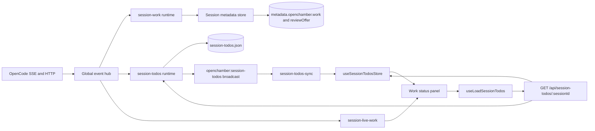
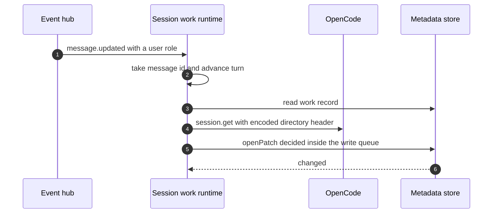
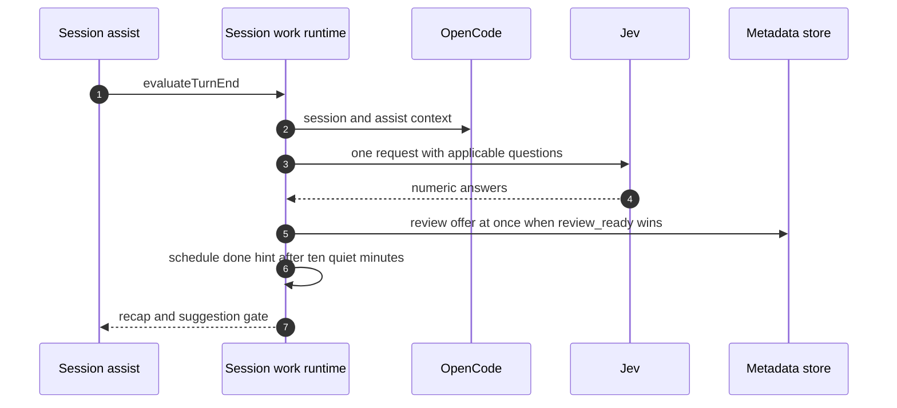
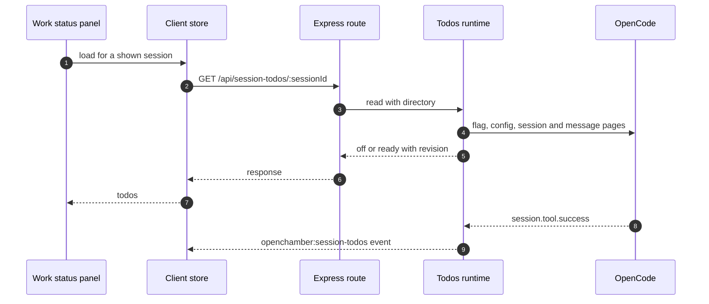

# Specification: Session work and todos

## Overview

The server owns two pieces of session state.
Work state lives in `metadata.openchamber.work` through the existing metadata store, and the turn-end check adds a done hint or a review offer to that metadata.
Todo lists live in `session-todos.json` under the OpenChamber data directory and are served through one Express route plus a broadcast event.
The shared UI reads both through dedicated stores and the existing event subscription layer.

## Architecture

`packages/web/server/lib/session-work/` owns the work record, membership rules, turn-end questions and the runtime.
`packages/web/server/lib/session-todos/` owns the todo file, flag resolution, history walk, route and event handling.
`packages/ui/src/stores/useSessionTodosStore.ts` and `packages/ui/src/sync/session-todos-sync.ts` own client state and reloads.
`packages/ui/src/sync/session-live-work.ts` owns streaming tool calls and context readings.
`packages/ui/src/components/chat/work-status/` renders the Tasks section and calls the loader.

## Data Models

### Work record

| Field | Type | Constraints | Description |
|---|---|---|---|
| state | string | enum open or done | Whether the session is in work. |
| openedAt | number | optional | Time the work opened. |
| openedBy | string | optional enum auto, jev or user | Who opened the work. |
| doneAt | number | optional | Time the user closed the work. |
| suggestDoneAt | number | optional | Time Jev's done hint was written. |

`readWork` parses the record with Zod and returns null for absent or malformed data.
Patch fields set to null remove metadata keys, and omitted fields leave them alone.

### Review offer and pin records

| Field | Type | Constraints | Description |
|---|---|---|---|
| openchamber.reviewOffer.at | number | optional | Time Jev offered a review of the last turn. |
| openchamber.pinned.at | number | optional | UI pin record that excludes a session from work. |

### Work patch types

| Type | Fields | Description |
|---|---|---|
| WorkPatch | state, openedAt, openedBy, doneAt, suggestDoneAt | Patches the work record inside the metadata write queue. |
| WorkMetadataPatch | openchamber.work, openchamber.reviewOffer | Shape passed to `updateSessionMetadata`. |

`openPatch` refuses pinned sessions, open work and messages at or before `doneAt`.
`userStatePatch` writes Track or Done and drops the done hint.
`suggestDonePatch` writes a hint only for open work and removes a review offer.
`clearSuggestionPatch` removes the hint when the next turn starts.

### Work session

| Field | Type | Constraints | Description |
|---|---|---|---|
| parentID | string | optional | Marks a subsession, which cannot be in work. |
| location.directory or directory | string | optional legacy fallback | Directory used for chat root checks. |
| metadata | SessionMetadata | optional | Carries work, pin and kind records. |
| time.archived and time.idle | number | optional | Used by membership and hint freshness. |

`createWorkMembership` also takes resolved chat roots.
`isDoneSuggested` requires current work, no archive, and `suggestDoneAt >= time.idle`.

### Turn-end request

| Field | Type | Constraints | Description |
|---|---|---|---|
| state.history | array of role and text | earlier turns oldest first | Explains short requests. |
| state.request | string | first 1500 characters | Latest user message. |
| state.answer | string | first and last 500 characters | Agent reply. |
| questions | record of question ids | each has type noul, instructions and optional criteria | Only applicable questions are included. |

The sign threshold is 0.5.
`review_ready` uses 0.7 and `recap` is skipped below 0.3.
A missing sign leaves the assist field allowed and blocks a done hint.

### Todo item

| Field | Type | Constraints | Description |
|---|---|---|---|
| content | string | nonempty, sliced to 2000 characters | Todo text from `todowrite`. |
| status | string | pending, in_progress, completed or cancelled | Unknown values become pending. |

The runtime keeps at most 200 items per list.

### Stored todo record

| Field | Type | Constraints | Description |
|---|---|---|---|
| directory | string | required | Directory that owns the list. |
| todos | array of todo items | at most 200 | Current list. |
| checkedThrough | number or null | finite | Newest completed message time the list accounts for. |
| updatedAt | number | finite | Last change time, used for eviction. |

`session-todos.json` holds `version: 1` and a map from session id to record.
The runtime keeps up to 2000 sessions and adds in-memory `verified` and `generation` fields that are not written to the file.

### Todo event and result

| Field | Type | Constraints | Description |
|---|---|---|---|
| type | string | openchamber:session-todos | Event name. |
| properties.revision | number | increases per announcement | Orders client updates. |
| properties.sessionId | string or null | null means every session or a directory-wide change | Target session. |
| properties.directory | string or null | null with a null session means every directory | Target directory. |
| properties.todos | array or null | null means read again | Replacement list. |

The route answers `{ revision, state: 'off' }` or `{ revision, state: 'ready', todos }`.

### Client todo entry

| Field | Type | Constraints | Description |
|---|---|---|---|
| directory | string | required | Directory used for reloads. |
| state | string | loading, off or ready | Load state. |
| todos | array | empty when off or loading | Current list. |
| revision | number or null | compared before commit | Event or route revision. |
| failures | number | increments on failed reads | Drives retry delay. |

### Live work state

| Field | Type | Constraints | Description |
|---|---|---|---|
| tools | map from session id to calls | at most 2000 sessions | Running and last tool calls. |
| running | array of part id, name and path | at most 16 entries | Calls still open. |
| last | call or null | optional | Most recently ended call. |
| context | map from session id to reading | measured tokens or compacted | Current context reading. |

Raw input strings are held for at most 4096 characters per part.

## API Contracts

The HTTP surface is one GET route on the OpenChamber server.

| Method | Path | Purpose |
|---|---|---|
| GET | /api/session-todos/:sessionId | Read the session's list for a directory, with `revision` and `state` of `off` or `ready`. |

| Status | Code | Description |
|---|---|---|
| 400 | INVALID_INPUT | Missing session id or blank directory. The body is `{"error":"a session id and directory are required"}`. |
| 502 | UPSTREAM_UNAVAILABLE | OpenCode failed to answer. The body is `{"error":"OpenCode did not answer"}`. |

Manual Track and Done use the existing generic session metadata route.
The broadcast `openchamber:session-todos` event travels over the existing OpenChamber event bus.
Work metadata is written through `updateSessionMetadata`, which decides the patch inside its per-session write queue.

## Sequences

### Work opens on a sent message

A failed read, session lookup or write schedules another attempt at two, ten and sixty seconds.
An archived session waits for `session.unarchived`.

### Turn-end evaluation

Every turn start and new user message advances a generation.
A write for an overtaken generation is dropped.

### Todo list read and live update

## Technical Decisions

| Decision | Choice | Rationale |
|---|---|---|
| Work state storage | `metadata.openchamber.work` | Survives restarts and uses the existing per-session metadata write queue. |
| Opening rule | Every eligible sent message opens, with no Jev judgment | The earlier Jev judgment was removed after measurement showed every session counts. |
| Hint timing | Ten quiet minutes in the current process | A closing-looking turn is often a subtask the user moves past quickly. |
| Turn binding | Process-wide generation counters | A late Jev answer cannot write a hint for a turn the user left. |
| Todo list ownership | Server-side runtime and JSON file | The UI loads only a window of messages and evicts unseen sessions. |
| Todo history | Lazy, one session at a time | A startup sweep would read every session's history. |
| Flag resolution | Mirror OpenCode's resolver and accept a seen call | OpenCode has no route for resolved flags or a location's tool list. |
| Event checks | Per-session generation and revision guards | A history walk or older event cannot overwrite newer live state. |
| Runtime parity | No auto-open, hint, review offer or todos route in VS Code | VS Code has no OpenChamber server and reads metadata through its bridge. |
| Client loading | Shared in-flight loads with capped retry | A section mount and an event can ask for the same list at once. |

## Risks and Unknowns

1. Jev wording and thresholds are tied to a measurement outside this repository and need that measurement again before any change.
2. A done hint pending at restart is lost because the quiet timer lives in the process.
3. Persisted todo lists are unverified after restart until they are checked against history.
4. Flag resolution mirrors OpenCode's `Flag.resolve`, so a change in OpenCode can drift from this module.
5. A history walk of a long session with no todo call reads several pages once per session.
6. The list cap, todo cap, session cap and live-work caps drop older data by design.
7. The client store and Tasks rendering have no dedicated unit test beyond the loader hook and section order tests.

## Out of Scope

- Sidebar grouping, row layout and project placement for In work.
- The plan display in FEAT-0023 and the multi-run behavior in FEAT-0015.
- Editing, reordering or adding todos from the work status panel.
- Classification provider setup and the Small Model requests that consume the assist gate.
- Review offer and done hint in VS Code.
- Automatic opening of sessions and todo reads in VS Code.
- Persistent timers for done hints across server restarts.
