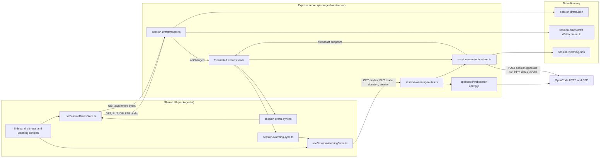
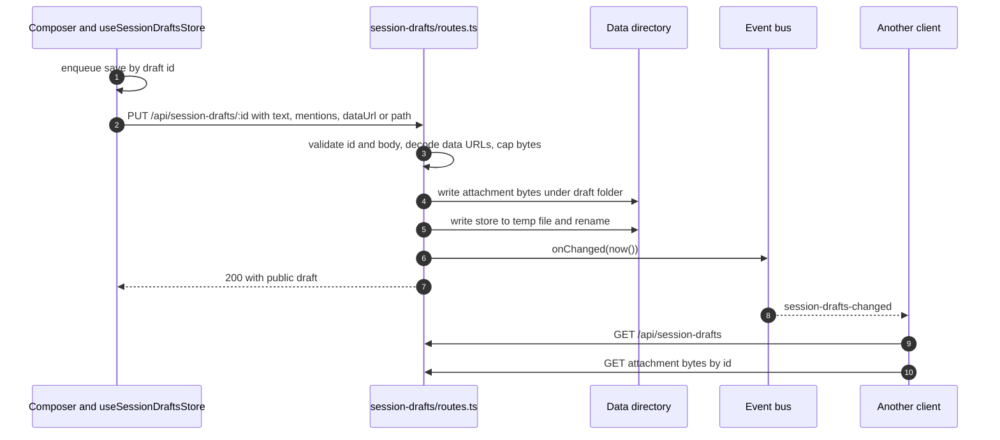
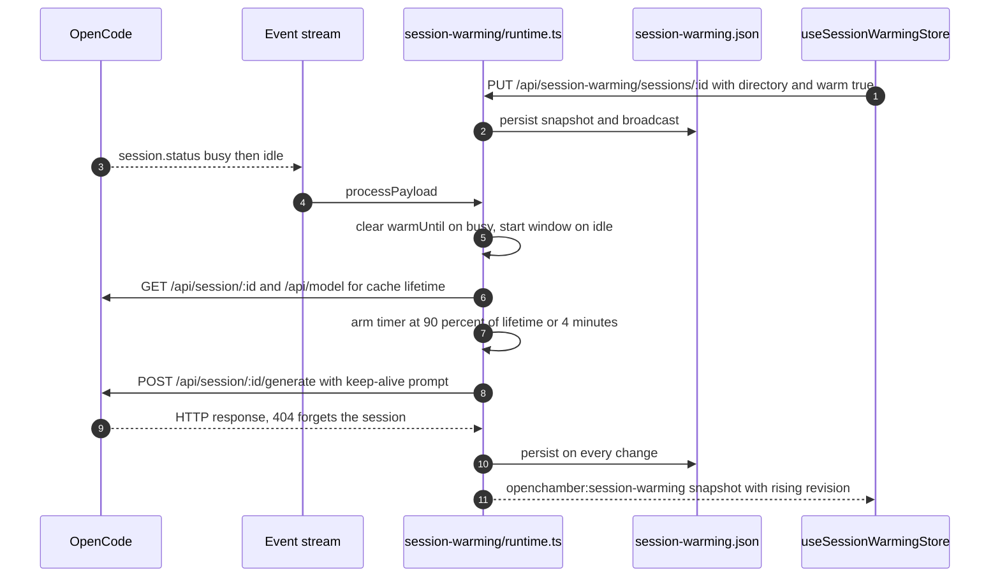

# Specification: Session drafts and warming

## Overview

`packages/web/server/lib/session-drafts/routes.ts` owns the draft JSON store, attachment files, and four draft routes.
`packages/web/server/lib/session-warming/runtime.ts` owns warming state, timers, OpenCode pings, and the state file.
`packages/web/server/lib/session-warming/routes.ts` maps the three mode, duration, and per-session routes to the runtime and the OpenCode config writer.
`packages/ui/src/stores/useSessionDraftsStore.ts` and `packages/ui/src/stores/useSessionWarmingStore.ts` hold the client state.
`packages/ui/src/sync/session-drafts-sync.ts` and `packages/ui/src/sync/session-warming-sync.ts` reload or apply snapshots from the event stream.
Both sync modules skip VS Code, which has no OpenChamber server.

## Architecture

## Data Models

### Stored draft

Inferred from `storedDraftSchema` in `packages/web/server/lib/session-drafts/routes.ts`.
The store is `{ version: 1, drafts: StoredDraft[] }` in `session-drafts.json`.

| Field | Type | Constraints | Description |
|---|---|---|---|
| id | string | min 1, max 200, matches `^[A-Za-z0-9][A-Za-z0-9_.-]*$` | Draft id taken from the URL. The UI generates `d<base36 time><random>`. |
| directory | string | min 1, max 4096 | Working directory the draft belongs to. |
| projectId | string or null | max 512, nullable, not null in stored rows | Project association; absent input becomes null. |
| targetFolderId | string | optional, min 1, max 512 | Session folder the new session should land in. |
| lead | true | optional literal | Present when the draft starts a lead. |
| text | string | max 200000 characters | Unsent input text. |
| mentions | string[] | max 500 items, each max 4096 | Confirmed mentions restored with the text. |
| attachments | StoredAttachment[] | max 20 items | Attachment metadata. |
| createdAt | number | from `now()` | Kept from the existing draft on replacement. |
| updatedAt | number | from `now()` | Time of the last write. |

### Stored attachment

A Zod discriminated union in `packages/web/server/lib/session-drafts/routes.ts`.

| Field | Type | Constraints | Description |
|---|---|---|---|
| kind | `'data' \| 'path'` | discriminator | `data` has bytes on disk; `path` holds a server file path. |
| id | string | min 1, max 200, same id pattern as drafts | Attachment id; the UI prefixes local ids with `a`. |
| filename | string | max 1024 | Name shown in the composer. |
| mimeType | string | max 256 | Response content type for byte attachments. |
| size | number | integer, non-negative | Byte size; for `data` it comes from the decoded bytes. |
| path | string | min 1, max 4096, only on `path` | Server path, exposed to clients only for this kind. |

Incoming attachments add `dataUrl` for new bytes or `path` for a server file.
`decodeDataUrl` requires a comma and a prefix ending in `;base64`; anything else returns 400.
Uploaded bytes are capped at 25 MB per draft, with a 40 mb JSON body limit to cover base64 expansion.

### Warming state file

`packages/web/server/lib/session-warming/runtime.ts` writes `session-warming.json` with `{ enabled, minutes, sessions }`.
Each value uses Zod `catch`, so bad fields fall back instead of blocking startup.

| Field | Type | Constraints | Description |
|---|---|---|---|
| enabled | boolean | `catch(false)` | Whether per-session warming is on. |
| minutes | number | integer in `[30, 60, 120, 180]`, `catch(60)` | Chosen warm duration. |
| sessions | record of session id to stored session | `catch({})` | Persisted warmed sessions. |
| sessions[].directory | string | min 1 | Directory used in ping requests. |
| sessions[].warmUntil | number or null | finite number or null, `catch(null)` | Time the warm window ends; null while busy or unknown. |

### Warming runtime entries

In-memory only, held in `Map<string, WarmingEntry>`.

| Field | Type | Constraints | Description |
|---|---|---|---|
| directory | string | min 1 at the route boundary | Directory passed to OpenCode. |
| warmUntil | number or null | null when busy or not settled | End of the current window. |
| intervalMs | number | positive | Ping interval from cache lifetime or 4 minutes. |
| lastAt | number or null | time or null | Time of the last ping or idle event. |
| pendingEpoch | number or null | epoch or null | Marks a read or ping still in flight. |
| timer | timer or null | owned by the runtime | Current armed timeout. |
| epoch | number | incremented on cancel | Guards callbacks after a state change. |

`SessionActivity` holds `busy` and `idleAt` per session.
`SessionWarmingSnapshot` is `{ revision, enabled, minutes, sessions: [{ sessionId, warmUntil }] }`.
The UI store maps that array to `Record<string, number | null>`.

### Model cache lifetime

`readSessionCacheLifetime` reads `GET /api/session/:id` for the model id and provider, then finds the model in `GET /api/model`.
A `settings.cache.ttl` value with units `ms`, `s`, `m`, `h`, or `d` gives the lifetime.
`claude-agent` with an empty `cost` array gets 60 minutes.
Anything else gets null, and the runtime uses `WARMING_INTERVAL_MS` of four minutes.
Pings go at 90 percent of the lifetime.

## API Contracts

| Method | Path | Body or query | Response |
|---|---|---|---|
| GET | /api/session-drafts | — | `{ drafts: PublicDraft[] }`; 500 when the store is malformed |
| PUT | /api/session-drafts/:id | `{ directory, projectId?, targetFolderId?, lead?, text, mentions?, attachments? }` | `{ draft: PublicDraft }`; 400 invalid, 409 cap reached, 413 bytes too large, 500 write failure |
| DELETE | /api/session-drafts/:id | — | `{ deleted: boolean }`; 400 invalid id, 500 failure |
| GET | /api/session-drafts/:id/attachments/:attachmentId | — | Bytes with the stored MIME type and `Cache-Control: private, no-store`; 400 invalid ids, 404 missing, 500 failure |
| GET | /api/session-warming | — | `SessionWarmingSnapshot` |
| PUT | /api/session-warming/mode | `{ mode: 'off' \| 'all' \| 'session' }` | `SessionWarmingSnapshot`; 400 invalid mode, 500 config write failure |
| PUT | /api/session-warming/duration | `{ scope: 'all' \| 'session', minutes: 30 \| 60 \| 120 \| 180 }` | `SessionWarmingSnapshot`; 400 invalid input, 500 config write failure |
| PUT | /api/session-warming/sessions/:sessionId | `{ directory, warm: boolean }` | `SessionWarmingSnapshot`; 400 invalid input or isolated space, 409 warming disabled |
| PUT | /api/config/warming | `{ enabled: boolean }` | Used by the UI store only when the warming endpoint is unavailable |

Error codes shared across endpoints:

| Status | Code | Description |
|---|---|---|
| 400 | INVALID_INPUT | A path id, body field, or value failed validation, or the directory is an isolated space |
| 404 | NOT_FOUND | The requested attachment was not found or its file is missing |
| 409 | LIMIT_REACHED / WARMING_DISABLED | The draft cap is reached or per-session warming is off |
| 413 | ATTACHMENTS_TOO_LARGE | Decoded attachment bytes exceed 25 MB for the draft |
| 500 | INTERNAL | A store, write, or config operation failed |

Event names on the wire:

| Event | Source | Client effect |
|---|---|---|
| `openchamber:session-drafts-changed` | Draft route `onChanged` | UI receives `session-drafts-changed` and loads drafts |
| `openchamber:session-warming` | Warming runtime `commit` | UI receives `session-warming` with a snapshot |
| `event-stream-ready` | Event pipeline | UI loads drafts and refreshes warming state |
| `session.status` | OpenCode | Warms or stops the session window |
| `session.deleted` | OpenCode | Forgets the session |
| `server.connected` | Server | Re-settles every warmed session |

## Sequences

### Draft save and cross-client restore

### Warming window after a turn ends

## Technical Decisions

| Decision | Choice | Rationale |
|---|---|---|
| Draft ownership | Server JSON store plus attachment files | A draft begun on one device opens on another with the same attachments. |
| Attachment bytes | Files under `session-drafts/<draftId>/<attachmentId>` and metadata in JSON | Base64 bytes in the JSON store would inflate every list response. |
| Draft writes | Serialized per server with a temporary file and rename | Concurrent saves cannot interleave, and readers see a complete store. |
| Failed draft save | Local unsynced copy in `safeStorage` without attachment bytes | Text survives an outage without storing large blobs in browser storage. |
| Retry timing | On the next `load()` and on `event-stream-ready` | A reconnect is the point where the server may be reachable again. |
| Warming state | Local JSON file instead of OpenCode session metadata PATCH | `warmUntil` changes at each turn end; a local write and one broadcast avoid a request and an update event per client. |
| Keep-alive owner | OpenChamber posts to OpenCode's generate route | OpenCode's warming is one global config key with no per-session switch. |
| Ping prompt | OpenCode's own keep-alive prompt | OpenCode treats the request as a keep-alive instead of restarting its own window. |
| Ping interval | 90 percent of the model cache lifetime, 4 minutes as fallback | An hour cache needs one ping per window instead of thirteen. |
| Duration choices | Four steps in Settings and no per-session slider | Steps are easier to select and one choice covers both modes. |
| Mode mapping | One config key or the per-session runtime, never both | The two writers would otherwise double warm sessions. |
| Snapshot revision | Starts from the clock and rises on each change | A snapshot after a restart is newer than one a client held before it. |
| Id validation | Pattern check plus a resolved path parent check | A validator change alone cannot let an id escape the drafts folder. |

## Risks and Unknowns

1. Claude Agent on a subscription is assumed to have a 60-minute cache because OpenCode lists it without a price.
An extra-usage subscriber has a 5-minute cache that this server cannot detect, so warming leaves gaps.
2. A gateway with a custom base URL can list a model without a price and fall back to four minutes even with a longer cache.
3. A hand-edited OpenCode config can leave `warming` on while per-session warming is on, so both writers may send pings.
4. A malformed `session-drafts.json` answers 500 until the file is repaired; unlike warming state, it has no automatic corrupt backup.
5. The 200-draft cap, 20-attachment cap, 25 MB byte cap, and 413 response are enforced in code but the listed test files do not assert the caps.
6. `session-drafts-sync.ts`, `session-warming-sync.ts`, and the warming UI components have no dedicated test files in the listed set.
7. An isolated space runs its own OpenCode, so the server cannot ping sessions there and the route refuses them.
8. A throwing `onChanged` callback is swallowed, so clients rely on their next load to see the saved draft.
9. Cost grows with the number of warmed sessions and shorter cache lifetimes, since each ping reads the whole session context.

## Out of Scope

- Editing or resending the content of a sent session.
- A per-session warm duration slider.
- Warming sessions inside isolated spaces.
- Replacing OpenCode's global `warming` config with OpenChamber pings for every session.
- Draft persistence and warming routes in VS Code, which has no OpenChamber server.
- Attachment scanning, deduplication, or per-user storage quotas.
- Warming subagent sessions separately from their root session.
- Browser-level end-to-end tests for the sidebar rows and warming controls.
