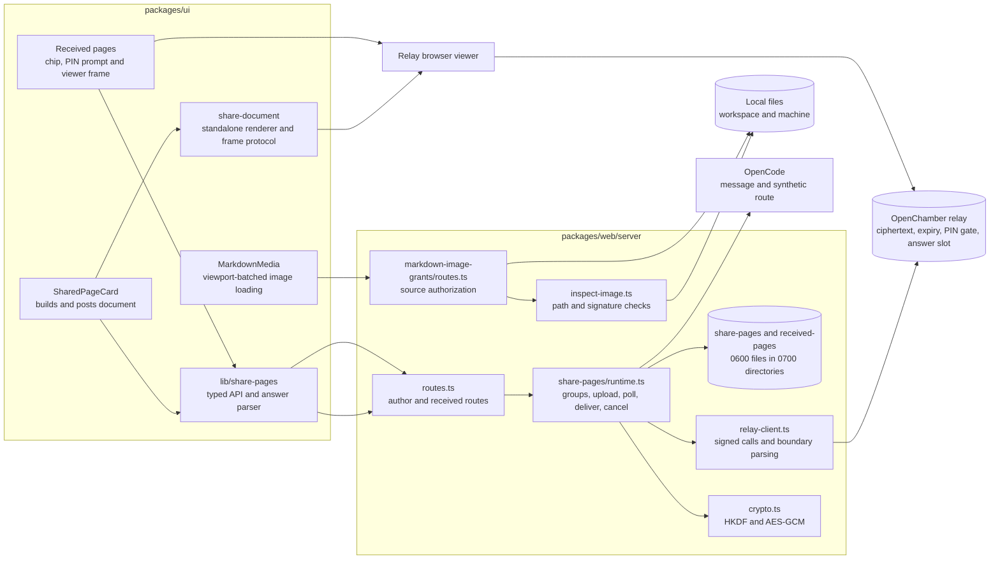
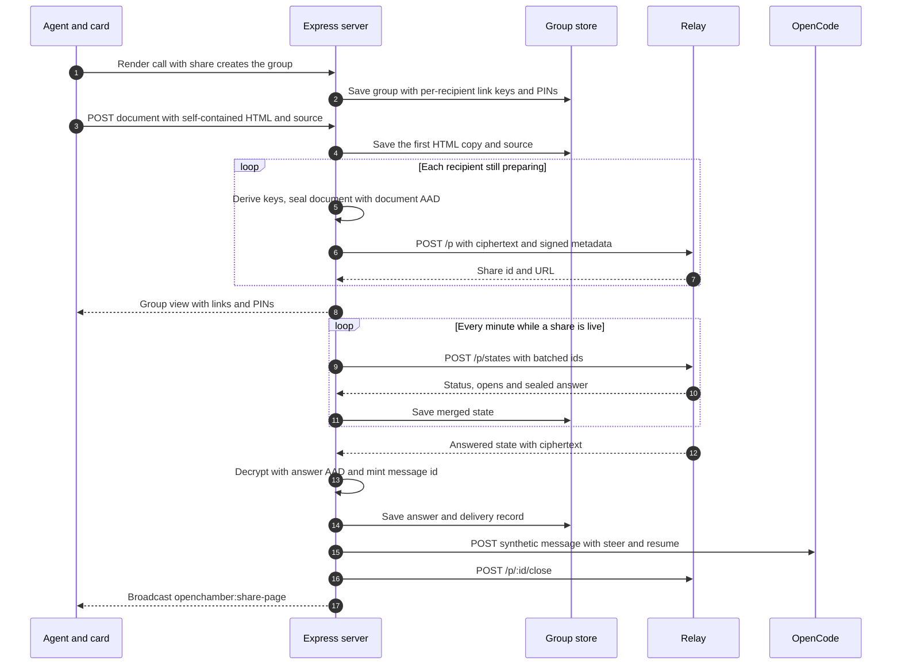
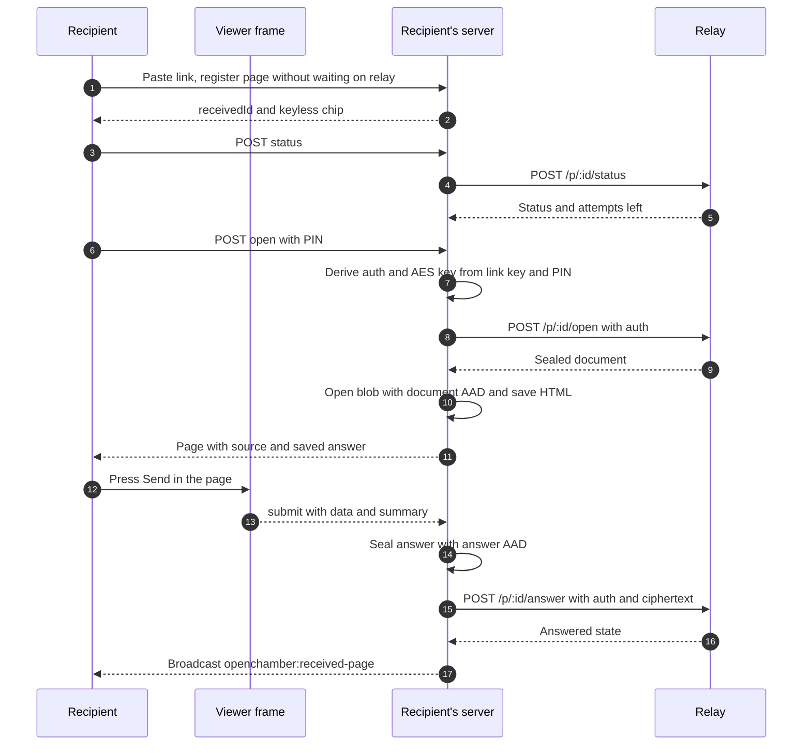

# Specification: Shared pages and local image grants

## Overview

The chat builds a self-contained document for a page the agent marks with `share`.
The server seals that document once per recipient with keys derived from a link key and a PIN, then uploads only ciphertext to the relay.
Answers come back through relay state, are decrypted on the server, and enter the originating session as steered synthetic messages.
Local images referenced by the assistant message are authorized by exact source and passed through the existing path-bound file grant, then inlined as data URLs when a document is uploaded.

## Architecture

## Data models

### Share group

From `packages/web/server/lib/share-pages/store.ts`.

| Field | Type | Constraints | Description |
|---|---|---|---|
| version | `1` | Literal | File format version |
| id | string | `sp_` plus 32 lowercase hex chars | Hash of session id and call id |
| sessionId | string | Non-empty | Owning session |
| callId | string | Non-empty | Tool call that created the group |
| title | string | Any | Page title |
| kind | `questionnaire` or `page` | Enum | Derived from `expectAnswer` |
| expectAnswer | boolean | Any | Whether the page takes an answer |
| summary | string or null | Any | One-line description for recipients |
| createdAt | number | Epoch ms | Creation time |
| expiresAt | number | Epoch ms | Server-computed deadline |
| relayBase | string | Non-empty | Relay HTTP origin fixed at creation |
| documentState | `preparing` or `ready` | Enum | Whether the first document is saved |
| documentSource | `{ format, text, summary }` or null | Optional | Source retained for the recipient's agent |
| recipients | array of recipient | At least one | One entry per named person |

### Recipient

| Field | Type | Constraints | Description |
|---|---|---|---|
| recipientId | string | `r` plus an index | Stable id within the group |
| label | string | Non-empty | Name the author gave the person |
| pin | string | Six digits | Uniform six-digit PIN |
| linkKey | string | Base64url, 32 bytes | Per-recipient key, unique per share |
| shareId | string or null | Relay id | Null until upload succeeds |
| url | string or null | Relay URL | Null until upload succeeds |
| status | `preparing`, `open`, `locked`, `answered`, `expired`, `cancelled` or `failed` | Enum | Local view of the share |
| opens | number[] | Any | Timestamps reported by the relay |
| answeredAt | number or null | Epoch ms | Answer arrival time |
| answer | `{ summary, data, submittedAt }` or null | Any | Decrypted answer |
| delivery | `{ messageId, delivered }` or null | Any | Synthetic-message state |
| relayClosed | boolean | Any | Whether close was acknowledged |
| error | string or null | Any | Last failure detail |

### Sealed document

Built in `runtime.ts` and sealed in `crypto.ts`.

| Field | Type | Constraints | Description |
|---|---|---|---|
| v | `1` | Literal | Document version |
| title | string | Trimmed or inherited | Display title |
| html | string | At most 32 MiB sealed | Self-contained document |
| source | `{ format: 'ui' or 'html', text, summary }` | Optional | Text capped at 200,000 characters, summary at 200 |

### Sealed answer

Built by the recipient's page and read in `runtime.ts`.

| Field | Type | Constraints | Description |
|---|---|---|---|
| v | `1` | Literal | Answer version |
| data | JSON value | At most 16,000 characters when rendered | Form or page answer |
| summary | string | At most 500 characters | Choice in a few words |
| submittedAt | number | Epoch ms | Recipient's submit time |

### Received page

From `packages/web/server/lib/share-pages/received-store.ts`.

| Field | Type | Constraints | Description |
|---|---|---|---|
| version | `1` | Literal | File format version |
| id | string | `rp_` plus 32 lowercase hex chars | Hash of relay base and share id |
| base | string | Non-empty | Relay HTTP origin |
| shareId | string | Non-empty | Relay share id |
| host | string | Non-empty | Link host |
| linkKey | string | Base64url | Kept from the pasted link |
| secrets | `{ auth, enc }` or null | Any | Derived bytes kept after PIN entry, never the PIN |
| createdAt | number | Epoch ms | Registration time |
| updatedAt | number | Epoch ms | Last touch, used for pruning |
| status | `open`, `locked`, `answered`, `expired`, `cancelled` or `missing` | Enum | Last known share state |
| kind | string or null | Any | Relay content label |
| wantsAnswer | boolean | Any | Whether an answer is expected |
| expiresAt | number or null | Epoch ms | Relay deadline |
| attemptsLeft | number or null | Any | PIN attempts remaining |
| title | string or null | Any | Page title |
| source | `{ format, text, summary }` or null | Any | Agent-facing page source |
| answer | `{ summary, data, submittedAt }` or null | Any | Saved answer |

### Relay share state

Parsed from every relay response at the boundary in `relay-client.ts`.

| Field | Type | Constraints | Description |
|---|---|---|---|
| id | string | Any | Share id |
| status | `open`, `locked`, `answered`, `expired`, `cancelled`, `missing` or `unavailable` | Enum | Relay state |
| opens | number[] | Optional | Opening timestamps |
| answer | string or null | Optional | Sealed answer ciphertext |
| answeredAt | number or null | Optional | Answer time |
| closed | boolean | Optional | Whether the relay deleted its copy |

### Image grant result

Returned per requested source by `packages/web/server/lib/markdown-image-grants/routes.ts`.

| Field | Type | Constraints | Description |
|---|---|---|---|
| source | string | Requested reference | Original text as sent by the client |
| status | `ready`, `missing`, `error` or `too-heavy` | Enum | Outcome for that source |
| path | string | Only for `ready` | Resolved local path |
| outsideFileGrant | string | Only outside the workspace | Existing path-bound `raw` grant token |
| expiresAt | number | With an outside grant | Grant expiry |

### Local image inspection

From `packages/web/server/lib/markdown-image-grants/inspect-image.ts`.

| Field | Type | Constraints | Description |
|---|---|---|---|
| status | `ready`, `missing` or `error` | Enum | Inspection outcome |
| path | string | Only for `ready` | Canonical outside path or resolved workspace path |
| outsideWorkspace | boolean | Only for `ready` | Whether the file lies outside the active directory |
| size | number | Only for `ready` | File size in bytes |

## API contracts

The server routes and their runtime guards are the normative contract.
The table below is a summary of the author, received-page and image-grant surfaces.

| Method | Path | Purpose |
|---|---|---|
| GET | `/api/openchamber/sessions/:sessionId/share-pages/:callId` | Read the group as the card sees it |
| POST | `/api/openchamber/sessions/:sessionId/share-pages/:callId/document` | Seal and upload the document, 40 MB JSON body limit |
| POST | `/api/openchamber/sessions/:sessionId/share-pages/:callId/recipients/:recipientId/cancel` | Withdraw one link |
| GET | `/api/openchamber/sessions/:sessionId/share-pages/:callId/preview` | Read the server's saved HTML |
| GET | `/api/openchamber/received-pages/config` | Report allowed relay bases |
| GET | `/api/openchamber/received-pages` | List received pages |
| POST | `/api/openchamber/received-pages` | Register a pasted link, 16 KB body limit |
| GET | `/api/openchamber/received-pages/:receivedId` | Read one page |
| POST | `/api/openchamber/received-pages/:receivedId/status` | Refresh from the relay |
| POST | `/api/openchamber/received-pages/:receivedId/open` | Prove the PIN and decrypt, 16 KB body limit |
| GET | `/api/openchamber/received-pages/:receivedId/document` | Read the decrypted document |
| POST | `/api/openchamber/received-pages/:receivedId/answer` | Seal and post an answer, 64 KB body limit |
| POST | `/api/openchamber/sessions/:sessionId/markdown-image-grants` | Prepare local image sources, 256 KB body limit |

Error codes shared across endpoints:

| Status | Code | Description |
|---|---|---|
| 400 | `invalid_input` | Missing or malformed route fields, bad share fields or bad link syntax |
| 400 | `invalid_link` | Pasted text is not a share link |
| 400 | `link_not_allowed` | Link is on a relay this server does not open |
| 403 | `enterprise_mode` | Sharing is unavailable under enterprise policy |
| 404 | `not_found` | No group, page or recipient for the id |
| 409 | `conflict` | Everyone already has the page, the link expired, or an answer arrived before withdrawal |
| 413 | `too_large` | Sealed document exceeds the relay's 32 MiB limit |
| 502 | `relay_unavailable` | Relay could not be reached during withdrawal |
| 503 | `prepare_failed` | Local image preparation failed |

Relay calls use `POST /p` to create a share, `POST /p/states` to read states in batches of 50, `POST /p/:id/close` to acknowledge, and `POST /p/:id/status`, `POST /p/:id/open` and `POST /p/:id/answer` for the recipient's viewer.
No call follows a redirect.

## Sequences

### Publish and collect an answer

### Open and answer from the recipient

## Technical decisions

| Decision | Choice | Rationale |
|---|---|---|
| Cryptography | HKDF-SHA-256 with UTF-8 PIN as salt and `openchamber-share-v1 auth` and `openchamber-share-v1 enc` info strings, then AES-256-GCM with a version byte, 12-byte IV and separate document and answer AAD | The relay's browser viewer uses the same byte-level contract, and separate AAD prevents swapping a document for an answer |
| Link keys and PINs | One 32-byte random key and one uniform six-digit PIN per recipient, generated by rejection sampling | A shared link cannot distinguish answers, and modulo reduction would bias the PIN distribution |
| Relay role | Store ciphertext, enforce expiry, apply the PIN gate, count openings and hold one answer slot with no view of keys or PINs | The relay needs no plaintext and the server keeps the policy decision at the point where the request leaves the machine |
| Request signing | ECDSA over timestamp, `share`, server id, POST, path, SHA-256 body hash and metadata header, with the relay key store's identity and no redirects | Matches the relay's `buildSharePayload` check and keeps a signed request from being replayed at another origin |
| Document ownership | The chat builds the document and the server only seals and uploads it | The renderer lives in `packages/ui` and the server cannot carry its language dependency |
| Renderer bundle | The app's UI block renderer built as `share-document.js` with shims for stores, runtime and extensions | One renderer serves the chat and the shared page, and the build fails if an app store reaches the opaque origin |
| Answer delivery | A steered synthetic message with `resume: true` and a message id minted before the first attempt | The author is not blocked for days, and a retry cannot post the answer twice |
| Expiry | Two working-day hours in local time with weekends skipped, shortened by `expiresInHours`, enforced by the relay | The author can shorten a share but never extend it, and the relay remains authoritative |
| State collection | Polling once per minute in batches of 50, plus an immediate poll on start, hub connect, wake and relay nudge | Only a host with a live private relay control socket receives the nudge, so polling covers the common case |
| Relay identity per group | The HTTP origin is captured when the group is created and reused for polling and close | A later settings change must not send a share's close or state request to a different relay |
| Image authorization | Fetch the stored assistant message once, collect exact inline, reference, rendered page and completed tool-result sources, then inspect each file | The path in the message is the only authorization, so an arbitrary local path in a request is refused |
| Workspace containment | Resolve relative and contained absolute paths against the active directory and check both lexical and canonical paths | A symlink inside the workspace cannot point to a file outside it |
| Outside files | Reuse the existing path-bound `raw` grant instead of adding a new copy or lifetime | Outside images are already readable by the agent's own tools, and one grant layer is enough |
| Page image budget | Take page images in order until source files exceed 25 MiB, from the first image past the budget onward every page image is `too-heavy` | File size is visible before reading, and a run from the top tells the agent where to split the page |
| Enterprise policy | Sharing exists only with a pinned relay, and every route and relay call checks the group's base against the pinned origin | Policy must hold where the request leaves the machine, including a group created before the mode was enabled |

## Risks and unknowns

1. A crash between admitting an answer and emitting the notification loses only the notification, not the answer.
2. The relay keeps expired state for one week, and local state expires at eight days past the deadline if no state arrives.
3. Resetting the relay signing identity invalidates the cached signer and can leave a share owned by the previous identity marked `unavailable`.
4. File size is a loose stand-in for decoded image memory, which follows pixel dimensions rather than bytes.
5. Answer identity is labelled unverified until accounts with known teammates can vouch for the sender.
6. The relay's viewer and browser policy live in a separate repository, so a change there must keep the crypto and frame contracts aligned.

## Out of scope

- Sending a link or PIN through the agent or any chat tool.
- Extending a share or editing an answer after submission.
- Verifying who answered through email codes or accounts.
- A separate image storage, copy or lifetime layer outside the existing `raw` grant.
- Image grants in VS Code for files outside the workspace.
- Local session export, which is a separate feature for transcripts and does not publish through the relay.
