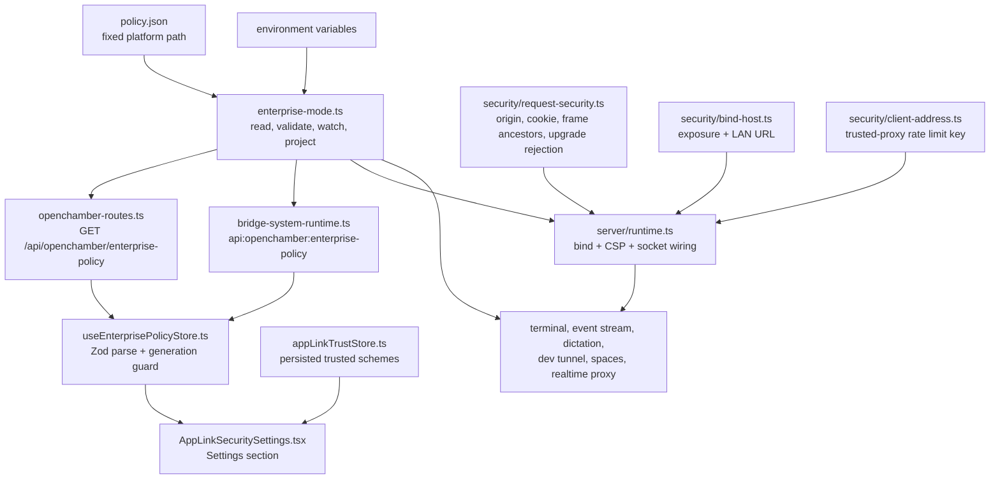
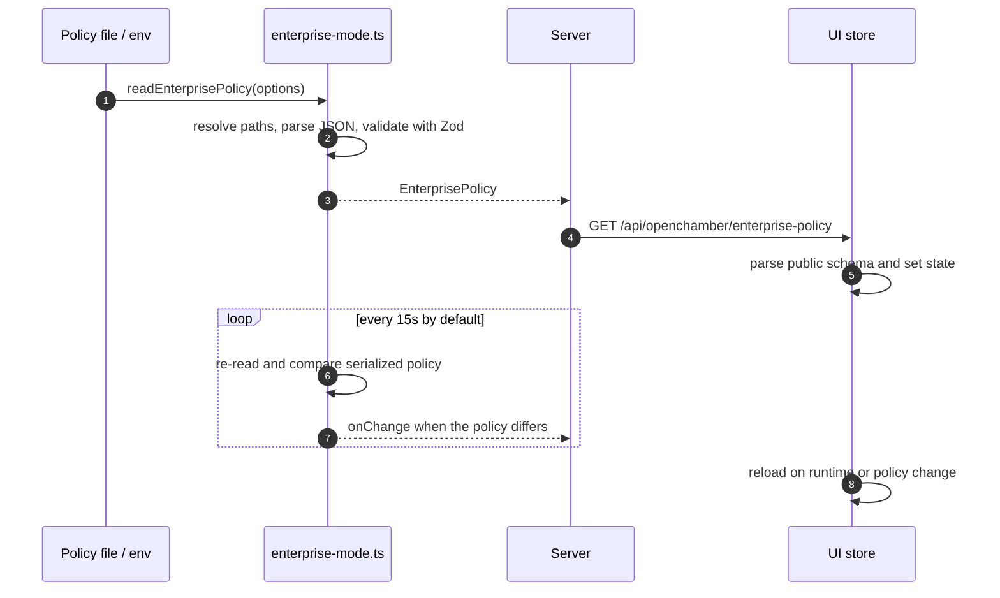
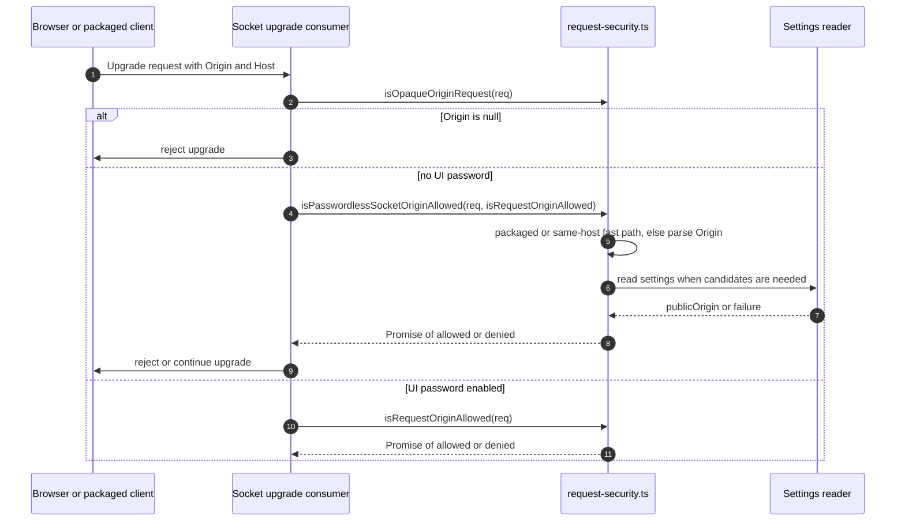

# Specification: Enterprise policy and request security

## Overview

The server reads an administrator policy from a fixed machine path or from environment variables, validates it with Zod, and projects a safe subset to every UI runtime.
Request-security helpers in `packages/web/server/lib/security/` decide origin trust, session-cookie slots, frame ancestors, bind-host exposure, and rate-limit keys from injected inputs so the web server, CLI, and VS Code extension host share one decision.
The UI stores the public policy with a Zod schema and generation guard, and Settings lists the trusted app-link schemes held by the persisted trust store.

## Architecture

## Data Models

### EnterprisePolicy (server, `enterprise-mode.ts`)

| Field | Type | Constraints | Description |
|---|---|---|---|
| enterpriseMode | boolean | derived | True when a governing file or the environment turns the mode on |
| source | `policy-file` or `environment` or null | null when off | Which input turned the mode on |
| organization | string or null | trimmed | Shown to users as the administrator |
| policyError | string or null | set only on read or parse failure | Human-readable failure including the file path |
| relayUrl | string or null | trimmed, file wins | Pinned private relay endpoint |
| jev | object or null | requires `url` | Pinned classification endpoint with optional model and API key |
| allowNetworkAccess | boolean | default false | Whether enterprise mode permits a network-exposed bind |
| allowedExtensions | string[] | max 200 | Extension repositories an administrator trusts |
| allowLocalExtensions | boolean | default false | Whether local-folder extension installs are allowed |
| opencodeBinary | string or null | file only, trimmed | Pinned OpenCode executable path |
| hideBuiltinSkillCatalogs | boolean | file only, default false | Hides the shipped skill catalogs |

### PublicEnterprisePolicy (client projection)

| Field | Type | Constraints | Description |
|---|---|---|---|
| enterpriseMode | boolean | required | Drives enterprise UI restrictions and the routing store fallback |
| source | enum or null | required | Where the policy came from |
| organization | string or null | required | Displayed as the managing organization |
| policyError | string or null | required | Displayed when a policy file could not be read |
| networkAccessBlocked | boolean | `enterpriseMode && !allowNetworkAccess` | Tells the UI that network exposure is blocked |
| opencodeBinary | string or null | required | Read-only pinned binary path |

The projection deliberately omits `relayUrl`, `jev`, `allowedExtensions`, `allowLocalExtensions`, and the raw `allowNetworkAccess` flag.

### Policy file schema

| Field | Type | Constraints | Description |
|---|---|---|---|
| enterpriseMode | boolean | optional, default false | Governs the policy when true |
| organization | string | optional, trimmed to undefined | Administrator name |
| relayUrl | string | optional, trimmed to undefined | Private relay pin |
| allowNetworkAccess | boolean | optional | Network exposure opt-in |
| allowedExtensions | string[] | optional, each trimmed and non-empty, max 200 | Trusted repositories |
| allowLocalExtensions | boolean | optional | Local extension opt-in |
| jev | object | optional, refined to require `url` when present | Endpoint, model, and API key |
| opencodeBinary | string | optional, trimmed to undefined | OpenCode pin, file only |
| hideBuiltinSkillCatalogs | boolean | optional | Built-in catalog switch, file only |

A leading byte-order mark is stripped before parsing and unknown keys are ignored.

### Environment inputs

| Name | Effect |
|---|---|
| OPENCHAMBER_ENTERPRISE_MODE | Turns the mode on when trimmed value is `1` or `true` |
| OPENCHAMBER_RELAY_URL | Relay pin when the file does not govern |
| OPENCHAMBER_JEV_URL / OPENCHAMBER_JEV_MODEL / OPENCHAMBER_JEV_API_KEY | Jev pin when the file does not govern and a URL is present |
| OPENCHAMBER_ALLOW_NETWORK_ACCESS | Network opt-in when the file does not govern |
| OPENCHAMBER_ALLOWED_EXTENSIONS | Comma-separated repository list when the file does not govern |
| OPENCHAMBER_ALLOW_LOCAL_EXTENSIONS | Local extension opt-in when the file does not govern |
| OPENCHAMBER_ALLOW_DEV_ORIGINS / OPENCHAMBER_ELECTRON_DEV | Trust loopback UI ports on development servers |
| OPENCHAMBER_ALLOW_UNAUTHENTICATED_LAN | Literal `true` accepts a network bind with no UI password |
| OPENCHAMBER_LAN_URL | Advertised HTTP or HTTPS origin for a host behind a proxy |
| OPENCHAMBER_TRUSTED_PROXIES | Comma-separated IPs or CIDRs allowed to set forwarded addresses |

### SecurityRequest and runtime dependencies

| Field | Type | Constraints | Description |
|---|---|---|---|
| headers | `NodeJS.Dict<string or string[]>` | required | Origin, host, forwarded headers, and cookie as received |
| socket | Socket with optional `encrypted` | optional | Used for the HTTP or HTTPS candidate and as the upgrade rejection target |
| readSettingsFromDiskMigrated | function | required dependency | Returns `{ publicOrigin?: string }` or null |
| allowLocalDevOrigins | boolean | default false | Enables loopback-port origin trust |

`RequestOriginChecker` is `(req: SecurityRequest) => Promise<boolean>`, so callers always await it.

### Bind host and URL classification

| Field | Type | Constraints | Description |
|---|---|---|---|
| host | string | resolved by startup or CLI | `localhost`, loopback IPs, IPv4-mapped loopback, and `::1` are loopback |
| isNetworkExposedBindHost | boolean | complement of loopback | Wildcard, LAN, IPv6 local, link-local, names, and empty strings are exposed |
| rateLimitKey | string | IP or `relay` | Derived from the peer, relay provenance, and trusted forwarded hops |
| advertisedLanUrl | string or null | HTTP(S) origin only | Path, query, hash, or non-HTTP schemes are ignored with a warning |

### UI store state

| Field | Type | Constraints | Description |
|---|---|---|---|
| enterpriseMode, source, organization, policyError, networkAccessBlocked, opencodeBinary | public policy fields | Zod validated | Mirrors the public projection with defaults for older servers |
| load | function | generation guarded | Fetches and parses the policy, ignoring stale responses |
| resetForRuntime | function | increments generation | Clears policy state on runtime change |
| trustedSchemes | string[] | max 64, persisted | Normalized lowercase app-link schemes shown in Settings |

## API Contracts

No OpenAPI file accompanies this specification because the surface is one internal GET route plus route guards on the shared OpenCode proxy.

| Method | Path or bridge id | Purpose |
|---|---|---|
| GET | /api/openchamber/enterprise-policy | Returns `publicEnterprisePolicy()` as JSON, including a `networkAccessBlocked` flag |
| bridge | api:openchamber:enterprise-policy | VS Code host answer for the same webview path |
| POST | /api/integration/:id/connect/... and /api/credential and /api/experimental/integration/wellknown | Refused with 403 `enterprise_mode` when enterprise mode is on, except MCP sign-in paths |
| GET or HEAD | /api/credential and router-equivalent spellings | Refused with 403 `credential_list_refused` regardless of enterprise mode |

Error codes shared across endpoints:

| Status | Code | Description |
|---|---|---|
| 403 | enterprise_mode | A provider-connect route is unavailable under the current policy |
| 403 | credential_list_refused | A client asked for the stored provider keys |

The UI store treats a 404 as no policy, treats other non-OK responses as a load failure, and validates the JSON body with Zod before storing it.

## Sequences

### Policy load and live change

### Socket upgrade origin decision

## Technical Decisions

| Decision | Choice | Rationale |
|---|---|---|
| Policy source precedence | A file with `enterpriseMode: true` governs all user-settable values | Users control their environment and cannot be allowed to lift an administrator lock |
| Unreadable or invalid policy | Fail closed, keep the mode on, clear pins, hide built-in catalogs, report an error | A broken file must never quietly lift protection |
| Windows path order | Fixed `C:\ProgramData` path first, then the `ProgramData` environment path | Redirecting `ProgramData` cannot hide the machine policy |
| File-only switches | `opencodeBinary` and `hideBuiltinSkillCatalogs` come only from the file | No environment bypass is provided for these controls |
| Client projection | Return only six public fields | Pinned endpoints and API keys stay on the server |
| Policy refresh | Poll the serialized policy on an unreferenced timer with a 15-second default | Changes apply without a restart and do not keep the process alive |
| Route classification | Normalize path segments like OpenCode, and fail closed on bad escapes or dot segments | Obfuscated spellings must not bypass the enterprise guard |
| Origin comparison | Compare the external host and allow a different upstream protocol | TLS can end at a cloud edge before a plain HTTP proxy hop |
| Packaged origins | Allow `openchamber-ui://app`, `capacitor://localhost`, and `https://localhost` without a password | Desktop and mobile shells need socket upgrades on non-browser hosts |
| Origin checker contract | Always return a Promise and enforce awaiting with a lint rule | Reading a pending lookup directly would treat it as allowed |
| Cookie extraction | Resolve the cookie name from the same host and port as the request | Browsers share cookies across LAN ports, and one instance must not borrow another's session |
| Frame ancestors | Allow app and packaged shells, add dev origins only in development, validate extras | Arbitrary documents must not frame the UI or inject a response policy |
| Bind classification | Treat every non-proven-loopback host as exposed | Wildcards and unusual numeric hosts must not slip through |
| Trusted proxies | Walk `x-forwarded-for` only through configured or loopback proxies | An untrusted client cannot set its own rate-limit identity |
| UI policy load | Validate with Zod, guard with a generation counter, and reset on runtime change | Malformed or stale responses cannot overwrite current policy state |

## Risks and Unknowns

1. The route classifiers mirror OpenCode 2.0.18 to 2.0.20 routing and need rechecking when OpenCode changes its router.
2. A reverse proxy that forwards arbitrary `x-forwarded-host` values can affect origin decisions, so proxy trust must be configured correctly.
3. OpenChamber runs as the user, so that user can read a policy file containing an API key.
4. A 15-second poll means a newly added file can leave a network-exposed instance briefly misconfigured until the next check.
5. `Origin: null` is refused because sandboxed previews and extension frames produce it, which can affect unusual embedders.
6. Development origins are trusted only when a development flag is set, so a misconfigured dev deployment will reject local UI ports.
7. An invalid `OPENCHAMBER_LAN_URL` is ignored with a warning, so a typo leaves the default advertised URL in place.
8. The app-link trust store is persisted in the UI, so clearing browser or webview storage drops previously trusted schemes.

## Out of Scope

- The OpenCode provider and tool policies that are the authoritative lock on model use.
- UI password issuance, passkeys, device pairing, and session cookie validation details owned by `packages/web/server/lib/ui-auth/`.
- Tunnel and private-relay lifecycle beyond consuming a pinned relay URL.
- Extension installation and capability enforcement beyond the parsed policy values.
- Response headers other than the `frame-ancestors` directive built here.
- New OpenAPI or SDK artifacts for the internal enterprise-policy route.
- Changelog entries and release notes.
