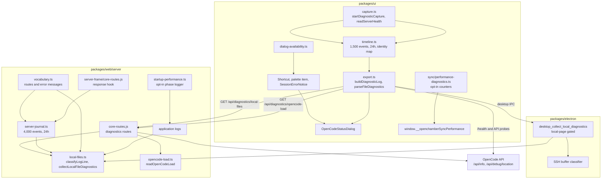
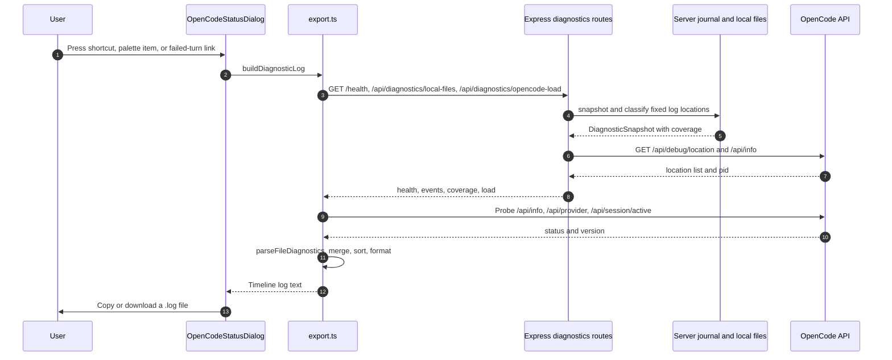
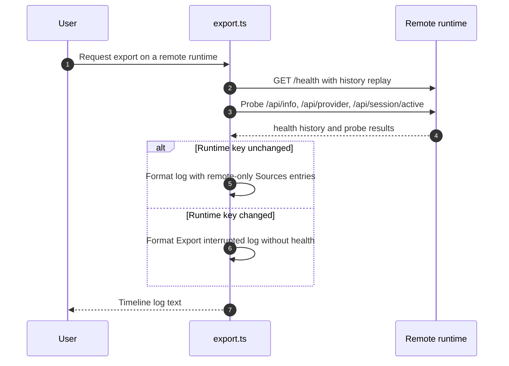

# Specification: Diagnostics timeline

## Overview

The feature is split between a server-side collector and a UI-side capture, validation, and formatting layer.
The server keeps a bounded journal, classifies known log lines through a fixed vocabulary, and exposes two read-only diagnostics routes.
The UI keeps a bounded renderer buffer, labels identities locally, samples health on demand, re-validates server records across the process boundary, and formats one text log for copy or download.
Every writer maps observations to a closed set of actions and details, and every reader admits only values from that set.

## Architecture

## Data Models

### DiagnosticEvent

| Field | Type | Constraints | Description |
|---|---|---|---|
| at | number | finite on capture, integer 0 to 8,640,000,000,000,000 on transport | Epoch milliseconds assigned by the writer. |
| source | string | fixed source set or `SSH connection 1` to `SSH connection 20` on transport | Component or collector that emitted the event. |
| action | string | fixed action set, optionally severity-prefixed | Fixed category such as `managed launch` or `error: api proxy failed`. |
| detail | string | optional, allowlisted pattern | Bounded metadata such as `attempt=1 class=timeout`. |

### DiagnosticCoverage

| Field | Type | Constraints | Description |
|---|---|---|---|
| source | string | fixed source set | Journal, file source, SSH manager, file events, or diagnostic transport. |
| status | enum | `truncated`, `read`, `filtered`, `empty`, `nonregular`, `older files omitted`, `missing`, `unreadable`, `unavailable`, `skipped`, `invalid records omitted` | Outcome of reading that source. |
| omitted | number | optional, non-negative integer | Events, lines, files, or invalid records left out. |
| filtered | number | optional, non-negative integer | Lines with no safe classification. |
| warnings | number | optional, non-negative integer | Filtered lines at warning level. |
| errors | number | optional, non-negative integer | Filtered lines at error level. |

### DiagnosticSnapshot

| Field | Type | Constraints | Description |
|---|---|---|---|
| events | DiagnosticEvent[] | sorted by `at`, capped per collector | Combined timeline events from a collector. |
| coverage | DiagnosticCoverage[] | one entry per attempted source | Read outcome for every source. |

### Server journal contracts

| Type | Fields | Constraints | Description |
|---|---|---|---|
| JournalOptions | now, maxEvents, maxAgeMs | optional overrides, defaults 4,000 events and 24 hours | Injected clock and bounds for tests. |
| LifecycleDetails | attempt, failureClass | attempt 1 to 100, failure class from a fixed enum | Allowed details for `record`. |
| DiagnosticJournal | record, recordHttpResponse, snapshot | actions from a fixed set, status 400 to 599 | Journal interface consumed by local-files.ts. |

### SSH diagnostic contracts

| Type | Fields | Constraints | Description |
|---|---|---|---|
| SshDiagnosticBuffer | lines, phase, updatedAtMs, retryAttempt, requiresUserAction | phase from the SSH phase set, retry clamped to 0 through 100 | Per-connection history held in Electron main. |
| SshDiagnosticOptions | entries, omittedSources | omittedSources is a non-negative count | Input to `collectSshBufferDiagnostics`. |

### Local file and process contracts

| Type | Fields | Constraints | Description |
|---|---|---|---|
| LocalFileDiagnosticOptions | electronLogPath, home, env, webPort, journal | webPort must be a positive integer when present | Injected paths and journal for collection. |
| ProcessEntry | ppid, rssKb, command | parsed from one `ps` line | Internal process table row, never exported. |
| ProcessSummary | openCodeMb, childProcesses, childMb | rounded non-negative megabytes | Exported process totals. |
| OpenCodeLoad | locations, processes | each field nullable | Loaded directory count and optional process summary. |
| OpenCodeProcessInfo | pid | integer from `/api/info` | Validated pid used to find the process tree. |
| OpenCodeLoadOptions | buildOpenCodeUrl, getOpenCodeAuthHeaders, platform, listProcesses, fetchImpl | platform and process listers injectable | Dependencies for `readOpenCodeLoad`. |

### DiagnosticHealthSample

| Field | Type | Constraints | Description |
|---|---|---|---|
| at | number | epoch milliseconds | Time of the health read. |
| http | number | HTTP status | Status returned by `/health`. |
| running | boolean or `unknown` | default `unknown` | Validated `openCodeRunning` field. |
| ready | boolean or `unknown` | default `unknown` | Validated `isOpenCodeReady` field. |
| secure | boolean or `unknown` | default `unknown` | Validated `openCodeSecureConnection` field. |
| port | number or null | 1 to 65535 when present | Validated `openCodePort` field. |
| wsl | boolean or `unknown` | default `unknown` | Validated `opencodeViaWsl` field. |
| binarySource | string | fixed enum or `unknown` | Where the OpenCode binary was found. |
| wrapper | string | fixed enum or `none` | Launch wrapper type. |
| lastError | string or null | classified label or `unclassified` | Kind of the last start error without its text. |

### StartupPerformanceDetails

| Field | Type | Constraints | Description |
|---|---|---|---|
| durationMs | number | optional, finite and non-negative | Phase duration. |
| totalDurationMs | number | optional, finite and non-negative | Cumulative startup duration. |
| attempt | number | optional, non-negative integer | Bootstrap attempt. |
| outcome | string | optional, `ready`, `timeout`, `aborted`, or `error` | Allowed outcome label. |
| routeClass | string | optional, `session-messages`, `session`, `events`, or `other` | Allowed readiness-hold route class. |

### SyncPerformanceCounters

| Field group | Fields | Description |
|---|---|---|
| Pipeline | pipelineRawEvents, pipelineCoalescedEvents, pipelineDeliveredEvents, reducerEvents, reducerChangedEvents | Counts events entering and leaving the sync pipeline. |
| Stores | directoryStorePublications, globalSessionPublications, globalStatusPublications, orderingPublications, timingPublications | Counts publications by store. |
| Aggregation | liveSessionAggregateRuns, sidebarStructureBuilds, sidebarStructureReuses, sidebarOrderBuilds, sidebarOrderMetadataEntries, recentCandidatesVisited | Counts aggregate and sidebar work. |
| Streaming | streamingFullReconciliations, streamingIncrementalReconciliations, streamingStatusEntriesVisited, streamingSessionCandidatesVisited, streamingMessagesVisited, streamingHeartbeatAttempts, streamingHeartbeatCommits | Counts reconciliation and heartbeat work. |
| Callbacks and skips | permissionChangeCallbacks, formChangeCallbacks, sessionMessageChangeCallbacks, sessionRenderableNotificationSkips, userMessageHistoryNotificationSkips, sessionMessageRecordNotificationSkips | Counts subscription callbacks and avoided notifications. |
| Materialization | materializationEnqueues, materializationEmptyAssistantEnqueues, materializationMissingMessageEnqueues, materializationMissingPartEnqueues, materializationLifecycleEnqueues, materializationPreflightSkips, materializationRequests | Counts message materialization work. |
| Persistence | persistenceSerializations, persistenceStorageWrites, persistenceUtf8Bytes | Counts serialization and storage cost. |

Every counter field is a number initialized to zero.
Counters are created only when enabled, are enabled from the `openchamber_sync_perf` localStorage key, and are exposed through `getSnapshot` and `reset` on `window.__openchamberSyncPerformance`.

## API Contracts

The two diagnostics routes are internal operator endpoints whose record structure is defined by `DiagnosticSnapshot` in `contracts.ts` and re-validated in `packages/ui/src/lib/diagnostics/export.ts`.
No public OpenAPI surface is introduced, so no `api.yaml` accompanies this specification.

| Method | Path | Purpose |
|---|---|---|
| GET | /api/diagnostics/local-files | Return merged journal and classified local-file events with coverage. |
| GET | /api/diagnostics/opencode-load | Return loaded-directory count and optional process totals for OpenCode. |
| GET | /health | Sample current OpenCode running, ready, secure, port, WSL, binary source, wrapper, and last start error. |
| GET | /api/info | Probe status and read the OpenCode version for the log header. |
| GET | /api/provider | Probe status only. |
| GET | /api/session/active | Probe status only. |
| IPC | desktop_collect_local_diagnostics | Return local files plus classified SSH history in the desktop shell. |

Access rules:

| Surface | Rule |
|---|---|
| Diagnostics routes | Loopback socket with local tunnel scope after UI auth, otherwise refused. |
| Forwarded requests | Tunnel clients and private-relay requests are refused even though they arrive over loopback. |
| Desktop IPC | Gated to a local page and absent from `COMMANDS_SAFE_FOR_REMOTE`. |

Error handling:

| Condition | Behavior |
|---|---|
| Non-OK route response | UI treats the source as unavailable and continues with the remaining sources. |
| Invalid response body | UI treats the source as unavailable, except invalid individual event records which are counted under `diagnostic transport`. |
| Aborted or failed request | UI emits a `health probe failed` or `probe failed` event and continues. |

## Sequences

### Local export

### Remote export

## Technical Decisions

| Decision | Choice | Rationale |
|---|---|---|
| Vocabulary | Fixed route templates, actions, and error messages shared by writers and readers | Private identifiers cannot enter the export even when a log line contains them. |
| Boundary validation | `parseFileDiagnostics` validates server records again with Zod schemas | The IPC and HTTP boundary is untrusted, and one bad record must not erase valid records. |
| Capture storage | Process-local ring buffers in the renderer and server | No persistent store is needed and a reload or restart starts a new scope. |
| Identity labeling | In-memory map capped at 5,000 entries with sequential labels | Events stay correlatable without exporting original IDs. |
| Process accounting | One `ps -A -o pid=,ppid=,rss=,comm=` call and a walk from the pid in `/api/info` | Counts stay cheap and command text never leaves the server. |
| Unknown values | `null` for locations or processes that cannot be read | A failed read must not be presented as zero. |
| Access control | Loopback and local tunnel scope checks after UI auth, plus a local-page-gated desktop IPC | Local-only sources stay off remote and forwarded sessions. |
| Health sampling | On demand at startup, runtime switch, and export | No background polling adds cost to the UI. |
| Console capture | Production only, with arguments discarded and known tags or warning levels retained | Development call sites stay intact and arguments cannot leak. |
| Timestamps | Preserve parsed local wall time for naive and bracketed timestamps | Timezone conversion would move events relative to neighboring log lines. |
| Startup timing | Opt in with `OPENCHAMBER_STARTUP_PERF` and allowlisted labels | Normal startup stays quiet while developers can collect comparable phases. |
| Sync counters | Opt in with localStorage and a window global, outside the export | Developers inspect sync hotspots without changing the shared bug-report format. |

## Risks and Unknowns

1. The server vocabulary in `vocabulary.ts` and the UI vocabulary in `export.ts` must be updated together.
2. A reused pid can be mistaken for the local OpenCode process.
3. The process tree is skipped on Windows and when OpenCode runs on another host or inside WSL.
4. A command that does not name `opencode` is accepted only when it is a direct child of this server.
5. Prefix and line caps drop older events, so an incident older than the retained window has no timeline record.
6. Heap snapshots can contain API keys, prompts, and file contents, so the dialog warns before a user shares the saved file.
7. Remote host logs, containers, and OpenCode's own logs are never read, which limits remote exports to health and probes.

## Out of Scope

- Analytics, telemetry upload, or central collection of diagnostic logs.
- Persistent storage of timeline events across UI reloads or server restarts.
- Reading remote host logs, containers, or OpenCode log files and output.
- Exporting heap snapshot contents or uploading the snapshot with the log.
- Mounting the status dialog in VS Code, hosted mobile, or the Capacitor app.
- Adding new theme tokens or changing the visual design of the status dialog.
- Changing the OpenCode process lifecycle to make more diagnostics available.
