# Architecture

## System Overview

```
┌──────────────────────────────────────────────────────────────────────────┐
│                           User Channels                                 │
│  WhatsApp  Telegram  Discord  Slack  iMessage  IRC  Signal  WebChat ... │
└───────────────────────────────────┬──────────────────────────────────────┘
                                    │
                                    ▼
┌──────────────────────────────────────────────────────────────────────────┐
│                  Gateway Server (node:http + WebSocket)                  │
│  ┌──────────┐ ┌──────────┐ ┌──────────┐ ┌───────────────────────────┐   │
│  │   Auth   │ │ Sessions │ │ Channels │ │      Control UI (Solid)   │   │
│  └──────────┘ └──────────┘ └──────────┘ └───────────────────────────┘   │
│  ┌──────────┐ ┌──────────┐ ┌──────────────────┐ ┌─────────────────────┐   │
│  │   CLI    │ │  Config  │ │ Plugin Registry  │ │ Worker Environments │   │
│  └──────────┘ └──────────┘ └──────────────────┘ └─────────────────────┘   │
└───────────────────────────────────┬──────────────────────────────────────┘
                                    │
                                    ▼
┌──────────────────────────────────────────────────────────────────────────┐
│                           Agent Runtime                                  │
│  ┌──────────┐ ┌──────────┐ ┌──────────┐ ┌───────────┐ ┌───────────┐    │
│  │  Models  │ │  Tools   │ │  Context │ │  Memory   │ │ Placement │    │
│  │ (Catalog)│ │ (+ MCP)  │ │  Engine  │ │ (+Recall)│ │  Workers  │    │
│  └──────────┘ └──────────┘ └──────────┘ └───────────┘ └───────────┘    │
│  ┌──────────┐ ┌──────────┐ ┌──────────┐ ┌───────────┐                  │
│  │  Prompts │ │Compaction│ │Trajectory│ │ Subagents │                  │
│  └──────────┘ └──────────┘ └──────────┘ └───────────┘                  │
└───────────────────────────────────┬──────────────────────────────────────┘
                                    │
                                    ▼
┌──────────────────────────────────────────────────────────────────────────┐
│   State Plane: SQLite (default) or Postgres (experimental)               │
│   Remote Placement: Gateway host | Paired device node | Cloud worker     │
└──────────────────────────────────────────────────────────────────────────┘
```

## Entity Relationship Diagram

The control-plane entities live in the shared state database (`src/state/openclaw-state-schema.sql`), and the per-agent entities live in each agent database (`src/state/openclaw-agent-schema.sql`).
The full typed schema, constraints, and indexes live in `schema.dbml`.

```mermaid
erDiagram
    AGENT {
        string agent_id PK
        string created_via
    }
    CONVERSATION {
        string conversation_id PK
        string channel
        string account_id
        string kind
        string peer_id
    }
    CONVERSATION_BINDING {
        string binding_key PK
        string target_session_key
        string channel
        string account_id
        string status
    }
    CHANNEL_INGRESS_EVENT {
        string queue_name PK
        string event_id PK
        string channel_id
        string account_id
        string status
    }
    DELIVERY_QUEUE_ENTRY {
        string queue_name PK
        string id PK
        string status
        string session_key
        string channel
    }
    SESSION_STATE_EVENT {
        int sequence PK
        string session_key
        string agent_id
        string kind
        string actor_type
        string summary
    }
    SESSION_STATE_HEAD {
        string session_key PK
        string agent_id PK
        int last_sequence
    }
    CRON_JOB {
        string store_key PK
        string job_id PK
        string agent_id
        string name
        int enabled
    }
    CRON_RUN_RECEIPT {
        string receipt_id PK
        string store_key
        string job_id
        string agent_id
        string status
    }
    SECRET_STORE_ENTRY {
        string scope_kind PK
        string scope_id PK
        string name PK
        string kind
    }
    AUDIT_EVENT {
        int sequence PK
        string event_id UK
        string kind
        string action
        string status
        string actor_type
        string agent_id
        string session_key
        string run_id
    }
    EXECUTION_IDENTITY_CONTEXT {
        string context_id PK
        string execution_id UK
        string run_id UK
        string coverage_state
    }
    DEVICE_IDENTITY {
        string identity_key PK
        string device_id
        string public_key_pem
    }
    USER_PROFILE_IDENTITY {
        string provider PK
        string subject PK
        string profile_id
    }
    WORKER_ENVIRONMENT {
        string environment_id PK
        string provider_id
        string profile_id
        string state
        int owner_epoch
    }
    WORKER_SESSION_PLACEMENT {
        string session_id PK
        string agent_id
        string session_key
        string environment_id
        string execution_mode
        string state
        int transition_generation
    }
    NODE_WORKER_LAUNCH {
        string launch_id PK
        string environment_id
        string session_id
        int owner_epoch
        int placement_generation
        string run_id
        string state
    }
    NODE_WORKER_TURN {
        string turn_id PK
        string owner_launch_id FK
        string run_id
        string state
    }
    PLUGIN_STATE_ENTRY {
        string plugin_id PK
        string namespace PK
        string entry_key PK
        string value_json
    }
    CONFIG_MACHINE_STATE {
        string state_key PK
        string value_json
    }
    PROJECT {
        string id PK
        string display_name
        string repo_root
        string source
    }
    WORKTREE {
        string id PK
        string repo_root
        string path
        string branch
        string owner_kind
        string owner_id
    }
    ACP_SESSION {
        string session_key PK
        string session_id
        string backend
        string agent
        string state
    }
    TASK_RUN {
        string task_id PK
        string runtime
        string child_session_key
        string agent_id
        string status
    }
    SESSION_NODE {
        string session_key PK
        string current_session_id
        string project_id
        string parent_session_key
        string status
    }
    SESSION_WINDOW {
        string session_id PK
        string session_key FK
        string previous_session_id
        string reason
        string session_scope
        string primary_conversation_id
        string channel
        string model
    }
    SESSION_CONVERSATION {
        string session_id PK
        string conversation_id PK
        string role
    }
    SESSION_PARTICIPANT {
        string session_key PK
        string identity_namespace PK
        string actor_id PK
        int contribution_count
    }
    TRANSCRIPT_EVENT {
        string session_id PK
        int seq PK
        string event_type
        string message_role
    }
    MESSAGE {
        string message_id PK
        string session_id
        string idempotency_key
    }
    CONVERSATION_DELIVERY {
        string operation_id PK
        string conversation_id
        string platform_message_id
        string status
    }
    SESSION_PROGRESS_CARD {
        string session_key PK
        string markdown
        string steps_json
        int revision
    }
    BOARD_TAB {
        string session_key PK
        string tab_id PK
        string title
        int position
    }
    MEMORY_INDEX_CHUNK {
        string id PK
        string path
        string source
        string model
    }
    STANDING_INTENT {
        int intent_key PK
        string id UK
        string description
        string status
        string source_session_id
    }
    CONTEXT_ENGINE_TURN_OUTBOX {
        int enqueue_sequence PK
        string engine_id
        string session_id
        string payload_json
    }

    AGENT ||--o{ SESSION_NODE : owns
    AGENT ||--o{ SESSION_STATE_EVENT : attributes
    AGENT ||--o{ CRON_JOB : schedules
    AGENT ||--o{ WORKER_SESSION_PLACEMENT : places
    AGENT ||--o{ TASK_RUN : runs

    CONVERSATION ||--o{ SESSION_CONVERSATION : linked
    CONVERSATION ||--o{ CONVERSATION_DELIVERY : delivers
    CONVERSATION ||--o{ CONVERSATION_BINDING : routes
    CONVERSATION ||--o{ SESSION_WINDOW : "primary conversation"

    CHANNEL_INGRESS_EVENT }o--o| CONVERSATION : drains into
    DELIVERY_QUEUE_ENTRY }o--o| CONVERSATION : renders for

    CONVERSATION_BINDING }o--|| SESSION_NODE : targets

    SESSION_NODE ||--o{ SESSION_WINDOW : "current and history"
    SESSION_NODE ||--o{ SESSION_PARTICIPANT : counts
    SESSION_NODE ||--o{ SESSION_STATE_EVENT : "logs"
    SESSION_NODE ||--o{ BOARD_TAB : hosts
    SESSION_NODE ||--o{ SESSION_PROGRESS_CARD : summarizes
    SESSION_NODE ||--o{ TASK_RUN : "child session"
    SESSION_NODE ||--o{ ACP_SESSION : owns

    SESSION_WINDOW ||--o{ TRANSCRIPT_EVENT : records
    SESSION_WINDOW ||--o{ CONTEXT_ENGINE_TURN_OUTBOX : "per turn"
    SESSION_WINDOW ||--o{ STANDING_INTENT : "source session"
    SESSION_WINDOW ||--o{ WORKER_SESSION_PLACEMENT : "placed session"

    TRANSCRIPT_EVENT ||--o| MESSAGE : identifies

    SESSION_STATE_HEAD ||--o{ SESSION_STATE_EVENT : caps

    CRON_JOB ||--o{ CRON_RUN_RECEIPT : produces
    CRON_JOB }o--|| AGENT : "owned by"

    USER_PROFILE_IDENTITY ||--o{ SECRET_STORE_ENTRY : "identity scope"

    EXECUTION_IDENTITY_CONTEXT ||--o{ AUDIT_EVENT : attributes

    WORKER_ENVIRONMENT ||--o{ WORKER_SESSION_PLACEMENT : hosts
    WORKER_ENVIRONMENT ||--o{ NODE_WORKER_LAUNCH : launches
    WORKER_SESSION_PLACEMENT ||--o| NODE_WORKER_LAUNCH : "placement generation"
    NODE_WORKER_LAUNCH ||--o{ NODE_WORKER_TURN : "runs turns"

    PROJECT ||--o{ SESSION_NODE : groups
    PROJECT ||--o{ WORKTREE : "repository checkout"
```



## Key Components

| Component | Responsibility | Technology |
|---|---|---|
| Gateway Server | HTTP and WebSocket server, auth, session lifecycle, API endpoints, hook and plugin routes | TypeScript, `node:http`, Node.js |
| Gateway Protocol | Typed request, response, and server-push frames for control-plane clients and nodes | TypeScript, JSON frames over WebSocket |
| Agent Runtime | Conversation engine, model provider integration, tool execution, subagent delegation | TypeScript, provider-specific SDKs |
| Context Engine | Plugin-owned context assembly, compaction, and provider checkpoint replay | TypeScript, `src/context-engine/`, `plugins.slots.contextEngine` |
| Channel System | Message transport abstraction, channel-specific rendering, deliverability | TypeScript, per-channel native SDKs |
| Plugin System | Extension registry, lifecycle management, import boundary enforcement, slot selection | TypeScript, facade-runtime pattern, `src/plugins/` |
| CLI | Command-line interface for configuration, plugins, channels, operations, and storage | TypeScript, commander |
| Config System | JSON schema validation, file I/O, env var substitution, merge-patch | TypeScript, zod |
| Control UI | Web dashboard for chat, sessions, boards, and administration | TypeScript, Solid 2 (`@solidjs/web`, `@solidjs/signals`) |
| Control UI Terminal | Embedded terminal, remote desktop, and code editing surfaces in the Control UI | TypeScript, `@openclaw/libterminal`, `ghostty-web`, `@novnc/novnc`, CodeMirror |
| Cloud Workers | Gateway-side control plane for session placement, worker environment lifecycle, and launch authorization | TypeScript, `src/gateway/worker-environments/`, `packages/worker-runtime/` |
| Worker Runtime | Worker-side runtime that executes turns and tool calls away from the Gateway host | TypeScript, `src/worker/` |
| Node Host | Device capabilities, worker supervision, file transfer, and node-side execution | TypeScript, `src/node-host/` |
| Rust Crates | Gateway client transport and policy, and node host runtime | Rust (`crates/openclaw-gateway-client`, `crates/openclaw-node-host`) |
| Memory | Memory plugins, host SDK, file and index owners, dreaming, recall lanes, standing intents | TypeScript, `src/memory/`, `packages/memory-host-sdk/`, `extensions/memory-core/`, `extensions/active-memory/`, `extensions/memory-lancedb/`, `extensions/memory-wiki/` |
| Boards and Projects | Session boards, workboard cards, project registry, session progress cards | TypeScript, `src/boards/`, `src/projects/`, `src/session-cards/`, `packages/workboard-contract/` |
| Skills | Bundled skill definitions, skill library, workshop revisions, usage tracking | Markdown with frontmatter, `src/skills/`, `skills/`, `custodian-skills/` |
| ACP | Agent Client Protocol sessions and replay for external agent harnesses | TypeScript, `@agentclientprotocol/sdk`, `packages/acp-core/` |
| Security and Audit | Local static security audit, durable content-free activity ledger, secret providers, local debug proxy | TypeScript, `src/security/`, `src/audit/`, `src/secrets/`, `src/proxy-capture/` |
| Device Pairing | Channel DM pairing, device identities, device tokens, join codes | TypeScript, `src/pairing/` |
| Process Execution | Command execution, named-lane command queue, spawn broker, process supervisor, PTY | TypeScript, `src/process/` |
| Shared Platform Layer | Agent run registry, worker task pool, diagnostics, telemetry, state migrations, database engine abstraction | TypeScript, `src/infra/` |
| Storage and Snapshots | Named storage destinations with encryption at rest, database and git backups | TypeScript, `src/storage/`, `src/snapshot/` |
| Daemon | Service install, launchd and systemd lifecycle, runtime pins | TypeScript, `src/daemon/` |
| MCP | Model Context Protocol server, plugin tool bridge, and stdio server | TypeScript, `src/mcp/` |
| Mobile and Desktop Apps | Companion applications for macOS, iOS, Android, Windows, and Linux | Swift (iOS, macOS), Kotlin (Android), C# (Windows), Tauri (Linux) |

## Data Flow

1. A user sends a message on a channel (WhatsApp, Telegram, Discord, Slack, etc.).
2. The channel plugin normalizes the message and writes it to the durable ingress queue (`channel_ingress_events`).
3. The ingress drain claims queued events, resolves the target conversation (`conversations`) and the owning session, and hands the turn to the session controller.
4. The session controller serializes turns per session and resolves the agent, model, auth profile, and tool policy.
5. The context engine plugin assembles the prompt from the transcript, memory recall, standing intents, and workspace context.
6. The model provider generates a response, possibly invoking tools that run through the process execution substrate and the MCP bridge.
7. The context engine compacts the transcript when a turn approaches the model context limit, and memory plugins flush durable memory during the same turn.
8. The response is written to the outbound delivery queue (`delivery_queue_entries`), and the channel plugin renders and delivers it in the native channel format.
9. Session state, transcripts, audit events, and receipts are persisted to the agent database and the shared state database, on SQLite by default and on Postgres when the experimental engine is enabled.
10. Placement decides where the turn runs: the Gateway host, a paired device node, or a cloud worker environment, and the transition is recorded in `worker_session_placements` and `node_worker_launches`.

## Infrastructure

| Area | Technology |
|---|---|
| Runtime | Node.js `>=24.16.0 <25 \|\| >=26.1.0`, Bun compatible |
| State storage | SQLite via Kysely query builder, with an experimental PostgreSQL engine under `src/infra/database-engine/` |
| Schema sources | `src/state/openclaw-state-schema.sql` for the shared control plane, `src/state/openclaw-agent-schema.sql` for the per-agent data plane, and generated PostgreSQL DDL under `src/state/postgres-schema.generated/` |
| Schema versions | State 28 and agent 31 (`src/state/openclaw-schema-versions.ts`) |
| Configuration | JSON files with zod schema validation |
| CI/CD | GitHub Actions, Blacksmith Testbox |
| Package manager | pnpm 12.12.1 (workspace monorepo) |
| Language | TypeScript 7.1.0-dev.20261011.1 |
| Build | tsdown 0.23.1 (TypeScript bundler) |
| Linting | oxlint 1.87.0 |
| Formatting | oxfmt 0.72.0 |
| Testing | Vitest 5.0.3, Vite 8.3.4 |
| Runtime libraries | Kysely 0.29.6, tslog 5.2.0, zod 4.6.6 |
| Protocol | Gateway Protocol (custom WebSocket and HTTP RPC) |
| Hosting | Self-hosted (user's machine, VPS, Docker, fly.io) |

## Architecture Decisions

Notable patterns include:
- Single trust-domain architecture: a team deployment shares one control plane through configuration, not multi-tenant isolation
- SQLite-first with an experimental PostgreSQL second engine: SQLite stays the default for every store and `docs/reference/database-engines.md` marks PostgreSQL as experimental, and state and caches never become new JSON or JSONL sidecar stores
- Plugin facade pattern: plugins import core only through `openclaw/plugin-sdk/*`
- No silent config compat: the runtime reads canonical config only, and migrations run through `openclaw doctor --fix`
- Bundled versus external plugins: bundled plugins ship in the core distribution, and external official plugins use the registry-aware facade runtime
- One owner per responsibility: each state area has a single owner, and caches and projections derive from that owner with an explicit invalidation lifecycle
- Solid-only Control UI: the Control UI and its plugin views use Solid 2 and native primitives, and Lit or Web Awesome are never added
- Durable writes beat side files: ingress, delivery, approvals, and audit records are persisted in the databases so a restart can reconcile them
