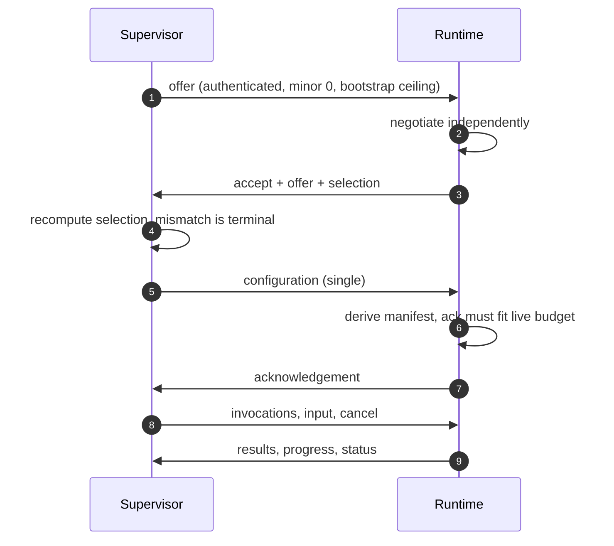
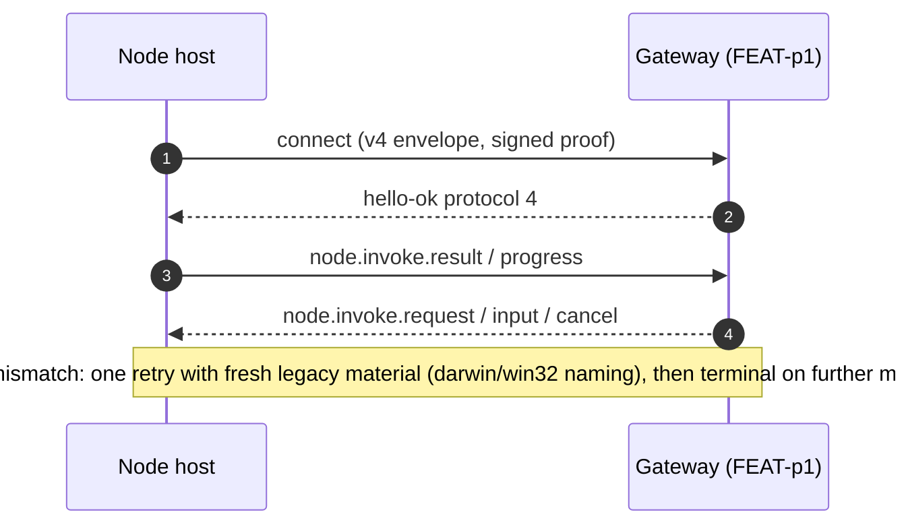
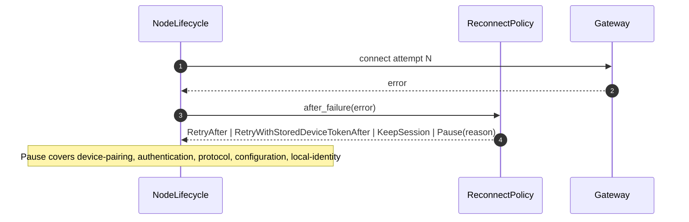

# Specification: Rust node host

## Overview

The implementation is a Cargo workspace (`crates/`) with two crates: `openclaw-gateway-client` owns TLS-pinned WebSocket transport, event retention, and request correlation, while `openclaw-node-host` owns the node connect envelope, Ed25519 identity, bounded command runtime, lifecycle/reconnect driver, headless host binary, and the v1 sidecar protocol stack.
Cross-language fixture vectors under `test/fixtures/` pin the wire contract so non-Rust adapters must reproduce exact bytes before selection.

## Architecture

```text
operator config + env secrets
        |
        v
+---------------+   local IPC    +------------------+
|  supervisor   |<---OCSC v1---->| runtime (bridge) |
|  (product)    |  HMAC + seq    | CommandRuntime   |
+---------------+                +--------+---------+
        |                                 |
        | Gateway WebSocket (node role)   | Gateway WebSocket (node role)
        v                                 v
+--------------------------------------------------+
| Gateway node registry / pairing (see FEAT-p1)    |
+--------------------------------------------------+
```

Crate module layout (`crates/openclaw-node-host/src/`): `node.rs` (connect envelope, session, invocation parsing), `identity.rs` (Ed25519), `runtime.rs` (bounded dispatch), `duplex.rs` (ordered input, progress output), `lifecycle.rs` (connect/reconnect/shutdown driver), `reconnect.rs` (policy classification), `host.rs` (`run_host`, config, health server), `sidecar_protocol.rs` (authenticated frames), `sidecar_handshake.rs` (offer/accept), `sidecar_runtime.rs` (config exchange, bridge), `main.rs` (`openclaw-node` CLI).
`crates/openclaw-gateway-client/src/` holds `session.rs` (transport, TLS trust, event buffer, in-flight requests) behind `lib.rs` (error details, pin-mismatch constants).

## Data Models

### Sidecar authenticated frame

| Field | Type | Constraints | Description |
|---|---|---|---|
| Magic | 4 bytes | ASCII `OCSC` | Frame identifier |
| Protocol major | u16 BE | `1` | Major version, must match |
| Protocol minor | u16 BE | `0` in bootstrap | Negotiated minor after handshake |
| Direction | u8 | `1` supervisor-to-runtime, `2` runtime-to-supervisor | Prevents reflection |
| Generation | u64 BE | Nonzero | Process/session generation scope |
| Sequence | u64 BE | Starts at `1`, strictly increasing per direction | Replay and gap detection |
| Session ID length | u16 BE | Matches session id bytes | Internal length, HMAC-covered |
| Payload length | u32 BE | Matches payload bytes | Internal length, HMAC-covered |
| Session ID | UTF-8 | Exact bootstrap identifier | Binds frame to one process |
| Payload | UTF-8 JSON | Typed message, budget-checked | Offer, accept, config, invocation, result, cancel, status |
| Authentication tag | 32 bytes | HMAC-SHA-256 over all preceding bytes | Verified before any field is trusted |

Each frame is preceded by a u32 BE length prefix that counts the authenticated frame and excludes itself.
The receiver applies its local hard ceiling to the prefix before allocating.

### Sidecar protocol offer

| Field | Type | Constraints | Description |
|---|---|---|---|
| Role | enum | Supervisor or runtime, must be complementary | Peer role |
| Reported identity | struct | Validated before channel use | Peer identity claim, key-authenticated but not artifact proof |
| Version | major/minor | Same major required | Offered protocol version |
| Feature bits | u64 | At most `2^53 - 1` | Additive features, intersected with integer arithmetic |
| Frame ceiling | bytes | Lower valid offer wins | Maximum frame size |
| In-flight ceiling | count | Lower valid offer wins | Maximum concurrent work |
| Bootstrap deadline | duration | Lower valid offer wins | Finite handshake deadline |

### Sidecar runtime messages

| Message | Direction | Purpose |
|---|---|---|
| Configuration | Supervisor to runtime | Command registrations with concurrency/input/output limits |
| Acknowledgement | Runtime to supervisor | Independently derived manifest digest |
| Admission | Bridge-internal | Product adapter allow/deny before native dispatch |
| Invocation | Supervisor to runtime | Command name plus bounded typed parameters |
| Result | Runtime to supervisor | Success payload or structured failure code/message |
| Cancellation | Either | Cooperative cancel via the runtime token |
| Status | Runtime to supervisor | Secret-free lifecycle state tied to manifest generation |

### Gateway node connect envelope

| Field | Type | Constraints | Description |
|---|---|---|---|
| minProtocol/maxProtocol | u32 | `3..=4` | Offered wire dialect range |
| client | struct | id `node-host`, mode `node` | Version, platform, display name, instance id |
| role/scopes | strings | role `node` | Requested pairing role |
| device | DeviceProof | Canonical v3 signature | Ed25519 proof over nonce, platform, auth token |
| auth | ConnectAuth | Exactly one of token, bootstrapToken, deviceToken, password | Credential material |
| commands/caps/permissions | arrays | Withheld until activated | Advertised manifest, empty unless `activate()` ran |

### Node invocation

| Field | Type | Constraints | Description |
|---|---|---|---|
| id | string | Non-empty | Invocation correlation id |
| nodeId | string | Non-empty | Target node id |
| command | string | Shared ASCII grammar, manifested | Command name |
| paramsJSON | string JSON | Parsed under input budget | Serialized parameters (v4); direct `params` rejected |
| timeoutMs | u64 | `0` disables deadline | Gateway deadline minus result grace |
| idempotencyKey | string | Optional, non-empty | Deduplication hint |
| sessionKey | string | Optional | Owning session scope |

## API Contracts

No `api.yaml` is provided because this feature defines no HTTP network API.
The Gateway WebSocket RPC surface is owned by FEAT-p1; the normative byte contract here is the sidecar IPC wire plus the local health probes, summarized below.
Full field semantics live in `crates/openclaw-node-host/SIDECAR_PROTOCOL.md`.

| Channel | Message | Purpose |
|---|---|---|
| Sidecar IPC | offer | Supervisor opens negotiation with its offer |
| Sidecar IPC | accept | Runtime replies with its offer and the derived selection |
| Sidecar IPC | configuration | Supervisor delivers the single command configuration |
| Sidecar IPC | acknowledgement | Runtime confirms the derived manifest |
| Sidecar IPC | invocation | Supervisor delivers one typed command invocation |
| Sidecar IPC | result | Runtime returns success payload or structured failure |
| Sidecar IPC | cancellation | Either peer cancels in-flight work |
| Sidecar IPC | status | Runtime publishes secret-free lifecycle state |
| Gateway WS | connect.challenge / connect | Challenge-signed node handshake with v3/v4 fallback |
| Gateway WS | node.invoke.request / .input / .cancel | Authorized invocation delivery with ordered input and cancel |
| Gateway WS | node.invoke.result / node.invoke.progress | Final results and chunked duplex progress |
| Local HTTP | GET /healthz | Liveness probe, always 200 when listening |
| Local HTTP | GET /readyz | Readiness probe, 200 when lifecycle is ready else 503 |

Stable runtime failure codes shared across the bridge: `SIDECAR_MESSAGE_TOO_LARGE`, `SIDECAR_NON_PORTABLE_JSON`, `SIDECAR_CHANNEL_RETIRED`, plus `OVERLOADED`, `INPUT_TOO_LARGE`, `OUTPUT_TOO_LARGE`, `HANDLER_TIMEOUT`, `HANDLER_PANIC`, `ADMISSION_DENIED`, `COMMAND_NOT_FOUND`, `COMMAND_NOT_ADVERTISED`, `DUPLICATE_INVOCATION`, `INVOCATION_CANCELLED`, `SESSION_RETIRED`, `DUPLEX_REQUIRES_RUN`.

## Sequences

### Sidecar bootstrap and activation



### Gateway node connection with fallback



### Failure classification and reconnect



## Technical Decisions

| Decision | Choice | Rationale |
|---|---|---|
| Language | Rust workspace, edition 2021, Rust 1.93 | Memory safety without GC for a long-lived host; `unsafe_code = forbid` |
| Local IPC auth | HMAC-SHA-256 frames over product-chosen transport | Portable authenticated channel without mandating pipes, sockets, or TLS locally |
| Sequence and generation scopes | Per-direction sequences plus separate channel, manifest, attempt, and pairing generations | Replays and cross-generation confusion fail closed without shared mutable state |
| Single-shot handshake and config | Two-frame handshake, exactly one configuration plus one acknowledgement | Prevents concurrency multiplication and stale-ceiling races |
| Gateway authority boundary | Node declares a manifest; only Gateway-delivered invocations reach handlers | Adding commands needs a new bridge and Gateway manifest; revocation cancels via the runtime token |
| Bounded runtime | Semaphore concurrency, byte-limited JSON preflight, admission before entry | Saturation and oversize inputs fail with stable codes instead of queueing unboundedly |
| Secret handling | Secrets via env indirection only; redacted Debug; key never enters the crate for external signers | Keeps platform credential stores (Keychain, TPM) as the persistence owners |
| Health surface | Loopback TCP probes with OS-assigned port by default | Collision-free local supervision with no remote exposure |

## Risks and Unknowns

1. Product supervisor duties (artifact verification, secret delivery, process creation, packaging, Windows integration) are unimplemented and must not weaken the auth and bounds guarantees when added.
2. Device tokens persist in process memory only, so a host restart loses the adopted token until the next issuance.
3. Embeddings that misconfigure `maxTimeout` below handler needs will see systematic `HANDLER_TIMEOUT` failures; defaults are 30 s with a 120 s cap for the binary.
4. JavaScript/TypeScript adapters must use `BigInt` for the feature-mask intersection because native `&` truncates to 32 bits; the negotiation fixture pins a bit above that range.

## Out of Scope

- Product IPC transport selection, protected credential/config delivery, and process supervision.
- Duplex input/progress transport beyond the current ordered-input and chunked-progress framing.
- Worker/session hosting, workspace transfer, plugins, host statistics, `system.run`, PTY, MCP, and skills.
- Gateway-side pairing UI, registry policy, and approval flows (see FEAT-p1).
- Durable device-token storage and restart/rollback policy.
