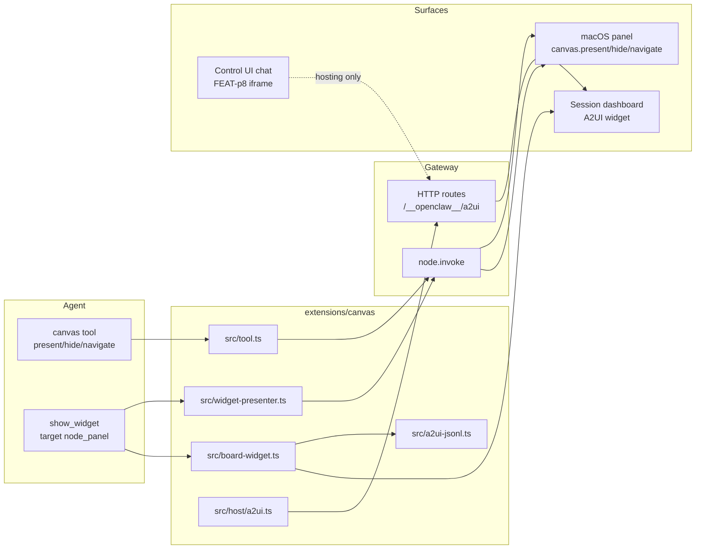
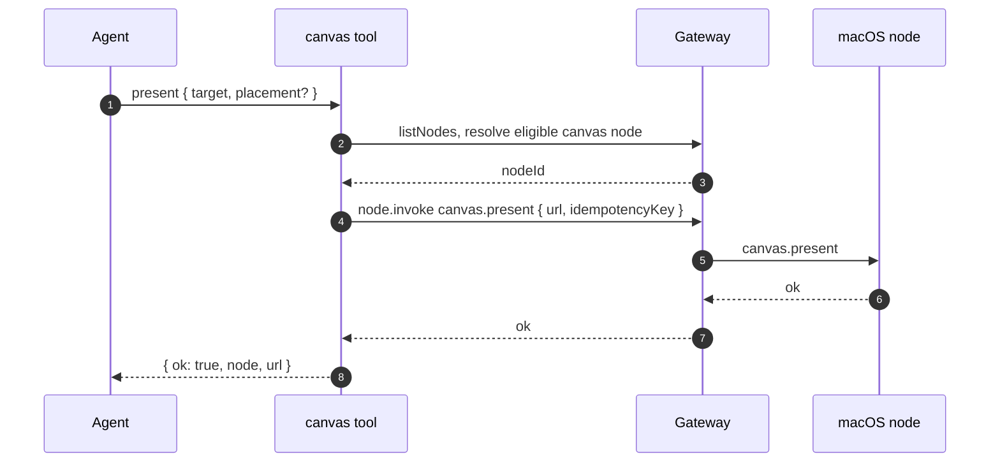
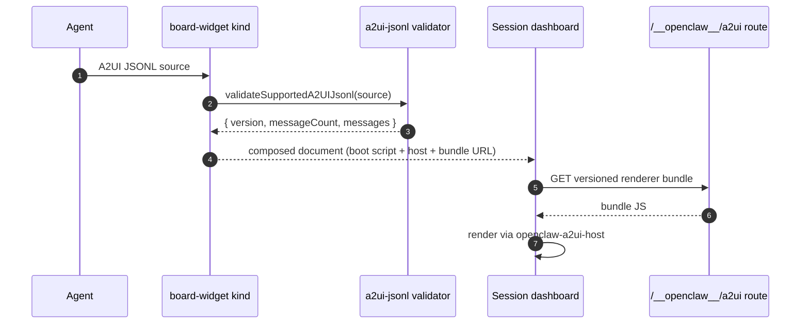
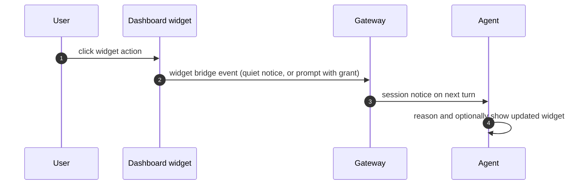

# Specification: Canvas Dynamic UI

## Overview

The Canvas plugin (`extensions/canvas/`) owns the agent-driven visual surface: a lazily loaded `canvas` agent tool, a `node_panel` widget presenter behind core `show_widget`, versioned A2UI renderer bundles served from Gateway routes, and an A2UI board-widget content kind for session dashboards.
The macOS panel itself and the Control UI iframe/sandbox hosting layer belong to the native app and FEAT-p8 respectively; this specification covers the plugin side and its contracts with both.

## Architecture

## Data Models

### A2UI message (v0.9, via `@a2ui/web_core`)

| Field | Type | Constraints | Description |
|---|---|---|---|
| version | string | Must be `v0.9` | Dialect marker on every message |
| createSurface | object | Exactly one action key per message | Declares a new rendering surface |
| updateComponents | object | Exactly one action key per message | Adds or replaces components on a surface |
| updateDataModel | object | Exactly one action key per message | Patches the data model bound to components |
| deleteSurface | object | Exactly one action key per message | Removes a surface |

### A2UI message (v0.8, bundled legacy dialect)

| Field | Type | Constraints | Description |
|---|---|---|---|
| beginRendering | object | Exactly one action key, no version field | Starts rendering a surface |
| surfaceUpdate | object | Exactly one action key, no version field | Updates surface content |
| dataModelUpdate | object | Exactly one action key, no version field | Patches the data model |
| deleteSurface | object | Exactly one action key, no version field | Removes a surface |

### Canvas tool parameters

| Field | Type | Constraints | Description |
|---|---|---|---|
| action | enum | Required, one of `present`, `hide`, `navigate` | Panel operation |
| node | string | Optional query (id, name, or IP) | Panel node selector, required when ambiguous |
| target | string | Optional, alias `url` | Hosted document path or URL for present and navigate |
| x, y, width, height | number | Optional finite numbers | Panel placement for present |
| timeoutMs | integer | Optional positive | Node invoke deadline, transport adds a 10 s grace |
| gatewayUrl, gatewayToken | string | Optional | Out-of-band Gateway addressing |

### Widget presenter result

| Field | Type | Constraints | Description |
|---|---|---|---|
| kind | string | Always `node` on success | Presentation target kind |
| nodeId | string | Required on success | Selected Mac node |
| nodeName | string | Optional | Display name when known |
| code | string | `no_eligible_node` or `node_error` on failure | Machine-readable failure reason |

## API Contracts

No `api.yaml` is included: this feature defines no REST API surface of its own.
The normative surfaces are Gateway RPC passthrough (`node.invoke`), Gateway plugin-route registration, and CLI commands, summarized below.

| Method | Path | Purpose |
|---|---|---|
| GET (prefix) | `/__openclaw__/a2ui/*` | Serve versioned A2UI renderer bundles (`a2ui.bundle.js` v0.8, `a2ui-v0.9.bundle.js` v0.9) |
| GET (prefix) | `/__openclaw__/canvas/*` | Serve hosted widget documents from core storage (core-owned route, Canvas-gated) |
| RPC | `node.invoke { canvas.present, canvas.hide, canvas.navigate }` | Drive the paired macOS panel |
| CLI | `openclaw nodes canvas present --node <id> [--target] [--x/--y/--width/--height]` | Show the panel, optionally with target and placement |
| CLI | `openclaw nodes canvas navigate <url> --node <id>` | Navigate the panel to a hosted path |
| CLI | `openclaw nodes canvas hide --node <id>` | Hide the panel without changing its document |

Error codes shared across surfaces:

| Status | Code | Description |
|---|---|---|
| n/a | `no_eligible_node` | No connected canvas-capable device available |
| n/a | `node_error` | Node lookup or invocation failed, message carries the cause |
| n/a | `CANVAS_DISABLED` | Panel commands on a node with Canvas disabled |

## Sequences

### Agent presents a widget on the Mac panel

### Agent emits an A2UI dashboard widget

### User interacts, event returns to the agent

## Technical Decisions

| Decision | Choice | Rationale |
|---|---|---|
| Dynamic interface dialect | A2UI JSONL v0.8 plus v0.9, validated per line | Matches the two prebuilt renderer bundles and rejects mixed files early |
| Dashboard renderer stack | `solid-js` 2.0.0-rc.14 with `@a2ui/lit` 0.12.0 and `@a2ui/web_core` 0.12.0 per `extensions/canvas/package.json` | Reuses the upstream A2UI component model instead of a bespoke widget DSL |
| Renderer delivery | Prebuilt bundles via `scripts/bundle-a2ui.mjs`, served from the Gateway asset route, never copied per widget | Keeps widgets small and guarantees version parity between validator and renderer |
| Panel targeting | Eligible node resolution shared with the SDK (`resolveEligibleNodeFromList`), macOS plus `canvas.present` required | One ownership rule for tool, presenter, and CLI instead of three ad hoc matchers |
| Heavy-module loading | `createLazyRuntimeModule` for tool, CLI, and A2UI handler | Idle Gateways pay no Canvas startup cost |
| Retired file-host removal | Doctor migration moves custom-root documents atomically into core storage | Hosted routes serve only the default folder, so legacy documents would otherwise go dark |

## Risks and Unknowns

1. Two A2UI dialects must be carried until v0.8 content ages out; the validator forbids mixing but both bundles ship.
2. Scoped `pluginSurfaceUrls.canvas` capability URLs expire, so callers must pass document paths and let the node refresh the capability.
3. Widget documents are agent-authored HTML/JS served over HTTP; exposure beyond loopback needs Gateway auth and operator care per the network exposure docs.
4. Renderer root resolution spans source, dist, and packaged layouts; a missed layout returns renderer-unavailable until the candidate list is extended.

## Out of Scope

- The Control UI chat, dashboard shell, iframe lease, and sandbox policy (FEAT-p8).
- The macOS panel implementation itself (native app, panel chrome, focus behavior).
- HTML `show_widget` document composition, script validation, and bridge protocol (core `show_widget`).
- Quotas or retention for hosted widget documents.
