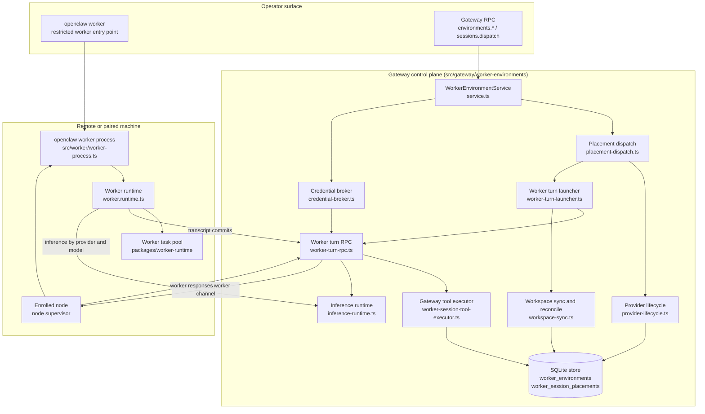
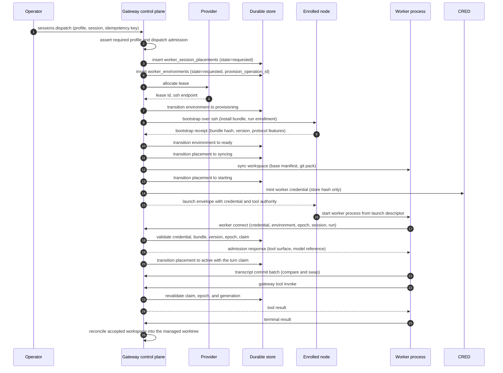
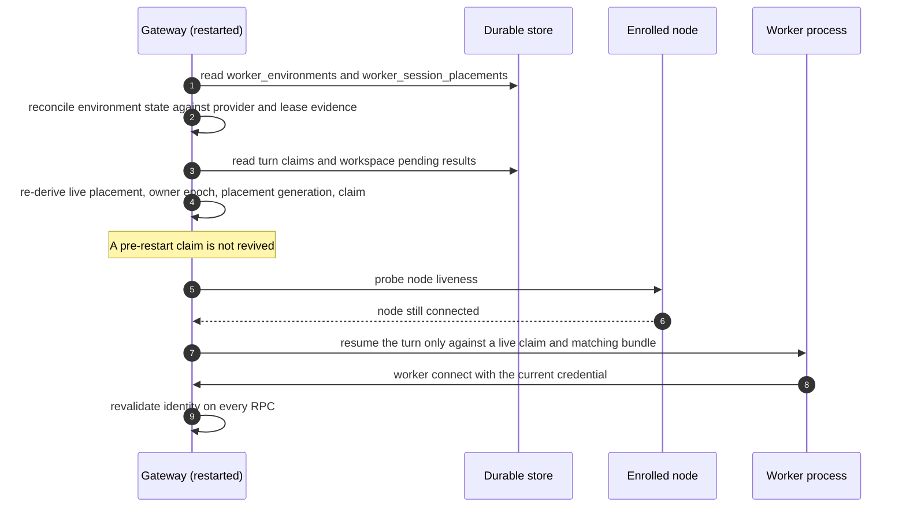

# Specification: Cloud Workers and Session Placement

## Overview

The implementation is split across three modules with a strict ownership boundary. The Gateway control plane in `src/gateway/worker-environments/` owns environment lifecycle, provider provisioning, placement dispatch, worker turn execution, workspace sync and reconciliation, credential brokering, and worker-local inference. The worker runtime in `src/worker/` owns the restricted process that runs on the remote machine: it parses a launch descriptor, opens the authenticated worker connection, and drives the local runtimes (browser, computer, GitHub binding, native inference). The private package `packages/worker-runtime/` owns the bounded task pool, admission, and shared compute capacity that both the Gateway and the worker use for local work. Durable state lives in the Gateway's SQLite database (`src/state/openclaw-state-schema.sql`); the remote machine holds only a throwaway state directory.

## Architecture

The remote machine never holds placement authority. Every transition that changes where work runs is decided and persisted by the Gateway, and the worker can only act inside the turn claim the Gateway issued.

## Data Models

### worker_environments

One row per durable worker environment. Defined in `src/state/openclaw-state-schema.sql`.

| Field | Type | Constraints | Description |
|---|---|---|---|
| environment_id | TEXT | PK, not null | Gateway-owned environment identity, derived from the create idempotency key as the `worker:` prefix followed by the first 32 hex characters of the sha256 digest |
| provider_id | TEXT | not null | Provider plugin that owns allocation and teardown |
| profile_id | TEXT | not null | Configured profile the environment was created from |
| profile_snapshot_json | TEXT | not null | Snapshot of the profile taken at creation, so later config edits do not change the live environment |
| last_activated_at_ms | INTEGER | nullable | Last time the environment carried a turn |
| preparation_key | TEXT | nullable | 64 lowercase hex characters, links the environment to a prepared-pool entry |
| preparation_purpose | TEXT | nullable | `reserve` or `build` |
| preparation_demand_at_ms | INTEGER | nullable | When the preparation was demanded |
| preparation_expires_at_ms | INTEGER | nullable | Strictly after the demand timestamp, at most 2^53-1 |
| preparation_consumed_at_ms | INTEGER | nullable | Between the demand and the expiry |
| provision_operation_id | TEXT | not null, unique | Fencing identity for the allocation, derived from the same idempotency key |
| lease_id | TEXT | nullable | Provider lease identity, unique per provider when present |
| node_setup_id | TEXT | nullable | Node-only setup identity used for enrollment binding |
| node_device_id | TEXT | nullable | Enrolled device identity for the environment |
| ssh_host, ssh_port, ssh_user, ssh_host_key, ssh_key_ref_json | TEXT, INTEGER, TEXT, TEXT, TEXT | port between 1 and 65535 | SSH endpoint and key reference for SSH-backed providers |
| desktop_json | TEXT | nullable | Desktop carrier descriptor |
| state | TEXT | not null | One of `requested`, `provisioning`, `bootstrapping`, `ready`, `attached`, `idle`, `draining`, `destroying`, `destroyed`, `failed`, `orphaned` |
| bootstrap_bundle_hash | TEXT | nullable | Bundle hash the worker reported at bootstrap |
| bootstrap_openclaw_version | TEXT | nullable | OpenClaw version the worker reported |
| bootstrap_protocol_features_json | TEXT | nullable | Protocol features the worker reported |
| bootstrap_install_kind | TEXT | nullable | Bundle or other install kind |
| owner_epoch | INTEGER | not null, default 0, at least 0 | Fencing epoch for the current owner of the environment |
| teardown_terminal_state | TEXT | nullable | `destroyed` or `failed` |
| attached_session_ids_json | TEXT | not null, default `[]` | Sessions currently attached |
| created_at_ms, updated_at_ms, state_changed_at_ms | INTEGER | not null | Timestamps |
| idle_since_at_ms | INTEGER | nullable | When the environment became idle |
| destroy_requested_at_ms | INTEGER | nullable | When teardown was requested |
| last_error | TEXT | nullable | Last recorded error |
| shared_host | INTEGER | nullable | True when the environment shares a host with other sessions |

Indexes: `idx_worker_environments_provider_lease` on `(provider_id, lease_id)` where `lease_id is not null`, and `idx_worker_environments_terminal_changed` on `(state_changed_at_ms, environment_id)`.

### worker_session_placements

One row per session that has a placement. Defined in `src/state/openclaw-state-schema.sql`.

| Field | Type | Constraints | Description |
|---|---|---|---|
| session_id | TEXT | PK, not null | Placement session identity |
| agent_id | TEXT | not null | Owning agent |
| session_key | TEXT | not null | Logical session key |
| execution_mode | TEXT | nullable | `worker-turn` or `remote-exec` |
| state | TEXT | not null | One of `local`, `requested`, `provisioning`, `syncing`, `starting`, `active`, `draining`, `reconciling`, `reclaimed`, `failed` |
| environment_id | TEXT | nullable | Bound environment, null while local or requested |
| transition_generation | INTEGER | not null, default 0, at least 0 | Increments on every transition, fences stale work |
| active_owner_epoch | INTEGER | nullable, at least 1 | Owner epoch of the live placement |
| workspace_base_manifest_ref | TEXT | nullable | Base manifest of the synced workspace |
| remote_workspace_dir | TEXT | nullable | Remote workspace directory |
| worker_bundle_hash | TEXT | nullable | Bundle the worker must match |
| last_transcript_ack_cursor | INTEGER | nullable, at least 0 | Last acknowledged transcript cursor |
| last_live_event_ack_cursor | INTEGER | nullable, at least 0 | Last acknowledged live-event cursor |
| recovery_error | TEXT | nullable | Set when the state is `failed` |
| turn_claim_owner | TEXT | nullable | `local` or `worker` |
| turn_claim_id | TEXT | nullable | Exact claim id for the running turn |
| turn_claim_run_id | TEXT | nullable | Run id of the running turn |
| turn_claim_generation | INTEGER | nullable, at least 0 | Claim generation |
| turn_claim_owner_epoch | INTEGER | nullable, at least 1 | Owner epoch of the claim, required for a worker claim |
| created_at_ms, updated_at_ms, state_changed_at_ms | INTEGER | not null | Timestamps |
| terminal_reason, terminal_at_ms | TEXT, INTEGER | nullable | Terminal placement outcome |

Table-level checks encode the state machine: a placement may only carry a manifest, remote directory, bundle hash, and cursors in the states that have them, a worker claim is only legal in `active` or `draining` with `execution_mode` `worker-turn`, and a `reclaimed` placement carries no claim.

Indexes: `idx_worker_session_placements_session_key` on `(agent_id, session_key)`, `idx_worker_session_placements_reconcile` on `(updated_at_ms, session_id)`, and `idx_worker_session_placements_environment` on `environment_id` where it is not null.

### worker_session_placement_moves

| Field | Type | Constraints | Description |
|---|---|---|---|
| operation_id | TEXT | PK, not null | Opaque id that fences a stale asynchronous completion |
| session_id | TEXT | not null, unique, FK to `worker_session_placements` | Session being moved |
| source_generation | INTEGER | not null, at least 0 | Placement generation the move was planned from |
| source_environment_id | TEXT | not null, trimmed, 1 to 256 characters | Source environment |
| source_owner_epoch | INTEGER | not null, at least 1 | Owner epoch the move was planned from |
| target_kind | TEXT | not null | `gateway`, `profile`, or `device` |
| target_id | TEXT | nullable | Required for `profile` and `device`, forbidden for `gateway` |
| target_machine_class, target_os | TEXT | nullable | Per-session machine and OS overrides |
| abandon_source | INTEGER | nullable | Durable operator decision to abandon the source |
| last_error | TEXT | nullable | Last recorded error |
| created_at_ms, updated_at_ms | INTEGER | not null | Timestamps |

### worker_turn_tool_authorities

| Field | Type | Constraints | Description |
|---|---|---|---|
| session_id | TEXT | PK, not null, FK to `worker_session_placements` | Session whose worker may call Gateway tools |
| environment_id | TEXT | not null | Environment the authority is bound to |
| owner_epoch | INTEGER | not null, at least 1 | Owner epoch of the bound environment |
| placement_generation | INTEGER | not null, at least 0 | Placement generation the authority was granted for |
| claim_id | TEXT | not null | Exact turn claim |
| run_id | TEXT | not null | Run id of the admitted turn |
| tool_names_json | TEXT | not null | Granted worker tool surface |
| updated_at_ms | INTEGER | not null | Timestamp |

### worker_session_tool_operations

| Field | Type | Constraints | Description |
|---|---|---|---|
| source_session_id | TEXT | PK part, FK to `worker_session_placements` | Session that requested the operation |
| source_claim_id | TEXT | PK part | Exact source turn claim; the idempotency scope |
| tool_call_id | TEXT | PK part | Tool-call id, an idempotency key only inside one claim |
| tool_name | TEXT | not null | `sessions_spawn` or `sessions_send` |
| request_digest | TEXT | not null | Digest of the request, used to detect a mismatched replay |
| operation_seed | TEXT | not null | Durable seed for downstream identities, separate from the Gateway authentication key |
| status | TEXT | not null | `running`, `succeeded`, `failed`, or `unknown` |
| child_session_key | TEXT | nullable | Spawned child session |
| result_json | TEXT | nullable | Cached terminal result |
| gateway_instance_id | TEXT | not null | Gateway instance that owns the operation |
| created_at_ms, updated_at_ms | INTEGER | not null | Timestamps |

### worker_environment_credentials

| Field | Type | Constraints | Description |
|---|---|---|---|
| environment_id | TEXT | PK, not null, FK to `worker_environments` | Environment the credential belongs to |
| credential_hash | TEXT | not null, unique | Hash of the minted credential; the value itself is never stored |
| bundle_hash | TEXT | not null | Bundle the credential is valid for |
| session_id | TEXT | nullable | Session the credential was minted for |
| rpc_set_version | INTEGER | not null, at least 1 | Worker RPC set the credential is valid for |
| owner_epoch | INTEGER | not null, at least 0 | Owner epoch the credential is bound to |
| expires_at_ms | INTEGER | not null | Expiry, enforced on admission and on every RPC |
| delivered_at_ms | INTEGER | nullable | When the credential was delivered to the worker |

### worker_transcript_commit_heads and worker_transcript_commits

`worker_transcript_commit_heads` holds one durable sequence cursor per attached session owner epoch.

| Field | Type | Constraints | Description |
|---|---|---|---|
| session_id | TEXT | PK part | Session |
| run_epoch | INTEGER | PK part, at least 0 | Owner epoch of the run |
| environment_id | TEXT | not null | Environment binding, so two workers with coincident epochs do not share replay state |
| next_seq | INTEGER | not null, at least 1 | Next expected sequence number |
| updated_at_ms | INTEGER | not null | Timestamp |

`worker_transcript_commits` holds one row per committed sequence number.

| Field | Type | Constraints | Description |
|---|---|---|---|
| session_id | TEXT | PK part, FK to the commit heads | Session |
| run_epoch | INTEGER | PK part | Owner epoch of the run |
| seq | INTEGER | PK part, at least 1 | Sequence number |
| request_hash | TEXT | not null | Digest of the committed request, used for the compare-and-swap |
| state | TEXT | not null | `pending` or `terminal` |
| result_json | TEXT | nullable | Cached result, present exactly when the state is `terminal` |
| created_at_ms, updated_at_ms | INTEGER | not null | Timestamps |

### worker_inference_turns

| Field | Type | Constraints | Description |
|---|---|---|---|
| session_id | TEXT | PK part | Session |
| run_epoch | INTEGER | PK part, at least 0 | Owner epoch of the run |
| run_id | TEXT | PK part | Run id |
| turn_id | TEXT | PK part | Turn id |
| environment_id | TEXT | not null, FK to `worker_environments` | Environment that owns the turn |
| request_hash | TEXT | not null | Digest of the inference request |
| state | TEXT | not null | `pending` or `terminal` |
| terminal_json | TEXT | nullable | Cached terminal outcome, present exactly when the state is `terminal` |
| created_at_ms, updated_at_ms | INTEGER | not null | Timestamps |

### worker_workspace_reconciliations and worker_workspace_pending_results

`worker_workspace_reconciliations` is written before any managed-worktree mutation.

| Field | Type | Constraints | Description |
|---|---|---|---|
| session_id | TEXT | PK, not null, FK to `worker_session_placements` | Session |
| environment_id | TEXT | not null | Environment that produced the result |
| owner_epoch | INTEGER | not null, at least 1 | Owner epoch |
| placement_generation | INTEGER | not null, at least 0 | Placement generation |
| base_manifest_ref | TEXT | not null | Base manifest of the reconciliation |
| current_manifest_ref | TEXT | not null | Manifest after reconciliation |
| plan_json | TEXT | not null | Reconciliation plan |
| base_pack | BLOB | not null, at most 256 MiB | Bounded Git base snapshot that repairs an interrupted apply |
| created_at_ms | INTEGER | not null | Timestamp |

`worker_workspace_pending_results` fences a completed remote turn from stale-claim teardown until its result is durably reconciled.

| Field | Type | Constraints | Description |
|---|---|---|---|
| session_id | TEXT | PK, not null, FK to `worker_session_placements` | Session |
| environment_id | TEXT | not null | Environment |
| owner_epoch | INTEGER | not null, at least 1 | Owner epoch |
| placement_generation | INTEGER | not null, at least 0 | Placement generation |
| claim_id | TEXT | not null | Claim that produced the result |
| run_id | TEXT | not null | Run id |
| gateway_instance_id | TEXT | not null | Gateway instance that owns the result |
| recovery_requested_at_ms | INTEGER | nullable | When recovery was requested |
| workspace_accepted_at_ms | INTEGER | nullable | When the workspace was accepted |
| staged_result_ref | TEXT | nullable | Reference to the staged result |
| repository_workspace_id | TEXT | nullable | Bound repository workspace |
| created_at_ms | INTEGER | not null | Timestamp |

### worker_environment_ssh_fallback_ports

| Field | Type | Constraints | Description |
|---|---|---|---|
| environment_id | TEXT | PK part, FK to `worker_environments` | Environment |
| position | INTEGER | PK part, 0 to 9 | Stable retry order |
| port | INTEGER | not null, 1 to 65535, unique per environment | Candidate port |

### local_workspace_projections

Local sandbox execution is a projection of a session-owned managed worktree.

| Field | Type | Constraints | Description |
|---|---|---|---|
| worktree_id | TEXT | PK, not null | Managed worktree identity |
| agent_id, session_key, session_id | TEXT | not null | Owning session |
| lifecycle_revision | TEXT | nullable | Revision of the managed worktree lifecycle |
| projection_path | TEXT | not null, unique | Local projection path |
| base_commit | TEXT | not null | Base commit of the projection |
| source_paths_json | TEXT | not null | Paths the projection covers |
| baseline_json, baseline_ref | TEXT | nullable | Baseline snapshot, present together |
| pending_ref | TEXT | nullable | Pending change reference |
| pending_target | TEXT | nullable | `canonical` or `projection` |
| paused_runtimes_json | TEXT | nullable | Paused runtimes |
| journal_json | TEXT | nullable | Reconciliation journal, present together with the pack |
| journal_pack | BLOB | nullable, at most 256 MiB | Journal pack, present together with the journal |
| revision | INTEGER | not null, default 0, at least 0 | Monotonic revision |
| created_at_ms | INTEGER | not null | Timestamp |

The table deliberately has no cascade to the session row, so an older binary cannot discard pending edits along with a session row.

## API Contracts

The Gateway protocol is a WebSocket and HTTP JSON-RPC surface, not REST. A request is a `req` frame with `id`, `method`, and optional `params`; a response is a `res` frame with `id`, `ok`, and optional `payload` or `error`; an event is an `event` frame with `event` and optional `payload`. The normative payload schemas live in `packages/gateway-protocol/src/schema/`, and the method policy table lives in `src/gateway/methods/core-descriptors.ts`.

The table below is a summary; request and response schemas, error response bodies, and scope requirements are in [`api.yaml`](api.yaml).

| Method | Scope | Group | Purpose |
|---|---|---|---|
| environments.list | dynamic | environments | List environment summaries, configured profiles, the suggested profile, and the prepared-pool summary |
| environments.status | operator.read | environments | Read one environment summary by id |
| environments.create | operator.admin | environments | Create a worker environment from a configured provider profile |
| environments.destroy | operator.admin | environments | Destroy one durable worker environment by id |
| environments.prepare | operator.admin | environments | Prepare a configured profile's local Git project without dispatching a session |
| environments.adoptSuggestedProfile | operator.admin | environments | Save the provider-suggested profile as a configured profile |
| environments.session.create | operator.admin | environments | Attach a session to an environment, reusing an existing attachment when one exists |
| environments.session.destroy | operator.admin | environments | Detach and tear down a session attachment |
| environments.session.status | operator.read | environments | Read the attachment and environment for a session |
| environments.session.exec | operator.admin | environments | Run or control a process inside the environment attached to the authenticated conversation |
| worker.desktop.launch | operator.admin | environments | Launch a desktop application on a cloud worker |
| worker.desktop.observe | operator.admin | environments | Open an RFB observation session for a cloud worker desktop |
| sessions.dispatch | dynamic | sessions-dispatch | Dispatch a session to a worker placement |
| sessions.move | dynamic | sessions-dispatch | Move a session between placements |
| sessions.reclaim | operator.write | sessions-dispatch | Reclaim a session back to the Gateway |

Control-plane methods (`environments.create`, `environments.destroy`, `environments.prepare`, `environments.adoptSuggestedProfile`, `environments.session.create`, `environments.session.destroy`, `sessions.dispatch`, `sessions.move`, `sessions.reclaim`) are control-plane writes and are subject to the shared write budget. `environments.create`, `environments.destroy`, `environments.prepare`, `sessions.dispatch`, `sessions.move`, and `sessions.reclaim` also require the sidecar to be ready before dispatch.

The worker-facing side of the surface is not a Gateway RPC. A worker connects over the authenticated worker route and speaks the worker protocol, which has a closed method allowlist: connect, transcript commit, live event, gateway tool invoke and cancel, inference start and cancel, and computer calls.

Error codes shared across endpoints. The Gateway frame error uses the closed set in `packages/gateway-protocol/src/gateway-error-details.ts`; the worker-environment service raises the finer-grained codes in `src/gateway/worker-environments/environment-errors.ts` and the handler maps them onto `INVALID_REQUEST` or `UNAVAILABLE`.

| Code | Description |
|---|---|
| INVALID_REQUEST | The request failed schema validation, the required profile does not match, or the service raised `profile_not_found`, `provider_not_found`, `environment_not_found`, `invalid_profile`, `invalid_project`, `desktop_app_not_found`, or `unsupported_platform` |
| FORBIDDEN | The caller lacks the operator scope the method requires; the details carry the missing scope |
| UNAVAILABLE | The sidecar, provider registry, or environment is not ready, or the service raised `capacity`, `invalid_state`, `launcher_failure`, `provider_failure`, or `bootstrap_failure` |
| APPROVAL_NOT_FOUND | An approval referenced by the request is missing or expired |

## Sequences

### Dispatch a session to a cloud worker

### Recover after a Gateway restart

## Technical Decisions

| Decision | Choice | Rationale |
|---|---|---|
| Ownership split | Gateway owns placement, transcript, tool authority, and credentials; the worker owns only its process-local state and turn execution | A remote machine is disposable; keeping the authoritative records on the Gateway makes a dead machine recoverable rather than fatal |
| Placement identity | A durable `worker_session_placements` row with a transition generation and an active owner epoch | Generations and epochs fence stale asynchronous work without a distributed lock |
| Provisioning idempotency | The environment id and the provision operation id are both derived from the create idempotency key | A replayed create cannot allocate a second machine, and the unique operation id fences duplicate teardown requests |
| Credential storage | The Gateway stores only the credential hash and compares with a constant-time secret comparison | A database read does not yield a usable worker credential |
| Admission bindings | Credential hash, environment id, session id, run id, owner epoch, bundle hash, OpenClaw version, RPC set version, and protocol features must all match | A worker built for a different Gateway or a stale build must not be admitted into a live turn |
| Revalidation | Identity is revalidated on every worker RPC, not only at connect | Credential rotation and expiry must fence a socket that is already open |
| Worker ingress | A closed worker method allowlist instead of a subset of operator RPCs | A worker cannot reach operator authority by accident or by injection |
| Model placement | Inference is proxied to the Gateway by a `{provider, model}` reference; worker-local inference is an explicit per-profile opt-in | Provider keys stay on the Gateway by default; the opt-in exists for paired devices that already hold a model configuration |
| Tool execution | Gateway-owned tools run on the Gateway and are reached over one closed transport, revalidating the run, claim, epoch, and generation | The tool's policy, hooks, and cancellation stay with their Gateway owners |
| Transcript commit | Compare-and-swap against a durable commit head, with terminal rows caching the result | A stale base must fail the run rather than duplicate or rebase paid output, and at-least-once replay stays deterministic |
| Workspace reconciliation | Write a bounded journal with a Git base snapshot before mutating the managed worktree | An interrupted apply can be repaired instead of leaving the session worktree half-written |
| Move fencing | A durable move row carries the source generation, source owner epoch, and an opaque operation id | A late completion cannot retire a newer placement; the operation id is correlation, never authority |
| Prepared pool | A bounded pool with declared-demand reservations and expiry | Capacity is ready when a dispatch arrives, and an unused preparation is released rather than held forever |
| Worker task pool | A private package with bounded admission by task count and bytes and a shared compute budget | One scheduler owns admission and settlement order for both ordinary and retained tasks; a second scheduler would duplicate that authority |
| Desktop reachability | The Gateway reaches the desktop over the existing authenticated node or worker channel | No inbound port is opened on the remote machine, and the existing authentication and revocation still apply |

## Risks and Unknowns

1. The prepared pool reserves capacity for a declared demand whose signal comes from configuration rather than from an observed queue. A demand that never materializes holds capacity until it expires.
2. Workspace transfer limits are implementation constants. A very large repository can fail a sync or a reconciliation with a limit error rather than a partial result, and there is no configuration escape hatch.
3. Worker-local inference moves model configuration onto the node. The credential boundary that keeps provider keys on the Gateway no longer applies to that profile, so the node's own account becomes the trust boundary.
4. A worker that dies mid-turn leaves the placement in `active` until recovery runs. The transcript stays intact because commits are durable, but the workspace result is only settled after the pending-result row is reconciled.
5. Placement depends on provider-specific capabilities such as fixed lease ids, script execution through stdin, and lease inspection. A backend without those capabilities fails permanently rather than degrading, and the diagnostics depend on the provider CLI keeping its error text.
6. The environment state machine has both `failed` and `orphaned` terminal-ish states, and the difference depends on provider evidence that can be indeterminate after a crash. The reconciliation rules for that case are covered by recovery tests but remain the most intricate part of the feature.

## Out of Scope

- The provider plugins themselves, including the bundled Crabbox provider, its CLI preparation, and its backend catalog. This feature owns the Gateway-side contract a provider must satisfy.
- The Rust node host and the Rust Gateway client in `crates/`. That implementation is tracked separately as FEAT-p11.
- The Control UI screens that render cloud environments, snapshots, and the pool. The RPC surface above is the contract the UI consumes.
- Model provider plugins and their credential storage. The worker only ever names a provider and a model.
- The GitHub publication broker. A publication request executes only after the exact turn claim's result is accepted locally, but the broker itself belongs to the GitHub tooling feature.
- Session catalog, board, and chat surfaces. The placement contract is consumed by those features rather than owned here.
- Sandbox policy for local execution. The local workspace projection is described here only because it is the reconciliation target.
