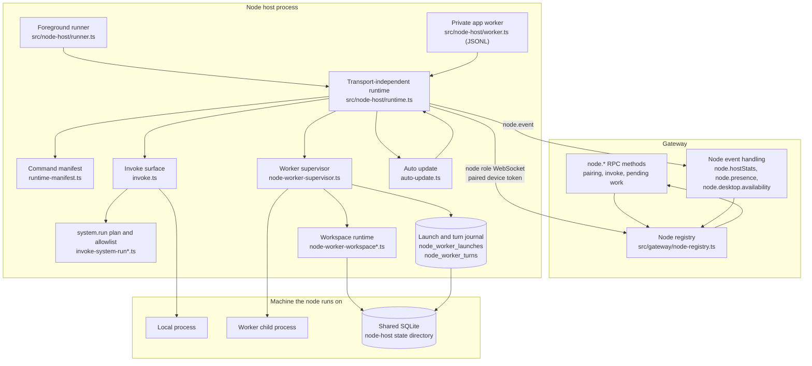
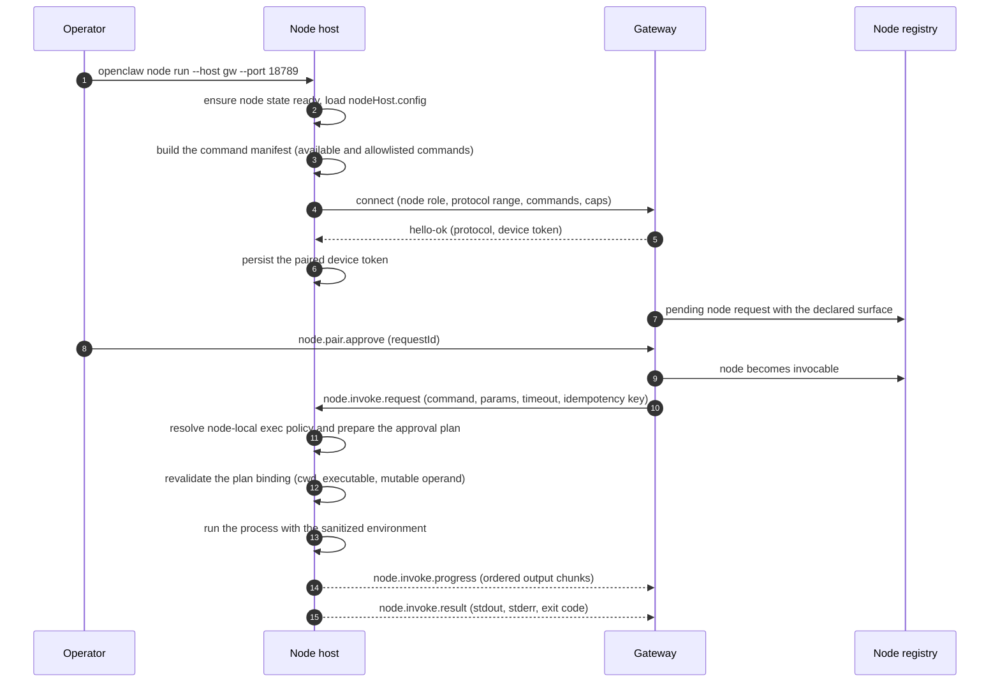
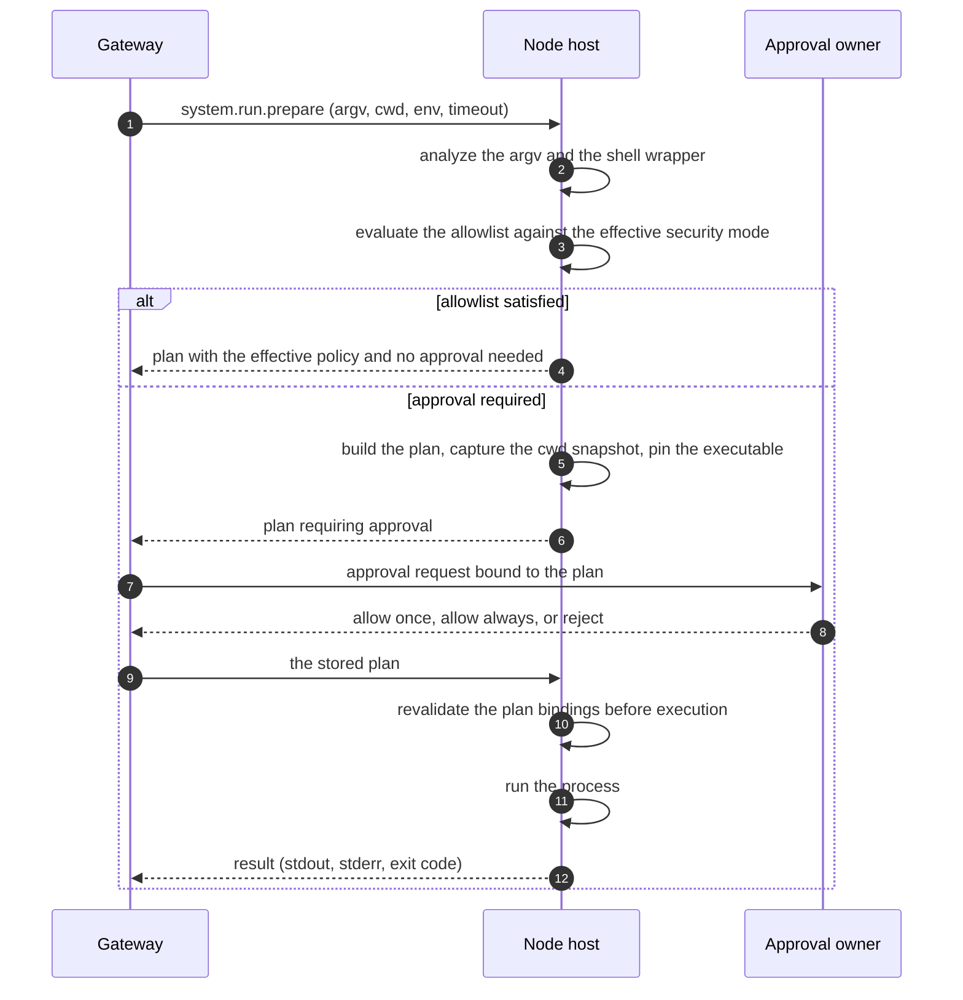
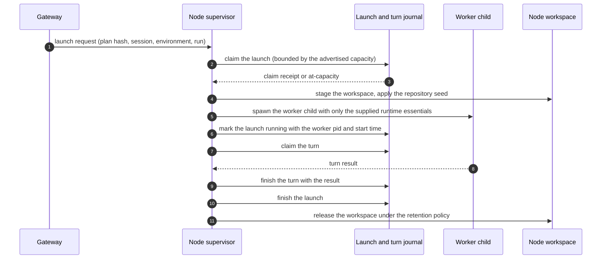

# Specification: Node Host and Device Execution

## Overview

The implementation is the TypeScript node host in `src/node-host/`. Two entry points share one transport-independent runtime: `src/node-host/runner.ts` is the foreground process started by `openclaw node run`, and `src/node-host/worker.ts` is the private JSONL entry point the macOS companion app spawns. `src/node-host/runtime.ts` prepares the command surface, the plugin registry, the MCP manager, the worker supervisor, and the workspace runtime, and it is the only place that knows how an invocation is executed. `invoke*.ts` implements the `node.invoke` command surface, including `system.run` with an approval plan (`src/node-host/invoke-system-run-plan.ts`), an allowlist evaluation (`src/node-host/invoke-system-run-allowlist.ts`), and the local exec policy (`src/node-host/exec-policy.ts`). `src/node-host/node-worker-supervisor.ts` owns worker children, `src/node-host/node-worker-launch-store.ts` and `src/node-host/node-worker-turn-store.ts` own the durable journal, `node-worker-workspace*.ts` owns workspace staging, git, quiescence, and retention, and `auto-update*.ts` owns the runtime update path. The Gateway side of the pairing and invocation surface lives in `src/gateway/server-methods/nodes*.ts` and the node registry, and is described here only where the node contract depends on it.

## Architecture

The Gateway decides where a session runs. The node advertises what it can do, executes what the Gateway authorizes, and keeps its own journal so a restart does not lose a worker it launched.

## Data Models

### node_worker_launches

One row per physical worker child the node launched. Defined in `src/state/openclaw-state-schema.sql`.

| Field | Type | Constraints | Description |
|---|---|---|---|
| launch_id | TEXT | PK, not null, 1 to 256 characters, no NUL | Launch identity |
| plan_hash | TEXT | not null, 64 lowercase hex characters | Digest of the immutable launch plan; a replay with a different plan is rejected |
| gateway_namespace | TEXT | not null, 1 to 128 characters of `A-Za-z0-9._-`, starting alphanumeric | Gateway namespace the launch belongs to |
| environment_id | TEXT | not null, 1 to 256 characters | Environment the launch serves |
| session_id | TEXT | not null, 1 to 256 characters | Session the launch serves |
| owner_epoch | INTEGER | not null, 1 to 2^53-1 | Owner epoch of the placement |
| placement_generation | INTEGER | not null, 0 to 2^53-1 | Placement generation the launch was admitted for |
| run_id | TEXT | not null, 1 to 256 characters | Run the launch serves |
| state | TEXT | not null | `pending`, `running`, `completed`, `failed`, `interrupted`, or `cancelled` |
| supervisor_pid | INTEGER | not null, 1 to 2147483647 | Pid of the supervisor process that owns the launch |
| supervisor_start_time | INTEGER | not null | Process start time, used to detect pid reuse |
| worker_pid | INTEGER | nullable, 1 to 2147483647 | Pid of the worker child, present exactly when `worker_start_time` is present |
| worker_start_time | INTEGER | nullable | Worker process start time |
| result_json | TEXT | nullable, 1 to 65536 bytes, valid JSON | Terminal result |
| error_text | TEXT | nullable, 1 to 4096 bytes, no NUL or newline | Terminal failure text |
| completed_at_ms | INTEGER | nullable | Completion timestamp |
| created_at_ms, updated_at_ms | INTEGER | not null | Timestamps, with `updated_at_ms` at or after `created_at_ms` |

Table-level checks tie the state to the fields: `pending` has no worker pid, result, error, or completion time; `running` has a worker pid and no terminal fields; `completed` has a result and no error; `failed`, `interrupted`, and `cancelled` have an error and no result.

Index: `idx_node_worker_launches_terminal_completed` on `(completed_at_ms, launch_id)` where the completion time is present.

### node_worker_turns

One row per turn executed by a worker. A turn receipt has a shorter lifetime than the physical worker, so the launch can stay running and keep its capacity.

| Field | Type | Constraints | Description |
|---|---|---|---|
| turn_id | TEXT | PK, not null, 1 to 256 characters, no NUL | Turn identity |
| owner_launch_id | TEXT | not null, FK to `node_worker_launches` | Physical worker that owns the turn |
| plan_hash | TEXT | not null, 64 lowercase hex characters | Digest of the launch plan |
| run_id | TEXT | not null, 1 to 256 characters | Run the turn belongs to |
| state | TEXT | not null | `running`, `completed`, `failed`, `interrupted`, or `cancelled` |
| result_json | TEXT | nullable, 1 to 65536 bytes, valid JSON | Terminal result |
| error_text | TEXT | nullable, 1 to 4096 bytes, no NUL or newline | Terminal failure text |
| completed_at_ms | INTEGER | nullable | Completion timestamp |
| created_at_ms, updated_at_ms | INTEGER | not null | Timestamps |

Indexes: `idx_node_worker_turns_terminal_completed` on `(completed_at_ms, turn_id)`, and the unique partial index `idx_node_worker_turns_active_owner` on `(owner_launch_id)` where the state is `running`, so one physical worker runs at most one turn at a time.

### node_worker_launch_boots

| Field | Type | Constraints | Description |
|---|---|---|---|
| launch_id | TEXT | PK, not null, FK to `node_worker_launches` | Launch the boot identity belongs to |
| boot_id | TEXT | nullable, 1 to 128 characters | Boot identity of the host that started the launch |

### node_worker_launch_containers

| Field | Type | Constraints | Description |
|---|---|---|---|
| launch_id | TEXT | PK, not null | Launch the container identity belongs to |
| container_json | TEXT | nullable | Container identity recorded for the launch |

### node_worker_launch_cleanup

| Field | Type | Constraints | Description |
|---|---|---|---|
| launch_id | TEXT | PK, not null, FK to `node_worker_launches` | Launch the cleanup certificate belongs to |
| cleanup_mode | TEXT | not null | `process-group` or `owned-anchor` |
| lineage_settled | INTEGER | nullable, exactly 1 when present | Certificate that the process lineage finished |

### node_worker_launch_process_scopes

| Field | Type | Constraints | Description |
|---|---|---|---|
| launch_id | TEXT | PK, not null, FK to `node_worker_launches` | Launch the process scope belongs to |
| scope_kind | TEXT | not null, exactly `linux-subreaper` | Scope kind |
| descendants_reaped | INTEGER | nullable, exactly 1 when present | Certificate that the descendants were reaped |

### node_worker_prepared_workspaces

A dedicated node registers its fixed build paths before it is ready, then binds them once. The environment itself belongs to the Gateway's separate database.

| Field | Type | Constraints | Description |
|---|---|---|---|
| preparation_key | TEXT | PK, not null, 64 lowercase hex characters | Preparation identity |
| cache_key | TEXT | not null, 64 lowercase hex characters | Cache identity of the prepared workspace |
| gateway_namespace | TEXT | not null, non-empty | Gateway namespace the workspace belongs to |
| workspace_dir | TEXT | not null, unique, non-empty | Absolute workspace directory on the node |
| home_dir | TEXT | not null, non-empty | Home directory for the prepared workspace |
| source_manifest_ref | TEXT | not null, `sha256:` plus 64 hex characters | Source manifest digest |
| prepared_manifest_ref | TEXT | not null, `sha256:` plus 64 hex characters | Prepared manifest digest |
| state | TEXT | not null | `available`, `bound`, `retiring`, or `retired` |
| environment_id | TEXT | not null, non-empty | Environment the workspace is bound to |
| session_id, session_key | TEXT | nullable, non-empty when present | Session that bound the workspace |
| owner_epoch | INTEGER | nullable, 1 to 2^53-1 | Owner epoch of the binding |
| created_at_ms | INTEGER | not null | Creation timestamp |
| bound_at_ms | INTEGER | nullable, at or after `created_at_ms` | Binding timestamp |
| retired_at_ms | INTEGER | nullable, at or after the binding or creation | Retirement timestamp |

Table-level checks tie the binding fields to the state: an unbound workspace has no session, no owner epoch, and no binding time; a bound workspace has all three; a retired workspace has a retirement time.

### Node identity and approval state

The node host stores its own state in the shared SQLite database under the node's state directory.

| Table | Key fields | Purpose |
|---|---|---|
| `config_machine_state` | `state_key` (PK), `value_json`, `updated_at_ms` | Holds the `nodeHost.config` value with the client instance id, the display name, and the Gateway connection metadata, plus the saved command allowlist |
| `device_identities` | `identity_key` (PK), `device_id`, `public_key_pem`, `private_key_pem`, `created_at_ms`, `updated_at_ms` | Holds the signed device keypair under the `primary` identity key; the derived cryptographic device id is what the Gateway pairs and routes on |
| `device_auth_tokens` | `device_id` and `role` (composite PK), `token`, `scopes_json`, `updated_at_ms` | Holds the paired device auth tokens |
| `exec_approvals_config` | `config_key` (PK), `raw_json`, `socket_path`, `has_socket_token`, `default_security`, `default_ask`, `default_ask_fallback`, `auto_allow_skills`, `agent_count`, `allowlist_count`, `updated_at_ms` | Holds the node-local exec approval policy that gates `system.run` |

## API Contracts

The Gateway protocol is a WebSocket and HTTP JSON-RPC surface, not REST. A request is a `req` frame with `id`, `method`, and optional `params`; a response is a `res` frame with `id`, `ok`, and optional `payload` or `error`; an event is an `event` frame with `event` and optional `payload`. The normative payload schemas live in `packages/gateway-protocol/src/schema/nodes.ts`, and the method policy table lives in `src/gateway/methods/core-descriptors.ts`.

The table below is a summary; request and response schemas, error response bodies, and scope requirements are in [`api.yaml`](api.yaml).

| Method | Scope | Group | Purpose |
|---|---|---|---|
| node.pair.list | operator.pairing | nodes | List pending node pairing requests |
| node.pair.approve | operator.pairing | nodes | Approve a pending node request, including its declared command surface |
| node.pair.reject | operator.pairing | nodes | Reject a pending node request |
| node.pair.remove | operator.pairing | nodes | Remove an already paired node from the trust set |
| node.rename | operator.pairing | nodes | Rename a paired node while preserving its stable id |
| node.list | operator.read | nodes | List the paired nodes |
| node.describe | operator.read | nodes | Describe one node, including its capabilities and command surface |
| node.pluginSurface.refresh | node | nodes | Refresh the agent-visible plugin surface of a connected node |
| node.pluginTools.update | node | nodes | Replace the connected node's dynamic plugin and MCP tool catalog |
| node.skills.update | node | nodes | Replace the connected node's agent-visible skill catalog |
| node.invoke | dynamic | nodes | Invoke one command on a paired node |
| node.invoke.progress | node | nodes | Node to Gateway: ordered output produced while a command runs |
| node.invoke.result | node | nodes | Node to Gateway: final result or failure of a command |
| node.event | node | nodes | Node to Gateway: a node-originated event such as presence, host statistics, or desktop availability |
| node.pending.drain | node | nodes-pending | Node to Gateway: fetch a bounded batch of queued node work |
| node.pending.enqueue | operator.write | nodes-pending | Queue work for a node |
| node.pending.pull | node | nodes | Node to Gateway: pull queued work items |
| node.pending.ack | node | nodes | Node to Gateway: acknowledge the queued work items that were consumed |

Node-originated events the Gateway broadcasts after accepting them are `node.hostStats`, `node.presence`, and `node.desktop.availability`. The node sends its own liveness and activity events through `node.event` as `node.presence.alive` and `node.presence.activity`.

The node-originated invocation stream is not a Gateway RPC. The Gateway pushes `node.invoke.request`, `node.invoke.input`, and `node.invoke.cancel` events to the node, and the node answers with `node.invoke.progress` and `node.invoke.result` frames.

The CLI surface for these methods is `openclaw node run|status|identity|install` (`src/cli/node-cli/register.ts`) and `openclaw nodes invoke|notify|push|screen record|location get|pending|remove|rename|status|describe|list` (`src/cli/nodes-cli/register.ts` and its sibling registration files). The `nodes invoke` command deliberately refuses `system.run` and `system.run.prepare`, which stay on the exec path.

Error codes shared across endpoints:

| Code | Description |
|---|---|
| INVALID_REQUEST | The request failed schema validation, or the node command was not permitted on this surface |
| FORBIDDEN | The caller lacks the operator scope the method requires; the details carry the missing scope |
| UNAVAILABLE | The node is not connected, the service is not ready, or a required local resource is unavailable |
| NOT_PAIRED | The device exists but still needs an explicit pairing approval |

## Sequences

### Node host connects, advertises, and executes a command

### Approve a `system.run` that needs a decision

### Host a session as a worker child

## Technical Decisions

| Decision | Choice | Rationale |
|---|---|---|
| Entry points | A foreground runner and a private JSONL app worker over one transport-independent runtime | The macOS app and the headless host must expose the same command surface; two implementations would drift |
| Identity | Three separate records: machine state for the client instance id, `device_identities` for the signed keypair, `device_auth_tokens` for the paired tokens | The cryptographic device id is the routing identity, so changing `--node-id` or migrating a retired file does not reset pairing |
| Command advertisement | The intersection of available commands and the node's saved allowlist, with the capabilities those commands need | A node that cannot run a command should not advertise it, and an explicit allowlist narrows the surface without disabling plugins |
| Exec approvals | The node keeps its own `exec_approvals_config` row and enforces it locally | The machine owner, not the Gateway, decides what runs on that machine |
| Approval plan | An explicit plan that captures the cwd snapshot, the resolved executable, and any mutable file operand, revalidated immediately before execution | A caller-edited command, directory, or file after approval would otherwise run something that was never approved |
| Allowlist evaluation | The effective argv and the shell wrapper that will carry it are both evaluated, and a wrapper form that is not itself allowlisted is refused | On Windows a `cmd.exe /c` wrapper changes execution semantics, so an inner-command match is not enough |
| Environment hardening | `PATH` overrides and interpreter or shell startup variables are stripped; shell wrappers receive an explicit environment allowlist | A node run must not be steerable into loading attacker-controlled code through the environment |
| Worker hosting | A supervisor with a durable launch and turn journal, bounded by the advertised slot count | A restart must not lose or duplicate a worker, and the node must never exceed the capacity it advertised |
| Launch identity | The plan hash is stored with the launch, and a replay with a different hash is rejected | A replayed launch with a different plan would run something the supervisor never admitted |
| Workspace custody | Workspaces are staged under node-owned storage with a seed, a quiescence lease, and a retention pass | A capture taken while a process is still writing is not a valid snapshot, and old generations must not accumulate |
| Capacity | The node's capacity is the smaller of the protocol maximum and the host's available parallelism, and exhaustion is reported rather than absorbed | The Gateway allocates against the advertised count, so the node must not exceed it |
| Auto update | Check hourly, apply only when idle, and at most once every 12 hours, with an explicit opt-out | An update must not interrupt a running turn, and the node must keep its identity and pairing across the restart |
| Service installation | launchd, systemd, and the Windows task scheduler each get a definition written from the same options, and the managed package is installed under the state directory | The service must survive a reboot and must not depend on a global installation |
| Boundary with the Rust node host | The TypeScript node host and the Rust node host in `crates/` are separate features with separate wire contracts | They are alternative implementations of the same role; the repository tracks them independently and does not merge their contracts |

## Risks and Unknowns

1. Node-local exec approvals default to `full` with `ask: "off"`. A freshly installed node therefore accepts any command until the operator tightens the local policy.
2. The automatic node update can be deferred indefinitely by a permanently busy node, and there is no maximum deferral or operator warning.
3. A command allowlist is all or nothing. A node that only publishes sessions cannot also keep computer use, skill publication, plugin tools, MCP servers, or worker hosting.
4. The node's private key material lives in the node's own SQLite database. The retired `device.json` and `device-auth.json` files in the node's `identity/` directory are Doctor-owned migration inputs, so a node that has both forms needs `openclaw doctor --fix` before it can prepare capabilities.
5. Session-host staging refuses a node whose state directory has a world-writable ancestor. The node stays connected for its other commands, so the failure is silent unless the operator reads the node log or the environment listing.
6. The workspace capture path and the git pack path are the most expensive operations in the node. A very large repository on a slow disk can hold a workspace generation past its retention window, and the retention pass deletes a bounded number of entries per run.

## Out of Scope

- The Rust node host in `crates/` (`openclaw-node-host` and `openclaw-gateway-client`). That implementation is tracked separately as FEAT-p11 and has its own sidecar protocol and its own pairing contract. This feature covers the TypeScript node host in `src/node-host/` only, and the two do not share a wire format.
- The macOS companion application's own UI and its notification and screen-recording surfaces. The node host exposes the commands; the app owns the presentation.
- The Gateway node registry, the pairing approval flow, and the Control UI screens for nodes. The node contract above is what those features consume.
- The cloud worker control plane in `src/gateway/worker-environments/`. A node can host workers, but the environment lifecycle, placement, and credential brokering belong to FEAT-p13.
- The `openclaw nodes` media commands beyond the invocation surface (camera capture, push registration, and location are registered in the same CLI group but are owned by their own features).
- The Gateway exec approval store for operators. The node reads and writes its own local `exec_approvals_config` row, and the Gateway's `exec.approvals.node.*` methods are the transport for that row.
