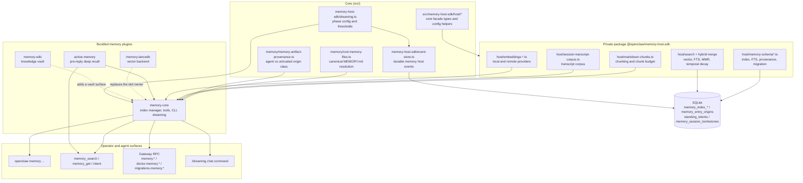
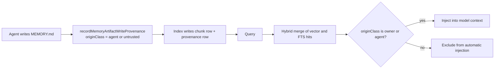
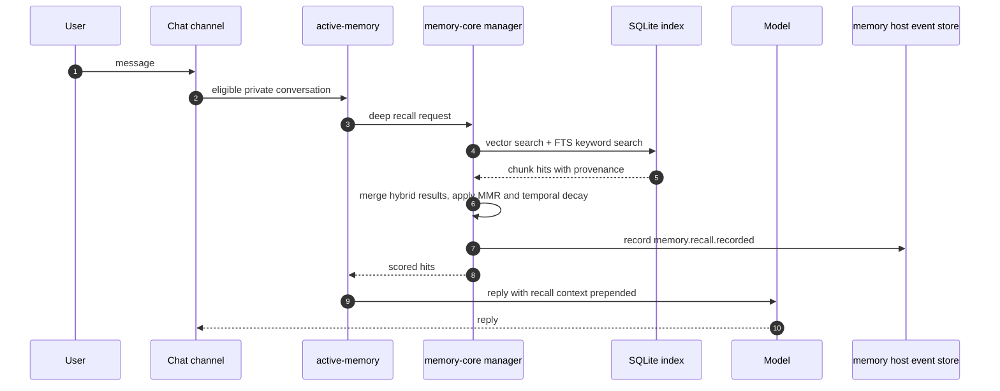
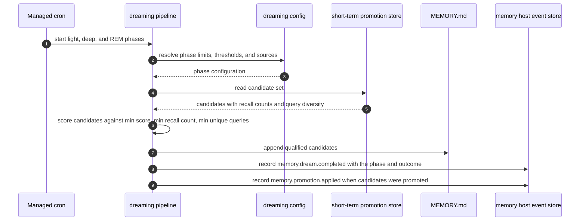
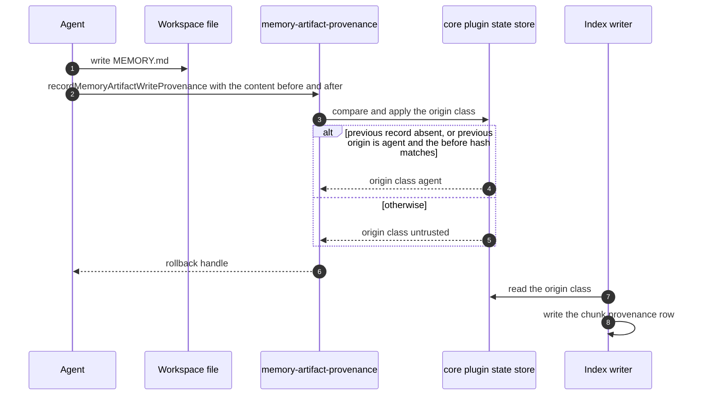

# Specification: Memory and Recall

## Overview

Memory is split into a core-owned foundation and a plugin-owned product surface.

The core owns three things:

- `src/memory/root-memory-files.ts` resolves the canonical root memory file of a workspace (`MEMORY.md`), keeps the legacy `memory.md` name out of auxiliary scans, and owns the `.openclaw-repair/root-memory` repair directory.
- `src/memory/memory-artifact-provenance.ts` records the origin class of every memory artifact write in a core plugin-state keyed store, using a physical-workspace key so a symlinked alias cannot split the writer and the reader into different trust records.
- `src/memory-host-sdk/` provides the core facade over the private `@openclaw/memory-host-sdk` package: the dreaming configuration and phase model, and the durable memory host event store.

The private package `packages/memory-host-sdk/` owns the storage mechanics: the memory index schema, Markdown chunking, embedding providers (local and remote, with batch upload), hybrid/vector/FTS search, the session transcript corpus, and the entry origin store.

The product surface lives in bundled plugins selected by `plugins.slots.memory` (default `memory-core`):

- `extensions/memory-core/` owns the built-in index manager, the `memory_search`, `memory_get`, and `intent` tools, the `openclaw memory` CLI, the `/dreaming` chat command, the Gateway session-backfill methods, and the dreaming consolidation pipeline.
- `extensions/active-memory/` runs bounded pre-reply deep recall with a recall subagent, a circuit breaker, and a timeout.
- `extensions/memory-lancedb/` provides a LanceDB-backed alternative backend with auto-recall, auto-capture, and its own `openclaw ltm` CLI.
- `extensions/memory-wiki/` provides a persistent wiki compiler and Obsidian-friendly knowledge vault.

Trust is enforced on the write path. `recordMemoryArtifactWriteProvenance` stores the hash of the content before and after a write; a write whose content-before hash matches the previously recorded agent-owned hash stays `agent`, and any other write becomes `untrusted`. At read time, `isAutomaticMemoryEntryEligible` admits only `owner` and `agent` content into automatic prompt injection.

## Architecture

Trust and data flow for one write and one recall:

## Data Models

All tables below are declared in `src/state/openclaw-agent-schema.sql` and are `STRICT` SQLite tables.

### memory_index_meta

| Field | Type | Constraints | Description |
|---|---|---|---|
| key | TEXT | PK, not null | Index metadata key |
| value | TEXT | not null | Index metadata value |

### memory_index_sources

| Field | Type | Constraints | Description |
|---|---|---|---|
| id | INTEGER | PK | Stable source identity |
| path | TEXT | not null | Source file path |
| source | TEXT | not null, default `memory` | Source class (`memory` or `sessions`) |
| hash | TEXT | not null | Content hash of the indexed file |
| mtime | REAL | not null | Source modification time |
| size | INTEGER | not null | Source size in bytes |

Unique constraint: `(path, source)`.

### memory_index_chunks

| Field | Type | Constraints | Description |
|---|---|---|---|
| chunk_rowid | INTEGER | PK | Row identity used by the FTS triggers |
| id | TEXT | not null, unique | Chunk identity |
| path | TEXT | not null | Source path of the chunk |
| source | TEXT | not null, default `memory` | Source class |
| start_line | INTEGER | not null | First line of the chunk in the source |
| end_line | INTEGER | not null | Last line of the chunk in the source |
| hash | TEXT | not null | Chunk content hash |
| model | TEXT | not null | Embedding model that produced the vector |
| text | TEXT | not null | Chunk text |
| embedding | BLOB | not null | Serialized embedding vector |
| updated_at | INTEGER | not null | Last update timestamp |

### memory_index_chunk_recall_metadata

| Field | Type | Constraints | Description |
|---|---|---|---|
| chunk_id | TEXT | PK | Foreign key to `memory_index_chunks(id)`, `ON DELETE CASCADE` |
| importance | INTEGER | null, `CHECK (importance IS NULL OR importance BETWEEN 1 AND 10)` | Manual importance score |
| triggers | TEXT | null | Semicolon-separated trigger phrases |
| project_key | TEXT | null | Stable repository identity |

### memory_index_chunk_provenance

| Field | Type | Constraints | Description |
|---|---|---|---|
| chunk_id | TEXT | PK | Foreign key to `memory_index_chunks(id)`, `ON DELETE CASCADE` |
| origin_class | TEXT | not null, `CHECK (origin_class IN ('owner','agent','untrusted','system'))` | Trust class of the chunk content |
| session_kind | TEXT | not null, `CHECK (session_kind IN ('interactive','cron','heartbeat','subagent','unknown'))` | Session class the chunk came from |
| observed_at | INTEGER | not null | Observation timestamp |
| supersedes_key | TEXT | null | Key of the chunk this one supersedes |

### memory_entry_origins

| Field | Type | Constraints | Description |
|---|---|---|---|
| entry_key | TEXT | not null, part of PK | Memory entry key |
| agent_id | TEXT | not null, part of PK | Owning agent |
| session_id | TEXT | not null, part of PK | Session the entry came from |
| session_key | TEXT | null | Session key |
| origin_class | TEXT | not null, `CHECK (origin_class IN ('owner','agent','untrusted','system'))` | Trust class |
| observed_at | INTEGER | not null | Observation timestamp |

Primary key `(entry_key, agent_id, session_id)`, declared `WITHOUT ROWID`.

### memory_session_tombstones

| Field | Type | Constraints | Description |
|---|---|---|---|
| session_id | TEXT | PK, not null | Deleted or reset session |
| agent_id | TEXT | not null | Owning agent |
| reason | TEXT | not null | Reason the session was tombstoned |
| created_at | INTEGER | not null | Creation timestamp |

### memory_embedding_cache

| Field | Type | Constraints | Description |
|---|---|---|---|
| provider | TEXT | not null, part of PK | Embedding provider id |
| model | TEXT | not null, part of PK | Embedding model |
| provider_key | TEXT | not null, part of PK | Provider-scoped credential or endpoint key |
| hash | TEXT | not null, part of PK | Content hash of the embedded text |
| embedding | BLOB | not null | Serialized embedding |
| dims | INTEGER | null | Vector dimensionality |
| updated_at | INTEGER | not null | Last update timestamp |

### memory_index_state

| Field | Type | Constraints | Description |
|---|---|---|---|
| id | INTEGER | PK, `CHECK (id = 1)` | Singleton row |
| revision | INTEGER | not null | Monotonic index revision |

The schema seeds the singleton with `INSERT OR IGNORE INTO memory_index_state (id, revision) VALUES (1, 0)`.

### standing_intents

| Field | Type | Constraints | Description |
|---|---|---|---|
| intent_key | INTEGER | PK | Row identity used by the FTS triggers |
| id | TEXT | not null, unique | Intent identity |
| description | TEXT | not null | Human readable intent description |
| trigger_keywords | TEXT | not null | Semicolon or newline separated trigger phrases |
| trigger_embedding | TEXT | null | Serialized trigger embedding |
| channel_scope | TEXT | null | Channel scope of the intent |
| sender_scope | TEXT | null | Sender scope of the intent |
| creator_sender | TEXT | null, `CHECK (creator_sender IS NULL OR length(trim(creator_sender)) > 0)` | Sender that created the intent |
| status | TEXT | not null, `CHECK (status IN ('pending','armed','fired','done','cancelled','expired'))` | Lifecycle state |
| expires_at | INTEGER | not null | Expiry timestamp |
| max_fires | INTEGER | not null, `CHECK (max_fires > 0)` | Maximum number of fires |
| fire_count | INTEGER | not null, default 0, `CHECK (fire_count >= 0)` | Number of fires so far |
| cooldown_seconds | INTEGER | not null, default 86400, `CHECK (cooldown_seconds >= 0)` | Minimum gap between fires |
| last_fired_at | INTEGER | null | Timestamp of the last fire |
| created_at | INTEGER | not null | Creation timestamp |
| source_session_id | TEXT | null | Session that created the intent |

Indexes: `idx_standing_intents_lifecycle (status, expires_at, last_fired_at)` and `idx_standing_intents_scope (status, channel_scope, sender_scope)`.

A companion FTS5 virtual table `standing_intents_fts` indexes `trigger_keywords` with the `unicode61 remove_diacritics 2` tokenizer and is kept in sync by insert, delete, and update triggers.

## API Contracts

The normative contract is in [`api.yaml`](api.yaml) (OpenAPI 3), written alongside this document whenever the specification defines an API surface.
The table below is a summary; request/response schemas, error response bodies, and auth requirements are in `api.yaml`.

OpenClaw's Gateway is a WebSocket or HTTP JSON-RPC surface, not REST. Each request is a frame `{ "type": "req", "id": string, "method": string, "params": object }` and each response is `{ "type": "res", "id": string, "ok": boolean, "payload": object, "error": object }`. The paths below are therefore RPC method names, and the `api.yaml` models one path per method.

| Method | Path | Purpose |
|---|---|---|
| RPC | `memory.search` | Search the active agent memory index; `version: 1` returns built-in results, `version: 2` delegates to the provider runtime |
| RPC | `memory.search.owner` | Owner-bound search that runs under a local state mutation owner and refuses when the owner changed |
| RPC | `memory.get` | Read a provider-scoped memory reference, optionally a line range |
| RPC | `memory.status` | Report the memory provider health, search mode, and index state |
| RPC | `memory.sessionBackfill.preview` | Preview trusted memory candidates distilled from retained session history |
| RPC | `memory.sessionBackfill.apply` | Stage session backfill candidates and write dream diary entries |
| RPC | `memory.sessionBackfill.rollback` | Remove staged backfill candidates and shared diary entries |
| RPC | `memory.sessionBackfill.preview.owner` | Owner-bound preview with an `expectedOwnerId` |
| RPC | `memory.sessionBackfill.apply.owner` | Owner-bound apply with an `expectedOwnerId` |
| RPC | `memory.sessionBackfill.rollback.owner` | Owner-bound rollback with an `expectedOwnerId` |
| RPC | `doctor.memory.status` | Report memory index status and embedding runtime state for an agent |
| RPC | `doctor.memory.dreamDiary` | Read the dream diary entries for the resolved workspace |
| RPC | `doctor.memory.backfillDreamDiary` | Write grounded REM backfill entries into the dream diary |
| RPC | `doctor.memory.resetDreamDiary` | Clear the dream diary for the resolved workspace |
| RPC | `doctor.memory.resetGroundedShortTerm` | Remove grounded short-term promotion candidates |
| RPC | `doctor.memory.repairDreamingArtifacts` | Archive and repair contaminated dreaming artifacts |
| RPC | `doctor.memory.dedupeDreamDiary` | Remove duplicate dream diary entries |
| RPC | `migrations.memory.plan` | Plan a memory import from the configured providers for one agent |
| RPC | `migrations.memory.apply` | Apply a planned memory import, guarded by an idempotency key |

Error codes shared across endpoints:

| Code | Description |
|---|---|
| INVALID_REQUEST | The request payload is malformed, the query is empty, the agent id is unknown, the selected memory slot cannot serve the request, the session backfill owner changed mid-operation, or an idempotency key was reused with a different fingerprint |
| UNAVAILABLE | The memory runtime, provider, or index could not be acquired or used for this request |

Operator scopes required per method:

| Method | Scope |
|---|---|
| `memory.search`, `memory.get`, `memory.status` | `operator.read` |
| `memory.search.owner` | `operator.admin` |
| `memory.sessionBackfill.preview` | `operator.read` |
| `memory.sessionBackfill.apply`, `memory.sessionBackfill.rollback` and their `.owner` variants | `operator.admin` |
| `doctor.memory.status`, `doctor.memory.dreamDiary` | `operator.read` |
| `doctor.memory.backfillDreamDiary`, `doctor.memory.resetDreamDiary`, `doctor.memory.resetGroundedShortTerm`, `doctor.memory.repairDreamingArtifacts`, `doctor.memory.dedupeDreamDiary` | `operator.write` |
| `migrations.memory.plan`, `migrations.memory.apply` | `operator.admin` |

## Sequences

### Recall during a turn

### Dreaming consolidation

### Memory artifact write and trust decision

## Technical Decisions

| Decision | Choice | Rationale |
|---|---|---|
| Trust decision point | Enforce trust at write time and gate structurally at promotion time | Content-level scanning of memory cannot reliably detect poisoned facts, so the origin class is recorded when the content is written and read back from the store rather than re-derived |
| Origin class upgrade rule | A write is `agent` only when there is no prior record, or the prior record was `agent` and the content-before hash still matches | Prevents an untrusted writer from laundering content by writing over an agent-owned file |
| Workspace identity for provenance | Key the provenance store on the realpath of the workspace, lowercased on Windows | A symlink or junction alias must not split the writer and the reader into different trust records |
| Storage engine | SQLite for index state, provenance, origins, tombstones, embedding cache, and standing intents | Repository rule: state and caches live in SQLite, not in new JSON, JSONL, or sidecar stores |
| Search strategy | Hybrid vector plus SQLite FTS, merged with fixed weights, then MMR and temporal decay | Keyword matching and semantic matching fail on different content; the merge keeps recall useful without a heavier index |
| Chunk and source identity | Chunk ids and source ids are stable across `VACUUM` and across source-identity migrations | FTS rowids and the source table must stay aligned, or a rebuilt index silently loses or duplicates hits |
| Dreaming schedule | A managed cron job reconciled by the memory plugin, with a default frequency of `0 3 * * *` | Consolidation runs off the reply path so curation does not add latency to a turn |
| Promotion thresholds | Fixed numeric defaults such as deep dreaming min score 0.75, min recall count 3, min unique queries 3 | Thresholds are code rules, not model judgments, so promotion stays auditable and reproducible |
| Memory slot ownership | Exactly one plugin owns the `memory` slot; an unset slot resolves to the default owner `memory-core` | An unset slot must mean a specific owner, never "whichever plugin happens to be enabled" |
| Engine and memory separation | The context engine is a separate slot with a separate owner | Retrieval and context assembly are different responsibilities with different failure modes and different plugin authors |
| Private package boundary | The index, chunking, embeddings, and search mechanics live in the private `@openclaw/memory-host-sdk` package behind a core facade | Third-party memory plugins need the same mechanics without depending on core internals |

## Risks and Unknowns

1. `memory.search.sources` accepts only `memory` and `sessions`, but the Active Memory plugin and the LanceDB backend expose additional provider-side recall surfaces. A third source value has no written contract.
2. The `CompactResult.result.sessionFile` field in the context engine contract is deprecated, yet the memory backfill paths still reason about transcript file paths. A storage-neutral locator for both features is not settled.
3. The standing intents table enforces a 24 hour default cooldown and a `max_fires` limit, but the user-visible explanation of a cooldown-blocked intent is not specified.
4. The `memory-core` plugin manifest declares the `memory-core-legacy-sidecar-index-to-agent-sqlite` state migration, so a workspace that still holds a legacy sidecar index needs a Doctor pass before the built-in index is authoritative.
5. The Active Memory recall subagent adds a model call to the pre-reply path. The circuit breaker and timeout bound it, but the resulting recall quality versus latency tradeoff is not measured in the repository.

## Out of Scope

- The context engine. Context assembly, compaction, and subagent context lifecycle belong to `plugins.slots.contextEngine` (default `legacy`) and are specified in the Context Engine and Compaction feature. Memory retrieves and persists; the context engine decides what the model sees.
- The `openclaw context` command family and the `/context list`, `/context detail`, and `/context map` reports, which describe model context, not memory.
- Model provider selection, pricing, and the request/response transport used by embedding providers, except for the embedding-specific configuration keys listed here.
- The Control UI memory panels. They render data the Gateway already exposes and add no memory behavior.
- The LanceDB and wiki backends beyond their role as alternative `memory` slot owners.
