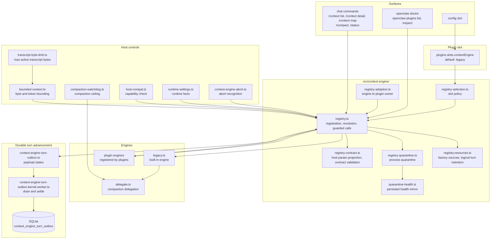
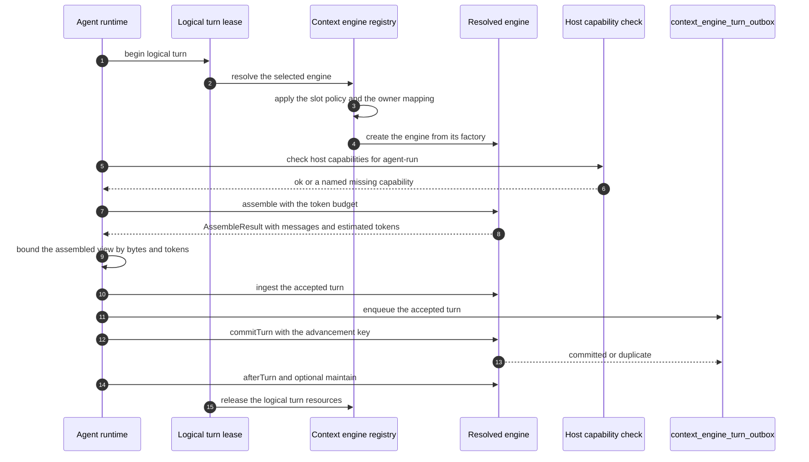
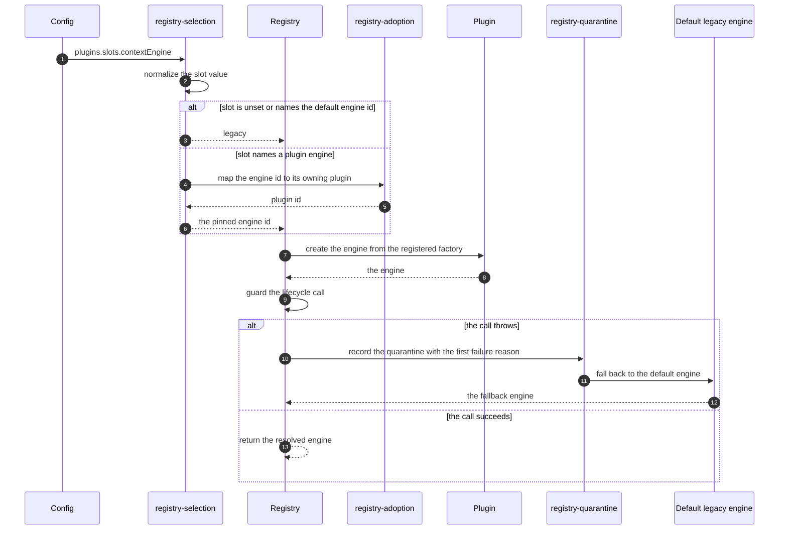
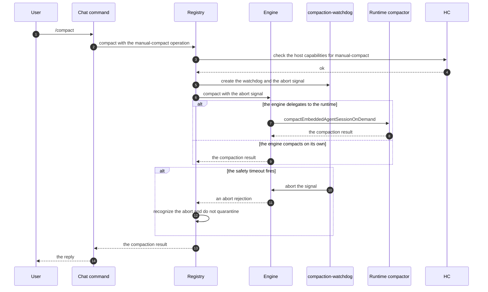
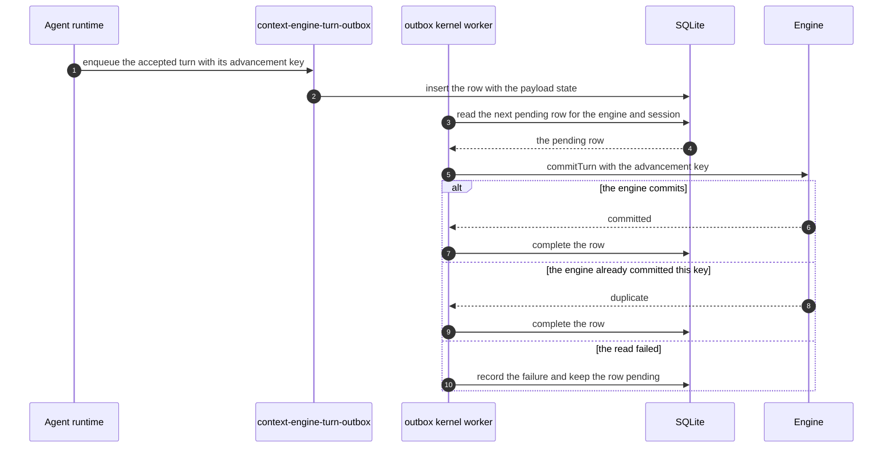

# Specification: Context Engine and Compaction

## Overview

The context engine is a pluggable owner of model context. The contract lives in `src/context-engine/types.ts` as the `ContextEngine` interface and the `AssembleResult` shape. The registry in `src/context-engine/registry.ts` owns registration, resolution, guarded invocation, and resource lifetime; `registry-selection.ts` applies the slot policy; `registry-adoption.ts` maps an engine back to its owning plugin; `registry-quarantine.ts` and `quarantine-health.ts` isolate a failing engine.

The built-in engine is `legacy.ts`, registered by `legacy.registration.ts` and reachable through `init.ts`. It is a thin adapter: ingest is a no-op, assemble returns the input messages, and compact is `delegateCompactionToRuntime` from `delegate.ts`, which routes to the built-in runtime compactor. The delegate also exports `buildMemorySystemPromptAddition` so a non-legacy engine can opt into the same memory prompt guidance the legacy path gets through system prompt assembly, without reimplementing memory prompt formatting.

Around the engine sit the host-side controls:

- `bounded-context.ts` bounds the assembled model view by bytes and tokens, and never splits a tool-use/result pair.
- `compaction-watchdog.ts` holds the per-operation ceiling and the no-progress window, keyed by the abort signal handed to the engine.
- `transcript-byte-limit.ts` resolves `agents.defaults.compaction.maxActiveTranscriptBytes` and owns the compaction latch.
- `host-compat.ts` evaluates, per operation, whether the host advertises the capabilities an engine requires.
- `runtime-settings.ts` builds the runtime facts reported to the engine.
- `registry-contract.ts` restricts the host parameters an engine receives to its declared `acceptedHostParams`, and validates that a factory returned a usable engine.
- `context-engine-abort.ts` recognizes an abort rejection so a cancelled compaction is not reported as an engine failure.

Durable turn advancement lives outside the engine interface but in the same capability: `src/agents/harness/context-engine-turn-outbox*.ts` and the SQLite table `context_engine_turn_outbox` hold accepted turns until the engine acknowledges them, and the kernel worker `src/agents/harness/context-engine-turn-outbox.kernel.worker.ts` executes them in the agent database worker.

## Architecture

Lifecycle of one turn:

## Data Models

### context_engine_turn_outbox

Declared in `src/state/openclaw-agent-schema.sql` as a `STRICT` SQLite table. It is owned by the agent harness outbox worker `src/agents/harness/context-engine-turn-outbox.kernel.worker.ts`.

| Field | Type | Constraints | Description |
|---|---|---|---|
| enqueue_sequence | INTEGER | PK | Monotonic enqueue order |
| advancement_key | TEXT | not null, unique | Idempotency key of the accepted turn |
| engine_id | TEXT | not null | Engine that must consume the turn |
| owner_plugin_id | TEXT | null | Plugin that owns the engine |
| session_id | TEXT | not null | Session the turn belongs to |
| payload_json | TEXT | not null | Serialized outbox payload |
| payload_state | TEXT | null | Payload state: `admitted`, `accepted`, `ready`, or `blocked` |
| attempt_count | INTEGER | not null, default 0 | Number of delivery attempts |
| last_attempt_at | INTEGER | null | Timestamp of the last attempt |
| last_error | TEXT | null | Last delivery error |
| created_at | INTEGER | not null | Enqueue timestamp |

Index: `idx_agent_context_engine_turn_outbox_engine (engine_id, created_at)`.

The payload states are defined by the TypeScript union `ContextEngineTurnOutboxPayload`:

| Payload state | Shape | Meaning |
|---|---|---|
| `admitted` | `admission`, `isHeartbeat` | The turn was admitted but not yet accepted |
| `accepted` | `boundary`, `isHeartbeat`, optional `runtimeContext` | The turn was accepted and the transcript boundary is known |
| `ready` | `boundary`, `isHeartbeat`, `messages`, optional `runtimeContext` | The turn messages are readable and the turn can be committed |
| `blocked` | `boundary`, `failure`, `isHeartbeat` | The turn cannot be read and is terminal audit evidence |

A `blocked` row is not retryable. A `projection-unavailable` read failure is retryable and is the only failure kind that keeps the row eligible.

### Context engine runtime settings

Not a table. The settings are built by `buildContextEngineRuntimeSettings` in `runtime-settings.ts` and handed to the engine as `runtimeSettings`.

| Field | Type | Description |
|---|---|---|
| schemaVersion | number | Always `1` |
| runtime.host | string | Always `openclaw` |
| runtime.mode | `normal` \| `fallback` \| `degraded` | Derived from the fallback and degraded reasons |
| runtime.harnessId | string \| null | Selected agent harness id |
| runtime.runtimeId | string \| null | Selected runtime id |
| model.requested | string \| null | Model the caller asked for |
| model.resolved | string \| null | Model the runtime actually resolved |
| model.provider | string \| null | Resolved provider |
| model.family | string \| null | Resolved model family |
| contextEngineSelection.selectedId | string \| null | Engine that was selected |
| contextEngineSelection.source | `configured` \| `default` \| `unknown` | How the selection was made |
| executionHost.id | string \| null | Host id, for example `openclaw-embedded` or `codex-app-server` |
| executionHost.label | string \| null | Human readable host label |
| limits.promptTokenBudget | number \| null | Runtime resolved context window budget |
| limits.maxOutputTokens | number \| null | Output token limit |
| diagnostics.fallbackReason | reason code \| null | `provider_timeout`, `provider_unavailable`, `rate_limited`, `context_overflow`, `runtime_unavailable`, or `unknown` |
| diagnostics.degradedReason | reason code \| null | Same reason code set |

### Context engine operation and capability vocabularies

| Vocabulary | Values |
|---|---|
| `ContextEngineOperation` | `agent-run`, `manual-compact`, `subagent-spawn` |
| `ContextEngineHostCapability` | `bootstrap`, `assemble-before-prompt`, `after-turn`, `maintain`, `compact`, `runtime-llm-complete`, `thread-bootstrap-projection` |
| `ContextEngineRuntimeMode` | `normal`, `fallback`, `degraded` |
| `ContextEngineHostParam` | `sessionKey`, `prompt`, `runtimeSettings`, `sessionTarget`, `runtimeContext`, `abortSignal`, `onProgress` |

## API Contracts

There is no dedicated `openclaw context` CLI command and no dedicated `contextEngine.*` Gateway RPC method. The context engine is not a remote API: it is an in-process plugin contract invoked by the agent runtime.

The observable surfaces are:

| Surface | Shape | Purpose |
|---|---|---|
| Config slot | `plugins.slots.contextEngine` | Selects the engine; defaults to `legacy`, and `none` also resolves to the default engine |
| `openclaw doctor` | Local CLI report | Names the selected engine and reports the host requirement inspection result, or a warning when the engine plugin failed to load or is only registered for read-only discovery |
| `openclaw plugins list` and `openclaw plugins inspect` | Local CLI report | Show the registered plugins, their status, and their activation reason, so an operator can confirm that the engine's owning plugin is present and enabled |
| `openclaw status` | Local CLI report | Adds a `context engine quarantine` count to the compact plugin health line when at least one engine is quarantined |
| Chat command `/context` | Chat reply | `list`, `detail`, `map`, and `json` breakdowns of the model context that the current turn would use |
| Chat command `/compact` | Chat reply | Requests a manual compaction, which routes to the selected engine's `compact` operation |
| Chat command `/status` | Chat reply | Reports the session and plugin status, including the `Context engine quarantines` section |

Because there is no RPC method for the context engine, this feature has no `api.yaml` file. The Gateway surface that does exist and that this feature depends on is the `context_engine_turn_outbox` table, which is internal state rather than an API.

## Sequences

### Engine resolution and fallback

### Manual compaction with the safety timeout

### Accepted turn advancement

## Technical Decisions

| Decision | Choice | Rationale |
|---|---|---|
| Default engine | A core-owned `legacy` engine that no-ops ingest, passes assembly through, and delegates compaction | A plugin-free installation must behave exactly as before, so the default engine is an adapter over the existing runtime rather than a reimplementation |
| Selection model | One engine per logical turn, resolved from a single plugin slot | Two engines assembling one turn would make the model context non-deterministic and undebuggable |
| Slot default | An unset slot resolves to the default owner `legacy`, never to "whichever plugin happens to be enabled" | The same rule the memory slot uses, so an operator can reason about one rule for both slots |
| Ownership mapping | An engine id maps to its plugin through the `plugin:` owner prefix, for example the owner `plugin:lossless-claw` | A plugin disablement can be recognized even when the engine id and the plugin id differ |
| Failure isolation | Quarantine the engine for the process, keep the first failure reason, fall back to the default engine | A broken plugin must not take the assistant offline, and the first failure is the root cause rather than a follow-on fallback artifact |
| Quarantine durability | A best-effort persisted health mirror next to the authoritative in-process map | The mirror aids diagnosis across restarts, but the quarantine decision must not depend on a write succeeding |
| Bounding semantics | Bound the model view only; required instructions and the pending input stay with their owners | A context engine may not drop the user turn or the system instructions to fit a budget |
| Pair integrity | When the byte budget is exceeded, advance the cut past complete tool-use and tool-result pairs | A tool result without its call, or a call without its result, produces a malformed provider request |
| Token pressure | The byte budget drops history; token pressure belongs to semantic compaction | Two independent mechanisms with two independent triggers keep each one simple and debuggable |
| Compaction ceiling | The host always bounds `compact` with a finite safety timeout and an abort signal | An engine that hangs must not hold a turn open forever, and the engine needs a way to stop its own in-flight work |
| Host parameter projection | The engine receives only the parameters it declares, with the compaction abort signal always preserved | An engine that validates a narrow input shape should not receive undeclared fields |
| Transcript writes | Engines request rewrites through `runtimeContext.rewriteTranscriptEntries` | The runtime stays the single owner of the on-disk session DAG |
| Turn advancement | A durable outbox keyed by a unique advancement key, drained by the agent database worker | An accepted turn must survive a crash between acceptance and acknowledgement, and a retry must not double-apply |
| Compaction ownership | `info.ownsCompaction` disables native provider compaction only on the routes where engine assembly is authoritative | The Codex app-server harness keeps its own thread history and compactor, so forcing the engine there would break the harness |
| No dedicated RPC or CLI | The engine is observed through the config slot, Doctor, the plugin commands, and the status report | The engine is an in-process contract, not a remote service, so a network API would add a surface with no consumer |

## Risks and Unknowns

1. The `CompactResult.result.sessionFile` field is deprecated in favor of the typed `sessionTarget`, but shipped third-party engines still report transcript rotation through the raw field. The removal window is not written down.
2. There is no dedicated Gateway RPC method or CLI command for the context engine, so a scripted operator can only read the config slot to learn which engine is active.
3. `info.ownsCompaction` currently affects only the direct OpenAI API-key `openai-responses` route. The interaction with the Codex app-server harness, where Codex owns its thread history and compactor, is documented as unchanged but is not specified for an engine that declares compaction ownership.
4. The outbox recovery read is bounded at 20000 events and 8 MiB. A single turn larger than that bound has no specified product behavior.
5. The `legacy` engine returns `estimatedTokens: 0` from `assemble` and the host carries the estimate. A plugin engine that returns a large estimate can make the host's diagnostics diverge from the real prompt size, and the reconciliation rule for that case is not written down.
6. Quarantine is a process-level decision. A plugin that fails only under a specific workload is quarantined for the whole process, and there is no documented policy for a partial or workload-scoped quarantine.

## Out of Scope

- The memory system. Memory is selected by `plugins.slots.memory` (default `memory-core`) and provides search and retrieval; the context engine is selected by `plugins.slots.contextEngine` (default `legacy`) and controls what the model sees. The two are separate capabilities with separate plugin slots.
- The `memory_search`, `memory_get`, and `intent` agent tools, the `openclaw memory` CLI, and the `memory.*` and `doctor.memory.*` Gateway RPC methods. Those belong to the Memory and Recall feature.
- The memory prompt section that a non-legacy engine may opt into. The engine can request it through `buildMemorySystemPromptAddition`, but the memory prompt content itself is owned by the memory system.
- The `/dreaming` chat command and the dreaming consolidation pipeline.
- The model provider request format, provider authentication, and the model's own context window, except where the host bounds the assembled view and the compaction call.
- Session transcript storage and the session DAG format. The context engine requests rewrites; the runtime owns the storage.
- Control UI panels for the context engine. The Control UI renders context information through the same chat-facing reports.
