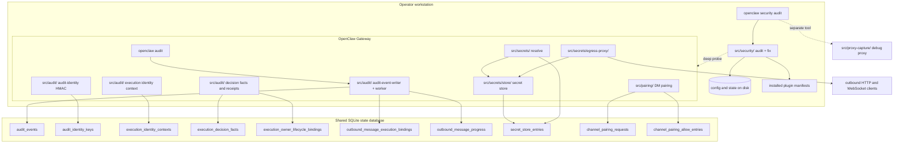
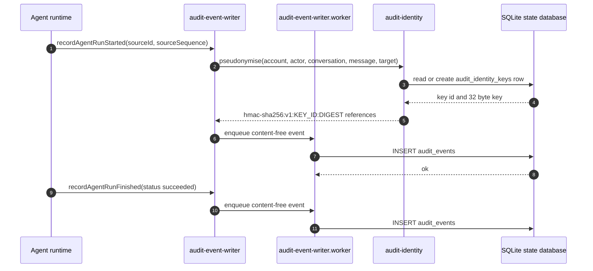
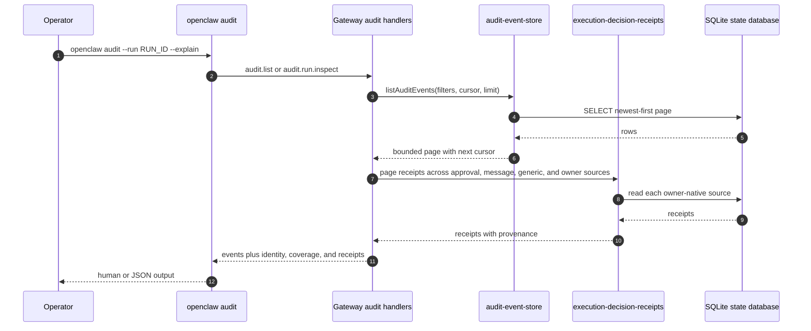
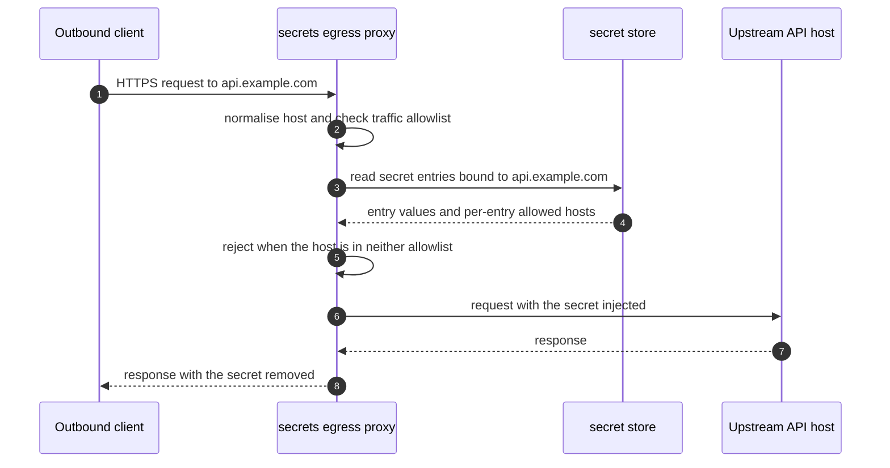

# Specification: Security, Audit, and Secrets

## Overview

The feature is implemented as four cooperating subsystems that share a trust model but not a data model. `src/security/` is a local static analyser. It reads the resolved config, the state directory, the credentials directory, the config include files, the exec approvals file, the sandbox configuration, the channel plugin metadata, and the installed plugin manifests, and it produces a `SecurityAuditReport` whose findings are keyed by a stable `checkId`. The same package owns the bounded fix path, which only tightens permissions and defaults. `src/audit/` is the durable runtime ledger. It writes content-free events into the shared SQLite state database from a worker thread so the audited operation never blocks on the ledger, and it exposes a bounded query surface for the operator. `src/secrets/` is the credential indirection layer. It defines the `SecretRef` grammar, resolves references against the `env`, `file`, `exec`, and `store` sources, persists a shared secret store in the same database, and runs an egress proxy that injects store-bound secrets at request time behind a host allowlist. `src/pairing/` closes the DM admission loop with short-lived human codes and a persistent allow list.

A separate subsystem, `src/proxy-capture/`, provides a local debug proxy that records captured traffic for debugging. It is a different tool with a different purpose and is not the secrets egress proxy. The two are documented separately and must not be conflated.

## Architecture

The local static audit and the durable ledger are deliberately separated. The static audit reads files that only exist on the operator's machine and produces a report with no durable home. The ledger lives entirely in the Gateway process and in SQLite. They share no tables, no identifiers, and no command surface.

## Data Models

### audit_events

The durable activity ledger. Every column is metadata. There is no column for a prompt, a message body, a tool argument, a tool result, an attachment, a file name, a URL, command output, or raw error text.

| Field | Type | Constraints | Description |
|---|---|---|---|
| sequence | integer | PK, autoincrement | Monotonic ledger order, also the pagination cursor |
| event_id | text | NOT NULL, UNIQUE | Stable identity of the event |
| source_id | text | NOT NULL, UNIQUE | Trusted-source identity used only for local replay deduplication |
| schema_version | integer | NOT NULL, default 1 | Ledger record version, currently 1 |
| source_sequence | integer | NOT NULL | Per-source ordering used for deduplication |
| occurred_at | integer | NOT NULL | Event time in Unix milliseconds |
| kind | text | NOT NULL | `agent_run`, `tool_action`, or `message` |
| action | text | NOT NULL | Dotted action name, for example `agent.run.finished` or `message.outbound.finished` |
| status | text | NOT NULL | `started`, `succeeded`, `failed`, `cancelled`, `timed_out`, `blocked`, or `unknown` |
| error_code | text | nullable | Normalized failure code, never raw error text |
| actor_type | text | NOT NULL | `agent`, `system`, or `channel_sender` |
| actor_id | text | NOT NULL | Actor identifier, pseudonymised where it is sensitive |
| agent_id | text | nullable | Agent that owns the run |
| session_key | text | nullable | Exact session key |
| session_id | text | nullable | Session identifier |
| run_id | text | nullable | Run identifier |
| tool_call_id | text | nullable | Tool call identifier |
| tool_name | text | nullable | Tool name, never tool arguments or results |
| direction | text | nullable | `inbound` or `outbound` for message records |
| channel | text | nullable | Channel identifier for message records |
| conversation_kind | text | nullable | `direct`, `group`, `channel`, or `unknown` |
| message_outcome | text | nullable | Normalized delivery outcome |
| reason_code | text | nullable | Normalized reason for a skip, suppression, or completion |
| delivery_kind | text | nullable | `text`, `media`, or `other` |
| failure_stage | text | nullable | `platform_send`, `queue`, or `unknown` |
| duration_ms | integer | nullable | Elapsed time of the recorded action |
| result_count | integer | nullable | Count of produced items, never their content |
| account_ref | text | nullable | Pseudonymised account reference |
| conversation_ref | text | nullable | Pseudonymised conversation reference |
| message_ref | text | nullable | Pseudonymised message reference |
| target_ref | text | nullable | Pseudonymised target reference |

Indexes: `(occurred_at DESC, sequence DESC)` for time-ordered reads, `(agent_id, sequence DESC)`, and `(session_key, sequence DESC)`.

### audit_identity_keys

The per-database singleton key material that makes the pseudonymised references stable across restarts.

| Field | Type | Constraints | Description |
|---|---|---|---|
| id | integer | PK, CHECK (id = 1) | Singleton row id |
| key_id | text | NOT NULL | 16 random bytes rendered as 32 lowercase hex characters |
| key | blob | NOT NULL | 32-byte HMAC key, registered for redaction at startup |
| created_at | integer | NOT NULL | Creation time in Unix milliseconds |

### execution_identity_contexts

The authoritative identity of one admitted agent run.

| Field | Type | Constraints | Description |
|---|---|---|---|
| context_id | text | PK, length 1 to 256 | Identity context identifier |
| execution_id | text | NOT NULL, UNIQUE, length 1 to 256 | Execution identifier |
| run_id | text | NOT NULL, length 1 to 256 | Run identifier |
| created_at | integer | NOT NULL, CHECK >= 0 | Creation time in Unix milliseconds |
| coverage_state | text | NOT NULL | `attribution-only`, `unattributed`, `unknown`, or `unsupported` |
| context_bytes | integer | NOT NULL, CHECK 1 to 16384 | Size of the serialized context |
| context_json | text | NOT NULL | Serialized identity facts, never prompt or message text |

Unique constraint on `(created_at, context_id)`, plus an index on `(run_id, created_at, execution_id)`.

### execution_decision_facts

Generic decision receipts that are not owned by another subsystem.

| Field | Type | Constraints | Description |
|---|---|---|---|
| cursor_id | integer | NOT NULL, UNIQUE index | Monotonic receipt cursor |
| receipt_id | text | PK, length 1 to 256 | Receipt identifier |
| context_id | text | NOT NULL, length 1 to 256 | Owning identity context |
| execution_id | text | NOT NULL, length 1 to 256 | Execution identifier |
| run_id | text | NOT NULL, length 1 to 256 | Run identifier |
| action_id | text | nullable, length 1 to 256 | Specific action identifier |
| action_family | text | NOT NULL, length 1 to 256 | Action family name |
| decision_outcome | text | NOT NULL | `allowed`, `denied`, `not-applicable`, or `unknown` |
| coverage_state | text | NOT NULL | `enforced`, `attribution-only`, `unattributed`, `unknown`, or `unsupported` |
| reason_code | text | NOT NULL, length 1 to 256 | Normalized reason |
| owner | text | NOT NULL, length 1 to 256 | Subsystem that owns the decision |
| source_ref | text | NOT NULL, length 1 to 256 | Reference to the owning record |
| occurred_at | integer | NOT NULL, CHECK >= 0 | Decision time in Unix milliseconds |
| receipt_bytes | integer | NOT NULL, CHECK 1 to 16384 | Size of the serialized receipt |
| receipt_json | text | NOT NULL | Serialized receipt metadata |

### execution_owner_lifecycle_bindings

The mapping from a native owner (a cron job, a task, or a flow) to the execution identity that ran it.

| Field | Type | Constraints | Description |
|---|---|---|---|
| owner_kind | text | NOT NULL, part of PK | Owner kind, for example `cron` |
| owner_id | text | NOT NULL, part of PK | Owner identifier |
| context_id | text | NOT NULL | Identity context identifier |
| execution_id | text | NOT NULL | Execution identifier |

### outbound_message_execution_bindings

The link from a terminal outbound message row to the execution that produced it.

| Field | Type | Constraints | Description |
|---|---|---|---|
| event_id | text | PK, FK to `audit_events(event_id)` on delete cascade | Terminal message event |
| context_id | text | NOT NULL, length 1 to 256 | Identity context identifier |
| execution_id | text | NOT NULL, length 1 to 256 | Execution identifier |
| run_id | text | NOT NULL, length 1 to 256 | Run identifier |

### outbound_message_progress

Non-terminal outbound message progress, written by a lazy companion store so queue admission and platform-send start are visible without polluting the terminal ledger.

| Field | Type | Constraints | Description |
|---|---|---|---|
| sequence | integer | PK, autoincrement | Monotonic order |
| progress_id | text | NOT NULL, UNIQUE, length 1 to 256 | Progress row identifier |
| source_id | text | NOT NULL, UNIQUE, length 1 to 512 | Trusted-source identity for deduplication |
| source_sequence | integer | NOT NULL, CHECK >= 1 | Per-source ordering |
| schema_version | integer | NOT NULL, CHECK = 1 | Record version |
| occurred_at | integer | NOT NULL, CHECK >= 0 | Event time in Unix milliseconds |
| action | text | NOT NULL | `message.outbound.queued` or `message.outbound.platform-started` |
| outcome | text | NOT NULL | `queued` or `platform_started` |
| actor_type | text | NOT NULL | `agent` or `system` |
| actor_id | text | NOT NULL, length 1 to 256 | Actor identifier |
| agent_id | text | nullable, length 1 to 256 | Agent identifier |
| run_id | text | nullable, length 1 to 256 | Run identifier |
| context_id | text | nullable | Identity context identifier |
| execution_id | text | nullable | Execution identifier |
| channel | text | NOT NULL, length 1 to 256 | Channel identifier |
| conversation_kind | text | NOT NULL | `direct`, `group`, `channel`, or `unknown` |
| duration_ms | integer | nullable, CHECK >= 0 | Elapsed time |
| account_ref | text | nullable | Pseudonymised account reference |
| conversation_ref | text | nullable | Pseudonymised conversation reference |
| target_ref | text | nullable | Pseudonymised target reference |

Unique constraint on `(occurred_at, progress_id)`.

### secret_store_entries

The shared secret store. `secret`-kind values are write-only from the API surface.

| Field | Type | Constraints | Description |
|---|---|---|---|
| scope_kind | text | NOT NULL, IN (`team`, `identity`) | Scope of the entry |
| scope_id | text | NOT NULL | Empty string for team scope, non-empty for identity scope |
| name | text | NOT NULL, part of PK | Entry name |
| value | text | NOT NULL | The secret or environment value |
| kind | text | NOT NULL, IN (`secret`, `env`) | `secret` values are write-only, `env` values are readable |
| created_at_ms | integer | NOT NULL, CHECK >= 0 | Creation time in Unix milliseconds |
| updated_at_ms | integer | NOT NULL, CHECK >= 0 | Update time in Unix milliseconds |
| updated_by | text | nullable | Profile that last wrote the entry |
| deleted_at_ms | integer | nullable | Soft deletion timestamp |
| allowed_hosts | text | nullable | Serialized host allowlist bound to a `secret` entry |

Check constraint: a team scope has an empty `scope_id`, an identity scope has a non-empty one. Primary key `(scope_kind, scope_id, name)`, plus a partial index on live rows.

### channel_pairing_requests

Pending DM pairing requests for one channel and account.

| Field | Type | Constraints | Description |
|---|---|---|---|
| channel_key | text | NOT NULL, part of PK | Normalized channel key |
| account_id | text | NOT NULL, part of PK | Normalized account id |
| request_id | text | NOT NULL, part of PK | Opaque request id, a 32 character base64url slice of a SHA-256 digest |
| code | text | NOT NULL | The 8 character human code drawn from an ambiguity-free alphabet |
| created_at | text | NOT NULL | ISO creation time |
| last_seen_at | text | NOT NULL | ISO time of the last sighting |
| meta_json | text | nullable | Channel-specific metadata such as the sender id |

Indexes on `(channel_key, code)` and `(channel_key, created_at, request_id)`.

### channel_pairing_allow_entries

The persistent per-channel and per-account allow list of approved senders.

| Field | Type | Constraints | Description |
|---|---|---|---|
| channel_key | text | NOT NULL, part of PK | Normalized channel key |
| account_id | text | NOT NULL, part of PK | Normalized account id |
| entry | text | NOT NULL, part of PK | Approved sender entry |
| sort_order | integer | NOT NULL | Operator-visible ordering |
| updated_at | text | NOT NULL | ISO update time |

## API Contracts

The Gateway protocol is a WebSocket and HTTP JSON-RPC surface, not REST. The table below names the RPC method, the modeled request path used in [`api.yaml`](api.yaml), and the purpose. Request and response schemas live in `api.yaml`.

| Method | Path | Purpose |
|---|---|---|
| audit.list | `/audit.list` | Bounded query over run and tool activity records, without message records |
| audit.activity.list | `/audit.activity.list` | Bounded query over the V1 activity union, including message records |
| audit.run.inspect | `/audit.run.inspect` | Inspect one run's execution identity, coverage, and decision receipts |
| secrets.reload | `/secrets.reload` | Re-resolve secret references and atomically swap the runtime snapshot |
| secrets.resolve | `/secrets.resolve` | Resolve a single secret reference for a caller with admin authority |
| secrets.store.list | `/secrets.store.list` | List stored names and non-secret metadata |
| secrets.store.set | `/secrets.store.set` | Create or update one store entry |
| secrets.store.delete | `/secrets.store.delete` | Soft delete one store entry |
| secrets.store.import | `/secrets.store.import` | Import dotenv-formatted entries from a file or stdin |
| secrets.store.allowedHosts | `/secrets.store.allowedHosts` | Read the host allowlist bound to a store entry |
| channels.pairing.list | `/channels.pairing.list` | List pending pairing requests for a channel |
| channels.pairing.approve | `/channels.pairing.approve` | Approve a pairing code and add the sender to the allow list |
| channels.pairing.dismiss | `/channels.pairing.dismiss` | Dismiss a pending pairing request |

Error codes shared across endpoints:

| Status | Code | Description |
|---|---|---|
| 400 | INVALID_REQUEST | The parameters failed validation, the range is inverted, or the cursor is malformed |
| 400 | INVALID_AUDIT_FILTERS | The requested filter combination is not supported, for example a message direction filter together with a session key filter |
| 403 | FORBIDDEN | The caller lacks the required operator authority for the method |
| 500 | INTERNAL | The Gateway failed to serve the request |

## Sequences

### Recording an agent run in the content-free ledger

### Operator reading the ledger and inspecting one run

### Resolving a store secret and injecting it through the egress proxy

## Technical Decisions

| Decision | Choice | Rationale |
|---|---|---|
| Keep the static audit and the durable ledger in separate packages | `src/security/` and `src/audit/` with no shared tables | The static audit runs on the operator's machine against files the Gateway never sees, and the ledger runs inside the Gateway. Sharing storage would let one surface's retention or schema changes break the other |
| Store audit identifiers as keyed pseudonyms instead of plaintext | HMAC-SHA256 with a per-database key in `audit_identity_keys` | The ledger must not retain user identifiers, but the same account must map to the same pseudonym across restarts so an operator can correlate records |
| Fail loudly on damaged identity key material | Throw an error instead of falling back to an unkeyed digest | Silent rotation or an unkeyed fallback would break correlation and would make the ledger look authoritative when it is not |
| Write the ledger from a worker | `audit-event-writer.worker.ts` | The audited operation must not block on, or fail because of, the audit write |
| Keep non-terminal outbound message progress in a separate table | `outbound_message_progress` with `message.outbound.queued` and `message.outbound.platform-started` | The terminal ledger stays a record of completed actions, and the progress companion stays a lazy owner-native source that run inspection merges without copying |
| Use one `SecretRef` grammar across config, plugin SDK, and Gateway | `src/secrets/ref-contract.ts` with the `env`, `file`, `exec`, and `store` sources | A single validated shape means a reference written in config is understood by the resolver, the plugin SDK, and the Gateway parity checks |
| Make `secret`-kind store values write-only | The store read path returns metadata only, and only `env` kind values are readable | An operator can verify that a credential exists without the API being able to hand the value back to a caller |
| Enforce the egress allowlist at the proxy, not at the client | `secrets.egressProxy.allowedHosts` plus per-secret host bindings | A secret only reaches the host the operator bound it to, and a client cannot bypass the check by choosing a different code path |
| Derive the pairing request id from a digest | `base64url(sha256(channel, accountId, requestId, createdAt))` truncated to 32 characters | The operator approves a request without the human code ever appearing in logs, and the id is stable across restarts |
| Use an ambiguity-free pairing alphabet | 8 characters from `ABCDEFGHJKLMNPQRSTUVWXYZ23456789` | A code read aloud or retyped over a voice channel cannot be confused with another code |

## Risks and Unknowns

1. The static audit and the ledger can disagree. The static audit reads the config as it exists on disk, while the ledger records what the running Gateway actually did. A Gateway running against a different config path produces audit findings that do not describe the live process.
2. Execution identity recording is off by default. Without it, `audit.run.inspect` can report coverage as `attribution-only` or `unsupported` and cannot show a decision receipt chain.
3. The `openclaw audit` legacy `audit.list` projection cannot represent message records and throws rather than silently dropping them, so a caller that expects one shape across both methods will fail.
4. Secret store values live in the shared SQLite database. The security of the store therefore depends entirely on the filesystem permissions of the state directory, which is exactly what the static audit's `fs.state_dir` checks inspect.
5. The pairing allow list has no expiry. Revoking access requires removing the entry by hand, and there is no record of when it was approved.
6. The deep audit probe reaches a live Gateway, so the result depends on the auth credentials in the shell and can report `gateway.probe_auth_secretref_unavailable` when those credentials are themselves behind an unresolvable secret reference.
7. `outbound_message_progress` rows do not share the ledger's 30 day retention window, so a very old progress row can outlive the terminal message row it precedes.

## Out of Scope

- The debug proxy in `src/proxy-capture/`, its capture store, and its traffic redaction rules. It is a separate operator tool for debugging and is not the secrets egress proxy.
- The operator-managed forward proxy described in `docs/security/network-proxy.md`, which OpenClaw routes through but does not ship or certify.
- Terminal operator approvals as an audit storage target. Approvals stay in their own owner-native table and are only adapted into decision receipts at read time.
- Plugin and skill code-safety scanning rules beyond what the static audit collects, and the ClawHub verdict pipeline.
- Automatic remediation of findings the static audit marks as not auto-fixable, such as a remote bind without shared auth.
- Rotation of the audit identity key, and any migration of existing ledger rows to new pseudonyms.
