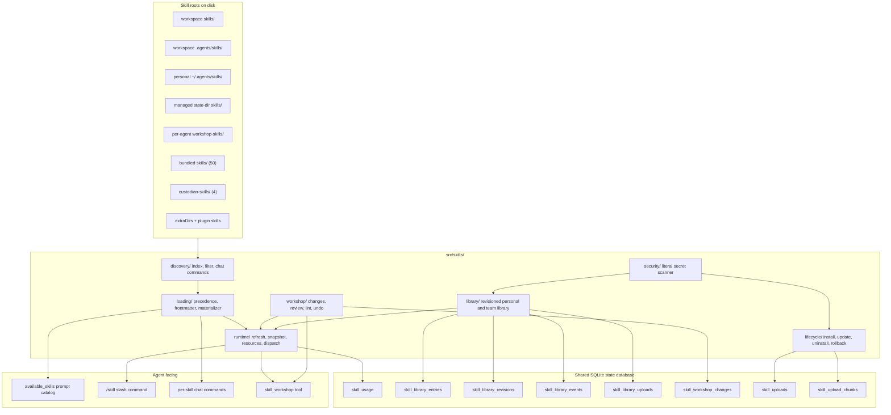
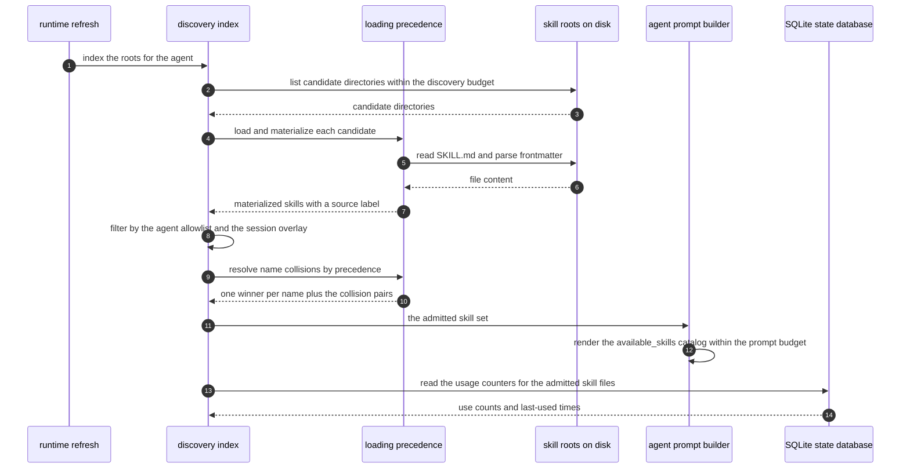
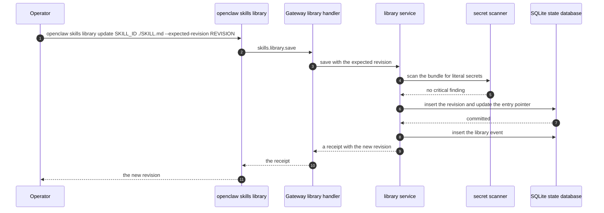
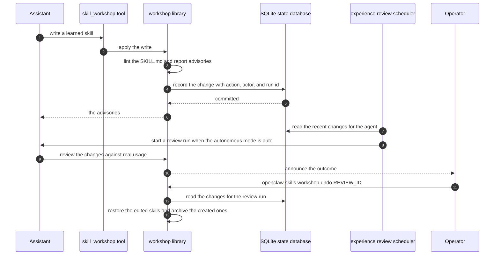

# Specification: Agent Skills and Workshop

## Overview

The skill pipeline in `src/skills/` is a staged pipeline with one owner per stage. `discovery/` indexes the skill roots and filters the result by the effective agent allowlist and by environment eligibility, and it owns the chat command surface. `loading/` resolves precedence across the workspace, project, personal, managed, Workshop, bundled, Custodian, and extra directories, and it materializes a skill into the runtime record. `runtime/` refreshes the discovery snapshot, materializes the skills into the host and the sandbox runtimes, delivers skill resources, and dispatches the skill tools. `library/` owns the personal and team skill library with revisioned bundles. `lifecycle/` owns install, update, uninstall, and rollback across ClawHub, Git, and local sources. `security/` scans skill bundles for literal secrets. `workshop/` owns the change feed, experience review, usage tracking, lint, archive, restore, and undo. The shipped content is the `skills/` directory with 50 bundled skills and the `custodian-skills/` directory with 4 operator-only playbooks.

The three agent-facing surfaces are separate views of one admitted set. The available-skills prompt catalog is the model-visible list, the `/skill` slash command is the explicit single-skill invocation, and the per-skill chat commands are the individual invocations derived from each skill name.

## Architecture

The retired proposal pipeline is not part of this flow. `skills.proposals.*` and `skills.curator.*` stay registered in the descriptor catalog so that old clients receive a pointer to the Workshop methods, and they answer with an `INVALID_REQUEST` error.

## Data Models

### skill_usage

Per-skill usage counters. The key is the canonical absolute path of the `SKILL.md`, so a same-named skill in another workspace never inherits another skill's counters.

| Field | Type | Constraints | Description |
|---|---|---|---|
| skill_file | text | PK | Canonical absolute path of the `SKILL.md` |
| skill_key | text | NOT NULL | Normalized skill key |
| skill_name | text | NOT NULL | Declared skill name |
| skill_source | text | NOT NULL | Source label the skill was loaded from |
| first_used_at_ms | integer | NOT NULL | First use time in Unix milliseconds |
| last_used_at_ms | integer | NOT NULL | Last use time in Unix milliseconds |
| use_count | integer | NOT NULL | Number of recorded uses |
| last_agent_id | text | nullable | Agent that last used the skill |

### skill_library_entries

The profile-owned library index. The table is additive and stays absent until the first publication or import.

| Field | Type | Constraints | Description |
|---|---|---|---|
| skill_id | text | PK | Library skill identifier, a UUID |
| owner_profile_id | text | nullable | Profile that owns the entry, null when shared with the team |
| author_profile_id | text | NOT NULL | Profile that authored the skill |
| slug | text | NOT NULL | Human-facing slug |
| current_revision | text | NOT NULL | The revision the entry currently points at |
| shared | integer | NOT NULL | Whether the entry is shared with the team |
| enabled | integer | NOT NULL | Whether the entry is enabled |
| removed | integer | NOT NULL | Soft removal flag |
| created_at | integer | NOT NULL | Creation time in Unix milliseconds |
| updated_at | integer | NOT NULL | Update time in Unix milliseconds |

### skill_library_revisions

The immutable content of one library revision.

| Field | Type | Constraints | Description |
|---|---|---|---|
| skill_id | text | NOT NULL, part of PK | Library skill identifier |
| revision | text | NOT NULL, part of PK | Revision digest, 64 lowercase hex characters |
| description | text | NOT NULL | The description captured for this revision |
| files_json | text | NOT NULL | Serialized manifest of the revision file tree |
| created_at | integer | NOT NULL | Creation time in Unix milliseconds |

### skill_library_events

The library audit trail.

| Field | Type | Constraints | Description |
|---|---|---|---|
| event_id | text | PK | Event identifier |
| skill_id | text | NOT NULL | Library skill identifier |
| revision | text | NOT NULL | Revision the event refers to |
| action | text | NOT NULL | The action, for example `save`, `share`, `remove`, or `rollback` |
| actor_profile_id | text | NOT NULL | Profile that performed the action |
| created_at | integer | NOT NULL | Event time in Unix milliseconds |

### skill_library_uploads

An in-flight private library upload.

| Field | Type | Constraints | Description |
|---|---|---|---|
| upload_id | text | PK | Upload identifier |
| owner_profile_id | text | NOT NULL | Profile that started the upload |
| slug | text | NOT NULL | Target slug |
| size_bytes | integer | NOT NULL | Declared bundle size |
| sha256 | text | NOT NULL | Declared bundle digest |
| archive_blob | blob | NOT NULL | The uploaded archive bytes |
| expires_at | integer | NOT NULL | Expiry time in Unix milliseconds |
| published_skill_id | text | nullable | The library skill the upload produced |

### skill_workshop_changes

The Workshop change feed. Each row is one change the assistant or the operator made to a learned skill.

| Field | Type | Constraints | Description |
|---|---|---|---|
| cursor_id | integer | NOT NULL, UNIQUE index | Portable pagination cursor |
| change_id | text | PK | Change identifier |
| agent_id | text | NOT NULL | Agent that owns the learned skill |
| skill_name | text | NOT NULL | Name of the changed skill |
| action | text | NOT NULL | `create`, `patch`, `write_file`, `remove_file`, `archive`, or `restore` |
| actor | text | NOT NULL | `agent`, `review`, `curator`, or `user` |
| summary | text | NOT NULL | Human-readable summary of the change |
| version_id | text | nullable | Saved version this change produced |
| session_key | text | nullable | Session that produced the change |
| run_id | text | nullable | Run that produced the change |
| created_at_ms | integer | NOT NULL | Change time in Unix milliseconds |

The feed keeps at most 500 rows per agent, and the same bound is the page size an undo uses so that one page holds a whole review run.

### skill_uploads

An in-flight skill install upload.

| Field | Type | Constraints | Description |
|---|---|---|---|
| upload_id | text | PK | Upload identifier |
| kind | text | NOT NULL | The upload kind |
| slug | text | NOT NULL | Target slug |
| force | integer | NOT NULL | Whether the install may overwrite |
| size_bytes | integer | NOT NULL | Declared archive size |
| sha256 | text | nullable | Declared archive digest |
| actual_sha256 | text | nullable | Digest computed from the received bytes |
| received_bytes | integer | NOT NULL | Bytes received so far |
| archive_blob | blob | NOT NULL | The received archive bytes |
| created_at | integer | NOT NULL | Creation time in Unix milliseconds |
| expires_at | integer | NOT NULL | Expiry time in Unix milliseconds |
| committed | integer | NOT NULL | Whether the upload was committed |
| committed_at | integer | nullable | Commit time in Unix milliseconds |
| idempotency_key_hash | text | UNIQUE | Hash of the client idempotency key |

### skill_upload_chunks

The chunked bytes of a skill upload.

| Field | Type | Constraints | Description |
|---|---|---|---|
| upload_id | text | NOT NULL, part of PK, FK to `skill_uploads(upload_id)` on delete cascade | Owning upload |
| byte_offset | integer | NOT NULL, part of PK, CHECK >= 0 | Offset of the chunk in the archive |
| size_bytes | integer | NOT NULL, CHECK > 0 | Chunk length in bytes |
| chunk_blob | blob | NOT NULL, CHECK length equals size_bytes | The chunk bytes |

## API Contracts

The Gateway protocol is a WebSocket and HTTP JSON-RPC surface, not REST. The table below names the RPC method, the modeled request path used in [`api.yaml`](api.yaml), and the purpose.

| Method | Path | Purpose |
|---|---|---|
| skills.status | `/skills.status` | Report the discovered skills for an agent workspace, including readiness and dependency status |
| skills.detail | `/skills.detail` | Report one skill's detail, including its registry setup and its ClawHub downloadability |
| skills.search | `/skills.search` | Search ClawHub for skills |
| skills.skillCard | `/skills.skillCard` | Read a Skill Card for a skill or a bundled command |
| skills.bins | `/skills.bins` | Report the binaries that skills require and whether they are present |
| skills.securityVerdicts | `/skills.securityVerdicts` | Report the ClawHub security verdicts for installed skills |
| skills.files.get | `/skills.files.get` | Read one skill file from its owning host |
| skills.install | `/skills.install` | Install a skill |
| skills.update | `/skills.update` | Update an installed skill |
| skills.upload.begin | `/skills.upload.begin` | Open a chunked skill upload |
| skills.upload.chunk | `/skills.upload.chunk` | Append one chunk to an open upload |
| skills.upload.commit | `/skills.upload.commit` | Commit an open upload |
| skills.library.list | `/skills.library.list` | List the caller's own and visible shared library skills |
| skills.library.read | `/skills.library.read` | Read one library skill, its supporting files, and its revision history |
| skills.library.save | `/skills.library.save` | Save a library skill, creating a new revision |
| skills.library.mutate | `/skills.library.mutate` | Apply a library mutation against an expected revision |
| skills.library.activate | `/skills.library.activate` | Attach, detach, or refresh a library skill in a session |
| skills.library.import | `/skills.library.import` | Import a ClawHub skill into the caller's private library |
| skills.library.upload | `/skills.library.upload` | Upload a private library bundle in chunks |
| skills.workshop.list | `/skills.workshop.list` | List the learned skills, the archived skills, and their usage |
| skills.workshop.changes | `/skills.workshop.changes` | List the recent Workshop changes for an agent |
| skills.workshop.read | `/skills.workshop.read` | Read one learned skill file or saved version |
| skills.workshop.archive | `/skills.workshop.archive` | Archive a learned skill so the agent no longer sees it |
| skills.workshop.restore | `/skills.workshop.restore` | Restore an archived skill or a saved version |
| skills.workshop.undo | `/skills.workshop.undo` | Undo a whole review run |
| skills.proposals.* | `/skills.proposals.*` | Retired. Answers with `INVALID_REQUEST` and points at the Workshop methods |
| skills.curator.* | `/skills.curator.*` | Retired. Answers with `INVALID_REQUEST` and points at the Workshop methods |

Error codes shared across endpoints:

| Status | Code | Description |
|---|---|---|
| 400 | INVALID_REQUEST | The parameters failed validation, the agent id is unknown, or the method is retired |
| 403 | FORBIDDEN | The caller lacks the required operator authority, or lost the ownership check for the skill |
| 409 | CONFLICT | The expected revision does not match the current library revision |
| 500 | INTERNAL | The Gateway failed to serve the request |

## Sequences

### Discovery, precedence, and prompt exposure

### Saving a library revision and activating it in a session

### The Workshop loop

## Technical Decisions

| Decision | Choice | Rationale |
|---|---|---|
| One owner per pipeline stage | `discovery/`, `loading/`, `runtime/`, `library/`, `lifecycle/`, `security/`, `workshop/` | A skill moves through these stages in order, and each stage owns one question. Splitting them keeps the precedence rules in one file and the change feed in another |
| Precedence is fixed and documented | Workspace, project, personal, managed, Workshop, bundled and Custodian, then extra | An operator needs to know which copy wins before they install anything. The order is published in `docs/tools/skills.md` |
| Collision reporting is one summary per root pair | Up to three example names, and identical content stays silent | A workspace with hundreds of skills would otherwise emit hundreds of log lines on every refresh |
| Key usage by the canonical file path, not by the skill name | `skill_usage.skill_file` is the primary key | A same-named skill in another workspace must not inherit another skill's counters |
| Keep prompt visibility and user invocability separate | Two independent flags on the skill entry | A skill can be useful to the operator without being advertised to the model, and the other way round |
| Give every library save a new revision | `skill_library_revisions` is append-only and the entry points at one revision | A published procedure must be reproducible, and a rollback needs the previous bytes |
| Require an expected revision on every library mutation | The caller states the revision it read | Two writers racing on the same skill would otherwise silently overwrite each other |
| Scan for literal secrets before install and before publication | `src/skills/security/` runs on both paths | A credential inside a skill would otherwise be pasted into every prompt that loads it |
| Apply Workshop changes immediately and make them undoable | No proposal queue, an explicit change feed, and an undo | The assistant's own procedures improve fastest when the loop is short, and the operator keeps a single reversal path |
| Retire the proposal and curator methods but keep them registered | They answer with `INVALID_REQUEST` and a pointer to the Workshop methods | The descriptor catalog is append-only, so removing a method would break an old client instead of redirecting it |
| Give the Custodian skills their own root beside the bundled root | `custodian-skills/`, loaded only for the configured Custodian agent | The Custodian playbooks carry a mandatory Gather, Mutate, Repair, Prove, Report contract and must not leak into a normal agent's catalog |

## Risks and Unknowns

1. The Workshop change feed keeps at most 500 rows per agent. An undo of a review whose changes have partly fallen out of the feed is refused rather than applied partially, so a busy agent can lose the ability to undo an old review.
2. The `skill_usage` table is written from the Gateway. A run that does not record skill reads reports no usage, and the unused-skill archiver fails closed in that case rather than archiving skills it cannot prove are unused.
3. The library is profile-owned. A skill published by one profile is not visible to another, so a team-shared procedure must be explicitly shared and the sharing is recorded in `skill_library_events`.
4. The library upload path writes archive bytes into the shared state database, so the state directory size grows with the bundle size even after the upload is published.
5. The `skills.proposals.*` and `skills.curator.*` methods are still listed in the descriptor catalog. A client that enumerates the catalog will see methods that always fail.
6. The `skills.files.get` method reads a skill file from its owning host. A remote workspace skill is delivered from the host that owns it, so a read path that assumes a local path fails for a node-hosted skill.
7. The skill command name is derived from the skill name and de-duplicated by appending a numeric suffix. A rename of a skill therefore changes the chat command the operator has memorized.

## Out of Scope

- The `skill_workshop` tool's own schema and the node-host MCP bridge that exposes it. Those are agent tool surfaces owned by the agent runtime.
- ClawHub registry behavior, listing, and downloadability, except for the verdicts the Gateway reads and reports.
- The retired proposal approval flow and the retired curator pin, unpin, and restore methods.
- The operator-managed forward proxy and the debug proxy, which belong to the security and secrets feature.
- Skill authoring guidance beyond the advisory lint rules and the shipped `docs/tools/creating-skills.md` guide.
- Node-hosted skill publishing, except for the read paths that must respect the owning host.
