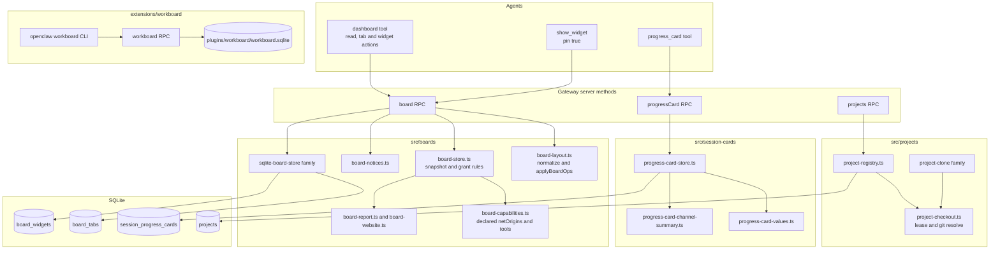
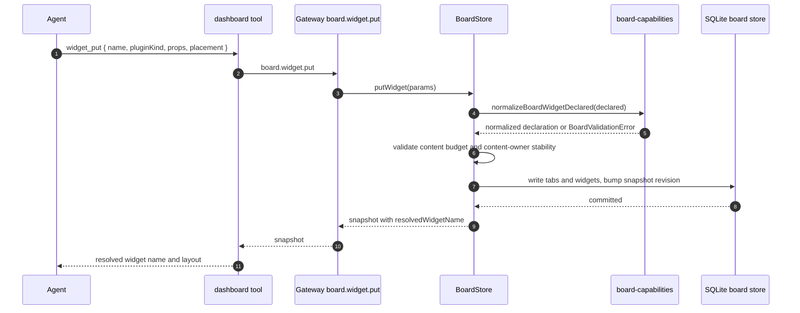
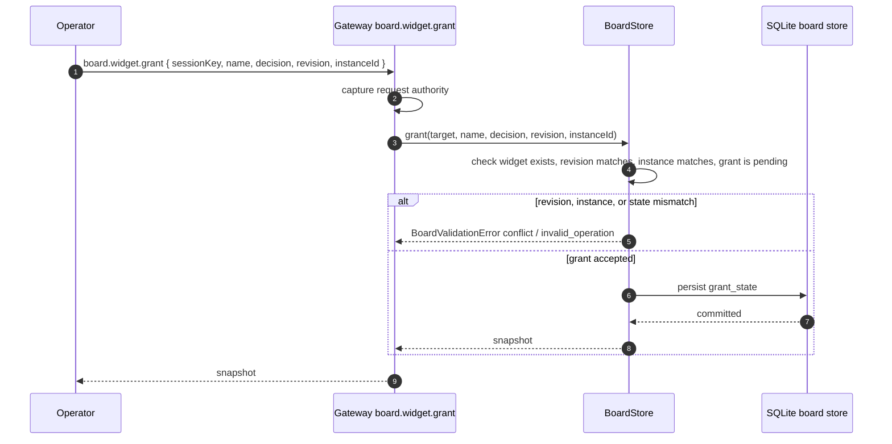
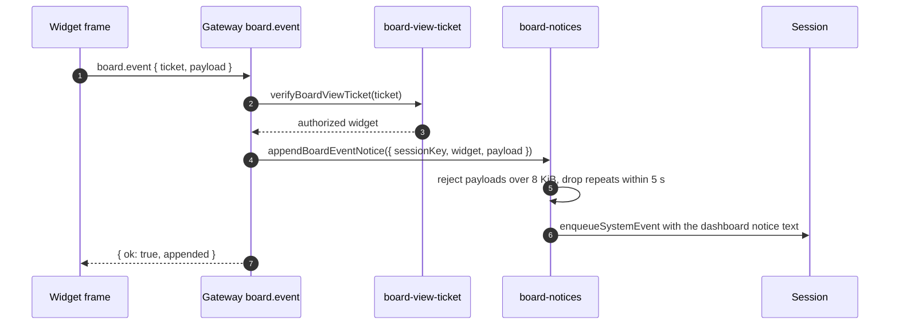
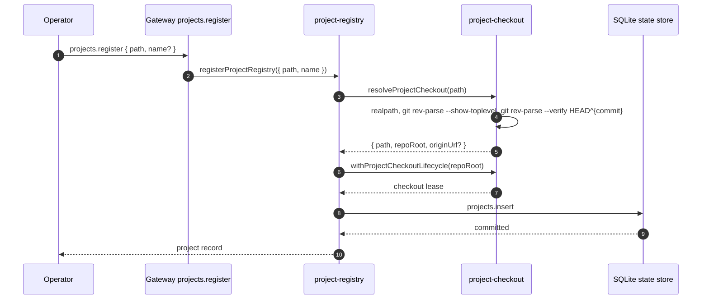

# Specification: Boards, Projects, and Session Cards

## Overview

The feature is three cooperating subsystems plus one bundled plugin.

- Boards (`src/boards/`) own a per-session dashboard. `board-layout.ts` is the pure normalizer: it turns a `BoardSnapshot` of tabs and widgets into a dense, ordered layout and applies `BoardOp` batches. `board-store.ts` owns the read/write contract and the snapshot construction rules (content budgets, grant state, content-owner stability). `board-capabilities.ts` validates the network origins and tools a widget declares and checks the declaration against the sandbox host. `sqlite-board-store.ts` and its kernel, codec, and worker own persistence. `board-report.ts` and `board-website.ts` own the two core-owned widget kinds, `session:report` and `session:website`; the `session:progress` kind is supplied by a plugin and reaches the board as ordinary plugin content. `board-notices.ts` publishes widget events back to the session as `[dashboard]` system events. `session-actor-board-store.ts` is the variant for hosts that own session storage per actor.
- Projects (`src/projects/`) own the registry of repositories. `project-registry.ts` and `project-registry.kernel.ts` own the registry read and write paths, `project-checkout.ts` owns the per-checkout lease and the git resolution, `project-clone.ts` and `project-clone-runtime.ts` own cloning and refresh, and `project-registration.ts` owns the registration write path.
- Session cards (`src/session-cards/`) own the progress card. `progress-card-store.ts` and `progress-card-store.worker.ts` own persistence, `progress-card-values.ts` owns write normalization, and `progress-card-channel-summary.ts` projects the card into a channel-facing summary.
- The Workboard plugin (`extensions/workboard/`, contract in `packages/workboard-contract/`) is a separate, card-based work tracker. It keeps its own SQLite file, its own RPC methods, and its own CLI, and it ships disabled by default.

## Architecture

## Data Models

### Board snapshot (in memory, `packages/gateway-protocol/src/schema/board.ts`)

| Field | Type | Constraints | Description |
|---|---|---|---|
| sessionKey | string | Non-empty | Session the board belongs to |
| revision | integer | >= 0 | Monotonic snapshot revision, bumped by every accepted write |
| tabs | BoardTab[] | Array | Ordered tabs |
| widgets | BoardWidget[] | Array | Ordered widgets, positions dense per tab |

### Board tab

| Field | Type | Constraints | Description |
|---|---|---|---|
| tabId | string | `^[a-z0-9-]{1,40}$` | Stable tab slug |
| title | string | 1 to 80 characters | Tab label |
| position | integer | >= 0, dense after normalization | Zero-based tab order |
| chatDock | enum | `left`, `right`, `bottom`, `hidden` | Where the chat panel docks for this tab |

### Board widget

| Field | Type | Constraints | Description |
|---|---|---|---|
| name | string | `^[a-z0-9][a-z0-9._-]{0,63}$` | Stable widget name, the update key |
| tabId | string | `^[a-z0-9-]{1,40}$` | Owning tab |
| title | string | Optional, 1 to 80 characters | Display title |
| contentKind | enum | `html`, `mcp-app`, `plugin` | Content family |
| contentOwner | enum | Optional, `html`, `mcp-app`, `plugin`, `registered` | Original content owner, used to block cross-kind replacement |
| registeredContentKind | string | Optional, `^[a-z][a-z0-9-]{0,31}$` | Registered kind behind a `plugin` widget |
| pluginKind | string | Optional, `^[a-z0-9][a-z0-9-]{0,63}:[a-z0-9][a-z0-9._-]{0,63}$` | Registered widget kind, for example `session:report`, `session:website`, or the plugin-supplied `session:progress` |
| props | object | Optional | Plugin widget props, JSON budget 8 KiB |
| presentation | enum | Optional, `card`, `full-bleed`, `frameless` | Panel presentation |
| heightMode | enum | Optional, `auto`, `fixed` | Height behavior; a resize forces `fixed` |
| sizeW | integer | 1 to 12 | Grid width in columns |
| sizeH | integer | 1 to 20 | Grid height in rows |
| position | integer | >= 0, dense within the tab | Zero-based order within the tab |
| grantState | enum | `none`, `pending`, `granted`, `rejected` | Capability grant state |
| revision | integer | >= 1 | Per-widget revision, incremented on every put |
| instanceId | string | Optional | Identity of the current widget instance, checked by grants |
| declaredSummary | string[] | Optional | Human-readable summary of the granted capabilities |
| declared | BoardWidgetDeclared | Optional | Normalized declaration |

### Board widget declaration

| Field | Type | Constraints | Description |
|---|---|---|---|
| netOrigins | string[] | Optional, max 32 entries, each an exact HTTPS origin | Origins the widget may fetch after approval |
| tools | string[] | Optional, max 64 entries, each 1 to 300 characters, no control characters | Tool capabilities the widget may request |

### `board_tabs` (agent schema, `src/state/openclaw-agent-schema.sql`)

| Field | Type | Constraints | Description |
|---|---|---|---|
| session_key | text | Not null, FK to `session_nodes(session_key)` on delete cascade | Owning session |
| tab_id | text | Not null | Tab slug |
| title | text | Not null | Tab label |
| position | integer | Not null, >= 0 | Tab order |
| chat_dock | text | Not null, default `right`, one of `left`, `right`, `bottom`, `hidden` | Chat dock side |
| created_by | text | Not null, one of `user`, `agent` | Author of the row |
| revision | integer | Not null, >= 0 | Row revision |
| Primary key | | (`session_key`, `tab_id`) | |
| Foreign key | | (`session_key`) to `session_nodes(session_key)` on delete cascade | |

### `board_widgets` (agent schema, `src/state/openclaw-agent-schema.sql`)

| Field | Type | Constraints | Description |
|---|---|---|---|
| session_key | text | Not null | Owning session |
| name | text | Not null | Widget name |
| tab_id | text | Not null, FK to `board_tabs(session_key, tab_id)` on delete cascade | Owning tab |
| title | text | Nullable | Display title |
| content_kind | text | Not null, one of `html`, `mcp-app`, `plugin` | Content family |
| html | blob | Nullable | HTML body for `html` widgets |
| descriptor_json | text | Nullable | MCP App descriptor or registered widget descriptor |
| sha256 | text | Not null | Content digest |
| view_generation | text | Nullable | 32 hex characters for `html` widgets |
| revision | integer | Not null, >= 1 | Widget revision |
| size_w | integer | Not null, between 1 and 12 | Grid width |
| size_h | integer | Not null, between 1 and 20 | Grid height |
| position | integer | Not null, >= 0 | Order within the tab |
| manifest | text | Not null, default `{}` | Widget manifest, holds the declaration, grant state, and instance identity |
| grant_state | text | Not null, default `none`, one of `none`, `pending`, `granted`, `rejected` | Capability grant state |
| granted_sha | text | Nullable | SHA-256 of the bytes the operator approved |
| created_by | text | Not null, one of `user`, `agent` | Author of the row |
| created_at | integer | Not null | Creation timestamp |
| updated_at | integer | Not null | Last update timestamp |
| Primary key | | (`session_key`, `name`) | |
| Check | | Exactly one of the three content shapes must hold: `html` widgets carry `html` and `view_generation`; `mcp-app` and `plugin` widgets carry `descriptor_json` and no `view_generation` | |
| Index | | `idx_agent_board_widgets_tab_position` on (`session_key`, `tab_id`, `position`) | |

### `session_progress_cards` (agent schema, `src/state/openclaw-agent-schema.sql`)

| Field | Type | Constraints | Description |
|---|---|---|---|
| session_key | text | Not null, primary key, FK to `session_nodes(session_key)` on delete cascade | Owning session |
| markdown | text | Nullable | Free-form card body |
| steps_json | text | Nullable | JSON array of `{ step, status }` with status `pending`, `in_progress`, or `completed` |
| revision | integer | Not null | Card revision, starts at 1 and increments on every write |
| created_at | integer | Not null | Creation timestamp |
| updated_at | integer | Not null | Last update timestamp |

### `projects` (state schema, `src/state/openclaw-state-schema.sql`)

| Field | Type | Constraints | Description |
|---|---|---|---|
| id | text | Not null, primary key | Project identifier |
| display_name | text | Not null | Operator-visible name |
| repo_root | text | Not null | Resolved git checkout root |
| origin_url | text | Nullable | Remote origin URL |
| source | text | Not null, one of `registered`, `cloned` | How the project entered the registry |
| created_at_ms | integer | Not null | Creation timestamp |
| updated_at_ms | integer | Not null | Last update timestamp |

### Workboard plugin tables (`extensions/workboard/src/workboard-schema.ts`)

The plugin owns its own schema version (`SCHEMA_VERSION = 3`) in its own database file.

| Table | Purpose | Key columns |
|---|---|---|
| `workboard_schema_migrations` | Applied plugin migrations | `id` primary key, `applied_at` |
| `workboard_boards` | Boards, including sessions boards | `id` primary key, `kind`, `sessions_spec`, `automation_job_id`, `default_workspace_json`, `orchestration_json`, `archived_at` |
| `workboard_session_placements` | Where a session sits on a sessions board | (`board_id`, `session_key`) primary key, `column_id`, `source`, `reason`, `facts_hash` |
| `workboard_cards` | Work cards | `id` primary key, `board_id`, `status`, `priority`, `position`, execution columns, `automation_json`, `claim_json`, `archived_at` |
| `workboard_card_labels` | Card labels | (`card_id`, `ordinal`) primary key, `label` |
| `workboard_card_events` | Card event log | `id` primary key, `card_id`, `ordinal`, `kind`, `at`, `from_status`, `to_status` |
| `workboard_card_attempts` | Execution attempts | `id` primary key, `card_id`, `ordinal`, `status`, `engine`, `mode`, `model`, `error` |
| `workboard_card_comments` | Card comments | `id` primary key, `card_id`, `ordinal`, `body` |
| `workboard_card_links` | Card links | `id` primary key, `card_id`, `ordinal`, `type`, `target_card_id`, `url` |
| `workboard_card_proof` | Card proof records | `id` primary key, `card_id`, `ordinal`, `status`, `label`, `command`, `url` |
| `workboard_card_artifacts` | Card artifacts | `id` primary key, `card_id`, `ordinal`, `label`, `url`, `path`, `mime_type` |
| `workboard_card_diagnostics` | Card diagnostics | (`card_id`, `ordinal`) primary key, `kind`, `severity`, `title`, `detail`, `count` |
| `workboard_card_notifications` | Card notifications | `id` primary key, `card_id`, `ordinal`, `kind`, `message`, `sequence` |
| `workboard_worker_logs` | Worker log lines | `id` primary key, `card_id`, `ordinal`, `level`, `message` |
| `workboard_worker_protocol` | Worker protocol state per card | `card_id` primary key, `state`, `updated_at`, `detail` |
| `workboard_card_attachments` | Attachment metadata | `id` primary key, `card_id`, `file_name`, `byte_size`, `mime_type` |
| `workboard_attachment_blobs` | Attachment bytes | `attachment_id` primary key, `content` blob |
| `workboard_notification_subscriptions` | Notification subscriptions | `id` primary key, `board_id`, `card_id`, `target`, `event_kinds_json` |

### Workboard taxonomy (`packages/workboard-contract/src/index.ts`)

| Constant | Values |
|---|---|
| `WORKBOARD_STATUSES` | `triage`, `backlog`, `todo`, `scheduled`, `ready`, `running`, `review`, `blocked`, `done` |
| `WORKBOARD_PRIORITIES` | `low`, `normal`, `high`, `urgent` |
| `WORKBOARD_EXECUTION_ENGINES` | `codex`, `claude` (persisted engines stay an open runtime identifier) |
| `WORKBOARD_EXECUTION_MODES` | `autonomous`, `manual` |
| `WORKBOARD_EXECUTION_STATUSES` | `idle`, `running`, `review`, `blocked`, `done` |
| `WORKBOARD_EVENT_KINDS` | `created`, `edited`, `moved`, `linked`, `specified`, `decomposed`, `claimed`, `heartbeat`, `execution_updated`, `attempt_started`, `attempt_updated`, `comment_added`, `link_added`, `proof_added`, `artifact_added`, `attachment_added`, `diagnostic`, `notification`, `dispatch`, `orchestration`, `protocol_violation`, `archived`, `unarchived`, `stale` |
| `WORKBOARD_ATTEMPT_STATUSES` | `running`, `succeeded`, `failed`, `blocked`, `stopped` |
| `WORKBOARD_LINK_TYPES` | `parent`, `child`, `blocks`, `blocked_by`, `relates_to` |
| `WORKBOARD_PROOF_STATUSES` | `passed`, `failed`, `skipped`, `unknown` |
| `WORKBOARD_TEMPLATE_IDS` | `bugfix`, `docs`, `release`, `pr_review`, `plugin` |

### Board size presets (`src/boards/board-layout.ts`)

| Preset | sizeW | sizeH |
|---|---|---|
| `sm` | 3 | 3 |
| `md` | 6 | 4 |
| `lg` | 8 | 6 |
| `xl` | 12 | 8 |
| `full` | 12 | 8 |

## API Contracts

The normative contract is in [`api.yaml`](api.yaml) (OpenAPI 3), written alongside this document.
OpenClaw's Gateway is a WebSocket and HTTP JSON-RPC surface, not a REST API, so `api.yaml` models each RPC method as a path under a synthetic `/rpc` root and records the method name, the request payload, and the response payload for each one.
The single REST-shaped path is the board widget document route, which the Gateway serves over HTTP.

| Method | Path | Purpose |
|---|---|---|
| RPC | `board.get` | Read the board snapshot for a session |
| RPC | `board.update` | Apply a batch of board operations |
| RPC | `board.widget.put` | Create or update one board widget |
| RPC | `board.widget.grant` | Record an operator grant decision for a widget |
| RPC | `board.widget.appView` | Mint a view for a pinned MCP App widget |
| RPC | `board.event` | Publish a widget event back to the session |
| RPC | `board.prompt.authorize` | Check whether a prompt needs a confirmation for a widget view |
| RPC | `board.data.read` | Read a declared dashboard data binding |
| RPC | `board.action` | Run a declared dashboard action verb |
| RPC | `progressCard.get` | Read the progress card of a session |
| RPC | `progressCard.put` | Write the progress card of a session |
| RPC | `progressCard.refresh` | Recompute the progress card from session state |
| RPC | `projects.list` | List the workspace and registered projects |
| RPC | `projects.add` | Add a project to the registry |
| RPC | `projects.register` | Register an existing local checkout as a project |
| RPC | `projects.remove` | Remove a project from the registry |
| RPC | `projects.searchRemote` | Search remote repositories that can be cloned as projects |
| RPC | `projects.checkoutOptions` | List the checkout options for a project |
| RPC | `workboard.boards.upsert` | Create or update a Workboard board |
| RPC | `workboard.boards.list` | List Workboard boards |
| RPC | `workboard.cards.list` | List Workboard cards |
| RPC | `workboard.cards.update` | Update a Workboard card |
| RPC | `workboard.cards.move` | Move a Workboard card to another status |
| RPC | `workboard.cards.archive` | Archive a Workboard card |
| RPC | `workboard.cards.delete` | Delete a Workboard card |
| RPC | `workboard.cards.stats` | Read Workboard card statistics |
| RPC | `workboard.cards.dispatch` | Promote ready cards and start worker runs |
| RPC | `workboard.sessionsBoard.read` | Read the sessions board and its placements |
| RPC | `workboard.sessionsBoard.update` | Update the sessions board specification |
| RPC | `workboard.sessionsBoard.move` | Place a session in a sessions board column |
| HTTP | `GET /__openclaw__/board/{sessionKey}/{widget}/index.html` | Serve a board widget document, authorized by a view ticket |
| CLI | `openclaw workboard list\|create\|show\|move\|dispatch` | Manage Workboard cards from a terminal |
| CLI | `openclaw projects` | Not provided; the project registry is Gateway-RPC and Control UI only |

Error codes shared across endpoints:

| Status | Code | Description |
|---|---|---|
| 400 | `not_found` | The tab, widget, project, card, or session does not exist |
| 409 | `conflict` | The widget revision, instance identity, or generated widget name conflicts with the stored state |
| 400 | `invalid_operation` | The operation is not valid for the current layout, content, or declaration |
| 403 | `operator.approvals` | The caller lacks the operator approval scope required for `board.widget.grant` |
| 403 | `operator.admin` | The caller lacks the operator admin scope required for `projects.register` and `projects.remove` |
| 400 | `BoardValidationError` | The board layout rejected the request |

## Sequences

### An agent puts a widget on a session board

### An operator grants a widget capability

### A widget publishes an event back to the session

### A project is registered

## Technical Decisions

| Decision | Choice | Rationale |
|---|---|---|
| Layout normalization | A pure function that clones the layout, applies each operation, and re-normalizes after every step | Callers get a value they own, and a rejected operation never leaves a half-applied layout behind |
| Error model | One `BoardValidationError` class with a `not_found`, `conflict`, or `invalid_operation` code | The Gateway maps the code onto a transport status, so handlers do not each invent a status |
| Widget budgets | 48 widgets per board, 8 KiB props for plugin widgets, 8 KiB JSON for a report, the shared widget HTML byte limit for HTML | The board renders in a browser, so the size of what it holds has to be bounded at write time |
| Capability model | Declare then grant, with the grant checked against the current revision and instance | A grant is a decision about one revision of one widget, not a standing permission |
| Grant narrowing | A new put may narrow the declaration but never widen it, and an HTML grant is bound to the approved SHA-256 | Re-publishing content must not silently inherit a wider capability set |
| Native widget kinds | `session:report` for data blocks and `session:website` for an embedded HTTPS page | The two kinds need no script, so they can render without the sandbox escalation |
| Board persistence | A dedicated SQLite board store with a codec, a kernel, and a worker | The board is read and written far more often than the rest of the session state, so it gets its own storage path |
| Session actor variant | A separate `session-actor-board-store` and `session-actor-progress-card-store` | Hosts that own session storage per actor need the same contract against a different owner |
| Project registry ownership | `project-registry.ts` owns reads, `project-registration.ts` owns the write path, `project-checkout.ts` owns the lease | One owner per responsibility, so the clone path and the register path cannot drift |
| Checkout serialization | A lease keyed on the resolved repo root, with a 30 s lease and a 30 s wait | Two operators editing the same working tree must not interleave, and a stuck holder must not block forever |
| Git resolution | `git rev-parse --show-toplevel` plus `git rev-parse --verify HEAD^{commit}` | A project is a real checkout with history, not an arbitrary directory |
| Projects exposure | Gateway RPC plus Control UI only | Project operations mutate the shared checkout, so they need the operator scope checks the Gateway already applies |
| Workboard separation | A private package for the contract, a plugin for the implementation, its own SQLite file, `enabledByDefault: false` | The card tracker is a different product surface from the session dashboard and must not load on every Gateway |
| Workboard taxonomy location | `@openclaw/workboard-contract` | Core and the plugin both need the status, priority, and event vocabularies, and neither should own them |
| Progress card writes | An optional `expectedRevision` guard plus a clear path for an empty card | A stale writer must not overwrite a newer card, and an emptied card must disappear rather than linger empty |
| Board event notices | A 5 s dedupe window and an 8 KiB payload cap | A polling widget would otherwise flood the session transcript with identical notices |

## Risks and Unknowns

1. The board snapshot revision increments on every accepted write, so a busy session produces a long chain of revisions and there is no compaction policy for that history.
2. The `projects` table has no agent column, so a registered project is visible to every agent on the Gateway; there is no per-agent project scoping yet.
3. The Workboard plugin keeps a copy of the card taxonomy in its own database file, so a taxonomy change needs a plugin migration rather than a core migration.
4. The board HTTP route sets `Access-Control-Allow-Origin: *` so a Control UI hosted away from the Gateway can observe authorization failures; the view ticket, not CORS, is the authorization boundary.
5. A widget that declares a GitHub Actions grant shares private repository data with the session audience, which the grant summary states but the operator must still understand.
6. The `board_widgets` manifest column carries the declaration, grant state, and instance identity as JSON, so the structured constraints on those fields live in the codec rather than in the table definition.

## Out of Scope

- The Control UI shell that renders boards, project lists, and progress cards (FEAT-p8).
- The canvas document composition, script validation, and bridge protocol behind `show_widget` (`src/canvas/`).
- The widget sandbox host, its content security policy, and the sandbox origin allocator (`src/gateway/board-sandbox.ts`).
- GitHub App authentication and the workflow dispatch pipeline behind the `github-actions` widget grant.
- The Workboard dispatcher's worker execution, workspace provisioning, and automation scheduler.
- Retention, quota, and archival policy for board revisions and for the widget HTML budget across sessions.
