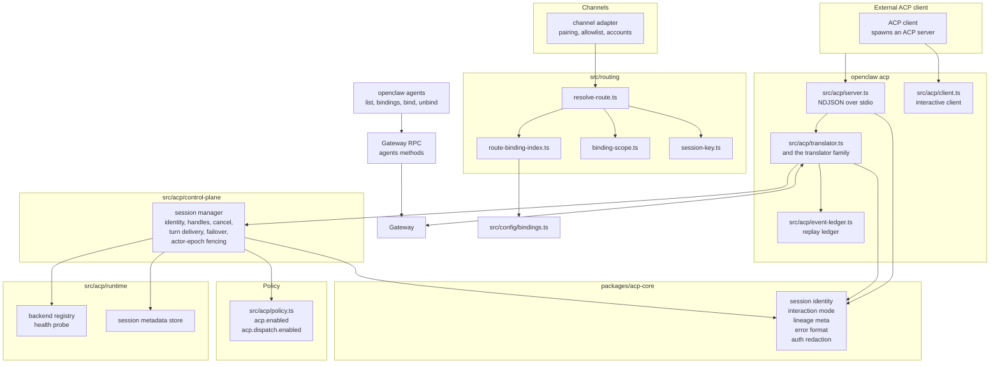
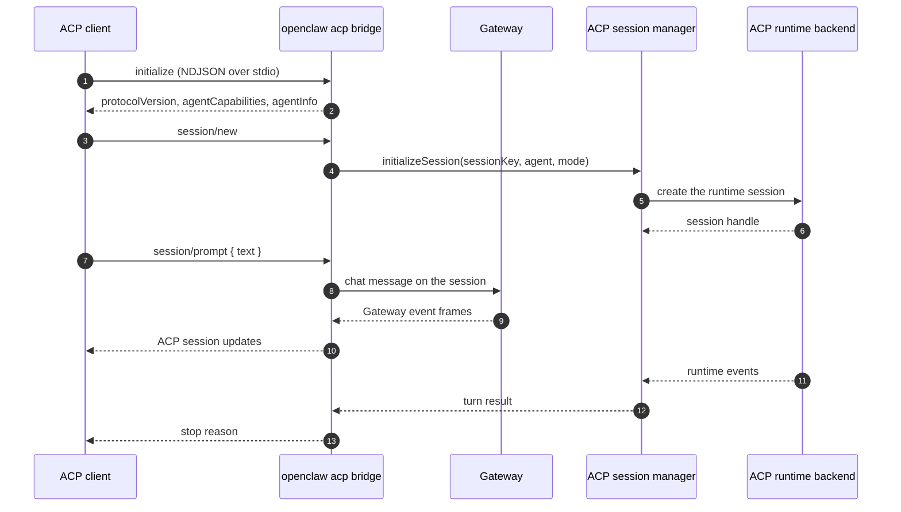
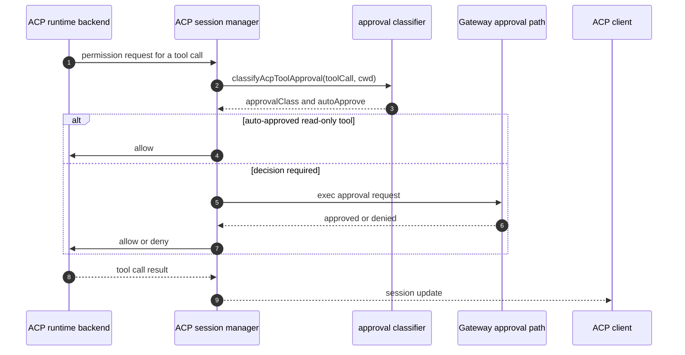
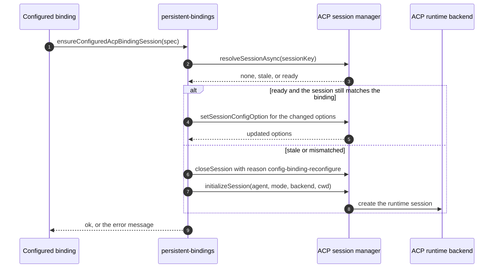
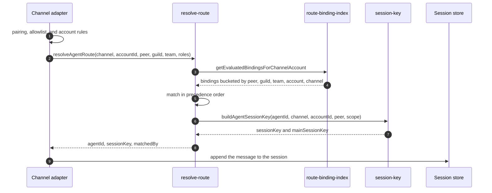

# Specification: ACP and Agent Bindings

## Overview

The feature has two halves that share a session identity contract.

The ACP half is a protocol bridge plus a control plane.
`openclaw acp` runs `src/acp/server.ts`, which speaks the Agent Client Protocol over NDJSON on stdio using `@agentclientprotocol/sdk` 1.8.0 and forwards prompts into a Gateway session over a WebSocket.
`src/acp/translator.ts` is the agent-side entry point; the `translator.*.ts` family splits the work into session lifecycle, session updates, prompt streaming, event mapping, disconnects, permission relay, replay, and presentation.
`src/acp/client.ts` is the other direction: it spawns an external ACP server and relays the permission requests the server raises.
`src/acp/control-plane/` is the process-wide session manager. It owns ACP session identity, runtime handles, cancellation, turn delivery, backend failover, and actor-epoch fencing, and it is the only writer of the persisted ACP session metadata.
`src/acp/runtime/` holds the backend registry and the availability probe, `src/acp/event-ledger.ts` holds the replay ledger, `src/acp/persistent-bindings.types.ts`, `src/acp/persistent-bindings.resolve.ts`, and `src/acp/persistent-bindings.lifecycle.ts` bind a channel conversation to a persistent ACP session, and `src/acp/policy.ts` enforces the feature and dispatch gates.
`packages/acp-core/` holds the shared, transport-free logic.

The bindings half decides which agent answers an inbound message.
`src/routing/resolve-route.ts` evaluates the configured route bindings in a fixed precedence order, `src/routing/route-binding-index.ts` buckets the bindings for lookup, `src/routing/binding-scope.ts` normalizes the binding and checks its guild, team, and role constraints, and `src/routing/session-key.ts` builds the session key of the routed conversation.
`src/config/bindings.ts` is the config source of truth and separates route bindings from ACP bindings.

## Architecture

## Data Models

### ACP session metadata (`acp_sessions`, state schema `src/state/openclaw-state-schema.sql`)

| Field | Type | Constraints | Description |
|---|---|---|---|
| session_key | text | Not null, primary key | OpenClaw session key that owns the ACP session |
| session_id | text | Nullable | ACP session id handed to the client |
| backend | text | Not null | ACP runtime backend id |
| agent | text | Not null | ACP harness agent id |
| runtime_session_name | text | Not null | Name of the runtime session |
| identity_json | text | Nullable | Serialized ACP session identity |
| resume_agent_session_id | text | Nullable | Agent session id to resume |
| resume_acpx_session_id | text | Nullable | ACPX session id to resume |
| mode | text | Not null | Session mode, `persistent` or `oneshot` |
| runtime_options_json | text | Nullable | Serialized runtime options such as model, thinking, cwd, and permission profile |
| cwd | text | Nullable | Working directory of the session |
| state | text | Not null | Session state, for example `ready`, `error`, or `closed` |
| last_activity_at | integer | Not null | Last activity timestamp |
| last_error | text | Nullable | Last error message |
| updated_at | integer | Not null | Last write timestamp |
| Index | | `idx_acp_sessions_state_activity` on (`state`, `last_activity_at` DESC, `session_key`) | |
| Index | | `idx_acp_sessions_agent_activity` on (`agent`, `last_activity_at` DESC, `session_key`) | |
| Index | | `idx_acp_sessions_resume_agent`, `idx_acp_sessions_resume_acpx` | |

### ACP replay session (`acp_replay_sessions`, state schema)

| Field | Type | Constraints | Description |
|---|---|---|---|
| session_id | text | Not null, primary key | Replay session id |
| session_key | text | Not null | OpenClaw session key |
| cwd | text | Not null | Working directory recorded with the session |
| complete | integer | Not null | 1 when the session finished, 0 while it is still recording |
| created_at | integer | Not null | Creation timestamp |
| updated_at | integer | Not null | Last update timestamp |
| next_seq | integer | Not null | Next sequence number for the session |
| estimated_bytes | integer | Not null, default 0 | Running estimate of the session ledger footprint, maintained at insert and trim so a budget check never scans the event table |
| Index | | `idx_acp_replay_sessions_key_updated` on (`session_key`, `complete`, `updated_at` DESC, `session_id`) | |
| Index | | `idx_acp_replay_sessions_updated` on (`updated_at` DESC, `session_id`) | |

### ACP replay event (`acp_replay_events`, state schema)

| Field | Type | Constraints | Description |
|---|---|---|---|
| session_id | text | Not null, FK to `acp_replay_sessions(session_id)` on delete cascade | Owning replay session |
| seq | integer | Not null | Sequence number within the session |
| at | integer | Not null | Event timestamp |
| session_key | text | Not null | OpenClaw session key |
| run_id | text | Nullable | Run that produced the event |
| update_json | text | Not null | Serialized ACP `SessionUpdate` |
| estimated_bytes | integer | Not null, default 0 | Byte estimate for the row |
| Primary key | | (`session_id`, `seq`) | |

### ACP parent stream events (`acp_parent_stream_events`, agent schema `src/state/openclaw-agent-schema.sql`)

| Field | Type | Constraints | Description |
|---|---|---|---|
| session_id | text | Not null, FK to `session_windows(session_id)` on delete cascade | Owning session window |
| run_id | text | Not null | Run that produced the event |
| seq | integer | Not null | Sequence number within the run |
| event_json | text | Not null | Serialized parent stream event |
| created_at | integer | Not null | Creation timestamp |
| Primary key | | (`session_id`, `run_id`, `seq`) | |
| Index | | `idx_agent_acp_parent_stream_run` on (`run_id`, `seq`) | |

### Replay ledger budgets (`src/acp/event-ledger.types.ts`)

| Budget | Default | Meaning |
|---|---|---|
| `maxSessions` | 200 | Maximum number of replay sessions kept |
| `maxEventsPerSession` | 5000 | Maximum number of events kept per replay session |
| `maxSerializedBytes` | 16 MiB | Maximum total serialized size of the ledger |

### Route binding (`src/config/bindings.ts`, `src/config/types.agents.ts`)

| Field | Type | Constraints | Description |
|---|---|---|---|
| agentId | string | Required | Agent that owns the matched conversations |
| type | enum | Optional, `route` or `acp`; a missing type means `route` | Binding kind |
| match.channel | string | Required | Channel id the binding applies to |
| match.accountId | string | Optional, `*` for every account | Account id the binding applies to |
| match.peer.kind | enum | Optional | Peer kind, for example `direct` or `group` |
| match.peer.id | string | Optional | Peer id |
| match.guildId | string | Optional | Guild scope constraint |
| match.teamId | string | Optional | Team scope constraint |
| match.roles | string[] | Optional | Channel or platform role ids; matching is a positive OR |
| comment | string | Optional | Operator note |
| session | object | Optional | Per-binding direct-message and group scope override |

### Configured ACP binding (`src/acp/persistent-bindings.types.ts`)

| Field | Type | Constraints | Description |
|---|---|---|---|
| channel | string | Required | Channel id |
| accountId | string | Required | Channel account id |
| conversationId | string | Required | Conversation id |
| parentConversationId | string | Optional | Parent conversation for a thread |
| agentId | string | Required | Owning OpenClaw agent id |
| acpAgentId | string | Optional | ACP harness agent id, defaults to `agentId` |
| mode | enum | `persistent` or `oneshot`, default `persistent` | ACP session mode |
| model | string | Optional | Model for the session |
| thinking | string | Optional | Thinking level forwarded to the session |
| cwd | string | Optional | Working directory |
| backend | string | Optional | ACP runtime backend id |
| label | string | Optional | Operator-facing label |

### ACP runtime backend (`src/acp/runtime/registry.ts`)

| Field | Type | Constraints | Description |
|---|---|---|---|
| id | string | Required, normalized to lowercase | Backend id |
| runtime | AcpRuntime | Required | Runtime implementation |
| healthy | function | Optional | Health probe; a backend without a probe is always healthy |

### Resolved agent route (`src/routing/resolve-route.ts`)

| Field | Type | Constraints | Description |
|---|---|---|---|
| agentId | string | Required | Agent that answers the message |
| channel | string | Required | Channel id |
| accountId | string | Required | Normalized account id |
| dmScope | enum | Optional, `main` or `per-peer` | Effective direct-message scope after a binding override |
| groupScope | enum | Optional, `main` or `per-group` | Effective group scope after a binding override |
| sessionKey | string | Required | Session key for persistence and concurrency |
| mainSessionKey | string | Required | Agent main session key |
| lastRoutePolicy | enum | `main` or `session` | Which session receives inbound last-route updates |
| matchedBy | enum | `binding.peer`, `binding.peer.parent`, `binding.peer.wildcard`, `binding.guild+roles`, `binding.guild`, `binding.team`, `binding.account`, `binding.channel`, `default` | Which rule matched |

### Session key forms (`src/routing/session-key.ts`)

| Scope | Key form |
|---|---|
| Agent main session | `agent:<agentId>:<mainKey>`, where `mainKey` defaults to `main` |
| Direct chat, per-peer scope | `agent:<agentId>:direct:<peerId>` |
| Direct chat, per-channel-peer scope | `agent:<agentId>:<channel>:direct:<peerId>` |
| Direct chat, per-account-channel-peer scope | `agent:<agentId>:<channel>:<accountId>:direct:<peerId>` |
| Group chat | `agent:<agentId>:<channel>:<peerKind>:<peerId>` |
| Configured ACP binding | `agent:<agentId>:acp:binding:<channel>:<accountId>:<hash>` |

## API Contracts

The normative contract is in [`api.yaml`](api.yaml) (OpenAPI 3), written alongside this document.
OpenClaw's Gateway is a WebSocket and HTTP JSON-RPC surface, not a REST API, so `api.yaml` models each RPC method as a path under a synthetic `/rpc` root and records the method name, the request payload, and the response payload.
The ACP bridge itself is a stdio NDJSON protocol, not an HTTP surface, so it is documented in the summary table and in the sequences rather than as a path.

| Method | Path | Purpose |
|---|---|---|
| RPC | `agents.list` | List the configured agents, optionally with their routing bindings |
| RPC | `agents.create` | Create a new agent |
| RPC | `agents.update` | Update an existing agent |
| RPC | `agents.delete` | Delete an agent and prune its workspace and state |
| RPC | `agents.workspace.get` | Read one agent workspace |
| RPC | `agents.workspace.list` | List the agent workspaces |
| CLI | `openclaw acp` | Run the ACP bridge over NDJSON on stdio, backed by the Gateway |
| CLI | `openclaw acp client` | Run the interactive ACP client against a local ACP server |
| CLI | `openclaw agents list` | List the configured agents |
| CLI | `openclaw agents bindings` | List the route bindings |
| CLI | `openclaw agents bind` | Add route bindings for an agent |
| CLI | `openclaw agents unbind` | Remove route bindings for an agent |
| Chat | `/acp spawn\|cancel\|steer\|close\|sessions\|status\|set-mode\|set\|cwd\|permissions\|timeout\|model` | Drive and configure an ACP session from a chat conversation |
| NDJSON | ACP over stdio | The bridge protocol between an ACP client and the Gateway session |

Error codes shared across endpoints:

| Status | Code | Description |
|---|---|---|
| n/a | `ACP_DISPATCH_DISABLED` | ACP is disabled by `acp.enabled`, or turn dispatch is disabled by `acp.dispatch.enabled` |
| n/a | `ACP_SESSION_INIT_FAILED` | The ACP session could not be created, including when the target agent is outside `acp.allowedAgents` |
| n/a | `ACP_BACKEND_MISSING` | The requested ACP runtime backend is not registered |
| n/a | `ACP_BACKEND_UNAVAILABLE` | The ACP runtime backend exists but is not healthy |
| n/a | `ACP_TURN_FAILED` | The ACP turn failed on the backend |
| n/a | `AGENT_SELECTION_REQUIRED` | No binding matched and no default owner could be resolved |

## Sequences

### An IDE drives an OpenClaw session over ACP

### A permission request is relayed and decided

### A configured ACP binding reconciles its session

### An inbound message is routed to an agent

## Technical Decisions

| Decision | Choice | Rationale |
|---|---|---|
| ACP transport | NDJSON over stdio, using `@agentclientprotocol/sdk` 1.8.0 | The protocol is a JSON-RPC dialect, and NDJSON over stdio is what IDE clients already speak |
| Bridge logging | Every log line goes to stderr, stdout carries protocol bytes only | The client parses stdout as protocol frames, so a stray log line would corrupt the stream |
| Shared core | A private `@openclaw/acp-core` package with no transport dependency | The Gateway and the bridge must agree on session identity, interaction mode, lineage metadata, error formatting, and auth redaction without sharing a transport |
| Control plane | One process-wide session manager, `getAcpSessionManager()` | Session identity, runtime handles, cancellation, and turn delivery need a single owner, otherwise two callers can drive one session |
| Actor-epoch fencing | Every mutation checks that the caller is still the current actor for the session | A superseded actor must not publish into a session it no longer owns |
| Failover rule | Fail over only when the prompt never started, no output was seen, and the error reads as transient | A turn that already produced output cannot be replayed on another backend without duplicating work |
| Backend selection | An explicit backend id wins; otherwise the first healthy backend is used | A deployment with one backend should not have to name it, and an unhealthy backend should not be picked |
| Policy gates | `acp.enabled` gates everything, `acp.dispatch.enabled` gates only turn execution | An operator can keep the commands visible while stopping execution |
| Agent allowlist | `acp.allowedAgents` is empty by default and permits every agent | A default-deny list would break every existing ACP deployment on upgrade |
| Replay ledger | A SQLite ledger with a running byte estimate per session | A budget check must not scan the event table, so the estimate is maintained at insert and trim |
| Session store eviction | The oldest idle session is evicted; an active run is never evicted | Cancellation ownership is explicit, so a session with a live run must not disappear underneath it |
| Binding precedence | Peer, parent peer, peer wildcard, guild with roles, guild, team, account, channel, then the default owner | The most specific fact wins, and the order is fixed so the behavior is predictable |
| Binding scope | A binding narrows to one channel and one account | A binding must not reach across accounts, so it can never widen channel access |
| Route binding source of truth | `src/config/bindings.ts`, with a missing `type` treated as a route binding | Existing configurations have no `type` field, and the doctor migration preserves them |
| Binding key | `agent:<agentId>:acp:binding:<channel>:<accountId>:<hash>` | The hash of the conversation identity keeps the key stable and free of characters that would break the key grammar |
| Session key family | `agent:<agentId>:<peer>` with a per-scope tail | The key shape is a public contract that clients and URLs depend on |
| Operators editing bindings | `openclaw agents bind` and `unbind` write the config, they do not mutate live routing state | The config is the source of truth, so the change applies through the normal reload path |

## Risks and Unknowns

1. `acp.allowedAgents` is empty by default, so a deployment that expects a closed agent set has to configure it explicitly.
2. The ACP replay tables live in the state database, so heavy ACP traffic grows that database and there is no separate retention job for the replay tables.
3. The route binding precedence is fixed in code, so an operator cannot put a channel-wide binding ahead of a peer binding.
4. A configured ACP binding whose backend, agent, mode, or working directory changes closes and recreates the session, so a backend rollout interrupts the bound conversation.
5. The ACP bridge depends on a reachable Gateway, so a remote IDE client needs a Gateway URL and credentials, and the credential has to be supplied out of band.
6. The ACP turn stream projection, its repeat suppression, and its per-session tag visibility are separate config keys under `acp.stream`, and their interaction with a long turn is not fully specified.
7. The route binding match order is the same for every channel, but some channels report a parent peer and some do not, so a thread-bound conversation can match differently from the same conversation at the top level.

## Out of Scope

- The IDE clients themselves, such as Zed, and the editor plugins that speak ACP.
- The ACP runtime backends themselves; the `acpx` plugin and the Codex harness are separate plugin work, referenced in `docs/plugins/reference/acpx.md`.
- The chat channels and their pairing, allowlist, and account policies; this feature decides which agent answers a message the channel already accepted.
- The Control UI agent roster screens; the Gateway RPC surface is covered here, the UI belongs to FEAT-p8.
- The `sessions_spawn` sub-agent path and the multi-agent orchestration rules.
- The heartbeat, cron, and Talk surfaces that also resolve an owning agent.
- Retention, quota, and archival policy for the ACP replay ledger.
- The ACP protocol version itself; the SDK is pinned and the protocol is owned upstream.
