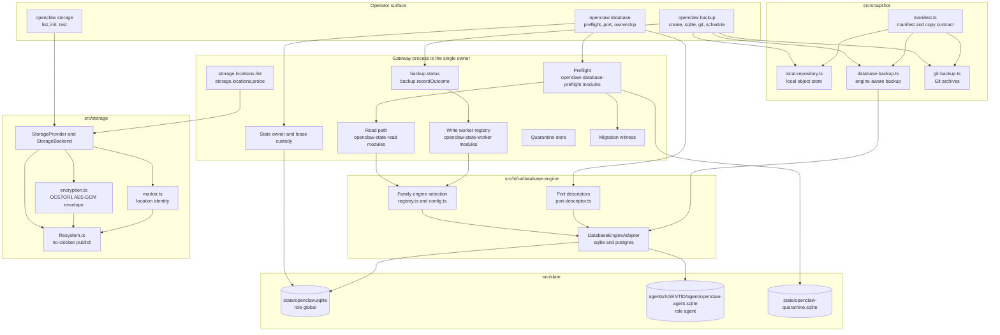
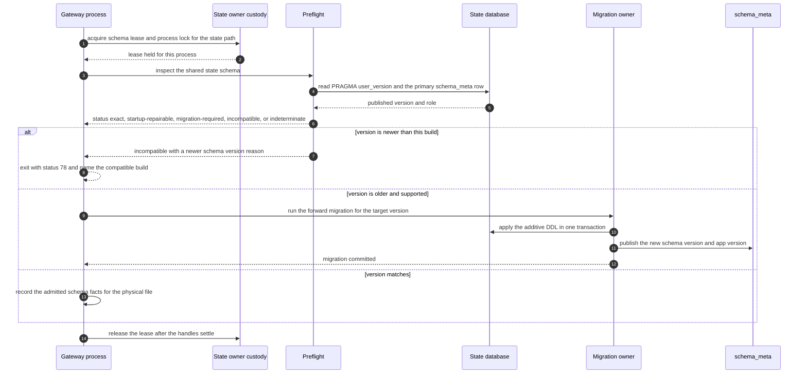
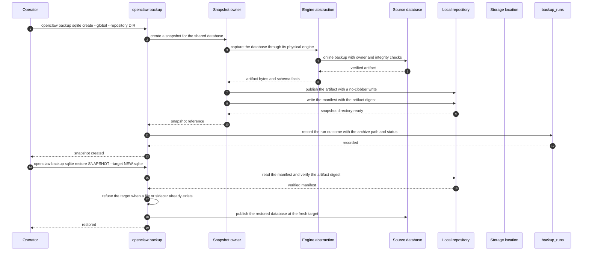
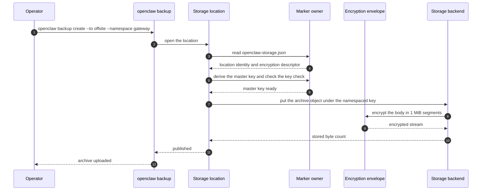

# Specification: Storage, Databases, and Backups

## Overview

The feature is five cooperating subsystems.

- The persistence layer (`src/state/`) owns the two OpenClaw databases and everything needed to open them safely. `openclaw-state-schema.sql` and `openclaw-agent-schema.sql` are the canonical DDL for the shared control-plane database and the per-agent database. `openclaw-state-db.ts` opens the shared database at `~/.openclaw/state/openclaw.sqlite`, `openclaw-agent-db.ts` opens the per-agent database at `~/.openclaw/agents/<agentId>/agent/openclaw-agent.sqlite`, and `openclaw-schema-versions.ts` owns the two version constants that `package.json` mirrors. `openclaw-state-ownership.ts` and the lease modules own single-owner admission, `openclaw-state-read*.ts` is the read path, `openclaw-state-worker*.ts` is the write worker registry, `openclaw-database-preflight*.ts` is the preflight, `openclaw-quarantine-store.ts` and `openclaw-migration-witness.ts` own quarantine and migration witnesses, and the `openclaw-state-db-schema-v*.ts` modules are the additive migrations. The domain repositories `user-profiles*.ts`, `user-preferences*.ts`, `user-model-accounts.ts`, `user-github-connections.ts`, `user-channel-identities.ts`, and `session-repository-workspaces*.ts` read and write through that layer.
- The engine abstraction (`src/infra/database-engine/`) sits under the persistence layer. `contract.ts` defines the adapter, `adapters.ts` holds the SQLite and PostgreSQL adapters, `config.ts` and `registry.ts` resolve the per-family engine selection, `admission-scope.ts` decides which thread may run engine SQL, and the port modules (`port-descriptor.ts`, `port-command.worker.ts`, `agent-port-descriptor.ts`) move stores between engines.
- The snapshot layer (`src/snapshot/`) produces portable copies. `manifest.ts` owns the snapshot manifest and copy contract, `local-repository.ts` is the Git-backed local repository object store, `database-backup.ts` and `database-backup-core.worker.ts` own engine-aware database backups, `git-backup.ts` and `git-backup-codec.ts` own the Git-backed backup archives, and `openclaw-snapshot-copy.ts` owns the shared copy contract that both the snapshot and the Git path use.
- The storage layer (`src/storage/`) owns named destinations. `types.ts` defines the `StorageProvider` and `StorageBackend` contracts, `filesystem.ts` is the built-in filesystem provider with no-clobber publish, `encryption.ts` is the chunked streaming AES-GCM envelope with a per-location key, `keys.ts` holds the portable object key rules, and `marker.ts` owns the per-location marker file that holds location identity.
- The operator surface is the CLI and the Gateway. `openclaw database`, `openclaw backup`, and `openclaw storage` are the three command groups, and the Gateway exposes `backup.status`, `backup.recordOutcome`, `storage.locations.list`, and `storage.locations.probe`.

The generated PostgreSQL DDL under `src/state/postgres-schema.generated/` is generated output. It is produced by the generator from the SQLite sources and the plugin family schemas, and it is never hand-edited.

## Architecture

## Data Models

The full catalog of the two databases is in [`.sdlc/context/schema.dbml`](../../context/schema.dbml), which records 206 tables with their columns, types, constraints, and indexes.
The tables below are the ones that carry this feature's own contracts.

### Shared state database (role `global`)

| Field | Type | Constraints | Description |
|---|---|---|---|
| path | string | Absolute, resolved from the state directory | `~/.openclaw/state/openclaw.sqlite` |
| role | string | `global` in `schema_meta` | The shared control plane |
| schema version | integer | 28 | Published shared state schema version |

The shared database holds shared configuration state, registries, approvals, plugin state, and shared runtime state.
Its domain tables include `config_machine_state`, `agent_databases`, `user_preferences`, `session_repository_workspaces`, and `backup_runs`.

### Per-agent database (role `agent`)

| Field | Type | Constraints | Description |
|---|---|---|---|
| path | string | Absolute, resolved from the state directory | `~/.openclaw/agents/<agentId>/agent/openclaw-agent.sqlite` |
| role | string | `agent` in `schema_meta` | The agent data plane |
| agent id | string | Recorded in `schema_meta.agent_id` | Owning agent |
| schema version | integer | 31 | Published per-agent schema version |

The per-agent database holds sessions, transcripts, memory indexes, auth state, and conversation state.
Its canonical DDL is `src/state/openclaw-agent-schema.sql`.

### `schema_meta` (both databases)

| Field | Type | Constraints | Description |
|---|---|---|---|
| meta_key | text | Not null, primary key | `primary` for the owning row |
| role | text | Not null | `global` for the shared database, `agent` for a per-agent database |
| schema_version | integer | Not null | Published schema version, equal to `PRAGMA user_version` |
| agent_id | text | Nullable | Owning agent for an agent database, null for the shared database |
| app_version | text | Nullable | The OpenClaw build that last wrote the schema metadata |
| created_at | integer | Not null | Creation timestamp |
| updated_at | integer | Not null | Last update timestamp |

### `state_leases` (shared database)

| Field | Type | Constraints | Description |
|---|---|---|---|
| scope | text | Not null, part of the primary key | Lease namespace, for example `shared` |
| lease_key | text | Not null, part of the primary key | Lease name inside the scope |
| owner | text | Not null | Owner token that identifies the holder |
| expires_at | integer | Nullable | Expiry in epoch milliseconds |
| heartbeat_at | integer | Nullable | Last heartbeat timestamp |
| payload_json | text | Nullable | Optional owner-published facts |
| created_at | integer | Not null | Creation timestamp |
| updated_at | integer | Not null | Last update timestamp |
| Primary key | | (`scope`, `lease_key`) | |
| Index | | `idx_state_leases_expiry` on (`expires_at`, `scope`, `lease_key`) where `expires_at` is not null | |
| Index | | `idx_state_leases_owner` on (`owner`) | |

### External ownership record (shared database, `config_machine_state`)

| Field | Type | Constraints | Description |
|---|---|---|---|
| state_key | text | Not null, primary key, value `gateway.supervision` | Reserved key for the ownership record |
| value_json | text | Not null | Exactly the keys `claimedAt`, `managerId`, `mode`, `version` |
| updated_at_ms | integer | Not null | Last update timestamp |

The record has `version` 1, `mode` `external`, a `managerId` that is a 1 to 128 character ASCII identifier, and a `claimedAt` timestamp.
Any other key set is a typed metadata error rather than an unclaimed database.

### `agent_databases` (shared database)

| Field | Type | Constraints | Description |
|---|---|---|---|
| agent_id | text | Not null, part of the primary key | Owning agent |
| path | text | Not null, part of the primary key | Agent database path, state-relative since schema 9 |
| schema_version | integer | Not null | Observed schema version of that database |
| last_seen_at | integer | Not null | Last time the process observed the database |
| size_bytes | integer | Nullable | Observed file size |

### `backup_runs` (shared database)

| Field | Type | Constraints | Description |
|---|---|---|---|
| id | text | Not null, primary key | Run identifier |
| created_at | integer | Not null | Run timestamp |
| archive_path | text | Not null | Archive, snapshot, or commit path |
| status | text | Not null | `ok` or `failed` |
| manifest_json | text | Not null | Additive manifest: `kind`, `target`, `namespace`, `error`, `pushFailed`, `bytes`, `location`, `retention` |
| Index | | `idx_backup_runs_created` on (`created_at` desc, `id`) | |

The `kind` field is one of `archive`, `sqlite-snapshot`, `git`, or `external`.
The `location` field records the storage name, provider, location identifier, object key, namespace, and the plaintext and stored byte counts.
The `retention` field records the kept and deleted counts.
Manifest fields are truncated on write: the target to 512 characters and the error text to 1200 characters.

### Storage location marker (`openclaw-storage.json` at the destination root)

| Field | Type | Constraints | Description |
|---|---|---|---|
| version | integer | Literal 1 | Marker format version |
| locationId | uuid | Not null | Identity of this location, distinct per initialization |
| createdAt | integer | Not null, nonnegative | Initialization timestamp in epoch milliseconds |
| encryption | object | `none` or a scrypt descriptor | The location encryption choice |

The scrypt descriptor holds `kdf` `scrypt`, a base64 16 byte `salt`, the literals `N` 32768, `r` 8, and `p` 1, and a base64 32 byte `keyCheck`.
The key check is an HMAC-SHA256 of a fixed check string under the derived master key, compared in constant time.
The marker never holds the master key or the passphrase.

### Encrypted storage object envelope (version 1)

| Field | Type | Constraints | Description |
|---|---|---|---|
| magic | bytes | `OCSTOR1\n` | Envelope preamble |
| header length | uint32 big endian | Bounded by 1024 bytes | Length of the JSON header |
| header | JSON | `v` 1, `objSalt` base64 32 bytes, `noncePrefix` base64 7 bytes, `segmentBytes` 1048576 | Per-object key material and segment size |
| segments | bytes | 1 MiB plaintext each, 16 byte GCM tag each | AES-256-GCM ciphertext with the header as additional data |

The per-object key is HKDF-SHA256 over the location master key with the per-object salt.
The nonce is the 7 byte prefix plus a 4 byte segment index, with the last byte marking the final segment.
The plaintext size is computable from the stored size alone, so a provider does not have to decrypt to report a size.

### Snapshot manifest (`manifest.json` in a snapshot directory)

| Field | Type | Constraints | Description |
|---|---|---|---|
| schemaVersion | integer | Literal 1 | Manifest format version |
| snapshotId | string | `^[a-zA-Z0-9][a-zA-Z0-9._-]{0,254}$`, equal to the directory name | Snapshot identity |
| createdAt | string | Canonical ISO 8601 | Creation timestamp |
| database.role | string | `global`, `agent`, or `generic` | Which database the snapshot holds |
| database.agentId | string | Required for `agent`, a canonical agent id | Owning agent |
| database.id | string | Required for `generic` | Store identity for a plugin store |
| database.basename | string | A bare file name | Source database file name |
| database.userVersion | integer | Signed 32 bit | SQLite user version of the source |
| artifact.path | string | `database.sqlite` | Artifact file name inside the snapshot directory |
| artifact.sha256 | string | 64 lowercase hex characters | Digest of the artifact bytes |
| artifact.sizeBytes | integer | Positive safe integer | Artifact size |

The manifest accepts exactly the listed keys. Any extra key is refused.

### Git backup manifest (`manifest.json` in a Git backup scope)

| Field | Type | Constraints | Description |
|---|---|---|---|
| schemaVersion | integer | 1 or 2 | Manifest format version |
| identity | object | `global`, `agent`, or `generic` | Which database the dump holds |
| postgresSource | object | Optional | `storeId` and `namespace` for a PostgreSQL source |
| userVersion | integer | Not null | SQLite user version of the source |
| excludedTables | string[] | Not null | Tables omitted from the dump, for example `backup_runs` and the transcript FTS tables |
| excludedConfigStateKeyPrefixes | string[] | Not null | Configuration state key prefixes omitted from the dump |
| tables | object | Per table, a row count and a SHA-256 digest | Content digest per dumped table |

### `state_leases` and the gateway state lock file

The lease table above is the durable cross-process record.
Alongside it, the Gateway holds a filesystem state lock under the state lock directory, named `state.<hash>.lock` for the canonical database path, and the Gateway's own `gateway.state.lock` in the same directory.
Those files are the process-level owner, not the database-level one.

## API Contracts

The normative contract is in [`api.yaml`](api.yaml) (OpenAPI 3), written alongside this document.
OpenClaw's Gateway is a WebSocket and HTTP JSON-RPC surface, not a REST API, so `api.yaml` models each RPC method as a path under a synthetic `/rpc` root and records the method name, the request payload, and the response payload.
The CLI is the primary operator surface for this feature and is listed in the summary table below.
`api.yaml` covers only the four Gateway methods, because the CLI commands are terminal invocations rather than an HTTP surface.

There is no `database.*` Gateway method.
The Gateway owns the databases process-side, and the operator reaches that ownership through the CLI, through the `backup.*` and `storage.locations.*` methods below, and through the `doctor`, `health`, and `system` method families that report on the runtime that owns the databases.

| Method | Path | Purpose |
|---|---|---|
| RPC | `backup.status` | Report the recorded backup runs, the scheduled backup jobs, and the configured storage locations |
| RPC | `backup.recordOutcome` | Record one external backup run outcome in the shared `backup_runs` table |
| RPC | `storage.locations.list` | List the configured storage locations with their provider, display target, and encryption choice |
| RPC | `storage.locations.probe` | Check one storage location for its marker, its encryption key, and its capacity |
| CLI | `openclaw database port` | Port existing database stores offline between SQLite and PostgreSQL |
| CLI | `openclaw database preflight` | Compare one copied SQLite file with this release's shared state schema |
| CLI | `openclaw database preflight-agent` | Compare one copied agent SQLite file with this release's agent schema and owner |
| CLI | `openclaw database verify-preservation` | Compare retained recovery captures without changing state or authorizing activation |
| CLI | `openclaw database restore-migration-backup` | Restore a scoped migration backup's tables and schema version while offline |
| CLI | `openclaw database ownership status` | Show the durable shared-state write ownership |
| CLI | `openclaw database ownership claim` | Claim shared-state writes for the active external supervisor |
| CLI | `openclaw backup create` | Write a backup archive for config, credentials, sessions, and workspaces |
| CLI | `openclaw backup list` | List archives in a storage location |
| CLI | `openclaw backup record` | Record an external backup job outcome |
| CLI | `openclaw backup enable` | Provision a Gateway automation for offsite or Git backups |
| CLI | `openclaw backup disable` | Remove both scheduled backup modes, or the selected mode |
| CLI | `openclaw backup git init` | Initialize or adopt an operator-owned Git backup repository |
| CLI | `openclaw backup git create` | Dump selected OpenClaw databases and commit one Git revision |
| CLI | `openclaw backup git log` | Show Git backup commits |
| CLI | `openclaw backup sqlite create` | Create a compact, verified snapshot of an OpenClaw SQLite database |
| CLI | `openclaw backup sqlite list` | List committed snapshots in a repository |
| CLI | `openclaw storage list` | List storage locations and check their availability |
| CLI | `openclaw storage init` | Initialize a new location or verify its existing marker and encryption key |
| CLI | `openclaw storage test` | Write, read, verify, and delete a temporary check object |

Error codes shared across endpoints:

| Status | Code | Description |
|---|---|---|
| 400 | INVALID_REQUEST | The parameters failed validation, for example a storage location name outside the allowed pattern |
| 403 | FORBIDDEN | The caller lacks the operator scope the method requires, `operator.read` for the reads and `operator.admin` for `backup.recordOutcome` |
| 503 | UNAVAILABLE | The backing store was not available for the call, or the local state owner changed while the mutation was in flight, which is reported with the detail `STATE_OWNER_CHANGED` and `mutationAccepted: false` |

## Sequences

### Schema migration on open

### Creating and restoring a backup

### Publishing an encrypted archive to a storage location

## Technical Decisions

| Decision | Choice | Rationale |
|---|---|---|
| Database split | One shared control-plane database and one database per agent | The control plane and the agent data plane have different lifetimes, different owners, and different retention rules, so one file cannot serve both |
| Canonical DDL | The two SQLite SQL files own the table definitions, and the PostgreSQL DDL is generated from them | One source of truth means the two engines cannot drift, and the generated tree stays disposable |
| Schema versioning | The version lives in `PRAGMA user_version` and in the primary `schema_meta` row | The header value is what SQLite itself compares, and the row carries the role and the writing build, so a mismatched or foreign file is detectable |
| Version constants | `src/state/openclaw-schema-versions.ts` is the code-side source of truth, and `package.json` mirrors it | A build that claims support for a version it cannot open is worse than a build that refuses, so the two are asserted equal |
| Migration direction | Forward only, with a version bump for anything an older reader cannot ignore | Downgrading a migrated database silently loses meaning, so the older build refuses instead |
| Ownership model | The Gateway process owns every database, and other processes route through it or take exclusive offline ownership | Two live writers on one SQLite file corrupt the write receipts and the caches that depend on them |
| External ownership | A reserved `config_machine_state` row holds the manager identity, and the claim is fenced by the schema lease | The record has to survive a restart of every process, and the claim has to be exclusive |
| Lease storage | Leases live in the `state_leases` table rather than in files | A lease that a crashed process left behind has to be reclaimable by expiry, which a table supports |
| Preflight | One preflight classifies a database as exact, startup-repairable, migration-required, incompatible, or indeterminate, and both the CLI and the startup path use it | The operator and the Gateway must reach the same conclusion about the same file, or one of them opens a database the other considers broken |
| Integrity checks | Format, schema, required index, and integrity checks run once per physical database per process load, with a clean-close seal for reuse | A per-request check would put a disk round trip on every read, and the facts do not change between requests |
| Quarantine | A failed database is recorded in a separate quarantine store and refused on the next open | Repairing a corrupt file in place destroys the evidence, so the refusal has to be durable |
| Engine abstraction | One `DatabaseEngineAdapter` interface with a SQLite and a PostgreSQL implementation | Feature code should not branch on the engine, and the transaction, error classification, and schema admission behavior should be decided in one place |
| PostgreSQL status | Experimental, and SQLite stays the default | The PostgreSQL adapter is newer than the SQLite path, so the default has to stay on the proven engine |
| Porting | Ports run offline, are scoped by family, and write a manifest that supports resume and rollback | A port that can only be interrupted leaves the operator without a way back, and a family-scoped port limits the blast radius |
| Storage identity | An explicit `openclaw-storage.json` marker at the destination root, written only by `openclaw storage init` | An unplugged disk or an empty mount point must not silently become a new destination |
| Storage encryption | A per-location master key derived with scrypt, and a per-object AES-256-GCM envelope with HKDF-derived keys | One location's key must not decrypt another location's objects, and a streaming envelope keeps a large archive out of memory |
| Object keys | A restricted portable character set with no `.` or `..` segments, at most 512 bytes | The same key has to work on a local filesystem and on an object store |
| No-clobber publish | A published object never replaces an existing key | A backup must not silently overwrite the previous good copy |
| Snapshot manifest | A strict manifest with a digest, a size, and the source identity | A copy that cannot be verified from its own contents is not a recovery point |
| Restore target | A restore only ever writes to a fresh path with no file and no sidecar | Restoring over a live database is how an operator loses the only good copy |
| Backup ledger | A bounded `backup_runs` table in the shared database, written through the shared worker | The freshness of the last backup is operational state that belongs with the other shared state, and it must not create a database on a fresh host |
| Backup archives | Archives, per-database snapshots, and Git dumps are separate artifacts with separate owners | An archive is broad and slow, a snapshot is narrow and verifiable, and a Git dump is diffable and reviewable, so one format cannot serve all three |

## Risks and Unknowns

1. The shared state database is SQLite by default, and the PostgreSQL adapter is experimental, so an installation that moves a family to PostgreSQL depends on a path with less operational history.
2. The schema version constants are duplicated between `src/state/openclaw-schema-versions.ts` and `package.json`, and a mismatch is caught by a test rather than by the build, so a release that skips the test would ship a build that claims a version it cannot open.
3. The ownership record has a `claimedAt` timestamp but no expiry, so a claim left behind by a removed supervisor blocks shared-state writes until an operator claims it with the same manager identifier.
4. The storage marker holds a scrypt key check but no key-rotation path, so changing the passphrase of an initialized location is refused rather than migrated.
5. The `backup_runs` table keeps a bounded window of runs, so the ledger can report freshness for recent backups but not for an old archive whose file has already been deleted.
6. The `state_leases` table and the filesystem state lock are separate mechanisms with separate failure modes, and a process that dies between renewing one and releasing the other can leave a stale lease that only the expiry bound clears.
7. The clean-close seal is a reconstructible cache of the admitted facts, and a wrong or stale seal would let a damaged database pass admission, so the seal carries a checksum and the physical file identity and is still checked on every reuse.
8. The `user_profiles` table exists in the PostgreSQL family schema and in the SQLite feature schema, but the two are maintained by separate owners, so a change to one has to be mirrored in the other.

## Out of Scope

- The table catalog itself.
  The full list of the 206 tables, their columns, and their indexes is in [`.sdlc/context/schema.dbml`](../../context/schema.dbml), and the SQL sources remain the canonical definition.
- The generated PostgreSQL DDL under `src/state/postgres-schema.generated/`.
  It is generated output, is regenerated from the SQLite sources and the plugin family schemas, and is not hand-edited.
- The business behavior of the domain repositories that read and write through the persistence layer, including the user profile merge rules, the personal model account rules, and the GitHub publication lifecycle.
- The session, transcript, memory, and channel behavior stored in the per-agent database.
- The plugin-defined database families, their own schemas, and their own backup policies.
- The archive format and the manifest of the broad `openclaw backup create` archive beyond the entries this feature records in `backup_runs`.
- The storage provider plugins themselves.
  This feature owns the `StorageProvider` and `StorageBackend` contracts, the location identity, the encryption envelope, and the built-in filesystem provider.
- The `openclaw update` and `openclaw doctor` command flows, except where they intersect with database preflight, migration, and backup coverage.
- The Control UI surfaces that display backup and storage state.
