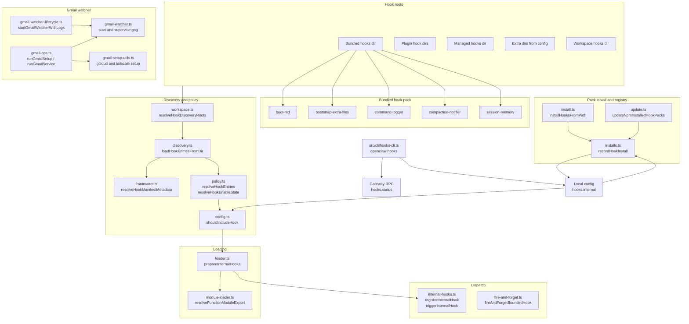
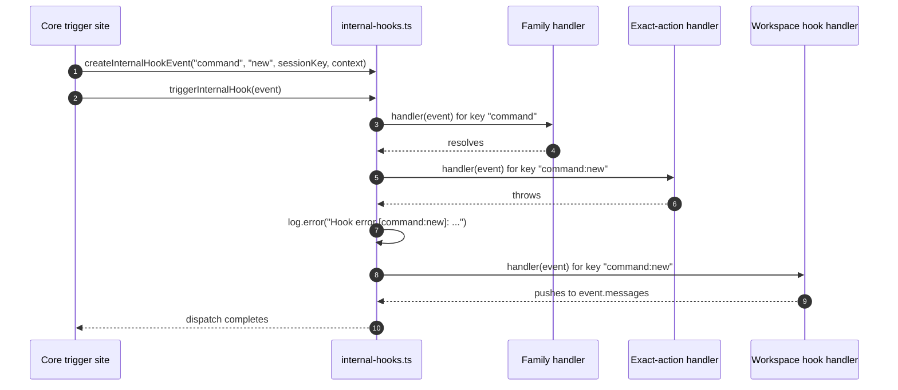
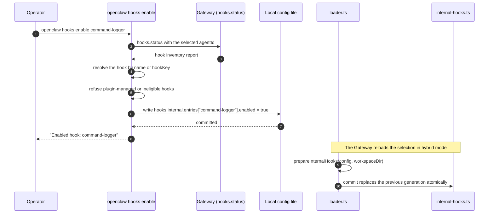

# Specification: Internal Event Hooks

## Overview

The internal event hook subsystem is a file-based extension model for the OpenClaw Gateway. A hook is a directory that holds a `HOOK.md` descriptor and one handler module. Discovery walks five roots, reads each descriptor through the boundary file reader, resolves the `metadata.openclaw` frontmatter into a typed metadata record, and merges the resulting entries by hook name under a fixed source precedence. A policy layer then decides two independent things: whether the hook is enabled by config, and whether its runtime requirements are satisfied on the current host. The loader imports the surviving handler modules behind a boundary check, resolves the declared export, and registers it against the internal event dispatcher for each declared event key. Dispatch runs family subscribers before exact-action subscribers and isolates handler failures. Config reload prepares a complete replacement generation before publishing it, so a failed reload never leaves the Gateway without its previously committed handlers. The operator surface is the `openclaw hooks` command, which reports the discovered inventory through the `hooks.status` Gateway RPC method and toggles per-hook enablement by writing `hooks.internal.entries.<hookKey>.enabled` into local config. Hook packs install through the unified plugin installer and record provenance in shared SQLite state under the `hooks.internal.installs` state key. A built-in Gmail watcher completes the feature by provisioning and supervising the `gog` watch and serve processes so inbound mail becomes assistant work.

## Architecture

## Data Models

### Hook descriptor (HOOK.md frontmatter)

The descriptor is a Markdown file with YAML frontmatter. Only the fields below are read; the Markdown body is documentation.

| Field | Type | Constraints | Description |
|---|---|---|---|
| `name` | string | Defaults to the directory name | Unique hook name used for discovery collisions and default config key |
| `description` | string | Optional | One-line summary shown in `hooks list` and `hooks info` |
| `homepage` | string | Optional | Documentation URL; `metadata.openclaw.homepage` overrides it |
| `metadata.openclaw.events` | string[] | At least one required for loadability | Event keys the handler subscribes to, exact (`command:new`) or family (`command`) |
| `metadata.openclaw.export` | string | Optional, defaults to `default` | Module export name resolved as the handler function |
| `metadata.openclaw.hookKey` | string | Optional, defaults to the hook name | Config entry key under `hooks.internal.entries` |
| `metadata.openclaw.emoji` | string | Optional | Display emoji in reports |
| `metadata.openclaw.os` | string[] | Optional | Allowed Node platform names such as `darwin`, `linux`, `win32` |
| `metadata.openclaw.requires.bins` | string[] | Optional | Every named executable must be on `PATH` |
| `metadata.openclaw.requires.anyBins` | string[] | Optional | At least one named executable must be on `PATH` |
| `metadata.openclaw.requires.env` | string[] | Optional | Every named variable needs a nonblank process value or a per-hook `env` value |
| `metadata.openclaw.requires.config` | string[] | Optional | Every dotted config path must be truthy |
| `metadata.openclaw.always` | boolean | Optional | Bypasses binary, environment, and config requirements; does not bypass OS or enablement |
| `metadata.openclaw.install` | object[] | Optional | Informational install descriptors with `kind` in `bundled`, `npm`, `git`, plus optional `id`, `label`, `package`, `repository`, `bins` |

The legacy `metadata.clawdbot` block is not read. The pre-July 2026 `metadata.openclaw` value is the only supported metadata namespace.

### Hook config entry (`hooks.internal.entries.<hookKey>`)

| Field | Type | Constraints | Description |
|---|---|---|---|
| `enabled` | boolean | Optional, defaults to enabled for non-workspace sources | Per-hook activation flag |
| `env` | Record<string, string> | Optional | Per-hook environment values that satisfy `requires.env`; does not mutate `process.env` |
| other keys | any | Passthrough | Handler-defined options, not validated by core |

### Internal hook config block (`hooks.internal`)

| Field | Type | Constraints | Description |
|---|---|---|---|
| `enabled` | boolean | Optional | Master switch for directory hooks; `false` disables all internal hooks |
| `entries` | Record<string, HookConfig> | Optional | Per-hook entries keyed by `hookKey` |
| `load.extraDirs` | string[] | Optional | Extra discovery roots; a nonempty list makes discovery open-ended |

### Hook install record (shared SQLite state)

Install provenance is stored as a single JSON document in the `config_machine_state` table under the state key `hooks.internal.installs`. There is no dedicated hook table.

| Column | Type | Constraints | Description |
|---|---|---|---|
| `state_key` | TEXT | PRIMARY KEY, not null | Literal value `hooks.internal.installs` |
| `value_json` | TEXT | not null | JSON object mapping hook pack id to a `HookInstallRecord` |
| `updated_at_ms` | INTEGER | not null | Write timestamp in milliseconds |

Each `HookInstallRecord` entry carries the shared install record fields (`source`, `spec`, `sourcePath`, `installPath`, `version`, `resolvedName`, `resolvedVersion`, `resolvedSpec`, `integrity`, `shasum`, `resolvedAt`, `installedAt`, `npmIntegrity`, `npmShasum`, `npmTarballName`, `gitUrl`, `gitRef`, `gitCommit`) plus the hook-specific field `hooks: string[]`, the hook names the pack declared.

### Internal hook event

| Field | Type | Constraints | Description |
|---|---|---|---|
| `type` | string | One of `command`, `session`, `agent`, `gateway`, `message` | Event family |
| `action` | string | Not null | Action within the family, such as `new` or `compact:before` |
| `sessionKey` | string | Not null | Session correlation key; Gateway events use a Gateway key |
| `context` | Record<string, unknown> | Not null | Producer-specific payload; `cfg` is not present on every event |
| `timestamp` | Date | Not null | Creation time of the event object |
| `messages` | string[] | Initially empty | Reply buffer; only certain producers consume it |

### Native hook relay bridge (`native_hook_relay_bridges`)

| Column | Type | Constraints | Description |
|---|---|---|---|
| `relay_id` | TEXT | PRIMARY KEY, not null | Relay registration identifier |
| `pid` | INTEGER | not null | Process identifier of the relay owner |
| `hostname` | TEXT | not null | Host that owns the relay |
| `port` | INTEGER | not null | Relay port |
| `token` | TEXT | not null | Relay credential; the table is listed in the secret state tables |
| `expires_at_ms` | INTEGER | not null | Expiry timestamp, indexed with `relay_id` |
| `updated_at_ms` | INTEGER | not null | Last write timestamp |

## API Contracts

The normative contract is in [`api.yaml`](api.yaml) (OpenAPI 3), written alongside this document because the feature defines a Gateway RPC surface.
The table below is a summary; request and response schemas, error response bodies, and scope requirements are in `api.yaml`.

### CLI contract (`openclaw hooks`)

| Command | Options | Purpose |
|---|---|---|
| `openclaw hooks` | `--agent <id>`, `--json` | Alias for `hooks list` |
| `openclaw hooks list` | `--agent <id>`, `--eligible`, `--json`, `-v, --verbose` | List discovered hooks with status, source, and missing requirements |
| `openclaw hooks info <name>` | `--agent <id>`, `--json` | Show one hook's paths, events, requirements, and blocked reason; exits 1 when not found |
| `openclaw hooks check` | `--agent <id>`, `--json` | Summarize ready and not-ready hooks with blocking reasons |
| `openclaw hooks enable <name>` | `--agent <id>` | Write `hooks.internal.entries.<hookKey>.enabled = true` in local config |
| `openclaw hooks disable <name>` | `--agent <id>` | Write `hooks.internal.entries.<hookKey>.enabled = false` in local config |
| `openclaw hooks relay` | `--provider`, `--relay-id`, `--event` (required), `--state-db`, `--remote-credential`, `--generation`, `--pre-tool-use-unavailable`, `--timeout` | Hidden native harness relay invocation |
| `openclaw hooks install <path-or-spec>` | `-l, --link`, `--pin`, `--force`, `--acknowledge-install-policy-warning` | Deprecated alias that forwards to `openclaw plugins install` |
| `openclaw hooks update [id]` | `--all`, `--dry-run`, `--acknowledge-install-policy-warning` | Deprecated alias that forwards to `openclaw plugins update` |

`--agent <id>` is rejected on `relay`, `install`, and `update`. A blank `--agent` value is rejected before dispatch.

### Gateway RPC contract

| Method | Scope | Purpose |
|---|---|---|
| `hooks.status` | `operator.read` | Return the hook inventory report for one agent workspace |
| `nativeHook.invoke` | `operator.admin` | Native harness relay invocation; unadvertised, not part of the internal event hook registry |

There is no `hooks.enable` or `hooks.disable` RPC method. Enable and disable mutate local config files on the host where the CLI runs.

### Config contract

| Key | Type | Owner |
|---|---|---|
| `hooks.internal.enabled` | boolean | Master switch for directory hooks |
| `hooks.internal.entries.<hookKey>.enabled` | boolean | Per-hook activation |
| `hooks.internal.entries.<hookKey>.env` | Record<string, string> | Per-hook environment values for requirement checks |
| `hooks.internal.load.extraDirs` | string[] | Extra discovery roots |
| `hooks.gmail.account` | string | Gmail account the watcher subscribes to |
| `hooks.gmail.label` | string | Gmail label to watch; defaults to `INBOX` |
| `hooks.gmail.topic` | string | Pub/Sub topic name; defaults to `gog-gmail-watch` |
| `hooks.gmail.subscription` | string | Pub/Sub subscription name; defaults to `gog-gmail-watch-push` |
| `hooks.gmail.pushToken` | string (sensitive) | Push token provisioned into the `gog` serve invocation |
| `hooks.gmail.hookUrl` | string | OpenClaw hook URL the watcher delivers to |
| `hooks.gmail.includeBody` | boolean | Whether to forward email body snippets |
| `hooks.gmail.maxBytes` | number | Body snippet byte bound; defaults to 20000 |
| `hooks.gmail.renewEveryMinutes` | number | Watch renewal interval; defaults to 720 |
| `hooks.gmail.serve.bind` | string | Serve bind host; defaults to `127.0.0.1` |
| `hooks.gmail.serve.port` | number | Serve port; defaults to 8788 |
| `hooks.gmail.serve.path` | string | Serve path; defaults to `/gmail-pubsub` |
| `hooks.gmail.tailscale.mode` | `off`, `serve`, `funnel` | Tailscale exposure mode for the push endpoint |
| `hooks.gmail.tailscale.path` | string | Tailscale serve or funnel path |
| `hooks.gmail.tailscale.target` | string | Tailscale target, for example `host:port` |
| `hooks.gmail.model` | string | Model alias used for mail triage |
| `hooks.gmail.thinking` | `off`, `minimal`, `low`, `medium`, `high` | Thinking level for mail triage |
| `hooks.token` | string (sensitive) | Shared token the Gmail watcher uses to authenticate against the Gateway hook URL |

Error codes shared across the RPC surface:

| Status | Code | Description |
|---|---|---|
| n/a | `INVALID_REQUEST` | The request parameters are invalid, for example an unknown `agentId` or a missing agent owner |

## Sequences

### An event fires and a hook handler runs

### The operator enables a hook and the Gateway picks it up

## Technical Decisions

| Decision | Choice | Rationale |
|---|---|---|
| Hook contract format | A `HOOK.md` descriptor plus a handler module in the same directory | Keeps the contract self-describing and reviewable in the same file tree as the code |
| Handler file precedence | `handler.ts`, `handler.js`, `index.ts`, `index.js`, first match wins | A stable order lets a hook ship TypeScript or plain JavaScript without a build step |
| Handler export | Default export unless `metadata.openclaw.export` names another | Matches the CommonJS and ESM default export conventions in the wider ecosystem |
| Discovery merge key | Hook name, with `hookKey` used only for the config entry | A name collision is a content conflict that the operator must see; the config key is an addressing detail |
| Source precedence | Managed (30) over plugin (20) over bundled (10); workspace (40) may add names but never replace other sources | Lets an operator override a shipped hook without letting untrusted workspace code shadow a reviewed one |
| Workspace enablement | Workspace hooks are disabled until `entries.<hookKey>.enabled` is true | Workspace code is the least trusted source, so it must opt in explicitly |
| Unknown event keys | Register the handler and emit an advisory warning | Plugins can emit keys that core does not know, so a hard failure would break legitimate integrations |
| Reload safety | Prepare a full generation, then publish it synchronously | A partially applied reload would leave the Gateway with an unpredictable mix of old and new handlers |
| Registry storage | Config file for enablement, `config_machine_state` for install provenance | Enablement is operator-authored config; install provenance is machine state that the config file must not own |
| Error isolation | Catch and log every handler error inside the dispatch loop | One bad hook must not break the command, message, or session operation that triggered it |
| Fire-and-forget bounds | 16 concurrent, 256 queued, 2000 ms informational timeout | Bounds detached work so a slow hook cannot exhaust the Gateway process |
| Gmail provisioning | Delegate to the external `gog` binary instead of implementing a Gmail client | Reuses an existing tool for OAuth, watch renewal, and Pub/Sub delivery |
| Gmail delivery path | `gog watch serve` posts to the Gateway hook URL with the shared hook token | Keeps the watcher stateless and lets the Gateway own the agent work |
| Plugin-managed hooks | Toggled by enabling the owning plugin, not by the hooks CLI | The plugin owner already holds the activation decision for its own contributions |

## Risks and Unknowns

1. Hook handlers are awaited inside the dispatch loop with no handler timeout and no cancellation signal, so a handler that never settles can delay Gateway shutdown and blocks the bounded shutdown budget.
2. Hook code runs as trusted code in the Gateway process; a malicious handler has the same filesystem, network, and environment access as the Gateway.
3. The per-hook config entry is global while `--agent` selects the inspected workspace, so an operator can enable a hook for one agent that then loads in every agent that discovers the same key.
4. Hook files and metadata are not watched, so a descriptor or code edit requires a Gateway restart and a stale handler can keep serving.
5. The `ready` and `loadable` report fields describe enablement and requirements only; they do not prove that the Gateway imported the handler or that the event ever fired.
6. The Gmail watcher depends on the external `gog` binary, a reachable Pub/Sub push endpoint, and Tailscale when that mode is selected; each of these can fail independently of the Gateway.
7. The deprecated `openclaw hooks install` and `openclaw hooks update` aliases still resolve, so operators can reach a path that the unified plugin installer now owns.

## Out of Scope

- HTTP webhooks. The Gateway HTTP hook ingress surface is configured by `hooks.enabled`, `hooks.path`, `hooks.token`, and `hooks.mappings`, and is implemented in `src/gateway/hooks.ts`. It is a separate system from the `HOOK.md` internal event hooks described here, as stated in `docs/automation/hooks.md` and `docs/automation/index.md`.
- Cron automations. Scheduled jobs live in `src/cron/` and are tracked separately; an internal event hook has no schedule and no run history.
- Typed plugin hooks. The `api.on(...)` lifecycle contract, including `before_tool_call` and `before_prompt_build`, belongs to the plugin system, not to the internal event hook registry. A plugin may contribute hook directories, and those hooks appear as `plugin:<id>` in the report.
- Standing orders, which grant the agent permanent operating authority through workspace instructions rather than event handlers.
- The internal IMAP reader plugin, which is a separate inbound mail path with sender gating and isolated reader sessions.
- Long-lived resources. Watchers, sockets, and clients belong in a plugin service with an explicit shutdown lifecycle, not in an event handler.
- The native harness relay internals. The `openclaw hooks relay` verb and the `nativeHook.invoke` method exist in the same CLI surface, but they carry native coding-harness events and are not part of the `HOOK.md` internal event hook model.
