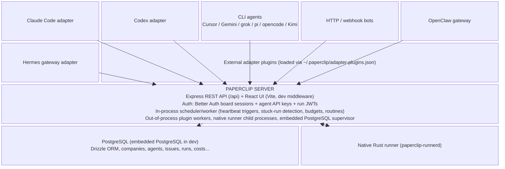

# Architecture

## System Overview

Paperclip is a Node.js control plane that orchestrates AI agents and supervises several kinds of child processes.
The main server process hosts the REST API, serves the React UI in dev middleware mode, and runs an in-process scheduler/worker.
It also supervises out-of-process plugin workers, native runner child processes, and an embedded PostgreSQL instance in dev.
Agents run in their own runtime, which can be a local provider process spawned by the server, a native Rust runner process, a gateway, or an external process that phones home over the API.
Adapters translate heartbeats into whatever runtime each agent lives in.
Entry points are `server/src/index.ts` (`startServer`), `server/src/app.ts` (`createApp`), `ui/src/main.tsx`, and `cli/src/index.ts`.

## Entity Relationship Diagram

The full detailed database schema (types, constraints, indexes) lives in `.sdlc/context/schema.dbml`.
The diagram below shows the core domain entities and their relationships only.

```mermaid
erDiagram
  companies {
    uuid id
    string name
    string status
    int budget_monthly_cents
    numeric spent_monthly_cents
  }
  agents {
    uuid id
    uuid company_id
    string name
    string status
    uuid reports_to
    string adapter_type
    uuid default_environment_id
    int budget_monthly_cents
    int spent_monthly_cents
  }
  goals {
    uuid id
    uuid company_id
    string title
    string level
    string status
    uuid parent_id
    uuid owner_agent_id
  }
  projects {
    uuid id
    uuid company_id
    uuid goal_id
    string name
    string status
    uuid lead_agent_id
  }
  issues {
    uuid id
    uuid company_id
    uuid project_id
    uuid goal_id
    uuid parent_id
    string status
    uuid assignee_agent_id
    string assignee_user_id
    uuid checkout_run_id
    uuid execution_run_id
    int request_depth
  }
  heartbeat_runs {
    uuid id
    uuid company_id
    uuid agent_id
    string status
    string invocation_source
  }
  heartbeat_run_events {
    bigserial id
    uuid company_id
    uuid run_id
    uuid agent_id
    bigint seq
    string event_type
  }
  cost_events {
    uuid id
    uuid company_id
    uuid agent_id
    uuid issue_id
    uuid project_id
    uuid goal_id
    uuid heartbeat_run_id
    uuid subscription_id
    string usage_kind
    string provider
    string model
    string biller
    string cost_status
    numeric cost_cents
  }
  budget_policies {
    uuid id
    uuid company_id
    string scope_type
    uuid scope_id
    int amount
    boolean hard_stop_enabled
  }
  pipelines {
    uuid id
    uuid company_id
    uuid project_id
    string key
    string name
  }
  pipeline_stages {
    uuid id
    uuid pipeline_id
    string key
    string kind
    int position
  }
  pipeline_transitions {
    uuid id
    uuid pipeline_id
    uuid from_stage_id
    uuid to_stage_id
  }
  pipeline_cases {
    uuid id
    uuid company_id
    uuid pipeline_id
    uuid stage_id
    string case_key
    uuid parent_case_id
  }
  workflows {
    uuid id
    uuid company_id
    string name
  }
  cases {
    uuid id
    uuid company_id
    uuid project_id
    uuid work_issue_id
    uuid workflow_id
    string identifier
    string case_type
    string status
    uuid parent_case_id
  }
  case_issue_links {
    uuid id
    uuid company_id
    uuid case_id
    uuid issue_id
    string role
  }
  approvals {
    uuid id
    uuid company_id
    string type
    string status
    uuid requested_by_agent_id
    string requested_by_user_id
    string decided_by_user_id
  }
  company_secrets {
    uuid id
    uuid company_id
    string scope
    string key
    string provider
    string status
    string owner_user_id
    uuid owner_agent_id
    uuid owner_project_id
    uuid owner_plugin_id
    int latest_version
  }
  agent_api_keys {
    uuid id
    uuid company_id
    uuid agent_id
    string key_hash
  }
  activity_log {
    uuid id
    uuid company_id
    string actor_type
    string action
    string entity_type
    string entity_id
    uuid run_id
  }
  routines {
    uuid id
    uuid company_id
    uuid assignee_agent_id
    string title
    string status
    string concurrency_policy
  }
  routine_triggers {
    uuid id
    uuid company_id
    uuid routine_id
    string kind
    timestamp next_run_at
  }
  routine_runs {
    uuid id
    uuid company_id
    uuid routine_id
    uuid trigger_id
    uuid linked_issue_id
    string status
  }
  documents {
    uuid id
    uuid company_id
    string title
    string format
    int latest_revision_number
  }
  issue_comments {
    uuid id
    uuid company_id
    uuid issue_id
    uuid author_agent_id
    string author_user_id
  }
  assets {
    uuid id
    uuid company_id
    string provider
    string object_key
  }
  auth_users {
    string id
    string email
    string name
  }
  company_memberships {
    uuid id
    uuid company_id
    string principal_type
    string principal_id
  }
  tool_connections {
    uuid id
    uuid company_id
    uuid application_id
    string transport
    string auth_kind
  }
  connection_grants {
    uuid id
    uuid company_id
    uuid connection_id
    string kind
    string subject_user_id
    uuid subject_agent_id
  }
  environments {
    uuid id
    string name
    string driver
    string status
  }
  execution_workspaces {
    uuid id
    uuid company_id
    uuid project_id
    uuid source_issue_id
    string mode
    string status
  }
  companies ||--o{ agents : "employs"
  agents ||--o{ agents : "reports_to (strict tree)"
  companies ||--o{ goals : "defines"
  goals ||--o{ goals : "parent/child"
  agents ||--o{ goals : "owns"
  companies ||--o{ projects : "has"
  goals ||--o{ projects : "groups"
  agents ||--o{ projects : "leads"
  companies ||--o{ issues : "tracks"
  projects ||--o{ issues : "contains"
  goals ||--o{ issues : "advances"
  issues ||--o{ issues : "parent/child"
  agents ||--o{ issues : "assigned (single assignee)"
  agents ||--o{ heartbeat_runs : "executes"
  heartbeat_runs ||--o{ heartbeat_run_events : "logs"
  issues ||--o{ heartbeat_runs : "checked out by"
  agents ||--o{ cost_events : "incurs"
  issues ||--o{ cost_events : "attributes"
  heartbeat_runs ||--o{ cost_events : "reports"
  companies ||--o{ budget_policies : "enforces"
  companies ||--o{ pipelines : "owns"
  projects ||--o{ pipelines : "scopes"
  pipelines ||--o{ pipeline_stages : "has"
  pipelines ||--o{ pipeline_cases : "tracks"
  pipeline_stages ||--o{ pipeline_cases : "holds"
  pipeline_cases ||--o{ pipeline_cases : "parent/child"
  companies ||--o{ cases : "owns"
  cases ||--o{ cases : "parent/child"
  companies ||--o{ approvals : "gates"
  agents ||--o{ approvals : "requests"
  companies ||--o{ company_secrets : "vaults"
  agents ||--o{ agent_api_keys : "authenticates"
  companies ||--o{ agent_api_keys : "scopes"
  companies ||--o{ activity_log : "audits"
  heartbeat_runs ||--o{ activity_log : "attributes"
  agents ||--o{ budget_policies : "agent scope"
  projects ||--o{ budget_policies : "project scope"
  pipelines ||--o{ pipeline_transitions : "has"
  pipeline_stages ||--o{ pipeline_transitions : "from/to"
  workflows ||--o{ cases : "defines"
  issues ||--o| cases : "work issue"
  cases ||--o{ case_issue_links : "links"
  issues ||--o{ case_issue_links : "linked by"
  companies ||--o{ routines : "defines"
  agents ||--o{ routines : "assigns"
  routines ||--o{ routine_triggers : "scheduled by"
  routines ||--o{ routine_runs : "executes"
  routine_triggers ||--o{ routine_runs : "fires"
  issues ||--o{ routine_runs : "linked issue"
  companies ||--o{ documents : "stores"
  issues ||--o{ issue_comments : "discusses"
  auth_users ||--o{ issue_comments : "authors"
  companies ||--o{ assets : "stores"
  auth_users ||--o{ company_memberships : "joins"
  companies ||--o{ tool_connections : "configures"
  tool_connections ||--o{ connection_grants : "grants"
  agents ||--o{ connection_grants : "receives"
  environments ||--o{ agents : "default for"
  companies ||--o{ execution_workspaces : "owns"
  projects ||--o{ execution_workspaces : "scopes"
  issues ||--o{ execution_workspaces : "sources"
```

## Key Components

| Component | Responsibility | Technology |
|---|---|---|
| `server/` | Express REST API, auth, orchestration services, in-process scheduler, out-of-process plugin workers, native runner child processes, embedded PostgreSQL supervisor | Node.js, TypeScript, Express |
| `ui/` | Board operator interface (dashboard, org chart, tasks, approvals, costs) | React, Vite, TypeScript |
| `packages/db/` | Drizzle schema, migrations, DB clients (Postgres or embedded PostgreSQL via `embedded-postgres`); legacy `pglite` database mode maps to `embedded-postgres` in `runtime-config.ts` | Drizzle ORM, PostgreSQL, embedded-postgres |
| `packages/shared/` | Shared API types, constants, validators, API path constants | TypeScript |
| `packages/adapters/` | Adapter package implementations (claude-local, codex-local, cursor-local, cursor-cloud, gemini-local, grok-local, kimi-local, opencode-local, pi-local, hermes, hermes-gateway, openclaw-gateway; shared ACPX engine lives in `packages/adapter-utils/`) | TypeScript |
| `packages/adapter-utils/` | Shared adapter utilities | TypeScript |
| `packages/plugins/` | Plugin system: SDK, create-paperclip-plugin, sandbox providers, example plugins | TypeScript |
| `packages/mcp-server/`, `packages/google-sheets-mcp-server/`, `packages/kv-demo-mcp-server/` | MCP servers (control-plane stdio, Google Sheets, KV demo) | TypeScript |
| `packages/paperclip-runner/`, `packages/paperclip-eval-kernel/` | Native runner protocol, process supervision, and provider-neutral eval matrix orchestration (Rust production runner under `packages/paperclip-runner/runner/`) | TypeScript, Rust |
| `packages/skills-catalog/`, `packages/teams-catalog/` | Skills and teams catalogs | TypeScript |
| `skills/` | Paperclip runtime/operational skills (not part of the app catalog) | Markdown, scripts |
| `server/src/realtime/` | WebSocket real-time events (live dashboards, terminal sessions, runner PRP) | TypeScript, WebSocket |
| `server/src/services/tool-access.ts`, `tool-gateway.ts` | Third-party tool/connection integration (OAuth, MCP/SSE gateways, access policies, runtime slots) | TypeScript |
| `server/src/secrets/` | Secrets provider implementations (local-encrypted and AWS live; GCP and Vault are registered but unavailable stubs) and provider registry | TypeScript |
| `server/src/middleware/auth.ts`, `server/src/auth/` | Auth middleware lives in `middleware/auth.ts`; `server/src/auth/` holds Better Auth and the workspace-login handoff | TypeScript |
| `server/src/services/plugin-worker-manager.ts`, `server/src/services/native-runtime/native-session-executor.ts`, `server/src/embedded-postgres-supervisor.ts` | Out-of-process plugin workers, native runner child processes, and embedded PostgreSQL supervision | TypeScript |
| `server/src/routes/cases.ts`, `ui/src/pages/Cases.tsx` | Case management routes and board page (pipeline tables live in `packages/db/src/schema/pipelines.ts`) | TypeScript, React |
| `server/src/services/company-transfer-runs.ts`, `company-import-transfers.ts`, `cloud-instance.ts`, `paperclip-cloud-connector.ts` | Cross-instance company transfer/sync and Paperclip Cloud connector | TypeScript |
| `cli/` | `paperclipai` CLI (onboard, configure, plugin install) | TypeScript (tsx) |
| `doc/` | Operational and product docs (SPEC, GOAL, PRODUCT, DATABASE, DEVELOPING) | Markdown |
| `docs/` | Published Mintlify docs | Markdown |
| `packages/tailscale-https-broker/` | Least-privilege HTTPS broker for tailnet-only loopback listeners used by managed branch runtimes | TypeScript |

## Data Flow

1. A board operator creates a company, defines goals, and hires/configures agents (org tree via `reports_to`).
2. Board users sign in with Better Auth sessions, and agents authenticate with bearer API keys (hashed at rest) scoped to one company.
3. For legacy adapters that support local agent JWTs, the heartbeat execution service mints a short-lived run JWT (`server/src/agent-auth-jwt.ts`) and injects it into the spawned process as `PAPERCLIP_API_KEY`.
4. The in-process scheduler wakes agents on their heartbeat schedule (or on event triggers / @-mentions); it skips invocation when an agent is paused/terminated, a run is active, or the hard budget limit is hit.
5. Scheduled work (`server/src/services/scheduled-work.ts`) also drives routine triggers, issue monitors, and agent timers.
6. The heartbeat execution service resolves workspace, injects secrets, loads skills, and invokes the agent's adapter (process spawn, HTTP call, CLI session, gateway, or external plugin).
7. Adapters stream stdout/stderr to run logs and report status; runs produce structured logs, cost events, session state, and audit trails.
8. Agents receive tasks via atomic checkout (single SQL update with `WHERE` guards), execute, write comments/documents/work products, report cost events, and delegate down the org tree (incrementing `request_depth`).
9. Issues can also be assigned to a human user via `issues.assignee_user_id`, using company membership to resolve the assignee.
10. Cost events aggregate into per-company/agent/project/goal rollups; budget policies apply to company, agent, or project scopes via `scope_type` and `scope_id` and auto-pause at the hard limit.
11. Every mutating action is written to `activity_log` for auditability; approvals gate governed actions such as hires and CEO strategy, tool invocation reviews, and decision workflows.
12. Tool connections use OAuth credentials and grants, and agents call them through the MCP/HTTP gateway in `server/src/services/tool-access.ts`, `server/src/services/tool-gateway.ts`, and `server/src/routes/tool-gateway.ts`.

## Infrastructure

- Hosting: Node.js control plane backed by PostgreSQL, with embedded PostgreSQL via `embedded-postgres` as the dev default when `DATABASE_URL` is unset.
- Process topology: the main server process supervises out-of-process plugin workers, native runner child processes, and the embedded PostgreSQL instance.
- Deployment topology: `local_trusted` (implicit board on loopback) or `authenticated` (session-based) modes with `private`/`public` exposure policy; file/object storage defaults to local disk with S3-compatible storage optional.
- Detailed technology stack, development tooling, CI/CD pipelines, environments, deployment procedures, and rollback live in `infrastructure.md`.
- Monitoring stack, alerting, and dashboards live in `observability.md`.

## Architecture Decisions

Key V1 product decisions are documented in `doc/SPEC-implementation.md` §3 (tenancy, board model, org graph shape, visibility, communication, task ownership, recovery, adapter strategy, budget period/enforcement, deployment modes).
Formal architecture/implementation decision records created during the pipeline live under `.sdlc/knowledge/decisions/`.
Notable decisions: single-tenant deployment with multi-company data model; strict tree org graph (`reports_to` nullable root); tasks+comments only (no separate chat); atomic single-assignee checkout; soft alerts + hard-limit auto-pause on monthly UTC budget window.
