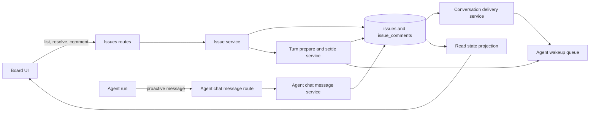
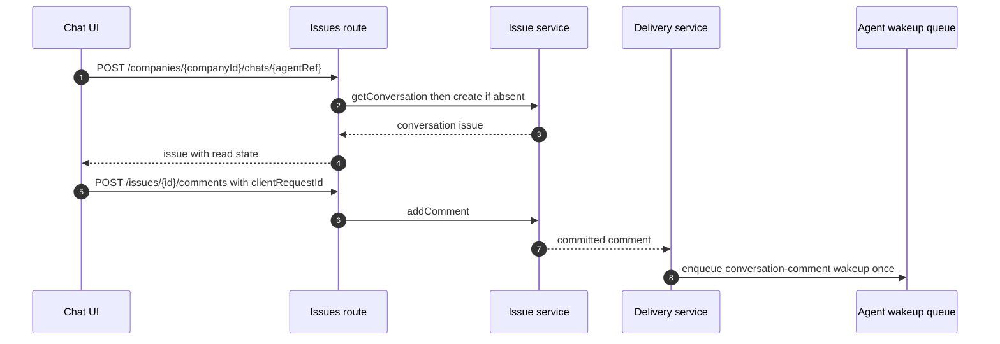
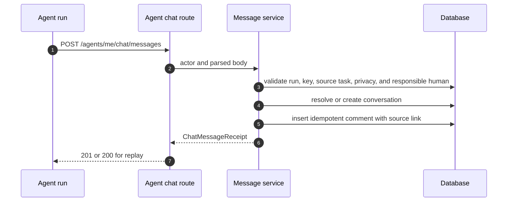
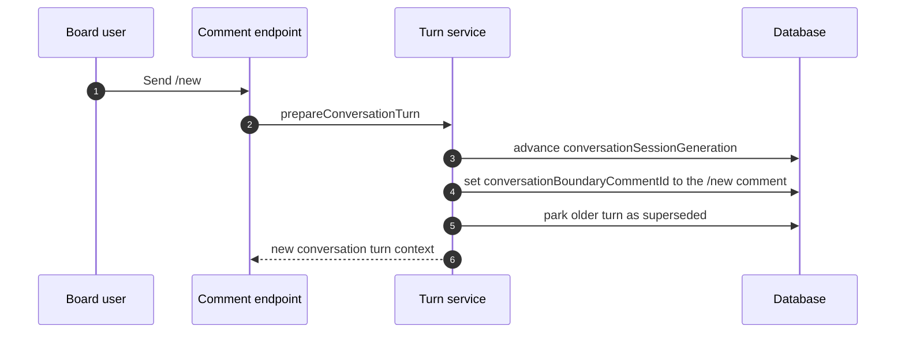

# Specification: Agent Conversations

## Overview

The implemented feature reuses the issue and comment model for in-app agent conversations.
A conversation is an issue with `conversationAgentId`, `conversationUserId`, `conversationState`, `conversationSessionGeneration`, and `conversationBoundaryCommentId` columns in `packages/db/src/schema/issues.ts:32`.
Human messages are issue comments, and agent proactive messages use a dedicated run-authenticated route that writes a comment with source-task metadata.
Turn preparation, delivery, reset, and read state live in server services, while the UI resolves and navigates through company-scoped routes.

## Architecture

The Chat pages call `agentChatsApi` in `ui/src/api/agentChats.ts:3` and reuse the task comment endpoints for human messages.
The board API resolves one conversation per agent and user in `server/src/routes/issues.ts:19281`.
The agent API accepts proactive messages only from an authenticated task run in `server/src/routes/agent-chat-messages.ts:9`.

## Data Models

### Conversation issue

| Field | Type | Constraints | Description |
|---|---|---|---|
| id | uuid | PK, not null | Conversation issue id |
| companyId | uuid | FK to companies, not null | Owning company |
| conversationAgentId | uuid | FK to agents, nullable | Agent participant |
| conversationUserId | text | nullable | Board user participant |
| conversationState | text | `active` or `waiting`, nullable | Whether a reply is pending |
| conversationSessionGeneration | integer | not null, default 0 | Current turn session generation |
| conversationBoundaryCommentId | uuid | nullable | Comment that starts the current session |
| assigneeAgentId | uuid | FK to agents | Execution assignee, equal to the conversation agent |
| status | text | task status | `in_review` while idle and execution status while working |
| originKind | text | nullable | `onboarding_first_task` for onboarding chats |

The unique index `issues_conversation_identity_idx` covers company, agent, and user, and the check constraint in `packages/db/src/schema/issues.ts:105` requires either no conversation fields or a full identity with an agent assignee.
`listConversations` and `getConversation` query these columns in `server/src/services/issues.ts:10597`.

### Chat message comment

| Field | Type | Constraints | Description |
|---|---|---|---|
| id | uuid | PK, not null | Comment id |
| companyId | uuid | FK to companies, not null | Owning company |
| issueId | uuid | FK to issues, not null | Conversation issue |
| authorAgentId | uuid | FK to agents, nullable | Agent author for replies and proactive messages |
| authorUserId | text | nullable | Board user author |
| clientRequestId | text | unique per issue and author | Retry key for human and agent messages |
| conversationSessionGeneration | integer | nullable | Session generation attached to a reset or reply |
| origin | text | `comment` or `fast_response` | Message origin |
| body | text | not null | Message body |
| metadata | jsonb | nullable | Chat message metadata, source task link, and presentation data |
| sourceTrust | jsonb | nullable | Source trust recorded with agent messages |
| createdAt | timestamp | not null, default now | Ordering and read-state cursor |

These columns are defined in `packages/db/src/schema/issue_comments.ts:16`.
The agent message metadata includes `sourceTaskId`, `sourceTaskIdentifier`, `sourceRunId`, and a content hash in `server/src/services/agent-chat-messages.ts:176`.

### Agent wakeup request

| Field | Type | Constraints | Description |
|---|---|---|---|
| id | uuid | PK, not null | Wakeup request id |
| companyId | uuid | FK to companies, not null | Owning company |
| agentId | uuid | FK to agents, not null | Agent to wake |
| idempotencyKey | text | unique | Stable key such as `conversation-comment:<commentId>` |
| status | text | queue status | Admission and execution state |

The delivery sweep uses the idempotency key to find comments that were committed without a wakeup request in `server/src/services/agent-conversations.ts:551`.

### Read state projection

| Field | Type | Constraints | Description |
|---|---|---|---|
| isUnreadForMe | boolean | computed | Agent comments newer than the user's last read time |
| unreadMessageCount | number | computed | Count of unread agent comments |
| lastExternalCommentAt | timestamp | computed | Newest non-system agent comment time |

`withConversationReadState` builds this projection in `server/src/services/agent-chat-read-state.ts:4`.

## API Contracts

The API surface is defined in [`api.yaml`](api.yaml).
The table below is a summary.

| Method | Path | Purpose |
|---|---|---|
| GET | `/api/companies/{companyId}/chats` | List the current board user's conversations with read state |
| GET | `/api/companies/{companyId}/chats/{agentRef}` | Resolve an existing conversation without creating one |
| POST | `/api/companies/{companyId}/chats/{agentRef}` | Resolve or create the single conversation for that agent and user |
| POST | `/api/companies/{companyId}/chats/{agentRef}/onboarding` | Open the current user's onboarding chat |
| POST | `/api/companies/{companyId}/chats/{agentRef}/onboarding/greeting` | Start the visible onboarding chat's welcome turn |
| POST | `/api/agents/me/chat/messages` | Publish a proactive task message into the responsible human's chat |
| POST | `/api/issues/{id}/comments` | Reused by the UI for human chat messages, attachments, and retries |

Error codes shared across endpoints:

| Status | Code | Description |
|---|---|---|
| 400 | INVALID_INPUT | Request body or query failed validation |
| 401 | UNAUTHENTICATED | No authenticated actor |
| 403 | FORBIDDEN | Company, actor, task permission, privacy, run ownership, or credential scope denial |
| 404 | NOT_FOUND | Company, agent, or conversation not visible |
| 409 | CONFLICT | Ambiguous agent reference or reused retry key with different content |
| 429 | TOO_MANY_REQUESTS | Cross-issue influence limit or daily delivery hold |

## Sequences

### Board user opens and sends a chat

### Agent publishes a proactive message

### Reset a conversation

## Technical Decisions

| Decision | Choice | Rationale |
|---|---|---|
| Storage model | Conversation is an issue and messages are comments | Reuses task permissions, privacy, attachments, activity logging, and the existing chat UI |
| Identity | Unique company, agent, and user columns | Gives each person one standing chat with each agent without a separate table |
| Idempotency | `clientRequestId` on comments and hashed `idempotencyKey` for agent messages | Prevents duplicate messages across retries and races |
| Session boundary | Generation plus boundary comment id | Keeps history visible while stopping stale replies and old replay content |
| Delivery | Comment outbox with wakeup idempotency | Covers the commit-to-enqueue crash window without a second message store |
| Authorization | Board-only chat routes and run-only proactive route | Separates human navigation from task-run message publication |
| Feature flag | Agent Chat always on, retired key ignored | Removes setup while preserving old configuration payloads |
| UI navigation | Shared resolver with read-only GET and explicit POST | Opening a chat list or stale route never writes a conversation |

## Risks and Unknowns

1. The external connector tables `chat_conversations` and `chat_message_links` have names that are easy to confuse with this feature.
2. Conversation guidance is large prompt text embedded in `server/src/services/agent-conversations.ts:65`, so product wording changes require code changes.
3. The delivery sweep limit of 100 comments may need tuning if a single conversation accumulates a large backlog.
4. Daily-limit holds keep messages owed until reset, so users may see saved text before the agent can reply.
5. This document was reverse-engineered from code, so future behavior changes can make it stale unless sync is rerun.

## Out of Scope

- External provider chats for Slack, Discord, Teams, GitHub, Telegram, iMessage, and email.
- Conference Room board chat.
- Generic task comments outside a conversation issue.
- Voice sessions and scheduled routine authoring, except when their results are delivered into a conversation.
