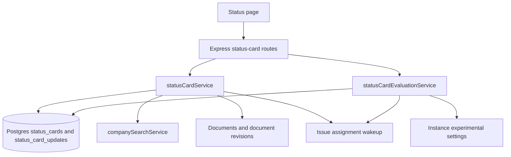
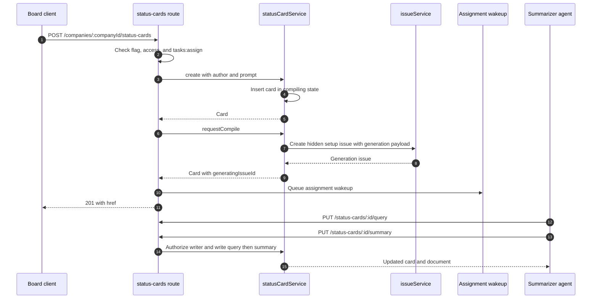
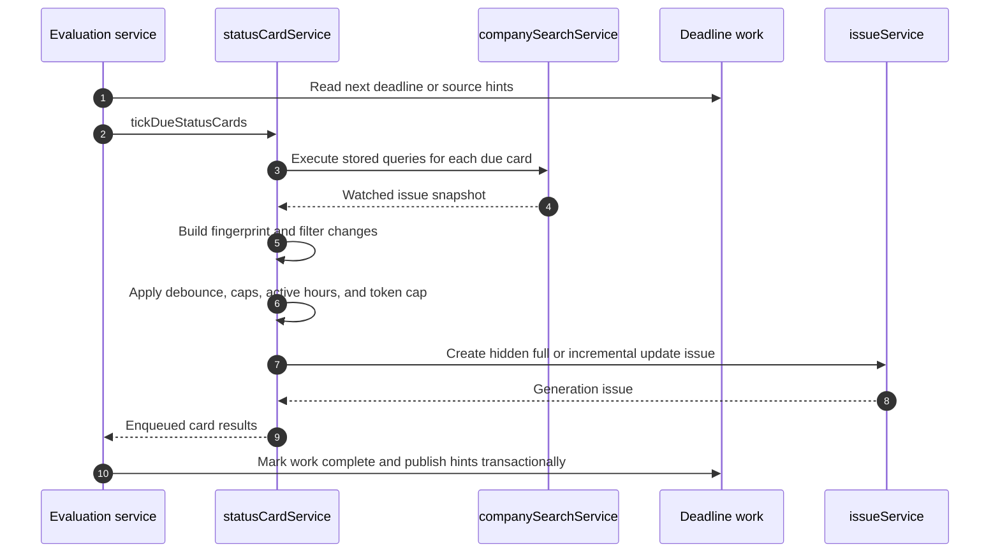

# Specification: Status Cards

## Overview

Status cards are company-scoped saved requests that compile an interest prompt into structured company-search queries and store a generated Markdown summary in a document.
A card owns an update ledger and a refresh policy, and the update engine turns watched-issue fingerprints into full rebuilds or incremental updates.
Generation runs as hidden issues assigned to a summarizer agent, and the agent writes the query and summary back through dedicated API endpoints.

## Architecture

The route layer checks the experimental flag, company access, actor permissions, and request schemas before it calls a service.
The service layer owns card persistence, prompt compilation payloads, write authorization, query execution, change detection, and refresh policy checks.
The evaluation service registers deadline work, consumes source-change hints, and dispatches generation issues to the existing assignment wakeup path.
Idle-sleep reconciliation reads card deadlines and blocks sleep while a card owns unfinished generation or pending policy work.

## Data Models

### StatusCard

| Field | Type | Constraints | Description |
|---|---|---|---|
| id | uuid | PK, default random | Card identifier |
| companyId | uuid | FK to companies, cascade delete, not null | Owning company |
| createdByUserId | text | nullable | Board author identifier |
| createdByAgentId | uuid | FK to agents, set null | Agent author identifier |
| title | text | nullable | Display title |
| titlePinned | boolean | not null, default false | Keeps the title stable across query writes |
| interestPrompt | text | not null | Board-provided request |
| queries | jsonb array | not null, default empty | Compiled company-search queries |
| queryVersion | integer | not null, default 0 | Increments on each compiled query write |
| agentId | uuid | FK to agents, set null | Per-card summarizer override |
| refreshPolicy | jsonb | not null, validated by shared schema | Manual, interval, or reactive policy |
| state | text enum | not null, default compiling | compiling, active, error, paused_budget, or paused_hours |
| pendingChangeCount | integer | not null, default 0 | Filtered watched-issue changes awaiting an update |
| fingerprint | jsonb | nullable | Last watched-issue fingerprint |
| mentionedIssueIds | jsonb uuid array | not null, default empty | Issues referenced by the latest summary |
| documentId | uuid | FK to documents, set null | Summary document |
| generatingIssueId | uuid | FK to issues, set null | Active compile or update task |
| nextEvalAt | timestamp | nullable | Next scheduled evaluation |
| nextEvalReason | text | nullable | membership, policy, retry, or refresh |
| archivedAt | timestamp | nullable | Archive time |

### StatusCardUpdate

| Field | Type | Constraints | Description |
|---|---|---|---|
| id | uuid | PK, default random | Ledger entry identifier |
| cardId | uuid | FK to status cards, cascade delete, not null | Owning card |
| kind | text enum | not null | compile, full, or incremental |
| trigger | text enum | not null | manual, interval, reactive, or restore |
| generationIssueId | uuid | FK to issues, set null | Task that produced the entry |
| runId | uuid | FK to heartbeat runs, set null | Agent run that produced the entry |
| changes | jsonb array | not null, default empty | Filtered issue deltas |
| tokens and cost | integer and numeric | not null, default zero | Usage and cost recorded for the entry |
| status | text enum | not null | running, ok, or failed |
| startedAt and finishedAt | timestamps | startedAt not null | Execution window |

### StatusCardSummaryRevision

Summary revisions come from the existing document revision table.
The API returns `id`, `revisionNumber`, `title`, `body`, `changeSummary`, and `createdAt`.

## API Contracts

The normative contract is in [`api.yaml`](api.yaml).
The table below is a summary.
Request bodies, response bodies, and error responses are in `api.yaml`.

| Method | Path | Purpose |
|---|---|---|
| GET | /api/companies/:companyId/status-cards | List active or archived cards with hydrated summaries and usage |
| POST | /api/companies/:companyId/status-cards | Create a card and queue its compile task |
| GET | /api/status-cards/:id | Get one hydrated card |
| PATCH | /api/status-cards/:id | Edit, archive, or restore a card |
| DELETE | /api/status-cards/:id | Delete a card |
| GET | /api/status-cards/:id/updates | List the update ledger newest first |
| GET | /api/status-cards/:id/summary-revisions | List summary revisions |
| POST | /api/status-cards/:id/recompile | Recompile the interest prompt into queries |
| POST | /api/status-cards/:id/refresh | Queue a full or incremental update |
| GET | /api/status-cards/:id/dry-run | Execute stored queries without a model |
| PUT | /api/status-cards/:id/query | Write a compiled query from the generation run |
| PUT | /api/status-cards/:id/summary | Write a generated summary from the generation run |

Error codes shared across endpoints:

| Status | Condition | Description |
|---|---|---|
| 400 | Invalid input | Request body or query failed schema validation |
| 403 | Forbidden | Actor lacks company access, `tasks:assign`, card ownership, low-trust dry-run access, or writer authorization |
| 404 | Not found | Feature is disabled, card was not found, or the card is outside the actor's company |
| 409 | Conflict | A concurrent refresh or compile claimed a newer card revision |
| 422 | Unprocessable | Policy, summarizer, archived state, or agent-authored limit rejects the request |

## Sequences

### Create and compile

### Scheduled or reactive update

## Technical Decisions

| Decision | Choice | Rationale |
|---|---|---|
| Feature delivery | Experimental setting gate with 404 when disabled | Keeps the API and UI hidden until the instance enables it |
| Generation transport | Hidden issues assigned to a summarizer agent | Reuses assignment, execution, retry, and transcript infrastructure |
| Write authority | Card agent or built-in summarizer, active generation issue, linked run, and payload must match | Prevents unrelated agents and runs from changing a card |
| Idempotency | Prompt hash for compile and revision plus fingerprint hash for refresh | Avoids duplicate tasks while allowing an explicit re-kick after prompt changes |
| Concurrency | Row revision checks with `xmin` and transactional claim updates | Prevents a losing refresh from writing over a newer claim |
| Watched set | Company-search results joined with bounded summary mentions | Tracks issues that matter to the summary without unbounded manual selection |
| Change model | Pure fingerprint diff and policy evaluation in a dedicated update engine | Keeps policy rules testable without database state |
| Scheduling | Deadline work plus transactional source-change hints | Avoids a separate aggregate interval and lets sleep logic see pending card work |
| Privacy | Redact summary body and watched-issue details when visibility differs | Keeps private task content out of card readers that cannot see it |

## Risks and Unknowns

1. The Cloud policy that sets `enableStatusCards` is outside Core.
2. Retention for update ledger rows and summary revisions is not defined in code.
3. A dedicated status-card user guide was not found.
4. Experimental gate removal and general availability behavior are not recorded in code.
5. Query cost for large reactive watched sets depends on company-search limits and indexes.

## Out of Scope

- Cloud ownership of the experimental flag policy.
- Internal model behavior of the summarizer agent.
- Dedicated browser end-to-end coverage for the Status page.
- Issue recovery cards and dashboard cards that are separate UI surfaces.
