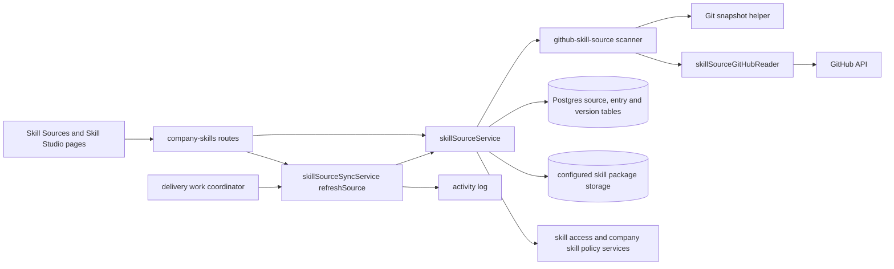
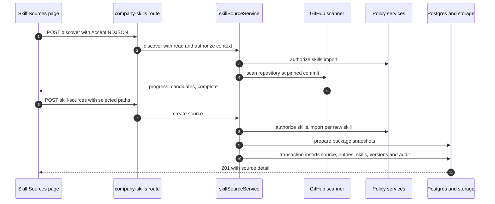
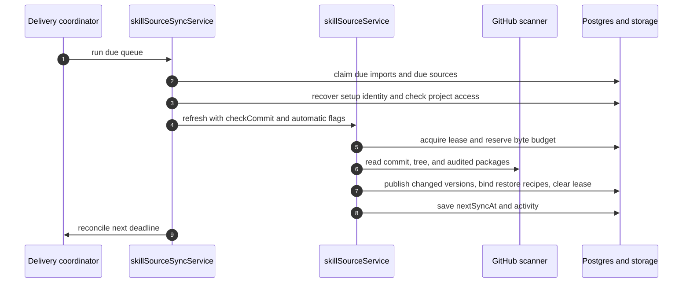
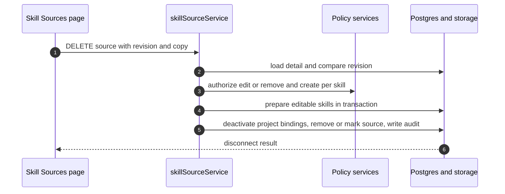
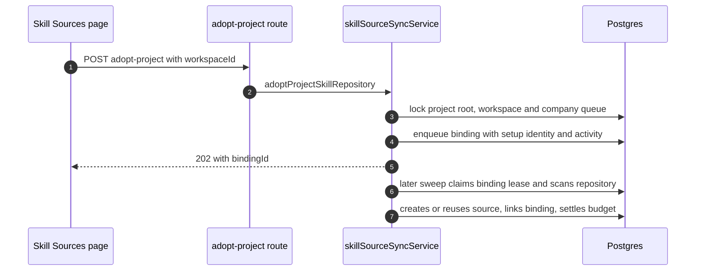

# Specification: Skill Sources

## Overview

The feature stores company-scoped GitHub source state in Drizzle tables and drives all mutations through `skillSourceService` in `server/src/services/skill-sources.ts`.
`skillSourceSyncService` in `server/src/services/skill-source-sync.ts` owns automatic imports, refreshes, scheduling, and worker reconciliation.
Repository scanning lives in `server/src/services/github-skill-source.ts` with Git snapshot and GitHub reader helpers.
Routes are registered in `server/src/routes/company-skills.ts`, and the normative API contract is in [`api.yaml`](api.yaml).
The UI surfaces are `ui/src/pages/SkillSources.tsx` and `ui/src/pages/SkillStudio.tsx`.

## Architecture

- Routes check company access and pass a `SkillSourceContext` with read, authorize, audit, and setup fields.
- Services never persist provider bodies or credentials.
- The scanner audits packages at a pinned commit and returns manifests during discovery.
- The worker queue uses saved deadlines and leases instead of per-turn polling.

## Data Models

### companySkillSources

Defined in `packages/db/src/schema/company_skill_sources.ts:9`.

| Field | Type | Constraints | Description |
|---|---|---|---|
| id | uuid | PK, default random | Source identity |
| companyId | uuid | not null, FK companies cascade | Company scope |
| repositoryId | text | nullable | Stable GitHub repository identity |
| repositoryUrl | text | not null | Tracked repository URL |
| fullName | text | not null | Owner and repository name |
| trackingRef | text | not null | Branch, ref, or HEAD alias |
| connectionId | uuid | nullable | Authorized refresh connection |
| packageMode | text | not null, default skills | skills or repository package mode |
| repositoryPackage | jsonb | nullable | Audited repository package manifest |
| excludedFolders | text array jsonb | not null, default empty | Folders omitted from selection |
| enabled | boolean | not null, default true | Whether the source is connected |
| removedAt | timestamp | nullable | Retained project source removal marker |
| automaticUpdates | boolean | not null, default true | Worker refresh toggle |
| importNewSkills | boolean | not null, default false | Auto-select newly discovered skills |
| accessScope | text | not null, default company | company or projects |
| refreshUserId, refreshAgentId, refreshLocalTrusted, refreshGrantId | mixed | nullable or default false | Stored setup identity |
| nextSyncAt, failureCount, revision | timestamp, integer, integer | not null | Retry and stale-write state |
| lastAttemptAt, lastSuccessAt, lastScanCommit, lastScanTreeSha | timestamp or text | nullable | Scan history |
| automaticBudgetBytes, automaticBudgetAt | integer, timestamp | not null, default 512 MiB and now | Refresh byte budget |
| lastError | text | nullable | Sanitized error text |
| leaseToken, leaseExpiresAt | uuid, timestamp | nullable | Refresh ownership |

Unique partial indexes cover company, repository URL, tracking ref and company, repository identity, tracking ref for rows where `removedAt` is null.

### projectSkillSources

Defined in `packages/db/src/schema/company_skill_sources.ts:50`.

| Field | Type | Constraints | Description |
|---|---|---|---|
| id | uuid | PK, default random | Binding identity |
| companyId, projectId | uuid | not null, FK cascade | Company and project scope |
| workspaceId | uuid | nullable, FK set null | Editor workspace provenance |
| sourceId | uuid | nullable, FK set null | Resulting company source |
| repositoryUrl, trackingRef | text | not null | Requested repository identity |
| active, status | boolean, text | not null | Binding lifecycle, pending, ready, or error |
| refreshUserId, refreshAgentId, refreshLocalTrusted, connectionId, refreshGrantId | mixed | nullable | Import setup identity |
| nextSyncAt, failureCount, lastError | timestamp, integer, text | not null or nullable | Retry state |
| leaseToken, leaseExpiresAt | uuid, timestamp | nullable | Import ownership |

Indexes cover workspace and repository ref uniqueness, company and source and project lookup, and pending sync deadlines.

### companySkillSourceEntries

Defined in `packages/db/src/schema/company_skill_sources.ts:76`.

| Field | Type | Constraints | Description |
|---|---|---|---|
| id | uuid | PK, default random | Entry identity |
| companyId, sourceId | uuid | not null, FK cascade | Company and source scope |
| path, name | text | not null | Repository path and skill name |
| description | text | nullable | Skill description |
| inspection | jsonb | nullable | Audited package inspection |
| skillId | uuid | nullable, FK set null | Installed company skill |
| selection | text | not null, default new | selected, excluded, or new |
| present | boolean | not null, default true | Whether the path was in the latest scan |
| error | text | nullable | Sanitized per-entry error |

Unique index covers source and path. An index covers company and skill.

### companySkillImportBudgets

Defined in `packages/db/src/schema/company_skill_sources.ts:94`.

| Field | Type | Constraints | Description |
|---|---|---|---|
| companyId | uuid | PK, FK cascade | Company scope |
| availableBytes | integer | not null, default 512 MiB | Sustained initial import credit |
| updatedAt | timestamp | not null | Last budget change |

### Related skill version tables

`companySkillRepositorySnapshots` at `packages/db/src/schema/company_skills.ts:138` stores content-addressed repository packages with storage, upload, restore receipts, and migration deadlines.
`companySkillVersions` at `packages/db/src/schema/company_skills.ts:158` stores version numbers, file inventories, and snapshot references used by published source skills.

### Shared contracts

Request and response types live in `packages/shared/src/types/skill-source.ts`, including `SkillSource`, `SkillSourceDiscovery`, `SkillSourceSelectionRequest`, `SkillSourceSettingsRequest`, `SkillSourceDisconnectRequest`, `SkillSourceBranches`, `ProjectSkillRepository`, and `SkillSourceUpdateDiff`.
Validators in `packages/shared/src/validators/skill-source.ts` use Zod to constrain repository URLs, paths, refs, revisions, selections, and disconnect options.
OpenAPI registration is in `server/src/routes/openapi.ts:14146`.

## API Contracts

The normative contract is in [`api.yaml`](api.yaml) (OpenAPI 3), written alongside this document whenever the specification defines an API surface.
The table below is a summary; request/response schemas, error response bodies, and auth requirements are in `api.yaml`.

| Method | Path | Purpose |
|---|---|---|
| GET | /api/companies/{companyId}/skill-sources | List visible company sources |
| GET | /api/companies/{companyId}/skill-sources/project-repositories | List accessible project repositories and import status |
| POST | /api/companies/{companyId}/skill-sources/adopt-project | Enqueue import of all skills from a project workspace repository |
| PATCH | /api/companies/{companyId}/skill-sources/{sourceId}/settings | Update automatic updates, imports, connection, or tracking ref |
| GET | /api/companies/{companyId}/skill-sources/{sourceId}/branches | List authorized repository branches |
| GET | /api/companies/{companyId}/skill-sources/repositories | Browse authorized GitHub repositories |
| GET | /api/companies/{companyId}/skill-sources/{sourceId} | Get one source with entries and visible projects |
| POST | /api/companies/{companyId}/skill-sources/discover | Audit repository skills, with optional NDJSON progress |
| POST | /api/companies/{companyId}/skill-sources/preview | Preview an audited file at an immutable commit |
| POST | /api/companies/{companyId}/skill-sources | Import a source with selected skill paths |
| PATCH | /api/companies/{companyId}/skill-sources/{sourceId} | Save selection and connection with revision check |
| POST | /api/companies/{companyId}/skill-sources/{sourceId}/refresh | Refresh installed source skills |
| DELETE | /api/companies/{companyId}/skill-sources/{sourceId} | Disconnect and copy or delete installed skills |

Error codes shared across endpoints:

| Status | Code | Description |
|---|---|---|
| 429 | skill_source_scan_limited | Caller or company scan quota exhausted |
| 409 | skill_source_settings_changed | Settings save lost to a lease or revision change |
| 422 | skill_source_ref_unavailable | Requested branch or revision has no valid commit |

Other failures use the shared route error helpers for validation, access denial, missing resources, and conflicts.

## Sequences

### Import a repository source

### Automatic refresh sweep

### Disconnect and retain editable copies

### Project repository adoption

## Technical Decisions

| Decision | Choice | Rationale |
|---|---|---|
| Persistence | Drizzle tables in Postgres with partial unique indexes | Source identity and company scope need transactional enforcement |
| Contracts | Zod validators and shared TypeScript types | The same request shape is used by routes, OpenAPI, and UI clients |
| Discovery transport | JSON by default and NDJSON with `Accept: application/x-ndjson` | Long scans stream progress and cancel when the client disconnects |
| Concurrency | Source revisions and ten-minute lease tokens | Stale clients and competing workers cannot overwrite installed content |
| Publication | Single transaction with deferred `paperclip_skill_runtime_changed` constraint | Activity failures and policy denials roll back all source changes |
| Package storage | Storage-backed packages with restore recipes and content-hash snapshots | Installed bytes, executable flags, and pinned versions remain recoverable |
| Scheduling | Delivery coordinator queue with persisted deadlines | Workers do not poll each company turn and can recover after restart |
| Authorization | Per-action calls to skill access and company skill policy services | Imports, updates, edits, removals, and creates are decided separately |
| Branch tracking | HEAD alias resolves to the current default branch | Default branch renames do not break a tracked source |
| Scan limits | Process-local caller and company buckets | Limits match the process-local Git download pool and snapshot cache |
| Retry timing | Shared exponential helper with provider delay ceiling | Repeated failures back off without accepting unbounded provider delays |

## Risks and Unknowns

1. Provider rate limits can exhaust grants before a scan starts, and the reader classifies quota denial separately from access denial.
2. Repository package mode can exceed supported size, so refreshes retain installed skills and require a smaller package before continuing.
3. Process-local scan limits are not shared across server instances.
4. Removed project sources keep provenance rows, and their retention period is not defined in the code.
5. HEAD tracking intentionally follows the default branch, while explicit ref tracking stays fixed.
6. The full Studio update-diff presentation was not traced beyond the shared `SkillSourceUpdateDiff` type and the Studio test suite.

## Out of Scope

- General company skill library CRUD and catalog browsing owned by FEAT-0012.
- GitHub App installation and OAuth connection setup owned by the Apps surfaces.
- Runtime skill delivery to agents and adapters.
- Cloud specific deployment policy or allowlists.
