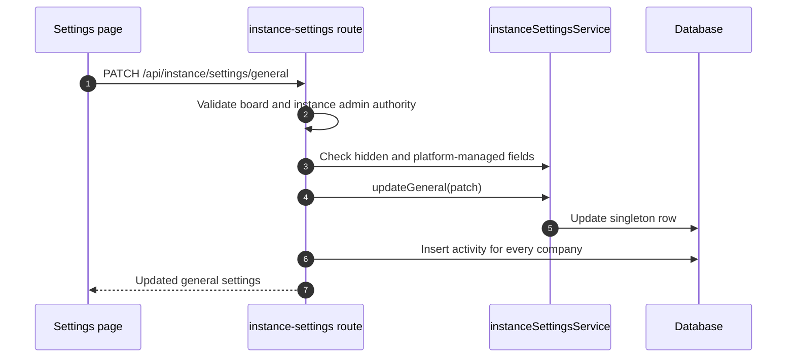
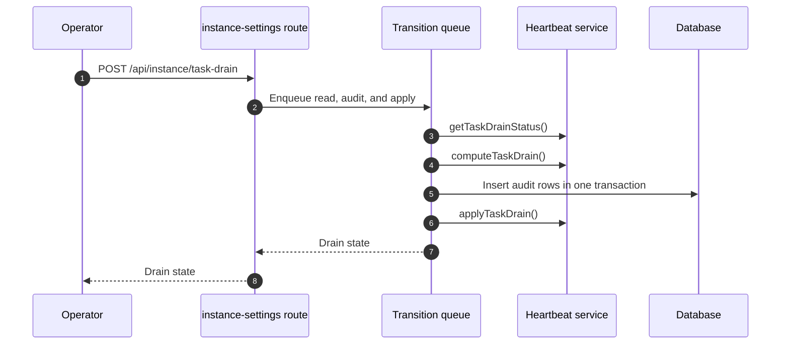
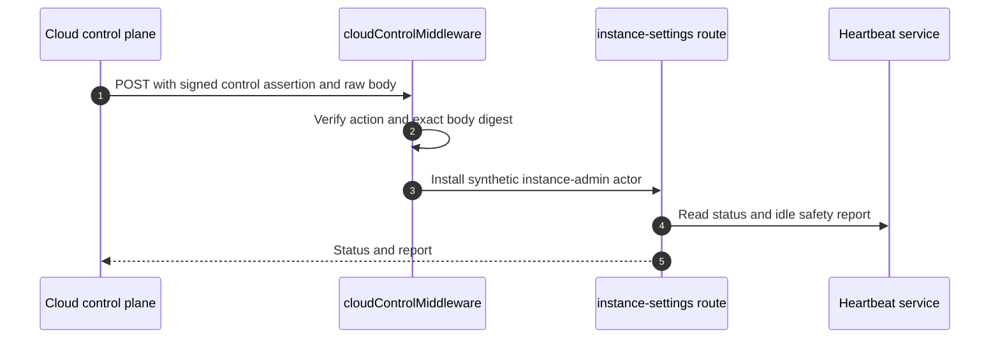
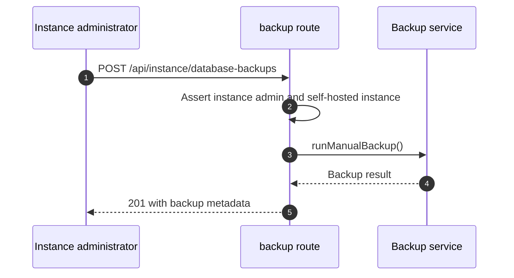

# Specification: Instance Operations and Settings

## Overview

The implementation uses a singleton settings row, shared Zod validators, Express route modules, service overlays, and process-local task drain state.
Mutation routes log activity for every company, and privileged reads use either instance-admin authority or a signed Cloud control assertion.

## Architecture

- `server/src/routes/instance-settings.ts:136` owns settings, task drain, and Cloud lifecycle endpoints.
- `server/src/services/instance-settings.ts:480` owns normalization, overlays, caching, and persistence.
- `packages/shared/src/validators/instance.ts:19` owns request and response schemas.
- `packages/db/src/schema/instance_settings.ts:4` defines the singleton settings table.
- `server/src/services/task-admission.ts:5` owns process-local task drain state.
- `server/src/services/heartbeat.ts:679` reports drain counters and upgrade readiness.
- `server/src/middleware/cloud-control.ts:54` verifies signed Cloud control assertions.
- `server/src/routes/instance-database-backups.ts:22` owns the manual backup endpoint.
- `server/src/services/database-backup-work.ts:5` schedules automatic backups.
- `server/src/routes/instance-server-metrics.ts:5` owns the metrics endpoint.
- `server/src/services/server-metrics.ts:15` owns metric collection and snapshots.
- `ui/src/api/instanceSettings.ts:11` calls the settings API.
- `ui/src/pages/InstanceGeneralSettings.tsx` and `ui/src/pages/InstanceExperimentalSettings.tsx` render the operator pages.

## Data Models

### instance_settings

| Field | Type | Constraints | Description |
|---|---|---|---|
| id | uuid | PK, defaultRandom | Settings row identifier. |
| singleton_key | text | not null, default `default`, unique | Keeps one settings row per instance. |
| default_environment_id | uuid | nullable, FK to environments with set null | Instance default environment. |
| general | jsonb | not null, default `{}` | General settings payload. |
| experimental | jsonb | not null, default `{}` | Experimental settings payload. |
| created_at | timestamp with time zone | not null, defaultNow | Creation time. |
| updated_at | timestamp with time zone | not null, defaultNow | Last mutation time. |

### InstanceGeneralSettings

| Field | Type | Constraints | Description |
|---|---|---|---|
| censorUsernameInLogs | boolean | default false | Masks usernames in logs. |
| feedbackDataSharingPreference | enum | default `prompt` | Allowed values are `allowed`, `not_allowed`, and `prompt`. |
| backupRetention | object | preset values | Daily days, weekly weeks, and monthly months. |
| executionMode | enum | optional | Allowed values are `any` and `kubernetes`. |

### InstanceExperimentalSettings

| Field | Type | Constraints | Description |
|---|---|---|---|
| boolean flags | object | schema defaults | The shared validator defines the current flag keys and defaults. |
| worktreeRunExecutionActivatedAt | string or null | server-managed | Cutoff recorded when worktree run execution is enabled. |
| worktreeRunExecutionActivationInstanceId | string or null | server-managed | Instance id captured with the cutoff. |
| managedKeys | object | optional in responses | Lists flags overlaid by Paperclip Cloud. |

### TaskDrainStatus

| Field | Type | Constraints | Description |
|---|---|---|---|
| draining | boolean | required | True when a drain or controller lease quiesce is active. |
| startedAt | string or null | required | Drain start time. |
| expiresAt | string or null | required | Drain expiry time. |
| activeRuns | number | required | Active in-process runs. |
| pendingWakes | number | required | Active in-process wakeups. |
| quiescent | boolean | required | True when no runs or wakeups are active. |
| ownerId | string | optional | Idle hold owner. |

### InstanceDatabaseBackupRunResult

| Field | Type | Constraints | Description |
|---|---|---|---|
| trigger | enum | required | One of `manual`, `scheduled`, or `idle`. |
| backupFile | string | required | gzip-compressed SQL file on the server host. |
| sizeBytes | number | required | Archive size. |
| prunedCount | number | required | Number of pruned files. |
| backupDir | string | required | Configured backup directory. |
| retention | object | required | Applied retention policy. |
| startedAt | string | required | Start time. |
| finishedAt | string | required | Finish time. |
| durationMs | number | required | Elapsed milliseconds. |

### ServerMetricsSnapshot

| Field | Type | Constraints | Description |
|---|---|---|---|
| schema | string | fixed `paperclip.server-metrics.v1` | Snapshot schema identifier. |
| processId | string | required | Process identifier. |
| buildRevision | string or null | required | Build revision. |
| uptimeSec | number | required | Process uptime. |
| sampledAt | string | required | Sample time. |
| windowMs | number | required | Rolling window length. |
| mainThreadCpu | number or null | required | Main thread CPU use on Linux. |
| processCpu | number | required | Process CPU use. |
| eventLoopUtilization | number | required | Event loop utilization. |
| eventLoopDelayP99Ms | number | required | Event loop delay p99. |
| statementsPerSecond | number | required | Database statement rate. |
| runEventLatenessP99Ms | number or null | required | Run event lateness p99. |
| runEventLatenessSamples | number | required | Lateness sample count. |
| agentApiPreHandlerP99Ms | number or null | required | Agent API pre-handler p99. |
| agentApiPreHandlerSamples | number | required | Pre-handler sample count. |
| leaseRenewalsMissed | number | required | Missed lease renewals since start. |
| dedicatedConnections | object or null | required | Dedicated database connection stats. |

## API Contracts

The normative contract is in [`api.yaml`](api.yaml).
The table below is a summary, and request and response schemas are in `api.yaml`.

| Method | Path | Purpose |
|---|---|---|
| GET | /api/instance/settings | Read combined instance settings. |
| PATCH | /api/instance/settings | Update the instance default environment. |
| GET | /api/instance/settings/general | Read general settings. |
| PATCH | /api/instance/settings/general | Update general settings. |
| GET | /api/instance/settings/experimental | Read experimental settings and managed keys. |
| PATCH | /api/instance/settings/experimental | Update experimental flags. |
| GET | /api/instance/task-drain | Read drain status and optional operator reports. |
| POST | /api/instance/task-drain/status | Read status with signed Cloud body authority. |
| POST | /api/instance/task-drain | Start a task drain. |
| DELETE | /api/instance/task-drain | Stop a task drain. |
| GET | /api/instance/lifecycle | Read Cloud primary company lifecycle state. |
| POST | /api/instance/lifecycle/unarchive-primary | Restore the Cloud primary company. |
| POST | /api/instance/database-backups | Trigger a manual database backup. |
| GET | /api/instance/server-metrics | Read the current process metrics snapshot. |

Error codes shared across endpoints:

| Status | Code | Description |
|---|---|---|
| 400 | Validation error | A request body or path failed Zod validation. |
| 401 | invalid_cloud_control_assertion | A Cloud control assertion was invalid or replayed. |
| 401 | Unauthorized | The request has no authenticated actor. |
| 403 | settings_operator_managed | The actor tried to change an operator-managed setting. |
| 403 | execution_mode_platform_managed | The actor tried to change Cloud-pinned execution mode. |
| 403 | database_backups_platform_managed | The actor tried a manual backup on a managed instance. |
| 403 | Forbidden | The actor lacks instance admin or board authority. |
| 404 | not_cloud_managed | The lifecycle route was called on a self-hosted instance. |
| 404 | primary_company_not_found | The Cloud primary company is missing. |
| 409 | Conflict | Another drain is active or drain ownership changed. |

## Sequences

### General settings update

### Task drain start

### Cloud body-bound status read

### Manual backup

## Technical Decisions

| Decision | Choice | Rationale |
|---|---|---|
| Settings storage | One singleton row with JSON general and experimental fields | A single row keeps instance-wide configuration simple. |
| Validation | Zod schemas in `packages/shared` | The same contracts serve server, UI, and API documentation. |
| Managed settings | Read-time overlays with `managedKeys` | Cloud policy stays enforced without persisting platform values into tenant rows. |
| Hidden settings | API floor plus UI hiding | The server remains authoritative when a client hides or omits a control. |
| Drain transitions | One queued read, audit, and apply sequence | Overlapping starts and stops cannot desync audit rows from live state. |
| Drain audit | One transaction for all companies | A partial audit history is impossible. |
| Activity publication | Best effort after commit | A publish failure cannot turn a committed mutation into a 500 response. |
| Metrics exposure | Opt-in route with no-store | Process diagnostics are available without caching sensitive operational data. |

## Risks and Unknowns

1. The idle-safety report has several negotiated Cloud modes that are documented in `doc/idle-sleep-safety.md`.
2. The experimental flag catalog changes with product rollouts, so `api.yaml` must be regenerated when the validator changes.
3. Cloud lifecycle routes depend on stack context and the Cloud primary company id.

## Out of Scope

- Database restore, which has no HTTP endpoint in this feature.
- The full Cloud control plane that signs task drain and lifecycle assertions.
- The detailed behavior of every feature enabled by an experimental flag.
