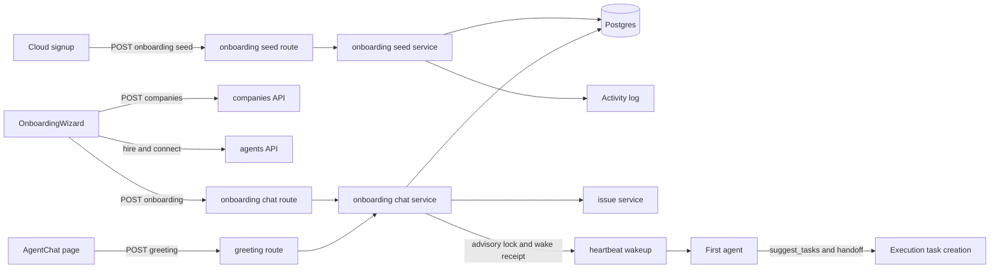
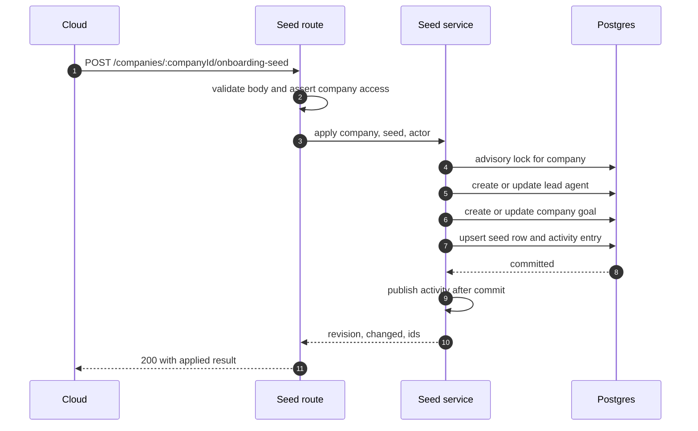
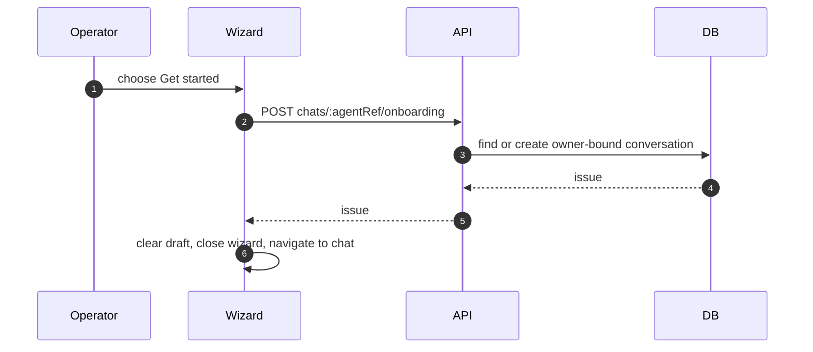
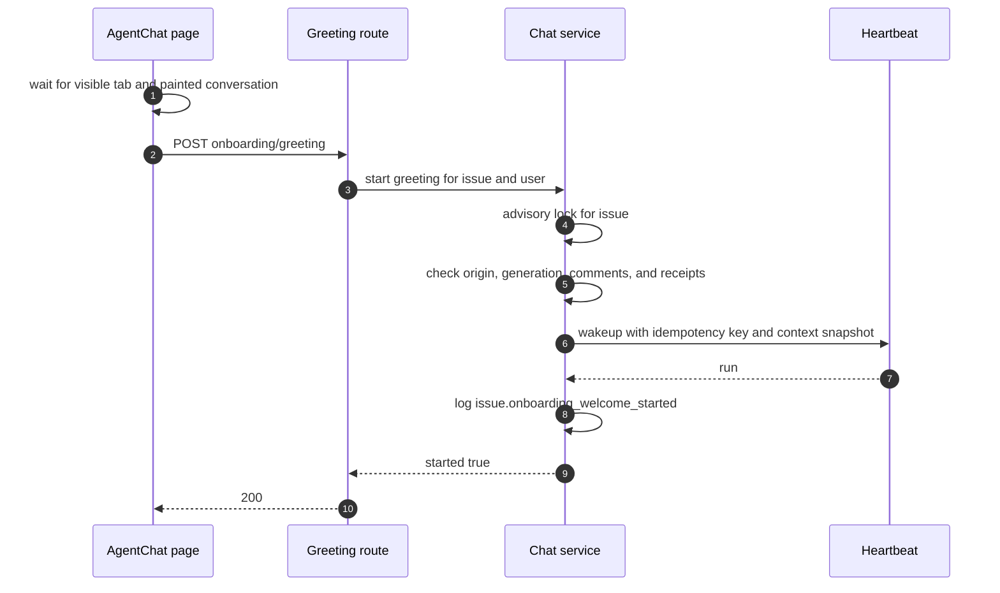
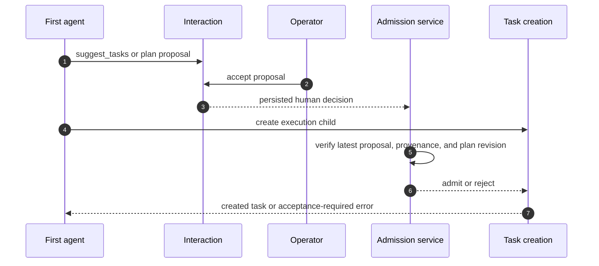

# Specification: Onboarding

## Overview

Onboarding is implemented as three cooperating surfaces.
The React wizard in `ui/src/components/OnboardingWizard.tsx` creates a company, hires and connects the first agent, then calls the onboarding chat endpoint before navigation.
The Cloud seed receiver in `server/src/routes/onboarding-seed.ts` and `server/src/services/onboarding-seed.ts` applies signup answers idempotently.
The chat flow in `server/src/routes/onboarding-chat.ts`, `server/src/services/onboarding-chat.ts`, and `ui/src/pages/AgentChat.tsx` uses an issue as a standing conversation and starts a single welcome through the normal agent queue.

## Architecture

## Data Models

### Company onboarding seed

| Field | Type | Constraints | Description |
|---|---|---|---|
| id | uuid | PK, not null, default random | Seed row identifier. |
| companyId | uuid | not null, FK to companies, cascade delete, unique per company | Owning company. |
| revision | text | not null | Content hash supplied by Cloud. |
| mission | text | nullable, max 2000 characters in the API | Untrimmed seed mission text. |
| agentName | text | nullable, max 80 characters in the API | Customer supplied first agent name. |
| agentRole | text | nullable, max 120 characters in the API | Customer supplied role text stored as agent title. |
| firstTaskTitle | text | nullable, max 200 characters in the API | Initial idea title retained as chat context. |
| firstTaskDetails | text | nullable, max 2000 characters in the API | Initial idea details retained as chat context. |
| goalId | uuid | nullable, FK to goals, set null on delete | Mission goal updated in place. |
| agentId | uuid | nullable, FK to agents, set null on delete | Seeded lead agent updated in place. |
| issueId | uuid | nullable, FK to issues, set null on delete | Historical first-task back-reference. |
| appliedAt | timestamp with time zone | not null, default now | Time the current revision was applied. |
| createdAt | timestamp with time zone | not null, default now | Row creation time. |
| updatedAt | timestamp with time zone | not null, default now | Last update time. |

The table is defined in `packages/db/src/schema/company_onboarding_seeds.ts:18` and created in `packages/db/src/migrations/0216_company_onboarding_seeds.sql`.
The unique index on `company_id` makes one seed row per company, and the service compares `revision` before changing anything.

### Onboarding chat conversation

| Field | Type | Constraints | Description |
|---|---|---|---|
| id | uuid | PK | Issue identifier used as the conversation id. |
| companyId | uuid | not null, company scope | Owning company. |
| originKind | string | `onboarding_chat` | Marks the record as an onboarding conversation. |
| conversationAgentId | uuid | nullable | Agent that owns the standing chat. |
| conversationUserId | uuid | nullable | Board user that owns the standing chat. |
| assigneeAgentId | uuid | nullable | Set to the same agent on creation. |
| createdByUserId | uuid | nullable | Set to the requesting user. |
| conversationState | string | `waiting` | Initial conversation state. |
| status | string | `in_review` | Initial issue status. |
| description | JSON text | derived | Holds organization name, company goals, and seed first-task context. |
| conversationSessionGeneration | number | starts at 0 | Controls whether a welcome is still allowed. |

`ensureOnboardingChat` in `server/src/services/onboarding-chat.ts:10` returns an existing conversation before creating one.
The create call does not use the task numbering path.

### Onboarding first task

| Field or rule | Type | Constraints | Description |
|---|---|---|---|
| originKind | string | `onboarding_first_task` | Single first-task marker on an issue. |
| company uniqueness | partial unique index | one per company where origin kind matches | Enforced by `packages/db/src/migrations/0212_onboarding_first_task_unique.sql`. |
| description | text | server owned | Built from `server/src/onboarding-assets/first-task/brief.md` at creation time. |
| greeting | issue comment | authored as the assigned agent | Rendered from the board approved greeting template. |
| opening question | issue interaction | fixed ids and two options | Offers interview or free-text task entry. |

### Wake receipts and activity

| Record | Key | Description |
|---|---|---|
| agentWakeupRequest | `onboarding-chat-greeting` for the issue | Durable receipt that prevents a duplicate welcome. |
| activity | `company.onboarding_seed_applied` | Seed application audit inside the seed transaction. |
| activity | `issue.conversation_opened` | Conversation creation audit with `onboarding: true`. |
| activity | `issue.onboarding_welcome_started` | Welcome start audit with agent and run ids. |

## API Contracts

The normative contract is in [`api.yaml`](api.yaml) (OpenAPI 3), written alongside this document whenever the specification defines an API surface.
The table below is a summary; request/response schemas, error response bodies, and auth requirements are in `api.yaml`.
All paths are mounted under `/api` by `server/src/app.ts:1149`.

| Method | Path | Purpose |
|---|---|---|
| POST | /companies/:companyId/onboarding-seed | Apply a Cloud collected onboarding seed. |
| POST | /companies/:companyId/chats/:agentRef/onboarding | Ensure the owner-bound onboarding conversation exists. |
| POST | /companies/:companyId/chats/:agentRef/onboarding/greeting | Start the agent welcome for an existing onboarding conversation. |

Error codes shared across endpoints:

| Status | Code | Description |
|---|---|---|
| 400 | not set by these routes | Zod validation returns `{ error: "Validation error", details: [...] }`. |
| 403 | not set by these routes | Company access denial or board user requirement failure. |
| 404 | not set by these routes | Agent Chat disabled, agent not found or ambiguous, or conversation not found. |
| 500 | not set by these routes | Unexpected service failure, with secret-sensitive responses sanitized. |

## Sequences

### Cloud seed push

### Wizard finish into chat

### Welcome start

### First-task proposal acceptance

## Technical Decisions

| Decision | Choice | Rationale |
|---|---|---|
| Seed idempotency | Compare the Cloud revision before applying | Cloud retries until a 2xx and records the acknowledged revision only afterwards. |
| Seed writes | Agent hire outside the content transaction, seed row and audit inside it | A retry can reuse the committed agent while a half-applied seed is never acknowledged. |
| Mission goal | First line becomes title and remaining lines become description | Keeps parity with the former wizard parser and avoids an empty goal. |
| Seeded adapter | Direct server adapter selected from environment or `claude_local` | Native runner rollout is an explicit post-onboarding choice. |
| Seeded agent role | Structural role `ceo` with customer text as title | Org chart and default instructions read the structural role. |
| First idea | Stored as chat context only | Finishing onboarding must not silently authorize execution work. |
| Chat storage | Existing issue and comment model with `onboarding_chat` origin | Reuses permission, history, and conversation infrastructure without task numbering. |
| Welcome delivery | Normal heartbeat wakeup with advisory lock and durable receipt | Prevents duplicate welcomes across refreshes and concurrent requests. |
| Draft restore | Discard saved state when its company is not in the settled owned list | localStorage is origin scoped and can outlive an account change. |
| First-task admission | Persisted human decision and plan revision checks | Agent replies cannot grant execution authority for onboarding proposals. |

## Risks and Unknowns

1. Cloud retry behavior depends on receiving a 2xx only after all seed state and audit state are durable.
2. Welcome delivery still depends on the normal agent queue, so a failed wakeup must remain retryable from the page.
3. A stale browser draft can be discarded after an account change, which loses wizard progress by design.
4. The first-task compatibility path and the chat path both exist, so product copy and tests must keep their boundaries clear.
5. Seed adapter selection reads deployment environment variables that Core does not own as policy.

## Out of Scope

- CLI instance bootstrap and service installation, which are separate setup flows.
- Invitation email onboarding text and Dot OAuth pairing, which are adjacent entry points.
- Team catalog installation, which is documented in `FEAT-0020-team-catalog`.
- Provider specific subscription login internals beyond their effect on wizard admission.
